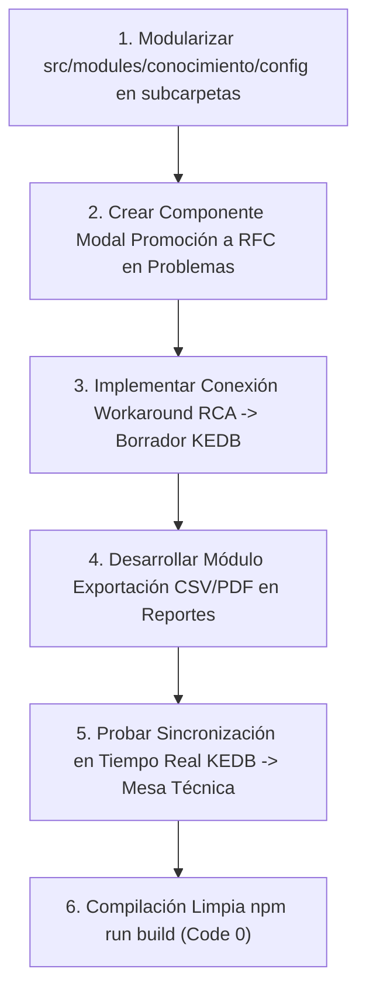

# Plan de Asignación y Especificación Técnica — Alexis (Backend / BI Developer)

> **Documento de especificación técnica y de desarrollo para el asistente IA.**
> **Responsable:** Alexis (Backend & Business Intelligence Specialist)
> **Módulos Asignados (Independientes):**
> 1. [src/modules/problemas](file:///c:/Users/apaza/Desktop/SISTEMA%20DE%20TICKETS/src/modules/problemas) (Gestión de Problemas ITIL 4, Análisis Causa Raíz RCA, KEDB, Problemas Mayores y Consola del Gestor)
> 2. [src/modules/conocimiento](file:///c:/Users/apaza/Desktop/SISTEMA%20DE%20TICKETS/src/modules/conocimiento) (Gestión del Conocimiento ITIL 4 / KCS, Base de Datos de Soluciones, Ciclo Editorial y Búsqueda)
> 3. [src/modules/reportes](file:///c:/Users/apaza/Desktop/SISTEMA%20DE%20TICKETS/src/modules/reportes) (Analítica ITSM, Tableros de Control de Gestión y los 9 Reportes Unificados)

---

## 1. Visión Arquitectónica y Principios de Diseño

### 1.1 Principio de Correspondencia Menú-Directorio (Modularidad Estricta)
Alexis tiene a su cargo el núcleo analítico, la gestión de causa raíz y la capitalización del conocimiento organizacional según ITIL 4.
- Cada opción de menú visible en la barra lateral debe corresponder a un archivo y carpeta modular dedicado. En `src/modules/problemas`, gracias a la ejecución previa de las pautas de configuración, ya se cuenta con una segmentación limpia en `config/` (`rca/`, `acuerdos/`, `sla/`, `flujo/`, `fases/`, etc.).
- En `src/modules/conocimiento`, la pantalla de configuración monolítica `VistaConocimientoConfig.tsx` debe fragmentarse en submódulos especializados dentro de `config/` (`config/categorias/`, `config/workflow-editorial/`, `config/politicas-acceso/`).
- En `src/modules/reportes`, las 9 vistas canónicas unificadas deben mantener aislamiento modular y contar con controladores dedicados de agregación estadística y exportación de datos.

### 1.2 Mecanismo de Sincronización Multi-Perfil en Tiempo Real
El valor de Problemas y Conocimiento radica en su capacidad de retroalimentar en tiempo real a los demás perfiles:
1. **Detección de Incidentes Recurrentes y Candidatos a Problema:**
   - Cuando el motor estadístico de problemas detecta 3 o más incidentes con la misma categoría o CI afectado en menos de 24 horas, emite automáticamente una alerta en tiempo real a la vista del **Gestor de Problemas** (`/problemas/candidatos`) y a la vista del **Supervisor** para evaluar la apertura de un problema preventivo.
2. **Publicación en la KEDB (Known Error Database) hacia el Técnico y Solicitante:**
   - En cuanto el Gestor de Problemas documenta una Solución Temporal (Workaround) en un registro KEDB, este artículo se indexa inmediatamente en la Base de Conocimiento (`src/modules/conocimiento`).
   - Los **Técnicos** que atienden incidentes similares en `/tecnico/mesa/asignados` reciben una sugerencia contextual inmediata ("Posible solución encontrada en KEDB: PRB-2026-042").
   - Si el artículo se marca como "Público para Autoservicio", queda disponible en el portal del **Solicitante** para resolver su problema de manera autónoma sin abrir un ticket.
3. **Segregación de Funciones (SoD) en Cierre de Problemas Mayores:**
   - Según ITIL 4 y RN-35, el Gestor de Problemas coordina el análisis RCA, pero el cierre formal de un Problema Mayor o la aceptación de un riesgo residual requiere la firma digital y dictamen del **Aprobador** o del Comité de Gobernanza.

---

## 2. Inventario Exhaustivo Actual y Estado de Situación

### 2.1 Módulo: Gestión de Problemas — `src/modules/problemas`
Identificación proactiva y reactiva de las causas subyacentes de incidentes para prevenir su recurrencia (ITIL 4 Problem Management).

| Archivo / Carpeta | Tipo | Estado Actual | Evaluación Técnica frente a ITIL 4 |
| :--- | :--- | :--- | :--- |
| `src/modules/problemas/config/rca/VistaRca.tsx` | Vista Config | 100% avanzado | Configuración de metodologías de Causa Raíz (5 Porqués, Diagrama de Ishikawa / Espina de Pescado, Árbol de Fallas). |
| `src/modules/problemas/config/acuerdos/VistaAcuerdos.tsx` | Vista Config | 100% avanzado | Definición de compromisos de tiempo de diagnóstico y entrega de solución definitiva. |
| `src/modules/problemas/config/sla/VistaSlaProblemas.tsx` | Vista Config | 100% avanzado | Objetivos de tiempo para cierre de problemas mayores P1 y problemas estándar. |
| `src/modules/problemas/config/flujo/VistaFlujo.tsx` | Vista Config | 100% avanzado | Ciclo de vida: Nuevo -> Bajo Análisis -> Solución Temporal -> Solicitud de Cambio (RFC) -> Resuelto -> Cerrado. |
| `src/modules/problemas/config/fases/VistaFases.tsx` | Vista Config | 100% avanzado | Configuración de compuertas de avance de fase operativa. |
| `src/modules/problemas/config/campos/VistaCamposPersonalizados.tsx` | Vista Config | 100% avanzado | Diseñador de campos dinámicos específicos para problemas técnicos. |
| `src/modules/problemas/config/catalogos/VistaCatalogosProblemas.tsx` | Vista Config | 100% avanzado | Catálogo de tipos de problema (Hardware, Software, Configuración, Telecomunicaciones). |
| `src/modules/problemas/config/clasificacion/VistaClasificacion.tsx` | Vista Config | 100% avanzado | Taxonomía de impacto en el negocio y severidad. |
| `src/modules/problemas/config/estado/VistaEstado.tsx` | Vista Config | 100% avanzado | Parámetros de estados activos, en pausa y de cierre. |
| `src/modules/problemas/config/formulario/VistaFormularioProblemas.tsx` | Vista Config | 100% avanzado | Formulario maestro de captura de problemas. |
| `src/modules/problemas/config/gobernanza/VistaGobernanza.tsx` | Vista Config | 100% avanzado | Políticas de riesgo aceptado y roles autorizados. |
| `src/modules/problemas/config/notificaciones/VistaNotificacionesProblemas.tsx` | Vista Config | 100% avanzado | Reglas de alerta automática a stakeholders ante problemas mayores. |
| `src/modules/problemas/config/roles/VistaRoles.tsx` | Vista Config | 100% avanzado | Matriz de permisos RBAC para el rol Gestor de Problemas y Especialistas RCA. |
| `src/modules/problemas/api/admin/*` (14 controladores) | API Controllers | 100% avanzado | Endpoints de backend para todas las opciones de parametrización. |
| `src/modules/problemas/api/analisisController.ts` | API Controller | Bien avanzado | Gestión de hallazgos del RCA e informe técnico final. |
| `src/modules/problemas/api/candidatosController.ts` | API Controller | Bien avanzado | Algoritmo de correlación de incidentes repetitivos para sugerir nuevos problemas. |
| `src/modules/problemas/api/mayoresController.ts` | API Controller | Bien avanzado | Procedimiento especial para Problemas Mayores de alta criticidad. |
| `src/modules/problemas/api/panelGestorController.ts` | API Controller | Bien avanzado | Indicadores de rendimiento para la consola del Gestor de Problemas. |
| `src/modules/problemas/api/problemasController.ts` | API Controller | Bien avanzado | CRUD de problemas y vinculación con tickets de incidentes. |
| `src/modules/problemas/views/VistaProblemas.tsx` | Vista Master | 100% avanzado | Listado integral de problemas con filtros por fase y criticidad. |
| `src/modules/problemas/views/VistaProblemasCandidatos.tsx` | Vista Operativa | Bien avanzado | Bandeja de candidatos derivados de incidentes en espera de aceptación o descarte. |
| `src/modules/problemas/views/VistaProblemasErroresConocidos.tsx` | Vista KEDB | 100% avanzado | Base de Errores Conocidos con soluciones temporales documentadas. |
| `src/modules/problemas/views/VistaProblemasMayores.tsx` | Vista Crisis | Bien avanzado | Monitoreo prioritario de problemas de impacto general en el negocio. |
| `src/modules/problemas/views/VistaProblemasRecurrentes.tsx` | Vista Analítica | Bien avanzado | Mapas de calor y análisis de tendencias de falla en CIs. |
| `src/modules/problemas/views/VistaPanelGestorProblemas.tsx` | Consola Rol | 100% avanzado | Dashboard dedicado del Gestor de Problemas (MTTR, KEDB activas, RFCs promovidas). |

---

### 2.2 Módulo: Gestión del Conocimiento — `src/modules/conocimiento`
Gestión de activos de información, procedimientos y manuales técnicos según el marco KCS (Knowledge-Centered Service).

| Archivo / Carpeta | Tipo | Estado Actual | Evaluación Técnica frente a ITIL 4 / KCS |
| :--- | :--- | :--- | :--- |
| `src/modules/conocimiento/api/admin/categoriasController.ts` | API Controller | Bien avanzado | Taxonomía de categorías de conocimiento organizadas en árbol jerárquico. |
| `src/modules/conocimiento/api/admin/politicasController.ts` | API Controller | Bien avanzado | Reglas de visibilidad (Público, Interno TI, Confidencial Jefaturas). |
| `src/modules/conocimiento/api/admin/conocimientoController.ts` | API Controller | Bien avanzado | Administración y moderación de artículos. |
| `src/modules/conocimiento/api/conocimientoController.ts` | API Controller | Bien avanzado | Endpoint público y técnico de consulta de artículos con búsqueda indexada. |
| `src/modules/conocimiento/api/conocimientoDetalleController.ts` | API Controller | Bien avanzado | Obtención del artículo con versión, historial de cambios y archivos adjuntos. |
| `src/modules/conocimiento/config/VistaConocimientoConfig.tsx` | Vista Monolítica | Requiere modularización | Pantalla monolítica. Debe fragmentarse en subdirectorios de configuración. |
| `src/modules/conocimiento/services/conocimientoService.ts` | Servicio | Bien avanzado | Lógica de publicación, control de versiones y cálculo de votos útiles. |
| `src/modules/conocimiento/views/VistaConocimientoBase.tsx` | Vista Master | Bien avanzado | Biblioteca de artículos con árbol de navegación lateral y buscador contextual. |
| `src/modules/conocimiento/views/VistaConocimientoDetalle.tsx` | Vista Detalle | Bien avanzado | Lector de artículos con resaltado de sintaxis de código y calificación CSAT de utilidad. |
| `src/modules/conocimiento/views/VistaConocimientoMisArticulos.tsx` | Vista Personal | Bien avanzado | Artículos creados por el usuario en sesión y sus estados editoriales. |
| `src/modules/conocimiento/views/VistaConocimientoNuevo.tsx` | Vista Edición | Bien avanzado | Editor Markdown / Rich Text con subida de capturas y enlaces a CIs. |
| `src/modules/conocimiento/views/VistaConocimientoRevisiones.tsx` | Vista Editorial | Bien avanzado | Bandeja de moderación para que supervisores y editores aprueben borradores técnicos. |

---

### 2.3 Módulo: Reportes & Business Intelligence — `src/modules/reportes`
Centralización de analítica, cumplimiento de SLA y tableros directivos.

| Archivo / Carpeta | Tipo | Estado Actual | Evaluación Técnica frente a ITIL 4 / ISO 20000 |
| :--- | :--- | :--- | :--- |
| `src/modules/reportes/api/indicadoresController.ts` | API Controller | Bien avanzado | Cálculo de KPIs clave (FCR - First Contact Resolution, MTTR, SLA Compliance Rate). |
| `src/modules/reportes/services/indicadoresService.ts` | Servicio | Bien avanzado | Agregaciones estadísticas y series temporales para gráficos. |
| `src/modules/reportes/views/VistaDashboard.tsx` | Dashboard BI | 100% avanzado | Tablero gerencial con gráficos de barras, líneas y semáforos de cumplimiento. |
| `src/modules/reportes/views/VistaInformesAuditoria.tsx` | Reporte Auditor | 100% avanzado | Registro de trazabilidad para auditorías ISO 27001 e ISO 20000. |
| `src/modules/reportes/views/VistaProductividad.tsx` | Reporte Técnico | Bien avanzado | Desempeño por técnico y grupo resolutor (tickets atendidos, tiempos promedio). |
| `src/modules/reportes/views/VistaReportesActivos.tsx` | Reporte Activos | Bien avanzado | Inventario por ciclo de vida, licencias por vencer y depreciación de hardware. |
| `src/modules/reportes/views/VistaReportesAprobador.tsx` | Reporte Aprobador | Bien avanzado | Tiempos de respuesta en aprobaciones y tasa de rechazo justificado. |
| `src/modules/reportes/views/VistaReportesArea.tsx` | Reporte Jefatura | Bien avanzado | Consumo de recursos de soporte y solicitudes por unidad organizacional. |
| `src/modules/reportes/views/VistaReportesCambios.tsx` | Reporte RFC | 100% avanzado | Indicadores de Change Failure Rate (CFR), cambios de emergencia y volumen mensual. |
| `src/modules/reportes/views/VistaReportesDisenador.tsx` | Report Builder | Avanzado pero falta revisar | Constructor dinámico de consultas con selección de dimensiones y métricas. |
| `src/modules/reportes/views/VistaReportesOperativos.tsx` | Reporte Operativo | 100% avanzado | Tablas operativas diarias con filtros por estado, prioridad y fechas. |
| `src/modules/reportes/views/VistaReportesProblemas.tsx` | Reporte Problemas | 100% avanzado | Efectividad del RCA, KEDBs implementadas y reducción de incidentes recurrentes. |

---

## 3. Lo que Falta por Desarrollar y Mapeo al Menú de Opciones

### 3.1 Modularización de la Configuración en Conocimiento
En línea con la arquitectura canónica, en `src/modules/conocimiento/config/` deben crearse las siguientes carpetas y vistas:
1. `src/modules/conocimiento/config/categorias/`:
   - `VistaConfigCategoriasConocimiento.tsx`: Mantenimiento del árbol jerárquico de categorías y etiquetas temáticas. Mapeada a la opción de menú `/plataforma/conocimiento/config/categorias`.
2. `src/modules/conocimiento/config/workflow-editorial/`:
   - `VistaConfigWorkflowEditorial.tsx`: Parámetros de revisión obligatoria por pares y roles autorizados para publicar. Mapeada a `/plataforma/conocimiento/config/workflow-editorial`.
3. `src/modules/conocimiento/config/politicas-acceso/`:
   - `VistaConfigPoliticasAccesoConocimiento.tsx`: Reglas de visibilidad pública vs interna técnica. Mapeada a `/plataforma/conocimiento/config/politicas-acceso`.

### 3.2 Interoperabilidad y Automatización en Problemas
1. **Generación de RFC Derivada desde Problemas:**
   - Crear el componente modal `src/modules/problemas/components/ModalCrearRfcDesdeProblema.tsx` que prellene automáticamente la solicitud de cambio en el módulo `cambios` vinculando el ID del problema y la justificación técnica del RCA.
2. **Promoción Automática de Workaround a KEDB:**
   - En `src/modules/problemas/api/conocimientoController.ts`, implementar la acción de un clic para transformar una solución temporal validada en un borrador de artículo de conocimiento listo para revisión editorial.

### 3.3 Capacidades Analíticas Faltantes en Reportes
1. **Motor de Exportación a Formatos Estándar:**
   - Implementar generadores de exportación a CSV y PDF en los 9 reportes unificados para permitir su distribución a directores y auditores externos.
2. **Filtros Temporales Paramétricos:**
   - Asegurar que los 9 reportes cuenten con selectores uniformes de rango de fechas (Hoy, Esta Semana, Mes Actual, Rango Personalizado) con persistencia en parámetros de URL (`searchParams`).

---

## 4. Guía de Ejecución para el Asistente IA de Alexis

### Instrucciones Específicas:
1. Descomponga `VistaConocimientoConfig.tsx` en las 3 carpetas modulares (`categorias`, `workflow-editorial`, `politicas-acceso`) manteniendo la estética y componentes compartidos del sistema.
2. Implemente en `src/modules/problemas` el conector de creación de cambios y publicación de KEDB hacia conocimiento.
3. Asegure que los 9 reportes carguen sin retraso mediante consultas indexadas y paginación en el servidor.
4. Verifique constantemente la ausencia total de emojis y compile con `npm run build` garantizando cero errores TypeScript.
