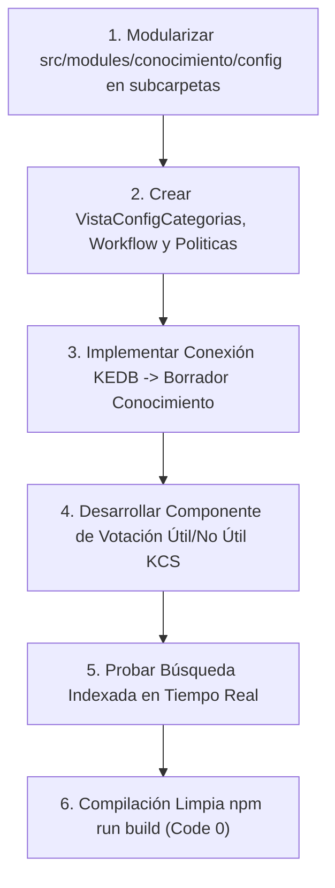

# Plan de Asignación y Especificación Técnica — Alexis / Darhien (Gestión de Problemas y Conocimiento)

> **Documento de especificación técnica y de desarrollo para el asistente IA.**
> **Responsable:** Alexis / Darhien (Darhien Chavez)
> **Módulos Asignados (100% Independientes y Aislados):**
> 1. [src/modules/problemas](file:///c:/Users/apaza/Desktop/SISTEMA%20DE%20TICKETS/src/modules/problemas) (Gestión de Problemas ITIL 4, Análisis Causa Raíz RCA 5-Why/Ishikawa, Base de Datos de Errores Conocidos KEDB, Problemas Mayores y Consola del Gestor de Problemas)
> 2. [src/modules/conocimiento](file:///c:/Users/apaza/Desktop/SISTEMA%20DE%20TICKETS/src/modules/conocimiento) (Gestión del Conocimiento ITIL 4 / KCS, Base de Artículos de Solución, Taxonomía, Ciclo Editorial y Búsqueda)
> 
> **Frontera de Trabajo Estricta:**
> - Alexis **NO** interviene en el módulo de reportes (`src/modules/reportes`) ni en consolas de perfiles (`src/modules/perfiles/*`). El módulo de reportes consolida métricas cruzadas de todos los procesos de la organización (tickets, incidentes, cambios, activos, aprobaciones), por lo que su desarrollo recae de forma centralizada en el Tech Lead (Miguel).
> - Alexis no modifica archivos ni pantallas de sus compañeros. Todo su código, backend, controladores, vistas y configuración se circunscriben estrictamente a `problemas` y `conocimiento`.

---

## 1. Visión Arquitectónica y Principios de Diseño

### 1.1 Principio de Correspondencia Menú-Directorio (Modularidad Estricta)
Cada opción de menú en el árbol lateral del sistema debe nacer directamente de una subcarpeta o archivo dedicado dentro de su respectivo módulo:
- En `src/modules/problemas`, gracias a la ejecución previa del Prompt 1, ya se cuenta con una segmentación modular limpia en `src/modules/problemas/config/` con 13 submódulos independientes (`acuerdos/`, `campos/`, `catalogos/`, `clasificacion/`, `estado/`, `fases/`, `flujo/`, `formulario/`, `gobernanza/`, `notificaciones/`, `rca/`, `roles/`, `sla/`).
- En `src/modules/conocimiento`, la pantalla de configuración monolítica `VistaConocimientoConfig.tsx` debe descomponerse en subcarpetas modulares dentro de `src/modules/conocimiento/config/`: `config/categorias/`, `config/workflow-editorial/` y `config/politicas-acceso/`.

### 1.2 Mecanismo de Sincronización Multi-Perfil en Tiempo Real
La sinergia entre Problemas y Conocimiento es un pilar fundamental de la estabilidad técnica:
1. **Detección de Incidentes Recurrentes y Sugerencia de Problemas:**
   - Cuando el motor de análisis de problemas detecta una acumulación de incidentes con la misma categoría o síntoma:
     - Se genera automáticamente un candidato a problema en `/problemas/candidatos`.
     - En la consola del **Supervisor**, se muestra una sugerencia para abrir una investigación proactiva antes de que la falla afecte a más usuarios.
2. **Publicación Inmediata de Workarounds en la KEDB hacia los Técnicos:**
   - En cuanto el Gestor de Problemas o el especialista de Causa Raíz documenta una Solución Temporal (Workaround) en `src/modules/problemas/views/VistaProblemasErroresConocidos.tsx`:
     - El registro se indexa inmediatamente en la Base de Conocimiento (`src/modules/conocimiento`).
     - Los **Técnicos** que atienden incidentes similares en su mesa de trabajo reciben una recomendación flotante contextual ("Solución temporal disponible en KEDB").
     - Si el artículo se publica para el cliente final, aparece automáticamente en el catálogo de autoservicio del **Solicitante**.
3. **Segregación de Funciones (SoD) en Cierre de Problemas Mayores:**
   - Según ITIL 4 y RN-35, el Gestor de Problemas coordina el análisis RCA, pero el cierre formal de un Problema Mayor o la aceptación de un riesgo residual requiere la aprobación del Aprobador de Gobernanza.

---

## 2. Inventario Exhaustivo Actual y Estado de Situación

### 2.1 Módulo: Gestión de Problemas — `src/modules/problemas`

| Ruta del Archivo / Carpeta | Tipo de Elemento | Estado Actual | Evaluación Técnica frente a ITIL 4 |
| :--- | :--- | :--- | :--- |
| `src/modules/problemas/config/rca/VistaRca.tsx` | Vista Config | 100% avanzado | Configuración de metodologías de Causa Raíz (5 Porqués, Diagrama de Ishikawa / Causa-Efecto, Árbol de Fallas). |
| `src/modules/problemas/config/acuerdos/VistaAcuerdos.tsx` | Vista Config | 100% avanzado | Definición de compromisos de tiempo para entrega de soluciones definitivas. |
| `src/modules/problemas/config/sla/VistaSlaProblemas.tsx` | Vista Config | 100% avanzado | Tiempos máximos de investigación según severidad y criticidad del servicio. |
| `src/modules/problemas/config/flujo/VistaFlujo.tsx` | Vista Config | 100% avanzado | Ciclo de vida: Registrado -> Diagnóstico -> Solución Temporal -> En Espera de Cambio (RFC) -> Resuelto -> Cerrado. |
| `src/modules/problemas/config/fases/VistaFases.tsx` | Vista Config | 100% avanzado | Compuertas de control entre fases de investigación técnica. |
| `src/modules/problemas/config/campos/VistaCamposPersonalizados.tsx` | Vista Config | 100% avanzado | Diseñador de campos dinámicos específicos para problemas. |
| `src/modules/problemas/config/catalogos/VistaCatalogosProblemas.tsx` | Vista Config | 100% avanzado | Taxonomía de causas comunes (Falla de Hardware, Bug de Software, Error Humano, Problema de Proveedor). |
| `src/modules/problemas/config/clasificacion/VistaClasificacion.tsx` | Vista Config | 100% avanzado | Criterios de impacto en el negocio y alcance de afectación. |
| `src/modules/problemas/config/estado/VistaEstado.tsx` | Vista Config | 100% avanzado | Parámetros de estados de la investigación. |
| `src/modules/problemas/config/formulario/VistaFormularioProblemas.tsx` | Vista Config | 100% avanzado | Formulario maestro de captura de problemas. |
| `src/modules/problemas/config/gobernanza/VistaGobernanza.tsx` | Vista Config | 100% avanzado | Políticas de riesgo aceptado y roles con autoridad de dictamen. |
| `src/modules/problemas/config/notificaciones/VistaNotificacionesProblemas.tsx` | Vista Config | 100% avanzado | Alertas automáticas ante activación de problemas mayores. |
| `src/modules/problemas/config/roles/VistaRoles.tsx` | Vista Config | 100% avanzado | Matriz de permisos RBAC específicos para la gestión de problemas. |
| `src/modules/problemas/api/admin/*` (14 controladores) | API Controllers | 100% avanzado | Endpoints de backend completos para todas las pantallas de parametrización. |
| `src/modules/problemas/api/analisisController.ts` | API Controller | Bien avanzado | Captura y almacenamiento de hallazgos del análisis de causa raíz. |
| `src/modules/problemas/api/candidatosController.ts` | API Controller | Bien avanzado | Lógica de correlación para identificación de problemas recurrentes. |
| `src/modules/problemas/api/mayoresController.ts` | API Controller | Bien avanzado | Tratamiento especial de problemas de alto impacto en el negocio. |
| `src/modules/problemas/api/panelGestorController.ts` | API Controller | Bien avanzado | Métricas del panel del Gestor de Problemas (MTTR, volumen de errores conocidos). |
| `src/modules/problemas/api/problemasController.ts` | API Controller | Bien avanzado | CRUD transaccional y vinculación con incidentes. |
| `src/modules/problemas/views/VistaProblemas.tsx` | Vista Master | 100% avanzado | Grilla general de problemas con filtros facetados. |
| `src/modules/problemas/views/VistaProblemasCandidatos.tsx` | Vista Operativa | Bien avanzado | Bandeja de candidatos propuestos para investigación. |
| `src/modules/problemas/views/VistaProblemasErroresConocidos.tsx` | Vista KEDB | 100% avanzado | Base de Errores Conocidos con sus respectivas soluciones temporales. |
| `src/modules/problemas/views/VistaProblemasMayores.tsx` | Vista Crisis | Bien avanzado | Seguimiento prioritario de fallas mayores. |
| `src/modules/problemas/views/VistaProblemasRecurrentes.tsx` | Vista Analítica | Bien avanzado | Visualización de recurrencias por CI o categoría de servicio. |
| `src/modules/problemas/views/VistaPanelGestorProblemas.tsx` | Consola Rol | 100% avanzado | Dashboard dedicado del Gestor de Problemas. |

---

### 2.2 Módulo: Gestión del Conocimiento — `src/modules/conocimiento`

| Ruta del Archivo / Carpeta | Tipo de Elemento | Estado Actual | Evaluación Técnica frente a ITIL 4 / KCS |
| :--- | :--- | :--- | :--- |
| `src/modules/conocimiento/api/admin/categoriasController.ts` | API Controller | Bien avanzado | Endpoints para la jerarquía de categorías de artículos de conocimiento. |
| `src/modules/conocimiento/api/admin/politicasController.ts` | API Controller | Bien avanzado | Configuración de visibilidad (Público, Interno Soporte, Restringido Jefaturas). |
| `src/modules/conocimiento/api/admin/conocimientoController.ts` | API Controller | Bien avanzado | Moderación y control administrativo de artículos. |
| `src/modules/conocimiento/api/conocimientoController.ts` | API Controller | Bien avanzado | Consulta pública y búsqueda indexada de artículos de conocimiento. |
| `src/modules/conocimiento/api/conocimientoDetalleController.ts` | API Controller | Bien avanzado | Obtención del artículo completo con adjuntos y versión. |
| `src/modules/conocimiento/config/VistaConocimientoConfig.tsx` | Vista Monolítica | Requiere modularización | Pantalla monolítica. Debe descomponerse en subdirectorios modulares. |
| `src/modules/conocimiento/services/conocimientoService.ts` | Servicio | Bien avanzado | Lógica de publicación, historial de versiones y votos de utilidad. |
| `src/modules/conocimiento/views/VistaConocimientoBase.tsx` | Vista Master | Bien avanzado | Catálogo de artículos con buscador predictivo y árbol de categorías. |
| `src/modules/conocimiento/views/VistaConocimientoDetalle.tsx` | Vista Detalle | Bien avanzado | Visualizador de artículo con soporte para Markdown y botones de feedback útil/no útil. |
| `src/modules/conocimiento/views/VistaConocimientoMisArticulos.tsx` | Vista Personal | Bien avanzado | Bandeja de artículos redactados por el autor conectado y su estado de revisión. |
| `src/modules/conocimiento/views/VistaConocimientoNuevo.tsx` | Vista Edición | Bien avanzado | Editor de artículos con soporte para adjuntar imágenes y código. |
| `src/modules/conocimiento/views/VistaConocimientoRevisiones.tsx` | Vista Editorial | Bien avanzado | Bandeja de aprobación editorial previa a la publicación oficial. |

---

## 3. Lo que Falta por Desarrollar y Mapeo al Menú de Opciones

### 3.1 Modularización en `conocimiento/config/`
En línea con la arquitectura canónica, en `src/modules/conocimiento/config/` deben crearse las siguientes carpetas y vistas:
1. `src/modules/conocimiento/config/categorias/`:
   - `VistaConfigCategoriasConocimiento.tsx`: Mantenimiento del árbol jerárquico de categorías de artículos. Mapeada a `/plataforma/conocimiento/config/categorias`.
2. `src/modules/conocimiento/config/workflow-editorial/`:
   - `VistaConfigWorkflowEditorial.tsx`: Configuración de etapas de revisión por pares y aprobadores autorizados para publicar. Mapeada a `/plataforma/conocimiento/config/workflow-editorial`.
3. `src/modules/conocimiento/config/politicas-acceso/`:
   - `VistaConfigPoliticasAccesoConocimiento.tsx`: Reglas de visibilidad pública vs interna técnica. Mapeada a `/plataforma/conocimiento/config/politicas-acceso`.

### 3.2 Opciones de Menú a Registrar en `MENUS_Y_PERFILES.md`
- `/plataforma/conocimiento/config/categorias` (Categorías de Conocimiento)
- `/plataforma/conocimiento/config/workflow-editorial` (Flujo de Revisión Editorial)
- `/plataforma/conocimiento/config/politicas-acceso` (Políticas de Acceso y Visibilidad)

### 3.3 Capacidades Funcionales a Completar
1. **Publicación Directa de Workaround a KEDB/Conocimiento:**
   - En `src/modules/problemas/views/VistaProblemasErroresConocidos.tsx`, habilitar el botón "Promover a Artículo de Conocimiento" que genere automáticamente un borrador en `conocimiento` con los campos prellenados del RCA.
2. **Contador de Votos de Utilidad y Calificación KCS:**
   - En `VistaConocimientoDetalle.tsx`, implementar la captura reactiva de "¿Te resultó útil este artículo?" con persistencia en base de datos.

---

## 4. Guía de Ejecución para el Asistente IA de Alexis

### Instrucciones Específicas:
1. Concéntrese exclusivamente en `src/modules/problemas` y `src/modules/conocimiento`. No edite archivos en `src/modules/reportes` ni en `src/modules/perfiles/`.
2. Descomponga `VistaConocimientoConfig.tsx` creando las subcarpetas modulares en `src/modules/conocimiento/config/`.
3. Asegúrese de que cada vista valide autorización mediante `exigirMenuPagina`.
4. Mantenga el estricto estándar de Cero Emojis y ejecute `npm run build` al finalizar cada bloque para garantizar cero errores de TypeScript.
