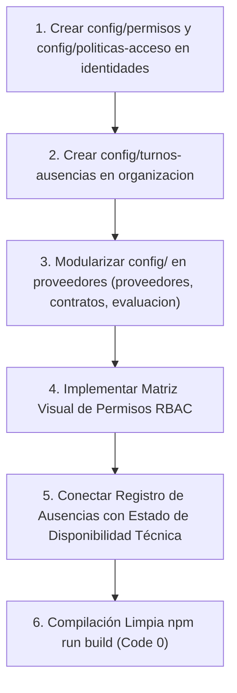

# Plan de Asignación y Especificación Técnica — Junior (Identidades, Organización y Proveedores)

> **Documento de especificación técnica y de desarrollo para el asistente IA.**
> **Responsable:** Junior
> **Módulos Asignados (100% Independientes y Aislados):**
> 1. [src/modules/identidades](file:///c:/Users/apaza/Desktop/SISTEMA%20DE%20TICKETS/src/modules/identidades) (Gestión de Identidades y Accesos IAM ISO/IEC 27001, Usuarios, Perfiles de Rol RBAC, Matriz de Permisos Granulares y Desbloqueo Seguro)
> 2. [src/modules/organizacion](file:///c:/Users/apaza/Desktop/SISTEMA%20DE%20TICKETS/src/modules/organizacion) (Estructura Organizacional, Departamentos Empresa, Departamentos TI / Grupos Resolutores, Técnicos, Niveles N1/N2/N3, Turnos y Ausencias)
> 3. [src/modules/proveedores](file:///c:/Users/apaza/Desktop/SISTEMA%20DE%20TICKETS/src/modules/proveedores) (Gestión de Proveedores ITIL 4 Supplier Management, Catálogo de Terceros, Contratos de Soporte UC y Homologación)
> 
> **Frontera de Trabajo Estricta:**
> - Junior **NO** interviene en la consola de auditoría (`src/modules/perfiles/auditor`) ni en ningún otro perfil. La consola de Auditoría observa datos cruzados de tickets, cambios y CMDB de toda la plataforma, por lo que su desarrollo recae de forma centralizada en el Tech Lead (Miguel).
> - Junior no modifica pantallas ni archivos de sus compañeros. Su código, backend, controladores y componentes se restringen estrictamente a `identidades`, `organizacion` y `proveedores`.

---

## 1. Visión Arquitectónica y Principios de Diseño

### 1.1 Principio de Correspondencia Menú-Directorio (Modularidad Estricta)
Cada opción de menú en el árbol lateral del sistema debe nacer directamente de una subcarpeta o archivo dedicado dentro del módulo correspondiente:
- En `src/modules/identidades`, la configuración debe descomponerse en subcarpetas modulares en `config/`: `config/usuarios/`, `config/perfiles/`, `config/permisos/` y `config/politicas-acceso/`.
- En `src/modules/organizacion`, se mantiene y profundiza la división en `config/departamentos/` (grupos de soporte TI), `config/departamentos-empresa/` (áreas de negocio), `config/tecnicos/` y la nueva subcarpeta `config/turnos-ausencias/`.
- En `src/modules/proveedores`, se elimina el componente monolítico único creando la estructura modular `config/proveedores/`, `config/contratos-soporte/` y `config/evaluacion-desempeno/`.

### 1.2 Mecanismo de Sincronización Multi-Perfil en Tiempo Real
Los tres módulos a cargo de Junior representan el Directorio Maestro de la organización (Entidades internas y externas):
1. **Gobierno de Accesos y Permisos RBAC en Tiempo Real:**
   - Cuando el Administrador o Gestor de Seguridad modifica los permisos de un rol o activa/desactiva un usuario en `src/modules/identidades`:
     - El cambio se persiste de inmediato en las tablas `perfiles_permisos` y `usuarios`.
     - Si el usuario afectado se encuentra conectado en el sistema, su sesión recibe una notificación de invalidación de token o recarga de permisos en memoria.
     - La barra lateral (Sidebar) redibuja sus opciones de navegación en tiempo real, ocultando o mostrando las pantallas según los nuevos permisos concedidos, sin necesidad de cerrar sesión.
2. **Impacto de Turnos y Ausencias Técnicas en la Operación:**
   - Cuando se registra la ausencia o vacaciones de un técnico en `src/modules/organizacion`:
     - El motor de balanceo de carga (`tecnicoCargaService.ts`) actualiza de inmediato la disponibilidad del técnico a estado "Ausente / Fuera de Turno".
     - El técnico deja de ser elegible para autoasignación o asignación automática de nuevos incidentes o solicitudes.
     - En la consola del **Supervisor**, se genera una alerta visual para redistribuir la carga pendiente.
3. **Contratos de Proveedores y SLAs Externos (UC):**
   - Cuando se asocia un contrato de soporte de un proveedor (Underpinning Contract) a un servicio de TI, los tiempos comprometidos por el tercero se sincronizan con las alertas de vencimiento de la mesa de ayuda.

---

## 2. Inventario Exhaustivo Actual y Estado de Situación

### 2.1 Módulo: Identidades & Accesos (IAM) — `src/modules/identidades`

| Ruta del Archivo / Carpeta | Tipo de Elemento | Estado Actual | Evaluación Técnica frente a ISO 27001 |
| :--- | :--- | :--- | :--- |
| `src/modules/identidades/config/usuarios/VistaUsuarios.tsx` | Vista Master | Bien avanzado | Catálogo maestro de usuarios corporativos con búsqueda facetada, filtros por estado (Activo, Inactivo, Bloqueado) y asignación de perfil. |
| `src/modules/identidades/config/perfiles/VistaPerfiles.tsx` | Vista Master | Bien avanzado | Gestión de los 10 perfiles oficiales del sistema y descripción de atribuciones SoD. |
| `src/modules/identidades/api/admin/usuariosController.ts` | API Controller | Bien avanzado | Endpoints para alta, edición y baja lógica de usuarios en base de datos. |
| `src/modules/identidades/api/admin/usuariosDetalleController.ts` | API Controller | Bien avanzado | Consulta de ficha de usuario, histórico de accesos y perfiles asignados. |
| `src/modules/identidades/api/admin/perfilesController.ts` | API Controller | Bien avanzado | CRUD de perfiles y roles del sistema. |
| `src/modules/identidades/api/admin/perfilesDetalleController.ts` | API Controller | Bien avanzado | Detalle de los permisos asociados a un perfil específico. |
| `src/modules/identidades/api/admin/permisosController.ts` | API Controller | Avanzado pero falta revisar | Endpoints de permisos. Requiere soportar matriz granular de permisos por módulo y acción (Crear, Leer, Editar, Eliminar, Aprobar). |
| `src/modules/identidades/api/usuarioDetalleDesbloquearController.ts` | API Controller | Bien avanzado | Mecanismo seguro de desbloqueo de cuentas bloqueadas por exceso de intentos erróneos. |
| `src/modules/identidades/api/credencialesController.ts` | API Controller | Bien avanzado | Generación segura de contraseñas temporales y envío mediante plantilla de correo. |
| `src/modules/identidades/services/enviarCredencialesService.ts` | Servicio | Bien avanzado | Integración con servicio de correo para envío de accesos. |
| `src/modules/identidades/services/perfilDetalleService.ts` | Servicio | Bien avanzado | Lógica de consulta de detalles de roles y permisos. |
| `src/modules/identidades/services/perfilService.ts` | Servicio | Bien avanzado | Capa de servicio de perfiles. |
| `src/modules/identidades/services/usuarioDetalleDesbloquearService.ts` | Servicio | Bien avanzado | Reseteo de contador de intentos fallidos y reactivación de cuenta. |
| `src/modules/identidades/services/usuarioDetalleService.ts` | Servicio | Bien avanzado | Consulta de perfil del usuario. |
| `src/modules/identidades/services/usuarioService.ts` | Servicio | Bien avanzado | Capa de servicio para operaciones con usuarios. |

---

### 2.2 Módulo: Organización & Estructura — `src/modules/organizacion`

| Ruta del Archivo / Carpeta | Tipo de Elemento | Estado Actual | Evaluación Técnica frente a ITIL 4 / COBIT |
| :--- | :--- | :--- | :--- |
| `src/modules/organizacion/config/departamentos/VistaDepartamentos.tsx` | Vista Config | Bien avanzado | Configuración de departamentos de TI (Mesa de Servicio, Redes, Infraestructura, Base de Datos, Ciberseguridad). |
| `src/modules/organizacion/config/departamentos-empresa/VistaDepartamentosEmpresa.tsx` | Vista Config | Bien avanzado | Configuración de áreas funcionales de la empresa (Finanzas, Legal, Recursos Humanos, Operaciones, Ventas). |
| `src/modules/organizacion/config/tecnicos/VistaTecnicos.tsx` | Vista Config | Bien avanzado | Mantenimiento de técnicos especialistas con indicación de nivel resolutor (N1, N2, N3) y grupos de pertenencia. |
| `src/modules/organizacion/api/admin/ausenciasController.ts` | API Controller | Bien avanzado | Registro y consulta de ausencias, permisos y vacaciones de técnicos. |
| `src/modules/organizacion/api/departamentoTiController.ts` | API Controller | Bien avanzado | Endpoints CRUD para grupos de soporte técnico de TI. |
| `src/modules/organizacion/api/departamentoTiDetalleController.ts` | API Controller | Bien avanzado | Ficha de departamento TI con lista de miembros técnicos asociados. |
| `src/modules/organizacion/api/departamentoEmpresaController.ts` | API Controller | Bien avanzado | Endpoints CRUD para departamentos corporativos de la empresa. |
| `src/modules/organizacion/api/departamentoEmpresaDetalleController.ts` | API Controller | Bien avanzado | Consulta de jefatura del departamento y colaboradores dependientes. |
| `src/modules/organizacion/api/tecnicoController.ts` | API Controller | Bien avanzado | Endpoints CRUD para gestión de datos de técnicos. |
| `src/modules/organizacion/api/tecnicoDetalleController.ts` | API Controller | Bien avanzado | Consulta de especialidades y carga asignada al técnico. |
| `src/modules/organizacion/api/colaboradoresAutorizacionesController.ts` | API Controller | Bien avanzado | Jerarquía de autorización para aprobación de solicitudes departamentales. |
| `src/modules/organizacion/api/colaboradoresController.ts` | API Controller | Bien avanzado | Directorio de colaboradores de la empresa. |
| `src/modules/organizacion/services/*` (9 servicios) | Servicios | Bien avanzado | Capa de negocio conectada a la base de datos organizacional. |

---

### 2.3 Módulo: Gestión de Proveedores — `src/modules/proveedores`

| Ruta del Archivo / Carpeta | Tipo de Elemento | Estado Actual | Evaluación Técnica frente a ITIL 4 |
| :--- | :--- | :--- | :--- |
| `src/modules/proveedores/api/proveedorController.ts` | API Controller | Bien avanzado | Endpoints CRUD para registro de suministradores de servicios tecnológicos. |
| `src/modules/proveedores/api/proveedorDetalleController.ts` | API Controller | Bien avanzado | Detalle de contratos, contactos de emergencia y niveles de soporte del proveedor. |
| `src/modules/proveedores/components/ProveedoresWorkspace.tsx` | Componente | Monolítico / Requiere estructuración | Componente contenedor único. Debe modularizarse en componentes específicos. |
| `src/modules/proveedores/services/proveedorService.ts` | Servicio | Bien avanzado | Capa de negocio para consulta y persistencia de proveedores. |
| `src/modules/proveedores/views/VistaProveedores.tsx` | Vista Master | Bien avanzado | Vista principal de directorio de proveedores y estado de contratos. |
| `src/modules/proveedores/config/` | Carpeta | Cascarón / Vacío | Carpeta vacía; debe crearse la estructura modular de configuración. |

---

## 3. Lo que Falta por Desarrollar y Mapeo al Menú de Opciones

### 3.1 Subcarpetas y Archivos a Crear en `identidades/config/`
1. `src/modules/identidades/config/permisos/`:
   - `VistaConfigPermisos.tsx`: Matriz interactiva de permisos donde se seleccionan los accesos por módulo y por perfil. Mapeada a `/plataforma/identidades/config/permisos`.
   - `components/GrillaPermisosRol.tsx`: Tabla visual de checkboxes para acciones (Crear, Leer, Editar, Eliminar, Aprobar).
2. `src/modules/identidades/config/politicas-acceso/`:
   - `VistaConfigPoliticasAcceso.tsx`: Configuración de políticas de seguridad (máximo de intentos fallidos antes del bloqueo, caducidad de contraseñas temporales, tiempo de inactividad de sesión). Mapeada a `/plataforma/identidades/config/politicas-acceso`.

### 3.2 Subcarpetas y Archivos a Crear en `organizacion/config/`
1. `src/modules/organizacion/config/turnos-ausencias/`:
   - `VistaConfigTurnosAusencias.tsx`: Gestión visual de turnos operativos (Mañana, Tarde, Noche, Guardias pasivas 24x7) y registro de licencias de técnicos. Mapeada a `/plataforma/organizacion/config/turnos-ausencias`.
   - `components/CalendarioTurnosTecnicos.tsx`: Calendario de guardias técnicas semanales.
   - `components/ModalRegistrarAusencia.tsx`: Modal para asentar ausencia con designación obligatoria de técnico de reemplazo.

### 3.3 Subcarpetas y Archivos a Crear en `proveedores/config/`
1. `src/modules/proveedores/config/proveedores/`:
   - `VistaConfigProveedores.tsx`: Categorización de proveedores (Estratégicos, Tácticos, Operacionales) y estados de homologación. Mapeada a `/plataforma/proveedores/config/proveedores`.
2. `src/modules/proveedores/config/contratos-soporte/`:
   - `VistaConfigContratosSoporte.tsx`: Parámetros de contratos de soporte externo (Underpinning Contracts - UC) vinculados a servicios. Mapeada a `/plataforma/proveedores/config/contratos-soporte`.
3. `src/modules/proveedores/config/evaluacion-desempeno/`:
   - `VistaConfigEvaluacionDesempeno.tsx`: Criterios de evaluación periódica de cumplimiento de SLAs del tercero. Mapeada a `/plataforma/proveedores/config/evaluacion-desempeno`.

### 3.4 Opciones de Menú a Registrar en `MENUS_Y_PERFILES.md`
- `/plataforma/identidades/config/permisos` (Matriz de Permisos por Rol)
- `/plataforma/identidades/config/politicas-acceso` (Políticas de Contraseñas y Bloqueo)
- `/plataforma/organizacion/config/turnos-ausencias` (Gestión de Turnos y Ausencias)
- `/plataforma/proveedores/config/proveedores` (Configuración de Proveedores)
- `/plataforma/proveedores/config/contratos-soporte` (Contratos de Soporte UC)
- `/plataforma/proveedores/config/evaluacion-desempeno` (Evaluación de Desempeño)

---

## 4. Guía de Ejecución para el Asistente IA de Junior

### Instrucciones Específicas:
1. Concéntrese exclusivamente en `identidades`, `organizacion` y `proveedores`. No modifique `perfiles/auditor` ni pantallas compartidas de otros módulos.
2. Cree las subcarpetas indicadas asegurando que cada una contenga su vista principal y componentes desacoplados.
3. Asegure tipado TypeScript estricto sin usar `any` y valide los formularios con Zod.
4. Mantenga el estándar de Cero Emojis y verifique la compilación limpia con `npm run build` al finalizar cada bloque.
