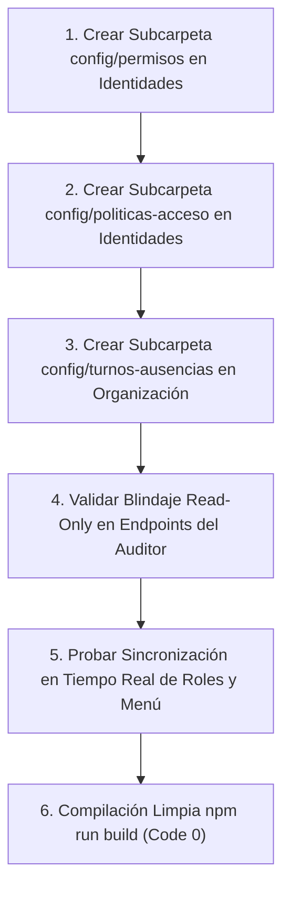

# Plan de Asignación y Especificación Técnica — Junior (Security & IAM Developer)

> **Documento de especificación técnica y de desarrollo para el asistente IA.**
> **Responsable:** Junior (IAM, Organization & Audit Specialist)
> **Módulos Asignados (Independientes):**
> 1. [src/modules/identidades](file:///c:/Users/apaza/Desktop/SISTEMA%20DE%20TICKETS/src/modules/identidades) (Gestión de Identidades y Accesos IAM ISO/IEC 27001, Usuarios, Perfiles de Rol RBAC, Matriz de Permisos y Desbloqueo)
> 2. [src/modules/organizacion](file:///c:/Users/apaza/Desktop/SISTEMA%20DE%20TICKETS/src/modules/organizacion) (Estructura Organizacional, Departamentos Empresa, Departamentos TI / Grupos Resolutores, Técnicos, Turnos y Ausencias)
> 3. [src/modules/perfiles/auditor](file:///c:/Users/apaza/Desktop/SISTEMA%20DE%20TICKETS/src/modules/perfiles/auditor) (Consola de Auditoría y Cumplimiento Read-Only, Muestreo de Calidad, Detección SoD, Recertificación de Accesos y Evidencias)

---

## 1. Visión Arquitectónica y Principios de Diseño

### 1.1 Principio de Correspondencia Menú-Directorio (Modularidad Estricta)
Junior tiene la custodia del control de accesos, el gobierno de identidades y la verificación independiente de cumplimiento normativo (ISO/IEC 27001, ISO/IEC 20000-1 y COBIT 2019).
- Cada opción de menú visible en la barra lateral debe provenir de una subcarpeta o archivo dedicado dentro de su respectivo módulo.
- En `src/modules/identidades`, las opciones deben articularse limpiamente en `config/usuarios/`, `config/perfiles/`, `config/permisos/` y `config/politicas-acceso/`.
- En `src/modules/organizacion`, las opciones deben distribuirse en `config/departamentos/` (TI), `config/departamentos-empresa/` (Negocio), `config/tecnicos/` y `config/turnos-ausencias/`.
- En `src/modules/perfiles/auditor`, la consola está compuesta por vistas especializadas de solo lectura (`muestreo/`, `sod/`, `cambios-irregulares/`, `recertificacion/`, `evidencias/`).

### 1.2 Mecanismo de Sincronización Multi-Perfil en Tiempo Real
Las configuraciones de Identidades y Organización definen la visibilidad y autoridad en toda la plataforma:
1. **Actualización Dinámica de Permisos y Roles (RBAC):**
   - Cuando el Administrador modifica los permisos de un perfil en `src/modules/identidades` (por ejemplo, habilitar a un técnico para votar en el CAB o quitar acceso a notas internas):
     - El token de sesión y el contexto de autorización de React en el navegador del usuario se sincronizan al instante vía evento de autenticación.
     - La barra lateral (Sidebar) del usuario conectado redibuja sus opciones de menú accesibles de forma reactiva, ocultando o mostrando las pantallas autorizadas sin cerrar la sesión.
2. **Impacto de Turnos y Ausencias en el Despacho de Tickets:**
   - Cuando en `src/modules/organizacion` se registra la ausencia o vacaciones de un técnico:
     - El motor de despacho de `src/modules/tickets` lo excluye inmediatamente del pool de técnicos disponibles para autoasignación o asignación automática.
     - En la consola del **Supervisor**, los tickets pendientes del técnico ausente se marcan con una advertencia visual para facilitar su reasignación inmediata.
3. **Segregación de Funciones (SoD) y Modo Solo Lectura del Auditor:**
   - Por principio de diseño SoD (RN-31 a RN-36), el perfil Auditor es de **Lectura Estricta (Read-Only)** en toda la plataforma. Ningún endpoint invocado por este perfil debe aceptar peticiones de mutación (`POST`, `PUT`, `DELETE`).
   - La vista de auditoría SoD (`VistaSod.tsx`) monitorea constantemente la base de datos para alertar en tiempo real si algún usuario acumula roles conflictivos (ej. solicitar y aprobar órdenes de compra, o crear y cerrar problemas mayores sin aprobación).

---

## 2. Inventario Exhaustivo Actual y Estado de Situación

### 2.1 Módulo: Identidades & Accesos (IAM) — `src/modules/identidades`
Gestión del ciclo de vida de usuarios, credenciales y asignación de roles bajo el principio de menor privilegio (ISO/IEC 27001 A.9).

| Archivo / Carpeta | Tipo | Estado Actual | Evaluación Técnica frente a ISO 27001 |
| :--- | :--- | :--- | :--- |
| `src/modules/identidades/config/usuarios/VistaUsuarios.tsx` | Vista Master | Bien avanzado | Catálogo maestro de usuarios corporativos con filtros por departamento y estado de cuenta. |
| `src/modules/identidades/config/perfiles/VistaPerfiles.tsx` | Vista Master | Bien avanzado | Gestión de los 10 perfiles oficiales y descripción de responsabilidades. |
| `src/modules/identidades/api/admin/usuariosController.ts` | API Controller | Bien avanzado | Alta, baja y modificación de usuarios en la base de datos de autenticación. |
| `src/modules/identidades/api/admin/usuariosDetalleController.ts` | API Controller | Bien avanzado | Detalle de cuenta, historial de accesos y pertenencia a grupos. |
| `src/modules/identidades/api/admin/perfilesController.ts` | API Controller | Bien avanzado | Administración de perfiles y asignación a usuarios. |
| `src/modules/identidades/api/admin/perfilesDetalleController.ts` | API Controller | Bien avanzado | Detalle de los permisos asignados a un perfil específico. |
| `src/modules/identidades/api/admin/permisosController.ts` | API Controller | Avanzado pero falta revisar | Matriz de permisos finos por módulo. Requiere granularidad a nivel de acción CRUD. |
| `src/modules/identidades/api/usuarioDetalleDesbloquearController.ts` | API Controller | Bien avanzado | Procedimiento seguro de desbloqueo de cuentas bloqueadas por exceso de intentos fallidos. |
| `src/modules/identidades/api/credencialesController.ts` | API Controller | Bien avanzado | Generación y envío seguro de contraseñas temporales por correo electrónico institucional. |
| `src/modules/identidades/services/*` (6 servicios) | Servicios | Bien avanzado | Capa de negocio conectada a Supabase Auth y tablas locales de identidad. |

---

### 2.2 Módulo: Organización & Estructura — `src/modules/organizacion`
Estructura departamental, jerarquías de aprobación y especialización técnica de soporte.

| Archivo / Carpeta | Tipo | Estado Actual | Evaluación Técnica frente a ITIL 4 / COBIT |
| :--- | :--- | :--- | :--- |
| `src/modules/organizacion/config/departamentos/VistaDepartamentos.tsx` | Vista Config | Bien avanzado | Gestión de Departamentos de TI (Mesa de Ayuda, Redes, Servidores, Base de Datos, Ciberseguridad). |
| `src/modules/organizacion/config/departamentos-empresa/VistaDepartamentosEmpresa.tsx` | Vista Config | Bien avanzado | Gestión de Departamentos de Negocio (Finanzas, Legal, Operaciones, Ventas, Recursos Humanos). |
| `src/modules/organizacion/config/tecnicos/VistaTecnicos.tsx` | Vista Config | Bien avanzado | Ficha de técnicos con asignación de nivel de soporte (N1, N2, N3) y pertenencia a grupos resolutores. |
| `src/modules/organizacion/api/admin/ausenciasController.ts` | API Controller | Bien avanzado | Registro de vacaciones, permisos y licencias médicas de especialistas. |
| `src/modules/organizacion/api/departamentoTiController.ts` | API Controller | Bien avanzado | CRUD de grupos de soporte técnico y sus líderes de equipo. |
| `src/modules/organizacion/api/departamentoEmpresaController.ts` | API Controller | Bien avanzado | CRUD de áreas de negocio vinculadas a centros de costo y jefes de área. |
| `src/modules/organizacion/api/tecnicoController.ts` | API Controller | Bien avanzado | Habilitación de técnicos y asignación de jornada laboral. |
| `src/modules/organizacion/api/colaboradoresAutorizacionesController.ts` | API Controller | Bien avanzado | Líneas de mando para flujos de aprobación jerárquica de solicitudes de servicio. |
| `src/modules/organizacion/services/*` (9 servicios) | Servicios | Bien avanzado | Capa de negocio completa para gestión organizacional. |

---

### 2.3 Consola de Perfil: Auditor — `src/modules/perfiles/auditor`
Entorno de aseguramiento independiente, verificación de cumplimiento y evidencia inalterable (ISO 27001 / ISO 20000).

| Archivo / Carpeta | Tipo | Estado Actual | Evaluación Técnica frente a ISO 27001 / ISO 20000 |
| :--- | :--- | :--- | :--- |
| `src/modules/perfiles/auditor/views/VistaPanelAuditoria.tsx` | Vista Principal | 100% avanzado | Tablero central de control de auditoría y alertas tempranas de incumplimiento normativo. |
| `src/modules/perfiles/auditor/views/VistaMuestreo.tsx` | Vista Aseguramiento | 100% avanzado | Generador de muestras aleatorias estadísticamente representativas de tickets para auditoría de calidad. |
| `src/modules/perfiles/auditor/views/VistaCambiosIrregulares.tsx` | Vista Detección | 100% avanzado | Identificación de cambios aplicados sin RFC previa, fuera de ventana o aprobados irregularmente. |
| `src/modules/perfiles/auditor/views/VistaSod.tsx` | Vista SoD | 100% avanzado | Monitoreo en tiempo real de infracciones de Segregación de Funciones (RN-31 a RN-36). |
| `src/modules/perfiles/auditor/views/VistaRecertificacion.tsx` | Vista IAM | 100% avanzado | Campañas de recertificación periódica de privilegios y cuentas activas. |
| `src/modules/perfiles/auditor/views/VistaCmdbResultados.tsx` | Vista SACM | 100% avanzado | Verificación de discrepancias de configuración y CIs no autorizados en producción. |
| `src/modules/perfiles/auditor/views/VistaBajasDisposicion.tsx` | Vista HAM | 100% avanzado | Inspección de certificados de borrado seguro de datos y actas de disposición física de activos. |
| `src/modules/perfiles/auditor/api/*` (9 controladores) | API Controllers | 100% avanzado | Endpoints de consulta estrictamente de solo lectura (Read-Only) para todos los informes. |
| `src/modules/perfiles/auditor/services/*` (4 servicios) | Servicios | 100% avanzado | Servicios de consulta y trazabilidad inmutable. |

---

## 3. Lo que Falta por Desarrollar y Mapeo al Menú de Opciones

### 3.1 Modularización en Identidades
Para cumplir con la arquitectura donde cada opción de menú nace de una carpeta física:
1. `src/modules/identidades/config/permisos/`:
   - `VistaConfigPermisos.tsx`: Matriz visual para marcar y desmarcar permisos granulares por perfil y por módulo. Mapeada a la opción de menú `/plataforma/identidades/config/permisos`.
   - `components/TablaPermisosPorModulo.tsx`: Grilla interactiva con checkboxes por acción (Crear, Leer, Editar, Eliminar, Aprobar).
2. `src/modules/identidades/config/politicas-acceso/`:
   - `VistaConfigPoliticasAcceso.tsx`: Configuración de umbral de bloqueo de cuentas (ej. 3 intentos fallidos), tiempo de bloqueo temporal y duración máxima de sesión inactiva. Mapeada a `/plataforma/identidades/config/politicas-acceso`.

### 3.2 Modularización en Organización
1. `src/modules/organizacion/config/turnos-ausencias/`:
   - `VistaConfigTurnosAusencias.tsx`: Calendario de turnos de guardia (Mañana, Tarde, Noche) y gestión de vacaciones/licencias de técnicos. Mapeada a la opción de menú `/plataforma/organizacion/config/turnos-ausencias`.
   - `components/CalendarioGuardiasTecnicas.tsx`: Componente visual de asignación de turnos semanales y mensuales.
   - `components/FormularioRegistroAusencia.tsx`: Modal para registrar licencia de un técnico con selección obligatoria del técnico suplente.

### 3.3 Blindaje de Solo Lectura en Auditoría
1. **Guarda Estricta en Controladores de Auditoría:**
   - Verificar en todos los controladores de `src/modules/perfiles/auditor/api/` que cualquier método que no sea `GET` responda con HTTP 405 Method Not Allowed, impidiendo que el perfil auditor modifique datos por error o diseño.

---

## 4. Guía de Ejecución para el Asistente IA de Junior

### Instrucciones Específicas:
1. Cree las vistas y subcarpetas faltantes en `src/modules/identidades/config/` y `src/modules/organizacion/config/` conectándolas con sus respectivos servicios.
2. Registre las nuevas rutas en `DOCUMENTACIÓN/MENUS_Y_PERFILES.md` y asegúrese de que el helper `exigirMenuPagina` proteja el acceso.
3. Asegure que la asignación de ausencias se comunique con el servicio de carga de técnicos para evitar asignaciones erróneas.
4. Ejecute periódicamente `npm run build` garantizando cero errores TypeScript y total ausencia de emojis en código y mensajes.
