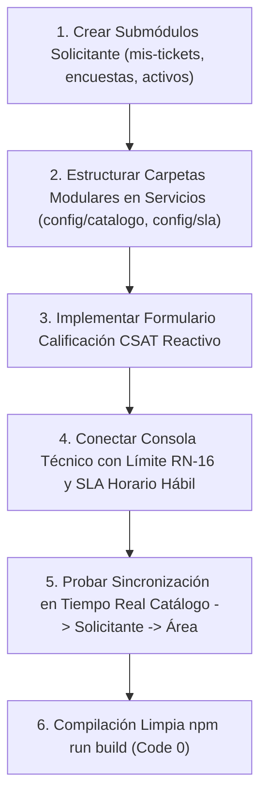

# Plan de Asignación y Especificación Técnica — Lourdes (Product Owner & Frontend Lead)

> **Documento de especificación técnica y de desarrollo para el asistente IA.**
> **Responsable:** Lourdes (Product Owner & Frontend Specialist)
> **Módulos Asignados (Independientes):**
> 1. [src/modules/servicios](file:///c:/Users/apaza/Desktop/SISTEMA%20DE%20TICKETS/src/modules/servicios) (Catálogo de Servicios de Negocio y Técnicos, Acuerdos de Nivel de Servicio SLA / OLA / UC ITIL 4)
> 2. [src/modules/perfiles/tecnico](file:///c:/Users/apaza/Desktop/SISTEMA%20DE%20TICKETS/src/modules/perfiles/tecnico) (Consola Operativa del Técnico / Especialista Resolutor N1/N2/N3)
> 3. [src/modules/perfiles/solicitante](file:///c:/Users/apaza/Desktop/SISTEMA%20DE%20TICKETS/src/modules/perfiles/solicitante) (Portal del Cliente, Autoservicio, Seguimiento y Calificación CSAT)
> 4. [src/modules/perfiles/gestor-area](file:///c:/Users/apaza/Desktop/SISTEMA%20DE%20TICKETS/src/modules/perfiles/gestor-area) (Consola de Jefatura de Área, Aprobaciones de Negocio y Control de Servicio)

---

## 1. Visión Arquitectónica y Principios de Diseño

### 1.1 Principio de Correspondencia Menú-Directorio (Modularidad Estricta)
Lourdes tiene la responsabilidad primordial del Front-End, la Experiencia de Usuario (UX) y el alineamiento con el Catálogo de Servicios de ITIL 4. Cada opción accesible desde el sidebar debe corresponder de manera unívoca a una carpeta o componente modular bien estructurado, eliminando páginas masivas o componentes sobrecargados.
- El catálogo de servicios se bifurca claramente en dos visiones: **Catálogo de Negocio** (orientado al usuario final y solicitante, con lenguaje claro y orientado a resultados) y **Catálogo Técnico** (orientado al especialista resolutor, vinculando los SLAs, CIs y grupos de soporte).
- En los perfiles (Técnico, Solicitante y Gestor de Área), cada opción de navegación debe organizarse en subcarpetas semánticas (`mesa/`, `cambios/`, `problemas/`, `sla/`, `aprobaciones/`, `activos/`).

### 1.2 Mecanismo de Sincronización Multi-Perfil en Tiempo Real
Los módulos a cargo de Lourdes son los principales receptores y generadores de eventos del sistema:
1. **Publicación en el Catálogo de Servicios:** Cuando se crea o actualiza un servicio en `src/modules/servicios` con nuevos campos personalizados o nuevas metas de tiempo SLA:
   - Se actualiza de forma inmediata la vitrina del **Solicitante** (`/solicitante/catalogo`), mostrando los formularios reactivos adaptados sin recargar la página.
   - En la consola del **Técnico** (`/tecnico/mesa/asignados`), el temporizador de SLA (`CockpitTemporizadorSla`) recalcula los tiempos límites (Response Time / Resolution Time) tomando en consideración el calendario hábil configurado.
   - En la consola del **Gestor de Área** (`/gestor-area/aprobaciones`), si el servicio requiere validación presupuestal del departamento, la solicitud aparece instantáneamente en su bandeja de pendientes.
2. **Atención Operativa y Estado de Solicitudes:** Cuando el Técnico cambia el estado de un ticket a "En Diagnóstico" o "Resuelto", el Solicitante ve reflejado el progreso en tiempo real mediante un Stepper visual amigable (`StepperProgresoConsumidor`), sin tecnicismos ni jerga interna.

---

## 2. Inventario Exhaustivo Actual y Estado de Situación

### 2.1 Módulo: Catálogo de Servicios & SLA — `src/modules/servicios`
Estructura y gobierno de los servicios ofrecidos por la organización de TI (ITIL 4 Service Catalogue Management & Service Level Management).

| Archivo / Carpeta | Tipo | Estado Actual | Evaluación Técnica frente a ITIL 4 / ISO 20000 |
| :--- | :--- | :--- | :--- |
| `src/modules/servicios/admin/servicios/page.tsx` | Vista Master | Bien avanzado | Vista principal del catálogo administrativo con filtrado por categoría y estado de publicación. |
| `src/modules/servicios/admin/servicios/ConfiguracionObjetivosSla.tsx` | Componente | Bien avanzado | Asignación de tiempos compromiso (Horas hábiles, criticidad, prioridades P1 a P4). |
| `src/modules/servicios/admin/servicios/GestionCategorias.tsx` | Componente | Bien avanzado | Gestión del árbol taxonómico de categorías (Infraestructura, Software, Accesos, Hardware). |
| `src/modules/servicios/admin/servicios/sla/page.tsx` | Vista | Bien avanzado | Vista dedicada a la definición de acuerdos de nivel de servicio globales y específicos. |
| `src/modules/servicios/admin/servicios/sla/components/MatrizPrioridadSla.tsx` | Componente | 100% avanzado | Matriz bidimensional de Prioridad ITIL (Impacto vs Urgencia) que define la severidad. |
| `src/modules/servicios/admin/servicios/[id]/formulario/page.tsx` | Vista Dinámica | Bien avanzado | Diseñador visual de campos obligatorios, opcionales y listas desplegables para el servicio. |
| `src/modules/servicios/admin/servicios/[id]/formulario/ui.tsx` | Componente UI | Bien avanzado | Elementos de interacción y widgets del diseñador de formularios. |
| `src/modules/servicios/api/admin/categoriaController.ts` | API Controller | Bien avanzado | CRUD de categorías del catálogo con soporte para jerarquía padre-hijo. |
| `src/modules/servicios/api/admin/categoriaDetalleController.ts` | API Controller | Bien avanzado | Detalle de dependencias y servicios asociados a la categoría. |
| `src/modules/servicios/api/admin/matrizController.ts` | API Controller | 100% avanzado | Persistencia y cálculo automático de la matriz de prioridad SLA. |
| `src/modules/servicios/api/admin/slaController.ts` | API Controller | Bien avanzado | Reglas de temporización y penalidades por incumplimiento de SLA. |
| `src/modules/servicios/api/servicioDetalleController.ts` | API Controller | Bien avanzado | Consulta integral de la ficha de servicio y costos asociados. |
| `src/modules/servicios/api/servicioDetalleWorkflowController.ts` | API Controller | Avanzado pero falta revisar | Orquestación del flujo de entrega del servicio (Fulfillment). Requiere afinar transiciones automáticas. |
| `src/modules/servicios/api/serviciosController.ts` | API Controller | Bien avanzado | Endpoints de consulta y publicación del catálogo. |
| `src/modules/servicios/catalogo/VistaCatalogoServicios.tsx` | Vista Pública | Bien avanzado | Portal de vitrina de servicios para los usuarios solicitantes. |
| `src/modules/servicios/catalogo-tecnico/VistaTecnicoCatalogo.tsx` | Vista Técnica | Bien avanzado | Vista de soporte para especialistas técnicos con CIs subyacentes. |
| `src/modules/servicios/categorias/categoriasService.ts` | Servicio | Bien avanzado | Capa de negocio para taxonomía de categorías. |
| `src/modules/servicios/categorias/categoriasTypes.ts` | Tipos TypeScript | 100% avanzado | Contratos de interfaces de datos fuertemente tipados. |

---

### 2.2 Consola de Perfil: Técnico / Especialista Resolutor — `src/modules/perfiles/tecnico`
El entorno de trabajo diario de los resolutores N1/N2/N3.

| Archivo / Carpeta | Tipo | Estado Actual | Evaluación Técnica frente a ITIL 4 |
| :--- | :--- | :--- | :--- |
| `src/modules/perfiles/tecnico/api/contadoresController.ts` | API Controller | Bien avanzado | Insignias numéricas en tiempo real de tickets asignados, en riesgo y pendientes. |
| `src/modules/perfiles/tecnico/api/recordatoriosController.ts` | API Controller | Bien avanzado | Alertas de vencimiento próximo de acuerdos de servicio SLA. |
| `src/modules/perfiles/tecnico/api/usuariosController.ts` | API Controller | Bien avanzado | Consulta de técnicos disponibles para escalamiento o consulta interna. |
| `src/modules/perfiles/tecnico/panel/VistaTecnicoPanel.tsx` | Vista Principal | Bien avanzado | Cockpit personal de rendimiento técnico (MTTR, tickets resueltos, cumplimiento SLA). |
| `src/modules/perfiles/tecnico/mesa/area/VistaTecnicoMesaArea.tsx` | Vista de Cola | Bien avanzado | Bandeja de tickets no asignados dirigidos al grupo resolutor del técnico. |
| `src/modules/perfiles/tecnico/mesa/asignados/VistaTecnicoMesaAsignados.tsx` | Vista Operativa | Bien avanzado | Tickets bajo responsabilidad directa del técnico. Respeta límite de carga (RN-16). |
| `src/modules/perfiles/tecnico/mesa/pendientes/VistaTecnicoMesaPendientes.tsx` | Vista Operativa | Bien avanzado | Tickets pausados en espera de respuesta del usuario o de proveedor externo. |
| `src/modules/perfiles/tecnico/mesa/historial/VistaTecnicoMesaHistorial.tsx` | Vista Histórica | Bien avanzado | Registro de atenciones pasadas para reutilización de soluciones. |
| `src/modules/perfiles/tecnico/mesa/incidente-mayor/VistaTecnicoMesaIncidenteMayor.tsx` | Vista Crisis | Bien avanzado | Consola de enlace con incidentes mayores P1 en curso y salas de crisis. |
| `src/modules/perfiles/tecnico/cambios/*` (5 vistas) | Vistas Cambios | Bien avanzado | Mis cambios, calendario, impacto, implementación e historial de despliegues. |
| `src/modules/perfiles/tecnico/problemas/*` (5 vistas) | Vistas Problemas | Bien avanzado | Problemas asignados, candidatos, consulta a la base de errores conocidos (KEDB). |
| `src/modules/perfiles/tecnico/sla/*` (2 vistas) | Vistas SLA | Bien avanzado | Semáforo visual de tiempos restantes y metas operativas OLA. |
| `src/modules/perfiles/tecnico/tareas/VistaTecnicoTareas.tsx` | Vista Tareas | Bien avanzado | Subtareas técnicas de cumplimiento derivadas de solicitudes o cambios. |

---

### 2.3 Consola de Perfil: Solicitante / Cliente — `src/modules/perfiles/solicitante`
Punto de contacto único (SPOC - Single Point of Contact) para los usuarios finales de la organización.

| Archivo / Carpeta | Tipo | Estado Actual | Evaluación Técnica frente a ITIL 4 |
| :--- | :--- | :--- | :--- |
| `src/modules/perfiles/solicitante/api/panelController.ts` | API Controller | Bien avanzado | Agrega métricas resumidas para el panel de autoservicio del cliente. |
| `src/modules/perfiles/solicitante/services/panelService.ts` | Servicio | Bien avanzado | Obtención de tickets activos, borradores y encuestas pendientes. |
| `src/modules/perfiles/solicitante/views/VistaPanelSolicitante.tsx` | Vista Principal | Bien avanzado | Pantalla de inicio del solicitante con buscador global y accesos rápidos a servicios. |
| `src/modules/perfiles/solicitante/mis-tickets/` | Carpeta | Falta estructurar | Actualmente se consulta mediante vistas genéricas de tickets. Debe modularizarse de forma dedicada. |
| `src/modules/perfiles/solicitante/encuestas/` | Carpeta | Falta estructurar | Módulo para la captura de CSAT (Customer Satisfaction Score) con estrellas y retroalimentación. |
| `src/modules/perfiles/solicitante/activos/` | Carpeta | Falta estructurar | Vista de equipos y periféricos asignados en custodia personal. |

---

### 2.4 Consola de Perfil: Gestor de Área — `src/modules/perfiles/gestor-area`
Herramienta de control y toma de decisiones para jefaturas departamentales.

| Archivo / Carpeta | Tipo | Estado Actual | Evaluación Técnica frente a ITIL 4 / COBIT |
| :--- | :--- | :--- | :--- |
| `src/modules/perfiles/gestor-area/api/activosController.ts` | API Controller | Bien avanzado | Consulta de los activos TI asignados al personal de su departamento. |
| `src/modules/perfiles/gestor-area/api/aprobacionesController.ts` | API Controller | Bien avanzado | Validación de solicitudes de compra, accesos y cambios que impactan su unidad. |
| `src/modules/perfiles/gestor-area/api/cambiosImpactoController.ts` | API Controller | Bien avanzado | Monitoreo de ventanas de mantenimiento que afectarán sus operaciones de negocio. |
| `src/modules/perfiles/gestor-area/api/contratosController.ts` | API Controller | Bien avanzado | Seguimiento de suscripciones y licencias con costo atribuido a su centro de costo. |
| `src/modules/perfiles/gestor-area/api/delegacionController.ts` | API Controller | Bien avanzado | Gestión de delegación temporal de autoridad de aprobación por ausencia justificada. |
| `src/modules/perfiles/gestor-area/api/historialController.ts` | API Controller | 100% avanzado | Registro inmutable de dictámenes y aprobaciones emitidas. |
| `src/modules/perfiles/gestor-area/api/panelController.ts` | API Controller | Bien avanzado | Resumen de consumo de servicios y cumplimiento de SLA por parte de TI. |
| `src/modules/perfiles/gestor-area/api/reportesController.ts` | API Controller | Bien avanzado | Generación de reportes ejecutivos del departamento. |
| `src/modules/perfiles/gestor-area/services/areaService.ts` | Servicio | Bien avanzado | Capa de orquestación de datos del área funcional. |
| `src/modules/perfiles/gestor-area/views/VistaPanelArea.tsx` | Vista Principal | Bien avanzado | Dashboard de gestión departamental. |
| `src/modules/perfiles/gestor-area/views/VistaAprobacionesNegocio.tsx` | Vista Dictamen | Bien avanzado | Flujo de aprobación con botones directos y justificación obligatoria en rechazo. |
| `src/modules/perfiles/gestor-area/views/VistaActivosArea.tsx` | Vista Inventario | Bien avanzado | Lista de activos físicos y lógicos utilizados por los colaboradores del área. |
| `src/modules/perfiles/gestor-area/views/VistaCambiosImpactoArea.tsx` | Vista Calendario | Bien avanzado | Calendario de cortes programados con avisos anticipados de indisponibilidad. |
| `src/modules/perfiles/gestor-area/views/VistaContratosArea.tsx` | Vista Contratos | Bien avanzado | Supervisión de renovaciones de licencias de software y servicios contratados. |
| `src/modules/perfiles/gestor-area/views/VistaDelegacionAprobaciones.tsx` | Vista Gobernanza | Bien avanzado | Asignación formal de suplente con fechas límite y revocación automática. |
| `src/modules/perfiles/gestor-area/views/VistaHistorialDecisiones.tsx` | Vista Auditoría | 100% avanzado | Trazabilidad con firma digital simulada y timestamps inmutables. |

---

## 3. Lo que Falta por Desarrollar y Mapeo al Menú de Opciones

### 3.1 Desacoplamiento y Modularización en el Portal del Solicitante
Para cumplir con la arquitectura modular donde cada opción de menú nace de una carpeta física:
1. `src/modules/perfiles/solicitante/mis-tickets/`:
   - `VistaSolicitanteMisTickets.tsx`: Vista dedicada al listado de tickets creados por el usuario, con badges de estado amigables ("En revisión", "Trabajando en la solución", "Esperando tu confirmación"). Mapeada a la opción de menú `/solicitante/mis-tickets`.
   - `components/FiltrosTicketsSolicitante.tsx`: Filtro simplificado por estado y fecha.
   - `components/DetalleTicketModalSolicitante.tsx`: Visualizador sin datos técnicos donde se muestra el avance del ticket y el chat público con el técnico.
2. `src/modules/perfiles/solicitante/encuestas/`:
   - `VistaSolicitanteEncuestas.tsx`: Bandeja de encuestas de satisfacción pendientes de responder tras el cierre de un ticket. Mapeada a `/solicitante/encuestas`.
   - `components/FormularioCalificacionCsat.tsx`: Componente interactivo con escala de 1 a 5 estrellas, evaluación de amabilidad técnica, velocidad de respuesta y campo de observaciones abiertas.
3. `src/modules/perfiles/solicitante/activos/`:
   - `VistaSolicitanteMisActivos.tsx`: Visualizador de equipos (laptops, monitores, teléfonos) asignados a su custodia, con opción de un clic: "Reportar problema con este equipo". Mapeada a `/solicitante/activos`.

### 3.2 Modularización de la Configuración en Servicios
En `src/modules/servicios/config/` se deben formalizar las subcarpetas de parametrización:
1. `src/modules/servicios/config/catalogo/`:
   - `VistaConfigCatalogoServicios.tsx`: Vista de gestión de publicación, deshabilitación de servicios obsoletos y visibilidad por perfil o departamento. Mapeada a `/plataforma/servicios/config/catalogo`.
2. `src/modules/servicios/config/sla/`:
   - `VistaConfigSlaServicios.tsx`: Parametrización de acuerdos OLA (acuerdos operativos internos entre grupos técnicos) y contratos de soporte subyacentes (UC). Mapeada a `/plataforma/servicios/config/sla`.

### 3.3 Sincronización en Tiempo Real y Criterios UX
1. **Validación Reactiva de Formularios Dinámicos:**
   - Asegurar que al cambiar un servicio en el catálogo, los campos dinámicos asociados se rendericen inmediatamente en la pantalla del solicitante utilizando Zod y React Hook Form.
2. **Encuestas CSAT Automáticas:**
   - Al marcar un ticket como "Resuelto", disparar de forma automática una notificación en tiempo real al solicitante con el modal flotante de calificación CSAT.

---

## 4. Guía de Ejecución para el Asistente IA de Lourdes

### Instrucciones Específicas:
1. Cree las subcarpetas faltantes en `src/modules/perfiles/solicitante/` (`mis-tickets`, `encuestas`, `activos`) con sus respectivas vistas y componentes desacoplados.
2. Valide que todas las rutas correspondientes estén registradas en `DOCUMENTACIÓN/MENUS_Y_PERFILES.md` y en `opciones_menu`.
3. Conecte los componentes de la mesa técnica (`VistaTecnicoMesaAsignados.tsx`) con el hook de validación de carga laboral.
4. Ejecute `npm run build` al finalizar cada bloque asegurando cero errores de compilación y ausencia absoluta de emojis.
