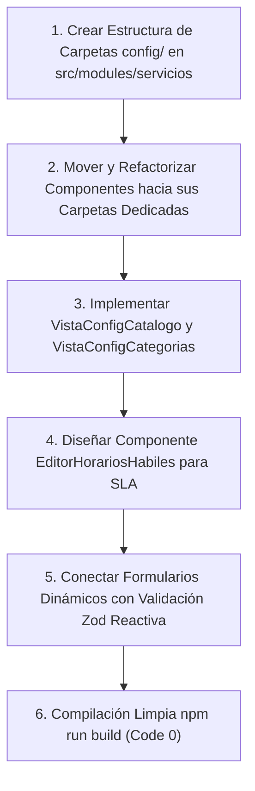

# Plan de Asignación y Especificación Técnica — Lourdes (Catálogo de Servicios y SLA)

> **Documento de especificación técnica y de desarrollo para el asistente IA.**
> **Responsable:** Lourdes
> **Módulo Asignado (100% Independiente y Aislado):**
> - [src/modules/servicios](file:///c:/Users/apaza/Desktop/SISTEMA%20DE%20TICKETS/src/modules/servicios) (Catálogo de Servicios de Negocio y Técnicos, Acuerdos de Nivel de Servicio SLA / OLA / UC ITIL 4, Diseñador de Formularios de Servicio)
> 
> **Frontera de Trabajo Estricta:**
> - Lourdes **NO** modifica consolas de perfiles (`src/modules/perfiles/*`), ni interviene en pantallas de otros compañeros.
> - Todo su desarrollo frontend, backend, controladores, componentes y vistas se encuentra estrictamente confinado dentro de `src/modules/servicios`.
> - Las vistas que Lourdes desarrolle serán consumidas o enlazadas en los perfiles correspondientes por el Tech Lead (Miguel).

---

## 1. Visión Arquitectónica y Principios de Diseño

### 1.1 Principio de Correspondencia Menú-Directorio (Modularidad Estricta)
Cada opción visible en el menú lateral relacionada con el catálogo de servicios debe nacer directamente de un archivo o subcarpeta modular especializada dentro de `src/modules/servicios`, erradicando páginas masivas o componentes sobrecargados.
- El catálogo de servicios se estructura formalmente en dos vistas complementarias según ITIL 4:
  1. **Catálogo de Servicios al Cliente / Negocio:** Orientado a los usuarios finales y solicitantes. Describe el servicio en términos de valor, entregables, costos o requisitos de aprobación, ocultando complejidades técnicas.
  2. **Catálogo de Servicios Técnicos:** Orientado a los grupos resolutores y especialistas de TI. Vincula los componentes de infraestructura (CIs), los grupos de soporte responsables y los acuerdos operativos (OLA).
- La configuración administrativa debe estar claramente separada en subcarpetas funcionales dentro de `src/modules/servicios/config/` (`config/catalogo/`, `config/categorias/`, `config/sla/`, `config/formularios/`).

### 1.2 Mecanismo de Sincronización Multi-Perfil en Tiempo Real
El módulo de Catálogo de Servicios es el punto de partida transaccional de toda la plataforma:
1. **Publicación y Edición de Servicios en el Catálogo:**
   - Cuando el Administrador o Gestor de Servicios crea o modifica un ítem de servicio (por ejemplo, "Solicitud de Nuevo Equipo Portátil"), actualiza sus campos dinámicos o ajusta sus objetivos SLA:
     - El servicio se persiste en base de datos (`servicios`, `servicios_campos_config`) emitiendo una notificación de invalidación de caché (React Query).
     - La vista del **Catálogo del Solicitante** (`/solicitante/catalogo`) recibe la actualización en tiempo real, renderizando de inmediato la nueva tarjeta de servicio con su formulario dinámico validado por Zod, sin que el usuario requiera refrescar la pantalla (`F5`).
     - En la **Mesa de Despacho del Técnico** (`/tecnico/mesa/area`), cualquier ticket que ingrese para este servicio calcula sus temporizadores de respuesta y resolución en base a la matriz SLA actualizada.
     - En la **Consola del Gestor de Área**, si el servicio tiene configurado un costo monetario o requiere validación jerárquica de compra, la regla de aprobación se enlaza automáticamente a su bandeja de decisiones.

---

## 2. Inventario Exhaustivo Actual y Estado de Situación

### 2.1 Archivos y Carpetas Existentes en `src/modules/servicios`

| Ruta del Archivo / Carpeta | Tipo de Elemento | Estado Actual | Evaluación Técnica frente a ITIL 4 / ISO 20000 |
| :--- | :--- | :--- | :--- |
| `src/modules/servicios/admin/servicios/page.tsx` | Vista Master | Bien avanzado | Listado maestro de servicios configurados en la plataforma. Permite filtrar por estado (Borrador, Activo, Retirado) y categoría. Cumple con el ciclo de vida de servicios ITIL 4. |
| `src/modules/servicios/admin/servicios/ConfiguracionObjetivosSla.tsx` | Componente | Bien avanzado | Formulario para asociar tiempos límite de primera respuesta y tiempo total de resolución según prioridad (P1 Crítica, P2 Alta, P3 Media, P4 Baja). |
| `src/modules/servicios/admin/servicios/GestionCategorias.tsx` | Componente | Bien avanzado | Administrador visual de la jerarquía de categorías y subcategorías (ej. Hardware -> Periféricos -> Monitores). |
| `src/modules/servicios/admin/servicios/sla/page.tsx` | Vista | Bien avanzado | Pantalla de mantenimiento de acuerdos SLA globales y políticas de cobertura horaria (24x7 vs 8x5 hábiles). |
| `src/modules/servicios/admin/servicios/sla/components/MatrizPrioridadSla.tsx` | Componente | 100% avanzado | Matriz estándar ITIL 4 que cruza Impacto (Alto, Medio, Bajo) con Urgencia (Alta, Media, Baja) para determinar automáticamente la Prioridad y los SLAs de servicio. |
| `src/modules/servicios/admin/servicios/[id]/formulario/page.tsx` | Vista Dinámica | Bien avanzado | Pantalla del diseñador de campos de formulario personalizados por cada servicio individual. |
| `src/modules/servicios/admin/servicios/[id]/formulario/ui.tsx` | Componente UI | Bien avanzado | Biblioteca de controles de interfaz (inputs, selects, datepickers, checkboxes) para el diseñador dinámico. |
| `src/modules/servicios/catalogo/VistaCatalogoServicios.tsx` | Vista Pública | Bien avanzado | Vista de vitrina orientada al cliente. Organiza los servicios por tarjetas visuales con buscador predictivo por palabras clave. |
| `src/modules/servicios/catalogo-tecnico/VistaTecnicoCatalogo.tsx` | Vista Técnica | Bien avanzado | Catálogo de servicios técnicos donde se visibilizan CIs subyacentes, acuerdos OLA y grupos resolutores N1/N2/N3 asignados. |
| `src/modules/servicios/categorias/categoriasService.ts` | Servicio | Bien avanzado | Métodos de negocio para consultar, crear, reordenar y desactivar ramas del árbol de categorías. |
| `src/modules/servicios/categorias/categoriasTypes.ts` | Tipos TypeScript | 100% avanzado | Definición estricta de interfaces para categorías, jerarquías padre-hijo e iconos. |
| `src/modules/servicios/categorias/categoriasValidaciones.ts` | Validaciones | 100% avanzado | Esquemas Zod para asegurar unicidad de nombres de categoría y evitar referencias circulares en el árbol. |
| `src/modules/servicios/api/admin/categoriaController.ts` | API Controller | Bien avanzado | Endpoint HTTP para operaciones CRUD sobre la taxonomía de categorías. |
| `src/modules/servicios/api/admin/categoriaDetalleController.ts` | API Controller | Bien avanzado | Endpoint para obtener una categoría específica con el conteo de servicios asociados. |
| `src/modules/servicios/api/admin/matrizController.ts` | API Controller | 100% avanzado | Endpoint para consultar y actualizar la matriz bidimensional de prioridad SLA. |
| `src/modules/servicios/api/admin/slaController.ts` | API Controller | Bien avanzado | Lógica de persistencia de acuerdos de nivel de servicio y tiempos de penalización. |
| `src/modules/servicios/api/servicioDetalleController.ts` | API Controller | Bien avanzado | Retorna la ficha técnica y de negocio completa del servicio, incluyendo sus campos custom. |
| `src/modules/servicios/api/servicioDetalleWorkflowController.ts` | API Controller | Avanzado pero falta revisar | Orquestador del flujo de cumplimiento (Fulfillment) del servicio. Requiere validar transiciones automáticas según el tipo de servicio. |
| `src/modules/servicios/api/serviciosController.ts` | API Controller | Bien avanzado | Endpoint maestro para listado paginado y búsqueda facetada de servicios. |
| `src/modules/servicios/services/categoriaDetalleService.ts` | Servicio | Bien avanzado | Capa de servicio de detalle de categorías. |
| `src/modules/servicios/services/categoriaService.ts` | Servicio | Bien avanzado | Capa de servicio para operaciones de categorías. |
| `src/modules/servicios/services/matrizSlaService.ts` | Servicio | 100% avanzado | Servicio de cálculo de prioridad por impacto y urgencia. |
| `src/modules/servicios/services/servicioService.ts` | Servicio | Bien avanzado | Servicio de dominio para el ciclo de vida del servicio. |
| `src/modules/servicios/services/slaService.ts` | Servicio | Bien avanzado | Servicio de temporización y reglas de escalamiento SLA. |
| `src/modules/servicios/config/` | Carpeta | Cascarón / Vacío | Carpeta creada pero sin modularización interna. Debe estructurarse formalmente. |
| `src/modules/servicios/components/` | Carpeta | Cascarón / Vacío | Actualmente vacía; debe albergar los componentes reutilizables del catálogo y SLA. |
| `src/modules/servicios/hooks/` | Carpeta | Cascarón / Vacío | Faltan hooks específicos para la carga y reactividad del catálogo. |

---

## 3. Lo que Falta por Desarrollar y Mapeo al Menú de Opciones

### 3.1 Modularización de la Carpeta `config/` en Servicios
Para cumplir con el principio de que cada opción de menú nace de una carpeta física dedicada dentro del módulo:
1. `src/modules/servicios/config/catalogo/`:
   - `VistaConfigCatalogo.tsx`: Pantalla de gobierno general del catálogo (publicación, retiro de servicios obsoletos, visibilidad por departamento o rol). Mapeada a la opción de menú `/plataforma/servicios/config/catalogo`.
   - `components/TablaServiciosActivos.tsx`: Grilla con interruptores rápidos de activación/pausa de servicios.
2. `src/modules/servicios/config/categorias/`:
   - `VistaConfigCategorias.tsx`: Pantalla dedicada a la administración visual del árbol taxonómico de servicios. Mapeada a `/plataforma/servicios/config/categorias`.
   - `components/ArbolCategoriasVisual.tsx`: Árbol jerárquico expandible con drag and drop para mover subcategorías.
3. `src/modules/servicios/config/sla/`:
   - `VistaConfigSla.tsx`: Pantalla para la parametrización de Acuerdos Operativos Internos (OLA) entre áreas de TI y contratos de soporte externo (Underpinning Contracts - UC). Mapeada a `/plataforma/servicios/config/sla`.
   - `components/EditorHorariosHabiles.tsx`: Selector de jornadas laborales (ej. Lunes a Viernes de 08:00 a 18:00) y excepciones de calendario.
4. `src/modules/servicios/config/formularios/`:
   - `VistaConfigFormulariosServicio.tsx`: Gestor centralizado de esquemas de formularios dinámicos asociados a ítems del catálogo. Mapeada a `/plataforma/servicios/config/formularios`.

### 3.2 Opciones de Menú Faltantes en `MENUS_Y_PERFILES.md` y UI
Para que las pantallas desarrolladas por Lourdes sean plenamente navegables y autorizadas por el sistema, se deben registrar/confirmar las siguientes opciones canónicas en `opciones_menu`:
- `/plataforma/servicios/config/catalogo` (Gobierno y Publicación del Catálogo)
- `/plataforma/servicios/config/categorias` (Estructura de Categorías del Catálogo)
- `/plataforma/servicios/config/sla` (Parametrización de SLAs, OLAs y Horarios Hábiles)
- `/plataforma/servicios/config/formularios` (Diseñador Dinámico de Formularios por Servicio)

### 3.3 Capacidades Funcionales a Completar en el Backend y UI
1. **Esquema Dinámico Zod para Formularios por Servicio:**
   - Asegurar que cuando se diseñen campos personalizados para un servicio (tipo de campo, obligatoriedad, valor por defecto, expresiones regulares), se genere automáticamente un esquema Zod que valide los datos antes del envío.
2. **Cálculo de Tiempos Hábil vs Natural en SLA:**
   - Conectar `slaService.ts` con el calendario oficial de feriados para que las metas de tiempo de resolución descuenten fines de semana y días no laborables de forma estricta.

---

## 4. Guía de Ejecución para el Asistente IA de Lourdes

### Instrucciones Específicas:
1. Concéntrese exclusivamente en `src/modules/servicios`. No edite archivos en `src/modules/perfiles/` ni en ningún otro módulo.
2. Cree las subcarpetas requeridas dentro de `src/modules/servicios/config/` (`catalogo/`, `categorias/`, `sla/`, `formularios/`) con sus respectivas vistas y componentes.
3. Asegúrese de que cada componente exporte por defecto o con nombre de forma limpia y mantenga tipado TypeScript estricto.
4. Al terminar cada archivo, verifique que no contenga emojis y compile ejecutando `npm run build` para comprobar cero errores.
