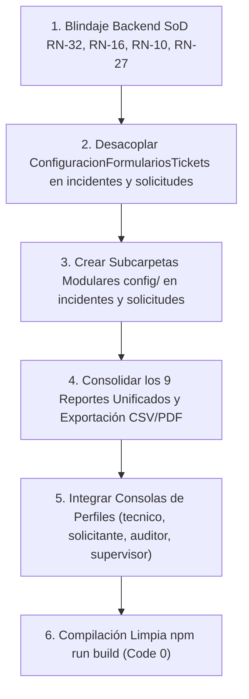

# Plan de Asignación y Especificación Técnica — Miguel (Tech Lead & Scrum Master)

> **Documento de especificación técnica y de desarrollo para el asistente IA.**
> **Responsable:** Miguel (Tech Lead & Scrum Master)
> **Módulos Asignados (Core, Transversales y Consolas de Perfil):**
> 1. [src/modules/tickets](file:///c:/Users/apaza/Desktop/SISTEMA%20DE%20TICKETS/src/modules/tickets) (Motor Core Transaccional de Tickets y Despacho)
> 2. [src/modules/incidentes](file:///c:/Users/apaza/Desktop/SISTEMA%20DE%20TICKETS/src/modules/incidentes) (Gestión de Incidentes e Incidentes Mayores ITIL 4)
> 3. [src/modules/solicitudes](file:///c:/Users/apaza/Desktop/SISTEMA%20DE%20TICKETS/src/modules/solicitudes) (Gestión de Solicitudes de Servicio y Flujo de Aprobación SoD)
> 4. [src/modules/reportes](file:///c:/Users/apaza/Desktop/SISTEMA%20DE%20TICKETS/src/modules/reportes) (Analítica ITSM, Tableros de Control de Gestión y los 9 Reportes Unificados)
> 5. [src/modules/seguridad](file:///c:/Users/apaza/Desktop/SISTEMA%20DE%20TICKETS/src/modules/seguridad) (Políticas de Seguridad y Auditoría de Acceso ISO 27001)
> 6. [src/modules/plataforma](file:///c:/Users/apaza/Desktop/SISTEMA%20DE%20TICKETS/src/modules/plataforma) (Gobierno de la Plataforma, Salud, Mantenimiento y Menú Admin)
> 7. [src/modules/operacion](file:///c:/Users/apaza/Desktop/SISTEMA%20DE%20TICKETS/src/modules/operacion) (Gestión de Eventos, Monitoreo y Resiliencia Operativa ITIL 4)
> 8. **Todas las Consolas de Perfiles:** [src/modules/perfiles](file:///c:/Users/apaza/Desktop/SISTEMA%20DE%20TICKETS/src/modules/perfiles) (`tecnico`, `solicitante`, `gestor-area`, `auditor`, `supervisor`, `aprobador`, `administrador`).
> 9. **Infraestructura Transversal:** [src/shared/lib](file:///c:/Users/apaza/Desktop/SISTEMA%20DE%20TICKETS/src/shared/lib), Migraciones SQL, Sincronización en Tiempo Real, WebSockets/SSE y Middleware SoD de Backend.

---

## 1. Visión Arquitectónica y Principios de Diseño

### 1.1 Principio de Correspondencia Menú-Directorio (Modularidad Estricta)
Como Tech Lead, Miguel tiene la responsabilidad de orquestar la integración global y desacoplar los componentes compartidos:
- En la arquitectura anterior, la configuración de formularios de tickets residía en un único archivo monolítico de más de 1200 líneas (`ConfiguracionFormulariosTickets.tsx`).
- En la arquitectura objetivo, la configuración de incidentes y solicitudes debe residir en sus propias carpetas dedicadas:
  - `src/modules/incidentes/config/`: `config/formulario/`, `config/flujo/`, `config/incidentes-mayores/`.
  - `src/modules/solicitudes/config/`: `config/formulario/`, `config/flujo-aprobaciones/`.
- Las consolas de perfil en `src/modules/perfiles/*` son puntos de integración visual que consumen los módulos específicos desarrollados por los demás compañeros, garantizando que ninguno de ellos deba modificar código fuera de sus dominios independientes.

### 1.2 Mecanismo de Sincronización Multi-Perfil en Tiempo Real
El núcleo de la plataforma debe garantizar que cualquier cambio administrativo se propague de inmediato sin requerir recargar el navegador (`F5`):
1. **Configuración de Formularios y Flujos:** Cuando el Administrador modifica un formulario dinámico o agrega un nuevo campo obligatorio en incidentes o solicitudes:
   - Se emite un evento de invalidación en el bus de tiempo real.
   - La pantalla del **Solicitante** (`/solicitante/crear`) renderiza dinámicamente el nuevo campo con sus reglas de validación en cliente.
   - La pantalla del **Técnico** (`/tecnico/mesa/asignados`) actualiza de inmediato el detalle del ticket con el nuevo campo visible.
2. **Segregación de Funciones (SoD) en Backend:**
   - La regla **RN-32** (el solicitante no puede ser su propio aprobador) se valida de forma bloqueante en el endpoint `/api/aprobaciones`.
   - La regla **RN-16** (máximo 5 tickets activos simultáneos por técnico) se valida en `/api/mesa/tomar` y en la reasignación de supervisores.
   - La regla **RN-10** (cálculo de SLA en horario hábil) descuenta fines de semana y feriados oficiales en `src/shared/lib/slaCalculator.ts`.
   - La regla **RN-27** (validación de magic bytes) inspecciona el encabezado binario de archivos subidos al servidor.

---

## 2. Inventario Exhaustivo Actual y Estado de Situación

### 2.1 Módulo: Tickets (Core Engine) — `src/modules/tickets`

| Ruta del Archivo / Carpeta | Tipo de Elemento | Estado Actual | Evaluación Técnica frente a ITIL 4 / ISO 20000 |
| :--- | :--- | :--- | :--- |
| `src/modules/tickets/api/admin/adminFormulariosTicketsController.ts` | API Controller | Bien avanzado | Gestión de esquemas de formularios. Requiere desacoplar lógica propia de incidentes o solicitudes. |
| `src/modules/tickets/api/admin/adminTicketsController.ts` | API Controller | Bien avanzado | Operaciones de administración masiva de tickets con auditoría completa de cambios de estado. |
| `src/modules/tickets/api/catalogosController.ts` | API Controller | Bien avanzado | Provee catálogos de prioridades, impactos y urgencias según matriz ITIL. |
| `src/modules/tickets/api/mesaTomaController.ts` | API Controller | Avanzado pero falta revisar | Implementa la autoasignación ("tomar ticket"). Requiere aplicar validación estricta de carga máxima (RN-16: máx 5 tickets activos). |
| `src/modules/tickets/api/tecnicoCargaController.ts` | API Controller | Bien avanzado | Calcula la saturación operativa de los especialistas de soporte. |
| `src/modules/tickets/api/ticketComentariosController.ts` | API Controller | 100% avanzado | Separa comentarios públicos (visibles por solicitante) de notas internas técnicas. |
| `src/modules/tickets/api/ticketDetalleController.ts` | API Controller | Bien avanzado | Carga el agregado completo del ticket con historial y SLA. |
| `src/modules/tickets/api/ticketsController.ts` | API Controller | Bien avanzado | CRUD transaccional base. Requiere asegurar magic bytes en subida de adjuntos (RN-27). |
| `src/modules/tickets/components/ConfiguracionFormulariosTickets.tsx` | Componente | Monolítico / Requiere refactorización | Archivo monolítico de 1200+ líneas que mezcla configuración de incidentes y solicitudes. Debe fragmentarse en submódulos especializados. |
| `src/modules/tickets/components/DisenadorFormulariosModal.tsx` | Componente | Bien avanzado | Modal visual para previsualizar campos dinámicos. |
| `src/modules/tickets/components/ModalReasignarTicket.tsx` | Componente | Bien avanzado | Reasignación entre técnicos con validación de carga laboral. |
| `src/modules/tickets/components/ModalTomarTicket.tsx` | Componente | Bien avanzado | Modal para tomar ticket de la cola de despacho. |
| `src/modules/tickets/components/ModuloTicketsWorkspace.tsx` | Componente | Bien avanzado | Bandeja general de tickets con filtros facetados. |
| `src/modules/tickets/components/VistaFormularioTicketDinamico.tsx` | Componente | Bien avanzado | Renderizador dinámico de campos basados en JSON Schema. |
| `src/modules/tickets/config/ConfiguracionTickets.tsx` | Vista Config | Avanzado pero falta revisar | Pantalla contenedora de configuración genérica. |
| `src/modules/tickets/gestion/asignaciones/VistaTicketsGestionAsignaciones.tsx` | Vista Operativa | Bien avanzado | Vista de asignación de mesa para supervisores. |
| `src/modules/tickets/gestion/ayuda/VistaTicketsGestionAyuda.tsx` | Vista Auxiliar | Bien avanzado | Centro de ayuda contextual. |
| `src/modules/tickets/gestion/crear/VistaTicketsGestionCrear.tsx` | Vista Creación | Bien avanzado | Formulario maestro de creación unificada de tickets. |
| `src/modules/tickets/gestion/mios/VistaTicketsGestionMios.tsx` | Vista Personal | Bien avanzado | Bandeja de tickets personales del usuario autenticado. |
| `src/modules/tickets/gestion/tecnicos/VistaTicketsGestionTecnicos.tsx` | Vista Supervisión | Bien avanzado | Monitoreo de colas por técnico. |
| `src/modules/tickets/presentadores/*` (11 presentadores) | Presentadores UI | Bien avanzado | Implementa vistas segregadas por perfil (Admin, Aprobador, Auditor, Consumidor, Operador, Supervisor, etc.). |
| `src/modules/tickets/services/*` (6 servicios) | Servicios de Dominio | Bien avanzado | Capa de negocio conectada a PostgreSQL. |
| `src/modules/tickets/ticket-detail/presentadores/*` | Detalle por Rol | 100% avanzado | Vistas de detalle adaptadas a Administrador, Consumidor, Operador, Supervisor y Gobernanza. |
| `src/modules/tickets/ticket-detail/secciones/*` (9 secciones) | Secciones UI | 100% avanzado | Cockpit SLA, Tarjeta SoD, Chat Público, Notas Internas, Panel CI, Controles Despacho. |
| `src/modules/tickets/[id]/VistaTicketsDetalle.tsx` | Vista Master | 100% avanzado | Enrutador principal de detalle de ticket según perfil. |

---

### 2.2 Módulo: Gestión de Incidentes — `src/modules/incidentes`

| Ruta del Archivo / Carpeta | Tipo de Elemento | Estado Actual | Evaluación Técnica frente a ITIL 4 |
| :--- | :--- | :--- | :--- |
| `src/modules/incidentes/api/incidenteComentariosController.ts` | API Controller | Bien avanzado | Endpoint para comunicación técnica e interacción en incidentes. |
| `src/modules/incidentes/api/incidenteDetalleController.ts` | API Controller | Bien avanzado | Recupera datos del incidente, vínculos a problemas y CIs afectados. |
| `src/modules/incidentes/api/incidentesController.ts` | API Controller | Bien avanzado | Maneja creación y ciclo de vida de incidentes N1/N2/N3. |
| `src/modules/incidentes/api/incidentesMayoresController.ts` | API Controller | Bien avanzado | Procedimiento de Incidentes Mayores (PIM) y activación de Sala de Crisis. |
| `src/modules/incidentes/services/incidentesMayoresService.ts` | Servicio | Bien avanzado | Lógica de declaración de incidente mayor y orquestación de comunicación ejecutiva. |
| `src/modules/incidentes/services/salaDeCrisisService.ts` | Servicio | Avanzado pero falta revisar | Gestión de la sala de crisis virtual (Swarming ITIL 4). |
| `src/modules/incidentes/services/incidentesService.ts` | Servicio | Bien avanzado | Transición de estados de incidentes. |
| `src/modules/incidentes/views/VistaIncidentes.tsx` | Vista Master | Bien avanzado | Grid interactivo con matriz de severidad e impacto. |
| `src/modules/incidentes/views/VistaIncidentesMayores.tsx` | Vista Crisis | Bien avanzado | Dashboard de crisis y seguimiento de fallas críticas P1. |
| `src/modules/incidentes/config/` | Carpeta | Cascarón / Vacío | Debe albergar la modularización en `config/formulario/`, `config/flujo/`, `config/incidentes-mayores/`. |

---

### 2.3 Módulo: Gestión de Solicitudes — `src/modules/solicitudes`

| Ruta del Archivo / Carpeta | Tipo de Elemento | Estado Actual | Evaluación Técnica frente a ITIL 4 |
| :--- | :--- | :--- | :--- |
| `src/modules/solicitudes/api/aprobacionesController.ts` | API Controller | Avanzado pero falta revisar | Flujo de aprobación multinivel. Requiere blindaje SoD bloqueante en backend (RN-32). |
| `src/modules/solicitudes/api/solicitudComentariosController.ts` | API Controller | Bien avanzado | Hilo conversacional con el solicitante. |
| `src/modules/solicitudes/api/solicitudDetalleController.ts` | API Controller | Bien avanzado | Recupera detalles de la solicitud y sus tareas de cumplimiento (Fulfillment). |
| `src/modules/solicitudes/api/solicitudesController.ts` | API Controller | Bien avanzado | CRUD de solicitudes y despacho automático según catálogo. |
| `src/modules/solicitudes/services/solicitudesService.ts` | Servicio | Bien avanzado | Motor de reglas de cumplimiento y asignación a grupos técnicos de fulfillment. |
| `src/modules/solicitudes/views/VistaSolicitudes.tsx` | Vista Master | Bien avanzado | Bandeja de solicitudes de servicio con estado de aprobaciones y entregables. |
| `src/modules/solicitudes/config/` | Carpeta | Cascarón / Vacío | Debe estructurarse en `config/formulario/` y `config/flujo-aprobaciones/`. |

---

### 2.4 Módulo: Reportes & Business Intelligence — `src/modules/reportes`

| Ruta del Archivo / Carpeta | Tipo de Elemento | Estado Actual | Evaluación Técnica frente a ITIL 4 / ISO 20000 |
| :--- | :--- | :--- | :--- |
| `src/modules/reportes/api/indicadoresController.ts` | API Controller | Bien avanzado | Cálculo de KPIs clave (FCR, MTTR, SLA Compliance Rate). |
| `src/modules/reportes/services/indicadoresService.ts` | Servicio | Bien avanzado | Agregaciones estadísticas y series temporales para gráficos. |
| `src/modules/reportes/views/VistaDashboard.tsx` | Dashboard BI | 100% avanzado | Tablero directivo con gráficos de barras, líneas y semáforos de cumplimiento. |
| `src/modules/reportes/views/VistaInformesAuditoria.tsx` | Reporte Auditor | 100% avanzado | Registro de trazabilidad para auditorías ISO 27001 e ISO 20000. |
| `src/modules/reportes/views/VistaProductividad.tsx` | Reporte Técnico | Bien avanzado | Desempeño por técnico y grupo resolutor (tickets atendidos, tiempos promedio). |
| `src/modules/reportes/views/VistaReportesActivos.tsx` | Reporte Activos | Bien avanzado | Inventario por ciclo de vida, licencias por vencer y depreciación de hardware. |
| `src/modules/reportes/views/VistaReportesAprobador.tsx` | Reporte Aprobador | Bien avanzado | Tiempos de respuesta en aprobaciones y tasa de rechazo justificado. |
| `src/modules/reportes/views/VistaReportesArea.tsx` | Reporte Jefatura | Bien avanzado | Consumo de recursos de soporte y solicitudes por unidad organizacional. |
| `src/modules/reportes/views/VistaReportesCambios.tsx` | Reporte RFC | 100% avanzado | Indicadores de Change Failure Rate (CFR), cambios de emergencia y volumen mensual. |
| `src/modules/reportes/views/VistaReportesDisenador.tsx` | Report Builder | Avanzado pero falta revisar | Constructor dinámico de consultas con selección de dimensiones y métricas. |
| `src/modules/reportes/views/VistaReportesOperativos.tsx` | Reporte Operativo | 100% avanzado | Tablas operativas diarias con filtros por estado, prioridad y fechas. |
| `src/modules/reportes/views/VistaReportesProblemas.tsx` | Reporte Problemas | 100% avanzado | Efectividad del RCA, KEDBs implementadas y reducción de incidentes recurrentes. |

---

### 2.5 Módulo: Seguridad — `src/modules/seguridad`

| Ruta del Archivo / Carpeta | Tipo de Elemento | Estado Actual | Evaluación Técnica frente a ISO 27001 |
| :--- | :--- | :--- | :--- |
| `src/modules/seguridad/api/auditoriaAccesoController.ts` | API Controller | 100% avanzado | Registro de intentos de autenticación, logins fallidos y sesiones anómalas. |
| `src/modules/seguridad/api/politicasSeguridadController.ts` | API Controller | Bien avanzado | Configuración de contraseñas, caducidad, bloqueo automático y sesiones concurrentes. |
| `src/modules/seguridad/components/AuditoriaAccesoWorkspace.tsx` | Componente | Bien avanzado | Visualizador de pistas de acceso perimetral. |
| `src/modules/seguridad/components/PoliticasSeguridadWorkspace.tsx` | Componente | Bien avanzado | Panel de configuración de políticas de seguridad corporativa. |
| `src/modules/seguridad/services/auditoriaAccesoService.ts` | Servicio | 100% avanzado | Persistencia de eventos de seguridad con hash SHA-256 inmutable. |
| `src/modules/seguridad/services/politicasSeguridadService.ts` | Servicio | Bien avanzado | Aplicación de reglas de complejidad de claves y timeout de sesión. |
| `src/modules/seguridad/views/VistaAuditoriaAcceso.tsx` | Vista Master | 100% avanzado | Vista de auditoría de accesos. |
| `src/modules/seguridad/views/VistaPoliticasSeguridad.tsx` | Vista Master | Bien avanzado | Gestión de directivas de seguridad corporativa. |

---

### 2.6 Módulo: Plataforma & Gobernanza — `src/modules/plataforma`

| Ruta del Archivo / Carpeta | Tipo de Elemento | Estado Actual | Evaluación Técnica frente a COBIT / ITIL 4 |
| :--- | :--- | :--- | :--- |
| `src/modules/plataforma/config/hub/VistaAdminRoot.tsx` | Vista | 100% avanzado | Hub principal de administración del sistema. |
| `src/modules/plataforma/config/auditoria-sistema/VistaAuditoriaSistema.tsx` | Vista | 100% avanzado | Log general de cambios en parámetros de configuración. |
| `src/modules/plataforma/config/mantenimiento-datos/VistaMantenimientoDatos.tsx` | Vista | Bien avanzado | Políticas de archivado, retención y depuración de registros históricos. |
| `src/modules/plataforma/config/menu/VistaMenu.tsx` | Vista | 100% avanzado | Gestión del catálogo unificado `opciones_menu` y visibilidad `opciones_menu_perfiles`. |
| `src/modules/plataforma/config/notificaciones/VistaNotificaciones.tsx` | Vista | Bien avanzado | Plantillas y canales de notificación (Email, Webhook, Push). |
| `src/modules/plataforma/config/salud/VistaSaludSistema.tsx` | Vista | 100% avanzado | Cockpit de salud de servicios, base de datos y latencia. |
| `src/modules/plataforma/config/seguridad-logs/VistaSeguridadLogs.tsx` | Vista | 100% avanzado | Logs de eventos de seguridad y anomalías de plataforma. |
| `src/modules/plataforma/services/*` (9 servicios) | Servicios | 100% avanzado | Soporte integral de administración del sistema y observabilidad. |

---

### 2.7 Módulo: Operación TI — `src/modules/operacion`

| Ruta del Archivo / Carpeta | Tipo de Elemento | Estado Actual | Evaluación Técnica frente a ITIL 4 |
| :--- | :--- | :--- | :--- |
| `src/modules/operacion/api/eventoController.ts` | API Controller | Bien avanzado | Ingesta de alertas y eventos desde herramientas de monitoreo. |
| `src/modules/operacion/api/eventoDetalleController.ts` | API Controller | Bien avanzado | Detalle de correlación de eventos y reglas de deduplicación. |
| `src/modules/operacion/api/resilienciaController.ts` | API Controller | Avanzado pero falta revisar | Simulaciones de failover y planes de continuidad de TI. |
| `src/modules/operacion/components/EventosWorkspace.tsx` | Componente | Bien avanzado | Consola de monitoreo de alarmas y correlación de alertas a incidentes. |
| `src/modules/operacion/components/ResilienciaWorkspace.tsx` | Componente | Bien avanzado | Gestión de simulacros de recuperación ante desastres (DRP). |
| `src/modules/operacion/services/eventoService.ts` | Servicio | Bien avanzado | Filtrado y normalización de eventos según estándar ITIL. |
| `src/modules/operacion/services/resilienciaService.ts` | Servicio | Bien avanzado | Control de RTO y RPO operativos. |
| `src/modules/operacion/views/VistaEventosOperacion.tsx` | Vista Master | Bien avanzado | Vista principal de gestión de eventos. |
| `src/modules/operacion/views/VistaResilienciaOperacion.tsx` | Vista Master | Bien avanzado | Panel de control de resiliencia operativa. |

---

### 2.8 Consolas de Perfiles Centralizadas — `src/modules/perfiles/*`
Todas las consolas de perfiles son gestionadas e integradas por Miguel:
1. `src/modules/perfiles/tecnico`: Consola resolutora N1/N2/N3 (bandeja de asignados con límite de 5 tickets activos RN-16, colas de grupo, historial, semáforo SLA).
2. `src/modules/perfiles/solicitante`: Portal de autoservicio (mis tickets con timeline amigable, encuestas CSAT, mis activos en custodia).
3. `src/modules/perfiles/gestor-area`: Consola de jefatura de negocio (aprobaciones departamentales, activos del área, cambios con impacto, delegación).
4. `src/modules/perfiles/auditor`: Consola de aseguramiento y cumplimiento de **Lectura Estricta (Read-Only)** (muestreo estadístico, cambios irregulares, matriz de violaciones SoD en tiempo real, recertificación).
5. `src/modules/perfiles/supervisor`: Consola de supervisión de mesa (balanceo de colas, monitoreo de SLA en riesgo, calidad CSAT).
6. `src/modules/perfiles/aprobador`: Bandeja centralizada de dictamen de solicitudes y votación CAB/ECAB.
7. `src/modules/perfiles/administrador`: Hub directivo de parametrización del sistema.

---

## 3. Lo que Falta por Desarrollar y Mapeo al Menú de Opciones

### 3.1 Modularización en `incidentes/config/`
1. `src/modules/incidentes/config/formulario/`:
   - `VistaConfigFormularioIncidentes.tsx`: Mapeada a `/plataforma/incidentes/config/formulario`.
   - `components/EditorCamposIncidentes.tsx`: Selector y creador de campos específicos.
   - `components/VistaPreviaFormularioIncidentes.tsx`: Render en tiempo real del formulario.
2. `src/modules/incidentes/config/flujo/`:
   - `VistaConfigFlujoIncidentes.tsx`: Matriz de transiciones y reglas de cierre automático. Mapeada a `/plataforma/incidentes/config/flujo`.
3. `src/modules/incidentes/config/incidentes-mayores/`:
   - `VistaConfigIncidentesMayores.tsx`: Criterios automáticos de escalamiento a PIM y salas de crisis. Mapeada a `/plataforma/incidentes/config/incidentes-mayores`.

### 3.2 Modularización en `solicitudes/config/`
1. `src/modules/solicitudes/config/formulario/`:
   - `VistaConfigFormularioSolicitudes.tsx`: Diseñador de formularios para ítems del catálogo. Mapeada a `/plataforma/solicitudes/config/formulario`.
2. `src/modules/solicitudes/config/flujo-aprobaciones/`:
   - `VistaConfigFlujoAprobaciones.tsx`: Diseñador visual de niveles de aprobación (Jefatura -> Finanzas -> TI) con validaciones SoD. Mapeada a `/plataforma/solicitudes/config/flujo-aprobaciones`.

### 3.3 Blindajes Críticos de Backend Transversal
1. **Blindaje SoD en `/api/aprobaciones` (RN-32):**
   - Asegurar que si `usuario_id === solicitante_id`, la solicitud sea rechazada de inmediato con HTTP 403 Forbidden y se registre un intento no autorizado en la tabla de auditoría.
2. **Cálculo de SLA en Horario Hábil (RN-10):**
   - Refinar el motor de SLA en `src/shared/lib/slaCalculator.ts` para descontar fines de semana y feriados oficiales.
3. **Validación de Carga Técnica (RN-16):**
   - Bloquear a nivel de backend que un técnico tome o se le asigne un sexto ticket activo simultáneo.
4. **Verificación de Adjuntos por Magic Bytes (RN-27):**
   - Inspeccionar el buffer binario inicial de cada archivo subido al servidor (PDF: `%PDF-`, PNG: `\x89PNG`, JPG: `\xFF\xD8\xFF`) rechazando ejecutables disfrazados.

---

## 4. Guía de Ejecución para el Asistente IA de Miguel

### Instrucciones Específicas:
1. Comience implementando los blindajes de backend en `src/modules/solicitudes/api/aprobacionesController.ts`, `src/modules/tickets/api/mesaTomaController.ts`, y `src/shared/lib/slaCalculator.ts`.
2. Segregue el archivo monolítico `ConfiguracionFormulariosTickets.tsx` creando los submódulos dentro de `incidentes/config/` y `solicitudes/config/`.
3. Verifique que todas las rutas canónicas del menú funcionen con autorización `exigirMenuPagina`.
4. Ejecute periódicamente `npm run build` para garantizar cero errores de TypeScript y estricto cumplimiento de Cero Emojis.
