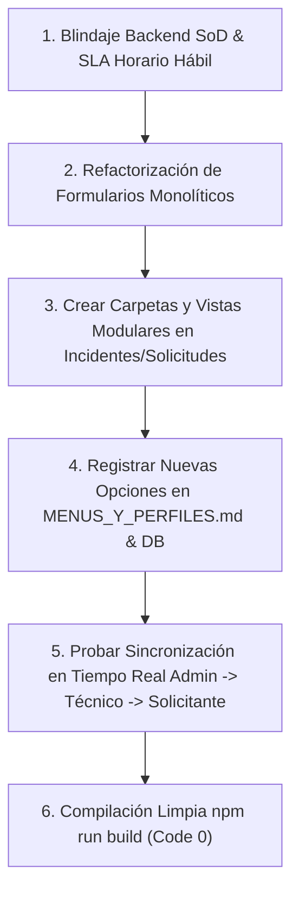

# Plan de Asignación y Especificación Técnica — Miguel (Tech Lead & Scrum Master)

> **Documento de especificación técnica y de desarrollo para el asistente IA.**
> **Responsable:** Miguel (Tech Lead & Scrum Master)
> **Módulos Asignados (Independientes y Transversales):**
> 1. [src/modules/tickets](file:///c:/Users/apaza/Desktop/SISTEMA%20DE%20TICKETS/src/modules/tickets) (Motor Core Transaccional de Tickets y Despacho)
> 2. [src/modules/incidentes](file:///c:/Users/apaza/Desktop/SISTEMA%20DE%20TICKETS/src/modules/incidentes) (Gestión de Incidentes e Incidentes Mayores ITIL 4)
> 3. [src/modules/solicitudes](file:///c:/Users/apaza/Desktop/SISTEMA%20DE%20TICKETS/src/modules/solicitudes) (Gestión de Solicitudes de Servicio y Flujo de Aprobación SoD)
> 4. [src/modules/seguridad](file:///c:/Users/apaza/Desktop/SISTEMA%20DE%20TICKETS/src/modules/seguridad) (Políticas de Seguridad y Auditoría de Acceso ISO 27001)
> 5. [src/modules/plataforma](file:///c:/Users/apaza/Desktop/SISTEMA%20DE%20TICKETS/src/modules/plataforma) (Gobierno de la Plataforma, Salud, Mantenimiento y Menú Admin)
> 6. [src/modules/operacion](file:///c:/Users/apaza/Desktop/SISTEMA%20DE%20TICKETS/src/modules/operacion) (Gestión de Eventos, Monitoreo y Resiliencia Operativa ITIL 4)
> 7. Consolas de Perfiles: [src/modules/perfiles/supervisor](file:///c:/Users/apaza/Desktop/SISTEMA%20DE%20TICKETS/src/modules/perfiles/supervisor), [src/modules/perfiles/aprobador](file:///c:/Users/apaza/Desktop/SISTEMA%20DE%20TICKETS/src/modules/perfiles/aprobador), [src/modules/perfiles/administrador](file:///c:/Users/apaza/Desktop/SISTEMA%20DE%20TICKETS/src/modules/perfiles/administrador)
> 8. Infraestructura Transversal: [src/shared/lib](file:///c:/Users/apaza/Desktop/SISTEMA%20DE%20TICKETS/src/shared/lib), Migraciones de Base de Datos, Motor de Sincronización en Tiempo Real y Middleware SoD.

---

## 1. Visión Arquitectónica y Principios de Diseño

### 1.1 Principio de Correspondencia Menú-Directorio (Modularidad Estricta)
Cada opción visible en el menú lateral y en el catálogo canónico debe nacer directamente de una subcarpeta o componente modular específico dentro del módulo, erradicando los archivos monolíticos gigantes.
- En la arquitectura previa, la parametrización de incidentes y solicitudes residía de forma amalgamada dentro de `ConfiguracionFormulariosTickets.tsx`.
- En la arquitectura objetivo, la configuración de cada módulo debe descomponerse en carpetas funcionales dedicadas (`config/formulario/`, `config/flujo/`, `config/sla/`, `config/incidentes-mayores/`, `config/notificaciones/`), replicando el estándar schema-driven exitosamente implementado en `problemas` y `cambios`.

### 1.2 Mecanismo de Sincronización Multi-Perfil en Tiempo Real
El sistema cuenta con 10 perfiles que interactúan sobre los mismos tickets y configuraciones bajo distintos prismas de autorización (SoD):
1. **Configuración Dinámica Centralizada:** Cuando el Administrador modifica un formulario (agrega un campo custom, cambia validaciones o reordena secciones), este cambio se persiste en base de datos (`campos_personalizados_config` / JSON Schema) y se emite un evento de invalidación de caché vía React Query / WebSockets.
2. **Propagación Inmediata a los Perfiles:**
   - La vista del **Solicitante** (`/solicitudes/crear`, `/incidentes/reportar`) refresca su esquema de formulario renderizando dinámicamente el nuevo campo con sus reglas de validación en cliente.
   - La vista del **Técnico** (`/tecnico/mesa/asignados`) actualiza de inmediato el detalle del ticket, mostrando el nuevo campo en la ficha técnica sin requerir recargar la página (`F5`).
   - La vista del **Supervisor** y del **Auditor** refleja el campo en los filtros de búsqueda avanzada y en las pistas de auditoría inalterables.
3. **Segregación de Funciones (SoD) en Backend:** Toda validación de interfaz (como impedir que el solicitante sea su propio aprobador en RN-32) se ejecuta de forma mandatoria e infranqueable en los endpoints de Next.js (`/api/aprobaciones`, `/api/tickets/transicion`).

---

## 2. Inventario Exhaustivo Actual y Estado de Situación

### 2.1 Módulo: Tickets (Core Engine) — `src/modules/tickets`
El motor transaccional transversal que gestiona el ciclo de vida, asignaciones y eventos de tickets.

| Archivo / Carpeta | Tipo | Estado Actual | Evaluación Técnica frente a ITIL 4 / ISO 20000 |
| :--- | :--- | :--- | :--- |
| `src/modules/tickets/api/admin/adminFormulariosTicketsController.ts` | API Controller | Bien avanzado | Maneja esquemas de formulario compartidos. Requiere desacoplar lógica que debe ser propia de incidentes o solicitudes. |
| `src/modules/tickets/api/admin/adminTicketsController.ts` | API Controller | Bien avanzado | Operaciones de administración masiva de tickets. Cumple con trazabilidad de cambios de estado. |
| `src/modules/tickets/api/catalogosController.ts` | API Controller | Bien avanzado | Provee catálogos de prioridades, impactos y urgencias según matriz ITIL. |
| `src/modules/tickets/api/mesaTomaController.ts` | API Controller | Avanzado pero falta revisar | Implementa la autoasignación ("tomar ticket"). Falta reforzar validación estricta de carga máxima (RN-16: máx 5 tickets activos). |
| `src/modules/tickets/api/tecnicoCargaController.ts` | API Controller | Bien avanzado | Calcula la saturación operativa de técnicos. Requiere incluir horario hábil de la jornada técnica. |
| `src/modules/tickets/api/ticketComentariosController.ts` | API Controller | 100% avanzado | Separa comentarios públicos (visibles por solicitante) y notas internas técnicas. |
| `src/modules/tickets/api/ticketDetalleController.ts` | API Controller | Bien avanzado | Carga el agregado completo del ticket con historial y SLA. |
| `src/modules/tickets/api/ticketsController.ts` | API Controller | Bien avanzado | CRUD transaccional base. Requiere asegurar magic bytes en subida de adjuntos (RN-27). |
| `src/modules/tickets/components/ConfiguracionFormulariosTickets.tsx` | Componente | Monolítico / Requiere refactorización | Archivo monolítico de 1200+ líneas que mezcla configuración de incidentes y solicitudes. Debe fragmentarse en submódulos especializados. |
| `src/modules/tickets/components/DisenadorFormulariosModal.tsx` | Componente | Bien avanzado | Modal visual para previsualizar campos dinámicos. |
| `src/modules/tickets/components/ModalReasignarTicket.tsx` | Componente | Bien avanzado | Reasignación entre técnicos con validación de carga laboral. |
| `src/modules/tickets/components/ModalTomarTicket.tsx` | Componente | Bien avanzado | Modal para tomar ticket de la cola de despacho. |
| `src/modules/tickets/components/ModuloTicketsWorkspace.tsx` | Componente | Bien avanzado | Bandeja general de tickets con filtros facetados. |
| `src/modules/tickets/components/VistaFormularioTicketDinamico.tsx` | Componente | Bien avanzado | Renderizador dinámico de campos basados en JSON Schema. |
| `src/modules/tickets/config/ConfiguracionTickets.tsx` | Vista Config | Avanzado pero falta revisar | Pantalla contenedora de configuración genérica. |
| `src/modules/tickets/gestion/asignaciones/VistaTicketsGestionAsignaciones.tsx` | Vista Operativa | Bien avanzado | Vista de asignación de mesa para supervisores. |
| `src/modules/tickets/gestion/ayuda/VistaTicketsGestionAyuda.tsx` | Vista Auxiliar | Bien avanzado | Centro de ayuda contextual. |
| `src/modules/tickets/gestion/crear/VistaTicketsGestionCrear.tsx` | Vista Creación | Bien avanzado | Formulario maestro de creación unificada de tickets. |
| `src/modules/tickets/gestion/mios/VistaTicketsGestionMios.tsx` | Vista Personal | Bien avanzado | Bandeja de tickets personales del usuario autenticado. |
| `src/modules/tickets/gestion/tecnicos/VistaTicketsGestionTecnicos.tsx` | Vista Supervisión | Bien avanzado | Monitoreo de colas por técnico. |
| `src/modules/tickets/presentadores/*` (11 presentadores) | Presentadores UI | Bien avanzado | Implementa vistas segregadas por perfil (Admin, Aprobador, Auditor, Consumidor, Operador, Supervisor, etc.). |
| `src/modules/tickets/services/*` (6 servicios) | Servicios de Dominio | Bien avanzado | Capa de negocio conectada a Supabase/PostgreSQL. |
| `src/modules/tickets/ticket-detail/presentadores/*` | Detalle por Rol | 100% avanzado | Vistas de detalle adaptadas a Administrador, Consumidor, Operador, Supervisor y Gobernanza. |
| `src/modules/tickets/ticket-detail/secciones/*` (9 secciones) | Secciones UI | 100% avanzado | Cockpit SLA, Tarjeta SoD, Chat Público, Notas Internas, Panel CI, Controles Despacho. |
| `src/modules/tickets/[id]/VistaTicketsDetalle.tsx` | Vista Master | 100% avanzado | Enrutador principal de detalle de ticket según perfil. |

---

### 2.2 Módulo: Gestión de Incidentes — `src/modules/incidentes`
Dedicado a la restauración inmediata de la operación normal del servicio frente a fallas o degradaciones (ITIL 4 Incident Management).

| Archivo / Carpeta | Tipo | Estado Actual | Evaluación Técnica frente a ITIL 4 / ISO 20000 |
| :--- | :--- | :--- | :--- |
| `src/modules/incidentes/api/incidenteComentariosController.ts` | API Controller | Bien avanzado | Endpoint para comunicación técnica e interacción en incidentes. |
| `src/modules/incidentes/api/incidenteDetalleController.ts` | API Controller | Bien avanzado | Recupera datos del incidente, vínculos a problemas y CIs afectados. |
| `src/modules/incidentes/api/incidentesController.ts` | API Controller | Bien avanzado | Maneja creación y ciclo de vida de incidentes N1/N2/N3. |
| `src/modules/incidentes/api/incidentesMayoresController.ts` | API Controller | Bien avanzado | Procedimiento de Incidentes Mayores (PIM) y activación de Sala de Crisis. |
| `src/modules/incidentes/services/incidentesMayoresService.ts` | Servicio | Bien avanzado | Lógica de declaración de incidente mayor y orquestación de comunicación ejecutiva. |
| `src/modules/incidentes/services/salaDeCrisisService.ts` | Servicio | Avanzado pero falta revisar | Gestión de la sala de crisis virtual (Swarming ITIL 4). Requiere integración en tiempo real de participantes. |
| `src/modules/incidentes/services/incidentesService.ts` | Servicio | Bien avanzado | Transición de estados (Registrado, Asignado, En Diagnóstico, Solución Temporal, Resuelto, Cerrado). |
| `src/modules/incidentes/views/VistaIncidentes.tsx` | Vista | Bien avanzado | Grid interactivo con matriz de severidad e impacto. |
| `src/modules/incidentes/views/VistaIncidentesMayores.tsx` | Vista | Bien avanzado | Dashboard de crisis y seguimiento de fallas críticas. |
| `src/modules/incidentes/config/` | Carpeta | Cascarón / Vacío | Falta implementar la modularización de configuración de formularios, flujos y matrices de escalamiento. |
| `src/modules/incidentes/components/` | Carpeta | Cascarón / Vacío | Faltan componentes dedicados para el Swarming y clasificación rápida. |

---

### 2.3 Módulo: Gestión de Solicitudes — `src/modules/solicitudes`
Dedicado a la atención de requerimientos de servicio predefinidos, accesos e información (ITIL 4 Service Request Management).

| Archivo / Carpeta | Tipo | Estado Actual | Evaluación Técnica frente a ITIL 4 / ISO 20000 |
| :--- | :--- | :--- | :--- |
| `src/modules/solicitudes/api/aprobacionesController.ts` | API Controller | Avanzado pero falta revisar | Flujo de aprobación multinivel. Requiere blindaje SoD bloqueante en backend (RN-32). |
| `src/modules/solicitudes/api/solicitudComentariosController.ts` | API Controller | Bien avanzado | Hilo conversacional con el solicitante. |
| `src/modules/solicitudes/api/solicitudDetalleController.ts` | API Controller | Bien avanzado | Recupera detalles de la solicitud y sus tareas de cumplimiento (Fulfillment). |
| `src/modules/solicitudes/api/solicitudesController.ts` | API Controller | Bien avanzado | CRUD de solicitudes y despacho automático según catálogo. |
| `src/modules/solicitudes/services/solicitudesService.ts` | Servicio | Bien avanzado | Motor de reglas de cumplimiento y asignación a grupos técnicos de fulfillment. |
| `src/modules/solicitudes/views/VistaSolicitudes.tsx` | Vista | Bien avanzado | Bandeja de solicitudes de servicio con estado de aprobaciones y entregables. |
| `src/modules/solicitudes/config/` | Carpeta | Cascarón / Vacío | Requiere estructura modular para formularios dinámicos por tipo de servicio y cadenas de aprobación. |

---

### 2.4 Módulo: Seguridad — `src/modules/seguridad`
Asegura la protección de la información, pistas inmutables y políticas de seguridad (ISO/IEC 27001).

| Archivo / Carpeta | Tipo | Estado Actual | Evaluación Técnica frente a ISO 27001 |
| :--- | :--- | :--- | :--- |
| `src/modules/seguridad/api/auditoriaAccesoController.ts` | API Controller | 100% avanzado | Registro de intentos de autenticación, logins fallidos y sesiones anómalas. |
| `src/modules/seguridad/api/politicasSeguridadController.ts` | API Controller | Bien avanzado | Configuración de contraseñas, caducidad, bloqueo automático y MFA. |
| `src/modules/seguridad/components/AuditoriaAccesoWorkspace.tsx` | Componente | Bien avanzado | Visualizador de pistas de acceso perimetral. |
| `src/modules/seguridad/components/PoliticasSeguridadWorkspace.tsx` | Componente | Bien avanzado | Panel de configuración de políticas de contraseñas y sesiones. |
| `src/modules/seguridad/services/auditoriaAccesoService.ts` | Servicio | 100% avanzado | Persistencia de eventos de seguridad con hash SHA-256 inmutable. |
| `src/modules/seguridad/services/politicasSeguridadService.ts` | Servicio | Bien avanzado | Aplicación de reglas de complejidad de claves y timeout de sesión. |
| `src/modules/seguridad/views/VistaAuditoriaAcceso.tsx` | Vista | 100% avanzado | Vista mapeada en menú para monitoreo de accesos. |
| `src/modules/seguridad/views/VistaPoliticasSeguridad.tsx` | Vista | Bien avanzado | Gestión de directivas de seguridad corporativa. |

---

### 2.5 Módulo: Plataforma & Gobernanza — `src/modules/plataforma`
Control general del sistema, auditoría de configuración, salud operativa y catálogo maestro de menú.

| Archivo / Carpeta | Tipo | Estado Actual | Evaluación Técnica frente a COBIT 2019 / ITIL 4 |
| :--- | :--- | :--- | :--- |
| `src/modules/plataforma/config/hub/VistaAdminRoot.tsx` | Vista | 100% avanzado | Hub principal de administración del sistema. |
| `src/modules/plataforma/config/auditoria-sistema/VistaAuditoriaSistema.tsx` | Vista | 100% avanzado | Log general de cambios en parámetros de configuración. |
| `src/modules/plataforma/config/mantenimiento-datos/VistaMantenimientoDatos.tsx` | Vista | Bien avanzado | Políticas de archivado, retención y depuración de registros históricos. |
| `src/modules/plataforma/config/menu/VistaMenu.tsx` | Vista | 100% avanzado | Gestión del catálogo unificado `opciones_menu` y visibilidad `opciones_menu_perfiles`. |
| `src/modules/plataforma/config/notificaciones/VistaNotificaciones.tsx` | Vista | Bien avanzado | Plantillas y canales de notificación (Email, Webhook, Push). |
| `src/modules/plataforma/config/salud/VistaSaludSistema.tsx` | Vista | 100% avanzado | Cockpit de salud de servicios, base de datos y latencia. |
| `src/modules/plataforma/config/seguridad-logs/VistaSeguridadLogs.tsx` | Vista | 100% avanzado | Logs de eventos de seguridad y anomalías de plataforma. |
| `src/modules/plataforma/services/*` (9 servicios) | Servicios | 100% avanzado | Soporte integral de administración del sistema y observabilidad. |

---

### 2.6 Módulo: Operación TI — `src/modules/operacion`
Gestión de eventos, alertas operativas y continuidad del servicio (ITIL 4 Service Continuity Management).

| Archivo / Carpeta | Tipo | Estado Actual | Evaluación Técnica frente a ITIL 4 |
| :--- | :--- | :--- | :--- |
| `src/modules/operacion/api/eventoController.ts` | API Controller | Bien avanzado | Ingesta de alertas y eventos desde herramientas de monitoreo (Zabbix, Datadog). |
| `src/modules/operacion/api/eventoDetalleController.ts` | API Controller | Bien avanzado | Detalle de correlación de eventos y reglas de deduplicación. |
| `src/modules/operacion/api/resilienciaController.ts` | API Controller | Avanzado pero falta revisar | Simulaciones de failover y planes de continuidad de TI. |
| `src/modules/operacion/components/EventosWorkspace.tsx` | Componente | Bien avanzado | Consola de monitoreo de alarmas y correlación de alertas a incidentes. |
| `src/modules/operacion/components/ResilienciaWorkspace.tsx` | Componente | Bien avanzado | Gestión de simulacros de recuperación ante desastres (DRP). |
| `src/modules/operacion/services/eventoService.ts` | Servicio | Bien avanzado | Filtrado y normalización de eventos según estándar ITIL. |
| `src/modules/operacion/services/resilienciaService.ts` | Servicio | Bien avanzado | Control de RTO y RPO operativos. |
| `src/modules/operacion/views/VistaEventosOperacion.tsx` | Vista | Bien avanzado | Vista principal de gestión de eventos. |
| `src/modules/operacion/views/VistaResilienciaOperacion.tsx` | Vista | Bien avanzado | Panel de control de resiliencia operativa. |

---

### 2.7 Consolas de Perfiles: Supervisor, Aprobador y Administrador
- `src/modules/perfiles/supervisor`:
  - `mesa/`: Bandejas de distribución de carga, reasignación masiva y seguimiento de SLA en riesgo.
  - `calidad/`: Auditoría de atención técnica y satisfacción CSAT.
  - Estado: **Bien avanzado**, requiere afinación en cálculos de SLA horario hábil.
- `src/modules/perfiles/aprobador`:
  - Bandeja unificada de aprobaciones (solicitudes de compra, accesos restringidos y votación de cambios normales/de emergencia).
  - Estado: **Bien avanzado**, requiere verificación de exclusión automática cuando el aprobador es solicitante.
- `src/modules/perfiles/administrador`:
  - Vistas consolidadas de parametrización global de la plataforma.
  - Estado: **100% avanzado**.

---

## 3. Lo que Falta por Desarrollar y Mapeo al Menú de Opciones

### 3.1 Desacoplamiento y Modularización en Incidentes
En línea con la visión de arquitectura donde cada opción de menú nace de una carpeta específica, deben crearse las siguientes carpetas y archivos en `src/modules/incidentes/config/`:
1. `src/modules/incidentes/config/formulario/`:
   - `VistaConfigFormularioIncidentes.tsx`: Pantalla administradora del formulario de incidentes. Mapeada a la opción de menú `/plataforma/incidentes/config/formulario`.
   - `components/EditorCamposIncidentes.tsx`: Selector y creador de campos específicos (ej. CI afectado, síntomas, canal de reporte).
   - `components/OrdenadorCamposIncidentes.tsx`: Drag and drop para ordenar secciones del formulario.
   - `components/VistaPreviaFormularioIncidentes.tsx`: Render en tiempo real del formulario antes de publicar.
2. `src/modules/incidentes/config/flujo/`:
   - `VistaConfigFlujoIncidentes.tsx`: Matriz de transición de estados y reglas de cierre automático. Mapeada a `/plataforma/incidentes/config/flujo`.
3. `src/modules/incidentes/config/incidentes-mayores/`:
   - `VistaConfigIncidentesMayores.tsx`: Criterios automáticos de escalamiento a PIM y asignación de gestores de crisis. Mapeada a `/plataforma/incidentes/config/incidentes-mayores`.

### 3.2 Desacoplamiento y Modularización en Solicitudes
En `src/modules/solicitudes/config/`:
1. `src/modules/solicitudes/config/formulario/`:
   - `VistaConfigFormularioSolicitudes.tsx`: Diseñador de formularios para ítems del catálogo de solicitudes. Mapeada a `/plataforma/solicitudes/config/formulario`.
   - `components/CamposDinamicosSolicitudes.tsx`: Campos personalizados con dependencias condicionales.
2. `src/modules/solicitudes/config/flujo-aprobaciones/`:
   - `VistaConfigFlujoAprobaciones.tsx`: Diseñador visual de niveles de aprobación (Jefatura -> Finanzas -> TI) con validaciones SoD. Mapeada a `/plataforma/solicitudes/config/flujo-aprobaciones`.

### 3.3 Backend y Blindajes Obligatorios de Transversalidad
1. **Blindaje SoD en `/api/aprobaciones` (RN-32):**
   - Asegurar en el controlador backend que si `usuario_id === solicitante_id`, la solicitud sea rechazada de inmediato con HTTP 403 Forbidden y se registre un intento no autorizado en la tabla de auditoría.
2. **Cálculo de SLA en Horario Hábil (RN-10):**
   - Refinar el motor de SLA en `src/shared/lib/slaCalculator.ts` para descontar sábados, domingos y feriados configurados en `calendario_feriados`.
3. **Validación de Carga Técnica (RN-16):**
   - Bloquear a nivel de base de datos y en `tecnicoCargaController.ts` que un técnico acepte o se le asigne un sexto ticket activo simultáneo.
4. **Verificación de Adjuntos por Magic Bytes (RN-27):**
   - Inspeccionar el buffer de bytes inicial de cada archivo subido al servidor (PDF: `%PDF-`, PNG: `\x89PNG\r\n\x1a\n`, JPG: `\xFF\xD8\xFF`) rechazando ejecutables disfrazados con extensiones falsas.

---

## 4. Guía de Ejecución para el Asistente IA de Miguel

### Instrucciones Específicas:
1. Comience aplicando las reglas de blindaje en `src/modules/solicitudes/api/aprobacionesController.ts` y en `src/shared/lib/slaCalculator.ts`.
2. Segregue el archivo monolítico `ConfiguracionFormulariosTickets.tsx` creando los submódulos dentro de `src/modules/incidentes/config/` y `src/modules/solicitudes/config/`.
3. Asegúrese de que cada componente creado tenga su correspondiente ruta canónica `/plataforma/...` y valide la autorización con `exigirMenuPagina`.
4. Ejecute periódicamente la verificación de tipos y compilación con `npm run build` garantizando cero errores de TypeScript y estricto cumplimiento de Cero Emojis.
