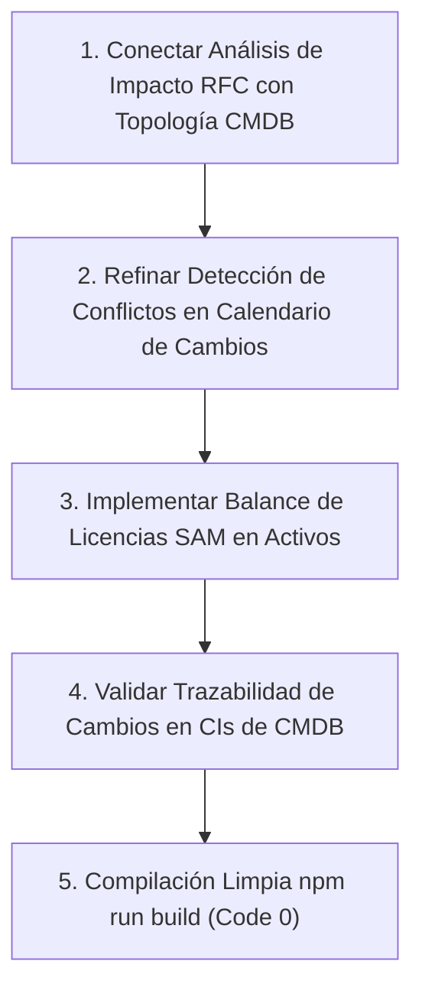

# Plan de Asignación y Especificación Técnica — Nain (Gestión de Cambios, Activos y CMDB)

> **Documento de especificación técnica y de desarrollo para el asistente IA.**
> **Responsable:** Nain
> **Módulos Asignados (100% Independientes y Aislados):**
> 1. [src/modules/cambios](file:///c:/Users/apaza/Desktop/SISTEMA%20DE%20TICKETS/src/modules/cambios) (Habilitación del Cambio ITIL 4 Change Enablement, Solicitudes de Cambio RFC, Matriz de Autoridad CAB/ECAB, Calendario, Ventanas y Congelamiento)
> 2. [src/modules/activos](file:///c:/Users/apaza/Desktop/SISTEMA%20DE%20TICKETS/src/modules/activos) (Gestión de Activos TI HAM/SAM ISO/IEC 19770-1, Inventario Físico/Lógico, Licenciamiento de Software, Contratos, Mantenimiento y Bajas)
> 3. [src/modules/cmdb](file:///c:/Users/apaza/Desktop/SISTEMA%20DE%20TICKETS/src/modules/cmdb) (Gestión de Configuración del Servicio SACM ITIL 4, Elementos de Configuración CIs, Topología de Dependencias, Análisis de Impacto y Líneas Base)
> 
> **Frontera de Trabajo Estricta:**
> - Nain **NO** interviene en el módulo de proveedores (`src/modules/proveedores`), el cual fue reasignado a Junior dentro de su bloque de entidades externas e internas.
> - Nain **NO** modifica consolas de perfiles (`src/modules/perfiles/*`).
> - Todo su código, backend, controladores, vistas y configuración se circunscriben estrictamente a `cambios`, `activos` y `cmdb`.

---

## 1. Visión Arquitectónica y Principios de Diseño

### 1.1 Principio de Correspondencia Menú-Directorio (Modularidad Estricta)
Cada opción de menú en el árbol lateral del sistema debe nacer directamente de una subcarpeta o archivo dedicado dentro de su respectivo módulo:
- En `src/modules/cambios`, la arquitectura modular ya está consolidada en `src/modules/cambios/config/` con 8 submódulos independientes (`flujo-evaluacion/`, `formulario/`, `matriz-autoridad/`, `modelos-estandar/`, `notificaciones-calendario/`, `plantillas/`, `reglas-clasificacion/`, `tipos-requisitos/`).
- En `src/modules/activos`, las carpetas modulares en `src/modules/activos/config/` (`tipos-modelos-atributos/`, `ciclos-vida-transiciones/`, `licencias-contratos/`) agrupan las pestañas operativas en componentes independientes.
- En `src/modules/cmdb`, la configuración reside en `src/modules/cmdb/config/cmdb-relaciones/`, separada por clases de CI, tipos de relación, reglas de integridad referencial y auditoría de líneas base.

### 1.2 Mecanismo de Sincronización Multi-Perfil en Tiempo Real
La tríada Cambios-Activos-CMDB es el núcleo de estabilidad tecnológica de la empresa:
1. **Detección Automática de Conflictos y Congelamientos (Freeze) en Calendario:**
   - Cuando el Gestor de Cambios define una ventana de mantenimiento o un congelamiento institucional en `src/modules/cambios`:
     - El motor de notificaciones alerta en tiempo real a los técnicos que intenten crear una RFC que coincida con ese rango de fechas.
     - En la consola del **Gestor de Área**, se actualiza de inmediato el cronograma de indisponibilidad programada para sus sistemas departamentales.
2. **Impacto en Cascada CMDB ante Cambios de Producción:**
   - Al registrar una RFC sobre un servidor o base de datos en `src/modules/cambios`:
     - El sistema consulta a `src/modules/cmdb` para calcular el árbol de dependencias hacia arriba (Upstream).
     - La tarjeta del CAB (`VistaCab.tsx`) despliega la lista consolidada de CIs y servicios en riesgo antes de la votación.
3. **Control del Ciclo de Vida de Activos y Bajas Seguras (HAM/SAM):**
   - El cambio de estado de un activo (Almacén -> Asignado -> Mantenimiento -> Baja) actualiza de inmediato la custodia del bien y su reflejo en la CMDB.

---

## 2. Inventario Exhaustivo Actual y Estado de Situación

### 2.1 Módulo: Gestión de Cambios — `src/modules/cambios`

| Ruta del Archivo / Carpeta | Tipo de Elemento | Estado Actual | Evaluación Técnica frente a ITIL 4 |
| :--- | :--- | :--- | :--- |
| `src/modules/cambios/config/flujo-evaluacion/VistaFlujoEvaluacion.tsx` | Vista Config | 100% avanzado | Definición de etapas, quórum de aprobación, temporizadores de evaluación y escalamiento. |
| `src/modules/cambios/config/formulario/VistaFormularioCambios.tsx` | Vista Config | 100% avanzado | Diseñador del formulario de RFC con campos condicionales y previsualización. |
| `src/modules/cambios/config/matriz-autoridad/VistaMatrizAutoridad.tsx` | Vista Config | 100% avanzado | Matriz de autoridad (Estándar, Menor, Normal, Emergencia) según riesgo e impacto. |
| `src/modules/cambios/config/modelos-estandar/VistaModelosEstandar.tsx` | Vista Config | 100% avanzado | Catálogo de cambios preaprobados con planes de trabajo y rollback predefinidos. |
| `src/modules/cambios/config/notificaciones-calendario/VistaNotificacionesCalendario.tsx` | Vista Config | 100% avanzado | Gestión de ventanas de mantenimiento, feriados, blackout periods y alertas. |
| `src/modules/cambios/config/plantillas/VistaPlantillas.tsx` | Vista Config | 100% avanzado | Plantillas para planes de prueba, implementación y marcha atrás. |
| `src/modules/cambios/config/reglas-clasificacion/VistaReglasClasificacion.tsx` | Vista Config | 100% avanzado | Algoritmo de cálculo de riesgo en base a CIs críticos y alcance de afectación. |
| `src/modules/cambios/config/tipos-requisitos/VistaTiposRequisitos.tsx` | Vista Config | 100% avanzado | Listas de verificación obligatorias por tipo de cambio. |
| `src/modules/cambios/api/*` (15 controladores) | API Controllers | 100% avanzado | Endpoints de backend completos para todas las funciones de parametrización y simulación. |
| `src/modules/cambios/views/VistaCab.tsx` | Consola CAB | 100% avanzado | Panel de votación colegiada del Change Advisory Board con registro de quórum. |
| `src/modules/cambios/views/VistaCalendarioCambios.tsx` | Vista Calendario | 100% avanzado | Calendario visual interactivo con ventanas de mantenimiento y marcas de congelamiento. |
| `src/modules/cambios/views/VistaCambios.tsx` | Vista Master | 100% avanzado | Listado integral de cambios con filtros facetados por tipo, estado y riesgo. |
| `src/modules/cambios/views/VistaCambiosBorradores.tsx` | Vista Operativa | Bien avanzado | RFCs en fase de preparación técnica antes de someterse a evaluación. |
| `src/modules/cambios/views/VistaCambiosComite.tsx` | Vista CAB | 100% avanzado | Sesiones programadas del comité de cambios. |
| `src/modules/cambios/views/VistaCambiosEmergencia.tsx` | Vista ECAB | 100% avanzado | Procedimiento de emergencia con aprobación expedita post-implementación. |
| `src/modules/cambios/views/VistaCambiosHistorial.tsx` | Vista Auditoría | 100% avanzado | Pista inmutable de todas las intervenciones ejecutadas. |
| `src/modules/cambios/views/VistaCambiosMantenimiento.tsx` | Vista Operativa | Bien avanzado | Programación detallada de cortes y ventanas técnicas. |
| `src/modules/cambios/views/VistaCambiosPir.tsx` | Vista Post-Cambio | Bien avanzado | Post-Implementation Review (PIR) para evaluar éxito o fallas de cambios implementados. |
| `src/modules/cambios/views/VistaCambiosRiesgo.tsx` | Vista Análisis | Bien avanzado | Cuestionario automatizado de evaluación de riesgo. |
| `src/modules/cambios/views/VistaPanelGestorCambios.tsx` | Consola Rol | 100% avanzado | Dashboard dedicado del Gestor de Cambios. |

---

### 2.2 Módulo: Gestión de Activos TI (HAM/SAM) — `src/modules/activos`

| Ruta del Archivo / Carpeta | Tipo de Elemento | Estado Actual | Evaluación Técnica frente a ISO 19770 |
| :--- | :--- | :--- | :--- |
| `src/modules/activos/config/tipos-modelos-atributos/*` | Vistas y Pestañas | Bien avanzado | Clases de activos, fabricantes, códigos de barras/QR, atributos custom y sedes físicas. |
| `src/modules/activos/config/ciclos-vida-transiciones/*` | Vistas y Pestañas | Bien avanzado | Estados: Pedido -> Almacén -> Asignado -> Mantenimiento -> Baja -> Disposición Final. |
| `src/modules/activos/config/licencias-contratos/*` | Vistas y Pestañas | Bien avanzado | Tipos de licencia (OEM, suscripción, volumen), contratos de soporte y alertas de vencimiento. |
| `src/modules/activos/api/*` (13 controladores) | API Controllers | Bien avanzado | Endpoints de backend para activos, asignaciones, bajas, licencias y contratos. |
| `src/modules/activos/views/VistaActivos.tsx` | Vista Master | Bien avanzado | Inventario general con filtros por sede, estado y custodio. |
| `src/modules/activos/views/VistaActivosAsignaciones.tsx` | Vista Operativa | Bien avanzado | Acta digital de entrega y recepción de equipamiento a colaboradores. |
| `src/modules/activos/views/VistaActivosBajas.tsx` | Vista Dictamen | Bien avanzado | Proceso formal de baja con certificado de destrucción o donación (RN-34). |
| `src/modules/activos/views/VistaActivosContratos.tsx` | Vista Contratos | Bien avanzado | Pólizas de garantía, soporte del fabricante y contratos de renting. |
| `src/modules/activos/views/VistaActivosImportacion.tsx` | Vista Utilidad | Bien avanzado | Carga masiva de inventario mediante plantillas CSV con validación previa. |
| `src/modules/activos/views/VistaActivosInventario.tsx` | Vista Auditoría | Bien avanzado | Conciliación de inventario físico vs registros del sistema. |
| `src/modules/activos/views/VistaActivosLicencias.tsx` | Vista SAM | Bien avanzado | Balance de licencias adquiridas vs licencias instaladas en equipos. |
| `src/modules/activos/views/VistaActivosMantenimiento.tsx` | Vista Operativa | Bien avanzado | Bitácora de servicios técnicos, reparaciones y calibración de hardware. |
| `src/modules/activos/views/VistaPanelGestorActivos.tsx` | Consola Rol | Bien avanzado | Dashboard del Gestor de Activos. |

---

### 2.3 Módulo: Gestión de Configuración (CMDB / SACM) — `src/modules/cmdb`

| Ruta del Archivo / Carpeta | Tipo de Elemento | Estado Actual | Evaluación Técnica frente a ITIL 4 |
| :--- | :--- | :--- | :--- |
| `src/modules/cmdb/config/cmdb-relaciones/VistaCmdbRelaciones.tsx` | Vista Config | Bien avanzado | Parametrización de relaciones de dependencia (Depends On, Runs On, Connected To, Hosted By). |
| `src/modules/cmdb/config/cmdb-relaciones/components/*` (6 pestañas) | Componentes UI | Bien avanzado | Clases de CI, tipos de relación, reglas de integridad referencial, líneas base y criticidad. |
| `src/modules/cmdb/api/*` (9 controladores) | API Controllers | Bien avanzado | Endpoints para relaciones, análisis de impacto, auditorías de configuración y líneas base. |
| `src/modules/cmdb/views/VistaCmdb.tsx` | Vista Master | Bien avanzado | Catálogo integral de Elementos de Configuración (CIs) con su nivel de criticidad. |
| `src/modules/cmdb/views/VistaCmdbAnalisis.tsx` | Vista Gráfica | Avanzado pero falta revisar | Visualizador topológico interactivo de dependencias y cálculo de impacto en cascada. |
| `src/modules/cmdb/views/VistaCmdbAuditoria.tsx` | Vista Auditoría | Bien avanzado | Detección de CIs huérfanos o relaciones inconsistentes. |
| `src/modules/cmdb/views/VistaCmdbInexactitudes.tsx` | Vista Calidad | Bien avanzado | Registro de discrepancias encontradas entre la realidad física y la CMDB. |
| `src/modules/cmdb/views/VistaCmdbLineasBase.tsx` | Vista Baseline | Bien avanzado | Snapshots inmutables del estado de la infraestructura en momentos clave. |
| `src/modules/cmdb/views/VistaTiposCi.tsx` | Vista Clases | Bien avanzado | Administración de tipos de CI (Servidores, Bases de Datos, Switches, Aplicaciones). |
| `src/modules/cmdb/views/VistaCmdbActualizaciones.tsx` | Vista Bitácora | Bien avanzado | Historial de modificaciones de configuración y atributos de cada CI. |

---

## 3. Lo que Falta por Desarrollar y Mapeo al Menú de Opciones

### 3.1 Integración Cambios - CMDB en Análisis de Impacto
1. **Topología de CIs en Vista de Riesgo:**
   - En `src/modules/cambios/views/VistaCambiosRiesgo.tsx`, enlazar el árbol de relaciones de `src/modules/cmdb/views/VistaCmdbAnalisis.tsx` para que al seleccionar un CI se dibujen automáticamente los servicios impactados.
2. **Detección de Solapamientos de RFCs en la Misma Ventana:**
   - En `src/modules/cambios/api/cambiosController.ts`, advertir de forma bloqueante si dos cambios afectan al mismo elemento de red o servidor en horarios concurrentes.

### 3.2 Afinar Proceso de Bajas y Licenciamiento SAM
1. **Balance Automático SAM:**
   - En `src/modules/activos/views/VistaActivosLicencias.tsx`, calcular de forma dinámica el semáforo de cumplimiento (Verde: superávit, Amarillo: límite, Rojo: déficit de licencias).

---

## 4. Guía de Ejecución para el Asistente IA de Nain

### Instrucciones Específicas:
1. Concéntrese exclusivamente en `cambios`, `activos` y `cmdb`. No modifique archivos en `proveedores` ni en consolas de perfiles.
2. Asegúrese de que no se generen dependencias circulares entre `cambios` y `cmdb`.
3. Mantenga el estándar de Cero Emojis y verifique la compilación limpia con `npm run build` al finalizar cada bloque.
