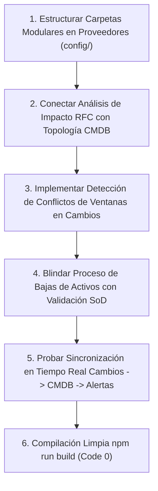

# Plan de Asignación y Especificación Técnica — Nain (ITSM Systems Developer)

> **Documento de especificación técnica y de desarrollo para el asistente IA.**
> **Responsable:** Nain (ITSM Systems & Infrastructure Specialist)
> **Módulos Asignados (Independientes):**
> 1. [src/modules/cambios](file:///c:/Users/apaza/Desktop/SISTEMA%20DE%20TICKETS/src/modules/cambios) (Habilitación del Cambio ITIL 4 Change Enablement, RFC, Matriz CAB/ECAB, Calendario, Ventanas y Freeze)
> 2. [src/modules/activos](file:///c:/Users/apaza/Desktop/SISTEMA%20DE%20TICKETS/src/modules/activos) (Gestión de Activos TI HAM/SAM ISO 19770, Inventario, Licencias, Contratos, Mantenimiento y Bajas)
> 3. [src/modules/cmdb](file:///c:/Users/apaza/Desktop/SISTEMA%20DE%20TICKETS/src/modules/cmdb) (Gestión de Configuración SACM ITIL 4, Elementos de Configuración CIs, Topología, Dependencias e Impacto)
> 4. [src/modules/proveedores](file:///c:/Users/apaza/Desktop/SISTEMA%20DE%20TICKETS/src/modules/proveedores) (Gestión de Proveedores ITIL 4, Contratos de Soporte UC, Acuerdos de Terceros y Desempeño)

---

## 1. Visión Arquitectónica y Principios de Diseño

### 1.1 Principio de Correspondencia Menú-Directorio (Modularidad Estricta)
Nain tiene la responsabilidad sobre los procesos estructurales de infraestructura y control de cambios de la organización.
- Cada opción accesible desde el menú debe mapearse a un archivo o carpeta dedicada. En `src/modules/cambios`, la arquitectura modular ya está consolidada en `config/` con 8 submódulos (`flujo-evaluacion/`, `formulario/`, `matriz-autoridad/`, `modelos-estandar/`, `notificaciones-calendario/`, `plantillas/`, `reglas-clasificacion/`, `tipos-requisitos/`).
- En `src/modules/activos`, las carpetas modulares (`config/tipos-modelos-atributos/`, `config/ciclos-vida-transiciones/`, `config/licencias-contratos/`) agrupan las pestañas operativas en componentes independientes.
- En `src/modules/cmdb`, la configuración reside en `config/cmdb-relaciones/`, separada por clases de CI, reglas de integridad y auditoría de líneas base.
- En `src/modules/proveedores`, se requiere abandonar la vista única monolítica y crear la estructura modular de configuración correspondiente.

### 1.2 Mecanismo de Sincronización Multi-Perfil en Tiempo Real
La tríada Cambios-Activos-CMDB es el corazón de la estabilidad de los servicios de TI:
1. **Detección Automática de Conflictos en Calendario y Congelamientos (Freeze):**
   - Cuando el Gestor de Cambios aprueba una ventana de congelamiento de fin de año o un despliegue en `src/modules/cambios`, el motor notifica en tiempo real a todos los perfiles:
     - El **Técnico** que intenta programar una intervención en `/tecnico/cambios/mis-cambios` recibe una advertencia bloqueante ("Ventana bloqueada por congelamiento institucional").
     - El **Gestor de Área** observa en su consola (`/gestor-area/cambios-impacto`) el período de indisponibilidad previsto para su departamento.
2. **Impacto en Cascada CMDB ante Cambios de Producción:**
   - Al registrar una Solicitud de Cambio (RFC) sobre un servidor o base de datos, el módulo consulta automáticamente a `src/modules/cmdb` para trazar el árbol de dependencias hacia arriba (Upstream Dependencies) e identificar qué servicios de negocio y departamentos serán afectados.
   - En la tarjeta del CAB (`TarjetaAprobacionSod`), los miembros del comité ven la lista consolidada de CIs en riesgo antes de emitir su voto.
3. **Control del Ciclo de Vida de Activos y Segregación SoD:**
   - La baja y disposición final de un activo tecnológico con valor contable requiere aprobación dual: dictamen técnico del Gestor de Activos y autorización presupuestal del Aprobador/Finanzas (RN-34).

---

## 2. Inventario Exhaustivo Actual y Estado de Situación

### 2.1 Módulo: Gestión de Cambios — `src/modules/cambios`
Habilitación controlada y trazable de cambios en la infraestructura para maximizar el éxito y minimizar incidentes (ITIL 4 Change Enablement).

| Archivo / Carpeta | Tipo | Estado Actual | Evaluación Técnica frente a ITIL 4 |
| :--- | :--- | :--- | :--- |
| `src/modules/cambios/config/flujo-evaluacion/VistaFlujoEvaluacion.tsx` | Vista Config | 100% avanzado | Definición de etapas, quórum de aprobación, temporizadores de evaluación y escalamiento. |
| `src/modules/cambios/config/formulario/VistaFormularioCambios.tsx` | Vista Config | 100% avanzado | Diseñador del formulario de RFC con campos condicionales y previsualización. |
| `src/modules/cambios/config/matriz-autoridad/VistaMatrizAutoridad.tsx` | Vista Config | 100% avanzado | Matriz de autoridad delegada (Cambio Estándar -> Autoaprobado, Menor -> Supervisor, Normal -> CAB, Emergencia -> ECAB). |
| `src/modules/cambios/config/modelos-estandar/VistaModelosEstandar.tsx` | Vista Config | 100% avanzado | Catálogo de cambios preaprobados con planes de trabajo y rollback predefinidos. |
| `src/modules/cambios/config/notificaciones-calendario/VistaNotificacionesCalendario.tsx` | Vista Config | 100% avanzado | Gestión de ventanas de mantenimiento, feriados, blackout periods y alertas. |
| `src/modules/cambios/config/plantillas/VistaPlantillas.tsx` | Vista Config | 100% avanzado | Plantillas para planes de prueba, implementación y marcha atrás. |
| `src/modules/cambios/config/reglas-clasificacion/VistaReglasClasificacion.tsx` | Vista Config | 100% avanzado | Algoritmo de cálculo de riesgo en base a CIs críticos, impacto en usuarios y complejidad técnica. |
| `src/modules/cambios/config/tipos-requisitos/VistaTiposRequisitos.tsx` | Vista Config | 100% avanzado | Listas de verificación obligatorias por tipo de cambio. |
| `src/modules/cambios/api/*` (15 controladores) | API Controllers | 100% avanzado | Endpoints de backend completos para todas las funciones de parametrización y simulación. |
| `src/modules/cambios/views/VistaCab.tsx` | Consola CAB | 100% avanzado | Panel de votación colegiada del Change Advisory Board con registro de quórum. |
| `src/modules/cambios/views/VistaCalendarioCambios.tsx` | Vista Calendario | 100% avanzado | Calendario visual interactivo con ventanas de mantenimiento y marcas de congelamiento. |
| `src/modules/cambios/views/VistaCambios.tsx` | Vista Master | 100% avanzado | Listado integral de cambios con filtros facetados por tipo, estado y riesgo. |
| `src/modules/cambios/views/VistaCambiosBorradores.tsx` | Vista Operativa | Bien avanzado | RFCs en fase de preparación técnica antes de someterse a evaluación. |
| `src/modules/cambios/views/VistaCambiosComite.tsx` | Vista CAB | 100% avanzado | Sesiones programadas del comité de cambios. |
| `src/modules/cambios/views/VistaCambiosEmergencia.tsx` | Vista ECAB | 100% avanzado | Procedimiento de emergencia con aprobación expedita post-implementación. |
| `src/modules/cambios/views/VistaCambiosHistorial.tsx` | Vista Auditoría | 100% avanzado | Pista inmutable de todas las intervenciones ejecutadas. |
| `src/modules/cambios/views/VistaCambiosMantenimiento.tsx` | Vista Operativa | Bien avanzado | Programación detallada de cortes y ventanas técnicas. |
| `src/modules/cambios/views/VistaCambiosPir.tsx` | Vista Post-Cambio | Bien avanzado | Post-Implementation Review (PIR) para evaluar éxito o lecciones aprendidas de cambios fallidos. |
| `src/modules/cambios/views/VistaCambiosRiesgo.tsx` | Vista Análisis | Bien avanzado | Cuestionario automatizado de evaluación de riesgo. |
| `src/modules/cambios/views/VistaPanelGestorCambios.tsx` | Consola Rol | 100% avanzado | Dashboard dedicado del Gestor de Cambios (CFR, cambios abiertos, quórum pendiente). |

---

### 2.2 Módulo: Gestión de Activos TI (HAM/SAM) — `src/modules/activos`
Control físico, lógico y contractual de los recursos tecnológicos durante todo su ciclo de vida (ISO/IEC 19770-1).

| Archivo / Carpeta | Tipo | Estado Actual | Evaluación Técnica frente a ISO 19770 |
| :--- | :--- | :--- | :--- |
| `src/modules/activos/config/tipos-modelos-atributos/*` | Vistas y Pestañas | Bien avanzado | Definición de clases de activos, fabricantes, códigos de barras/QR, atributos custom y ubicaciones. |
| `src/modules/activos/config/ciclos-vida-transiciones/*` | Vistas y Pestañas | Bien avanzado | Estados: Pedido -> Almacén -> Asignado -> Mantenimiento -> Baja -> Disposición Final. |
| `src/modules/activos/config/licencias-contratos/*` | Vistas y Pestañas | Bien avanzado | Tipos de licencia (OEM, suscripción, por núcleo), contratos de mantenimiento y alertas de vencimiento. |
| `src/modules/activos/api/*` (13 controladores) | API Controllers | Bien avanzado | Endpoints de backend para activos, asignaciones, bajas, licencias y contratos. |
| `src/modules/activos/views/VistaActivos.tsx` | Vista Master | Bien avanzado | Inventario general con filtros por sede, estado y custodio. |
| `src/modules/activos/views/VistaActivosAsignaciones.tsx` | Vista Operativa | Bien avanzado | Acta digital de entrega y recepción de equipamiento a colaboradores. |
| `src/modules/activos/views/VistaActivosBajas.tsx` | Vista Dictamen | Bien avanzado | Proceso formal de baja con certificado de destrucción o donación (RN-34). |
| `src/modules/activos/views/VistaActivosContratos.tsx` | Vista Contratos | Bien avanzado | Pólizas de garantía, soporte del fabricante y contratos de renting. |
| `src/modules/activos/views/VistaActivosImportacion.tsx` | Vista Utilidad | Bien avanzado | Carga masiva de inventario mediante plantillas CSV/Excel con validación previa. |
| `src/modules/activos/views/VistaActivosInventario.tsx` | Vista Auditoría | Bien avanzado | Conciliación de inventario físico vs registros del sistema. |
| `src/modules/activos/views/VistaActivosLicencias.tsx` | Vista SAM | Bien avanzado | Balance de licencias adquiridas vs licencias instaladas en equipos (Software Compliance). |
| `src/modules/activos/views/VistaActivosMantenimiento.tsx` | Vista Operativa | Bien avanzado | Bitácora de servicios técnicos, reparaciones y calibración de hardware. |
| `src/modules/activos/views/VistaPanelGestorActivos.tsx` | Consola Rol | Bien avanzado | Dashboard del Gestor de Activos (Total activos, valor depreciado, licencias por renovar). |

---

### 2.3 Módulo: Gestión de Configuración (CMDB / SACM) — `src/modules/cmdb`
Mapeo de las interconexiones, relaciones y topología de los servicios tecnológicos (ITIL 4 SACM).

| Archivo / Carpeta | Tipo | Estado Actual | Evaluación Técnica frente a ITIL 4 |
| :--- | :--- | :--- | :--- |
| `src/modules/cmdb/config/cmdb-relaciones/VistaCmdbRelaciones.tsx` | Vista Config | Bien avanzado | Parametrización de relaciones de dependencia (Depends On, Runs On, Connected To, Hosted By). |
| `src/modules/cmdb/config/cmdb-relaciones/components/*` (6 pestañas) | Componentes UI | Bien avanzado | Clases de CI, tipos de relación, reglas de integridad referencial, líneas base y criticidad. |
| `src/modules/cmdb/api/*` (9 controladores) | API Controllers | Bien avanzado | Endpoints para relaciones, análisis de impacto, auditorías de configuración y líneas base. |
| `src/modules/cmdb/views/VistaCmdb.tsx` | Vista Master | Bien avanzado | Catálogo integral de Elementos de Configuración (CIs) con su nivel de criticidad. |
| `src/modules/cmdb/views/VistaCmdbAnalisis.tsx` | Vista Gráfica | Avanzado pero falta revisar | Visualizador topológico interactivo de dependencias y cálculo de impacto en cascada. |
| `src/modules/cmdb/views/VistaCmdbAuditoria.tsx` | Vista Auditoría | Bien avanzado | Detección de CIs huérfanos o relaciones inconsistentes. |
| `src/modules/cmdb/views/VistaCmdbInexactitudes.tsx` | Vista Calidad | Bien avanzado | Registro de discrepancias encontradas entre la realidad física y la CMDB. |
| `src/modules/cmdb/views/VistaCmdbLineasBase.tsx` | Vista Baseline | Bien avanzado | Snapshots inmutables del estado de la infraestructura en momentos clave. |
| `src/modules/cmdb/views/VistaTiposCi.tsx` | Vista Clases | Bien avanzado | Administración de tipos de CI (Servidores, Bases de Datos, Switches, Aplicaciones). |
| `src/modules/cmdb/views/VistaCmdbActualizaciones.tsx` | Vista Bitácora | Bien avanzado | Historial de modificaciones de configuración y atributos de cada CI. |

---

### 2.4 Módulo: Gestión de Proveedores — `src/modules/proveedores`
Administración de contratos de soporte externo y suministradores (ITIL 4 Supplier Management).

| Archivo / Carpeta | Tipo | Estado Actual | Evaluación Técnica frente a ITIL 4 |
| :--- | :--- | :--- | :--- |
| `src/modules/proveedores/api/proveedorController.ts` | API Controller | Bien avanzado | CRUD de datos de contacto, RUC/identificador fiscal y razón social de proveedores. |
| `src/modules/proveedores/api/proveedorDetalleController.ts` | API Controller | Bien avanzado | Información de contratos activos, contactos de escalamiento 24/7 y SLAs externos. |
| `src/modules/proveedores/components/ProveedoresWorkspace.tsx` | Componente | Monolítico / Requiere estructuración | Componente contenedor único que agrupa la gestión de proveedores. |
| `src/modules/proveedores/services/proveedorService.ts` | Servicio | Bien avanzado | Capa de negocio para consulta y evaluación de proveedores. |
| `src/modules/proveedores/views/VistaProveedores.tsx` | Vista Master | Bien avanzado | Grid interactivo con la lista de proveedores homologados y contratos vinculados. |

---

## 3. Lo que Falta por Desarrollar y Mapeo al Menú de Opciones

### 3.1 Modularización en Proveedores
En `src/modules/proveedores/config/` se debe estructurar la configuración dividida en carpetas físicas:
1. `src/modules/proveedores/config/proveedores/`:
   - `VistaConfigProveedores.tsx`: Categorización de proveedores (Estratégicos, Tácticos, Operativos) y niveles de homologación. Mapeada a la opción de menú `/plataforma/proveedores/config/proveedores`.
2. `src/modules/proveedores/config/contratos-soporte/`:
   - `VistaConfigContratosSoporte.tsx`: Parámetros de contratos de soporte externo (Underpinning Contracts - UC) vinculados a los SLAs de los servicios. Mapeada a `/plataforma/proveedores/config/contratos-soporte`.
3. `src/modules/proveedores/config/evaluacion-desempeno/`:
   - `VistaConfigEvaluacionProveedores.tsx`: Criterios de evaluación periódica de calidad y cumplimiento de terceros. Mapeada a `/plataforma/proveedores/config/evaluacion-desempeno`.

### 3.2 Afinar la Integración Cambios - CMDB en Análisis de Impacto
1. **Mapa de Dependencias en Ficha de Cambio:**
   - En `src/modules/cambios/views/VistaCambiosRiesgo.tsx`, integrar el componente topológico de `src/modules/cmdb/views/VistaCmdbAnalisis.tsx` para que al seleccionar un CI se dibujen de forma instantánea todos los servicios que dependen de él.
2. **Validación Bloqueante de Ventanas de Mantenimiento:**
   - En `src/modules/cambios/api/cambiosController.ts`, bloquear el guardado de una RFC si se solapa con otro cambio programado que afecte al mismo CI o al mismo entorno de red.

### 3.3 Aprobación SoD en Bajas de Activos
1. **Doble Aprobación de Baja (RN-34):**
   - Asegurar que la vista `src/modules/activos/views/VistaActivosBajas.tsx` exija la firma digital del Aprobador Financiero cuando el activo a dar de baja posea un valor libro superior a cero.

---

## 4. Guía de Ejecución para el Asistente IA de Nain

### Instrucciones Específicas:
1. Descomponga el workspace de proveedores creando las subcarpetas modulares en `src/modules/proveedores/config/` con sus vistas correspondientes.
2. Asegure que la comunicación entre `cambios` y `cmdb` no genere dependencias circulares mediante el uso de interfaces limpias en `src/shared/lib/` o servicios desacoplados.
3. Respete en todo momento las rutas canónicas del menú `/plataforma/...` y la autorización con `exigirMenuPagina`.
4. Ejecute periódicamente `npm run build` para garantizar cero errores y la estricta ausencia de emojis.
