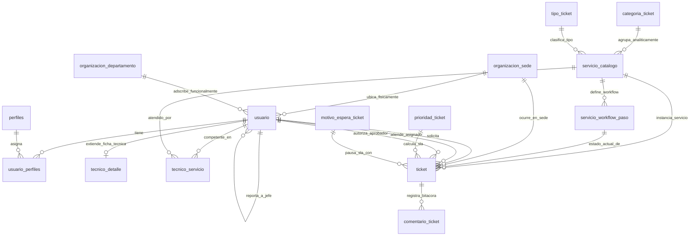

# Análisis ITIL v4 — Sistema de Tickets Empresarial

Este documento presenta un diagnóstico técnico exhaustivo y la propuesta de diseño arquitectónico alineada al marco **ITIL v4** para un **Sistema de Gestión de Tickets de nivel corporativo (B2B / ITSM)**. El software está concebido como una solución estándar y configurable capaz de adaptarse a cualquier empresa (sector financiero, retail, telecomunicaciones, manufactura, servicios o logística) que adquiera la plataforma para gestionar su Mesa de Ayuda de TI.

El análisis se fundamenta en la inspección directa del código fuente real, la base de datos (`db/schema.sql`, `db/seed.sql`), los endpoints de API (`src/app/api/`) y las interfaces de usuario (`src/app/`, `src/components/`, `src/lib/`).

---

## Resumen: qué existe hoy y qué falta

| Punto Evaluado | Estado Actual | Evidencia Técnica en el Proyecto |
| :--- | :--- | :--- |
| **1. Definición de Usuario** | **Parcial** | **Existe:** Tabla `usuario` (`db/schema.sql`, líneas 17-35), tabla `perfiles` y tabla relacional `usuario_perfiles` (`db/schema.sql`, líneas 38-43 y 60-65). Gestión de roles RBAC en `src/app/api/usuarios/route.ts` y conmutación de perfiles en `src/components/SelectorPerfilActivo.tsx`.<br>**Falta:** No existe distinción entre Usuario (consumidor operativo) y Cliente (aprobador de negocio / jefatura de área). No existe estructura corporativa empresarial: faltan sedes, departamentos/gerencias, centros de costo, cargos y relación de jerarquía (`id_jefe_inmediato`). |
| **2. Catálogo de Servicios** | **Parcial / Conceptualización Incompleta** | **Existe:** Tabla `tipo_ticket` con 2 registros (Incidente y Solicitud, `db/schema.sql`, líneas 92-99) y tabla `categoria_ticket` con 6 registros (`db/seed.sql`, líneas 129-136). Formulario de creación en `src/app/(app)/tickets/gestion/crear/page.tsx` que filtra categorías por tipo.<br>**Falta:** La tabla `categoria_ticket` es solo una taxonomía interna de soporte técnico, no un Catálogo de Servicios corporativo. No existe tabla `servicio` ni workflows específicos por servicio; todos los requerimientos caen obligatoriamente en el mismo flujo plano de 7 estados genéricos (`estado_ticket`). No existen compuertas de aprobación jerárquica para solicitudes con impacto financiero o de seguridad. |
| **3. Definición de Técnicos** | **No existe (es solo un perfil genérico)** | **Existe:** El rol técnico solo existe como un registro en la tabla `perfiles` (`id_perfil = 2`, `db/seed.sql`, línea 9). En `src/app/api/tickets/catalogos/route.ts` (líneas 54-64) se filtra como técnico a cualquier usuario con perfil 1 o 2. En `src/app/(app)/tickets/gestion/tecnicos/page.tsx` se muestra un tablero de supervisión que calcula métricas reactivas en el cliente.<br>**Falta:** No existe tabla ni atributos para registrar especialidades técnicas, certificaciones, sedes físicas asignadas, turnos ni niveles de soporte ITIL (N1, N2, N3). No existe relación técnico ↔ servicio ni técnico ↔ categoría. |
| **4. Definición de Tickets** | **Parcial (depende de categorías, no de servicios)** | **Existe:** Tabla `ticket` (`db/schema.sql`, líneas 161-187) con cálculo dinámico de prioridad ITIL (Impacto x Urgencia) en `src/app/api/tickets/route.ts` (líneas 8-20), control de pausas por motivo de espera (`motivo_espera_ticket`), solución obligatoria para cierre y bitácora con notas internas (`comentario_ticket`).<br>**Falta:** La tabla `ticket` no tiene clave foránea hacia un catálogo de servicios corporativo (solo apunta a `id_categoria`). Su ciclo de vida depende exclusivamente de la tabla global `estado_ticket`. No soporta compuertas de aprobación ni captura de campos dinámicos específicos según el servicio contratado. |

---

## 1. Definición de Usuario

### Marco ITIL v4
En ITIL v4, dentro de la dimensión de **Organizaciones y Personas** y en la práctica de **Service Desk (Mesa de Servicio)**, se establece una diferenciación conceptual determinante para cualquier software corporativo:
* **Usuario (User):** Es el colaborador de la empresa que utiliza los servicios tecnológicos en el día a día para desempeñar sus labores operativas (por ejemplo, un analista de finanzas usando el ERP, un asesor comercial con el CRM, o un operador de almacén con un lector de código de barras).
* **Cliente (Customer):** Es la persona o rol de gestión que representa a la unidad de negocio, define los requerimientos funcionales, negocia y supervisa los acuerdos de nivel de servicio (SLA) y asume la responsabilidad del impacto o costo del servicio (por ejemplo, el Gerente de Finanzas, el Jefe de Recursos Humanos o el Director de Operaciones). En ITIL, el Cliente actúa como **Aprobador** cuando un usuario solicita un servicio con impacto presupuestal o de seguridad.
* **Patrocinador (Sponsor):** Es la alta dirección (Gerencia General / CFO) que autoriza el presupuesto para la adquisición y mantenimiento de las plataformas tecnológicas.
* **Proveedor de Servicios (Service Provider):** El departamento de TI interno (Dirección de Sistemas / IT Operations) o un proveedor tercerizado que entrega y mantiene el servicio.

En una empresa real de cualquier sector, los usuarios no interactúan en el vacío: pertenecen a una **Sede física** (Sede Central, Sucursales, Plantas de Producción, Almacenes), a un **Departamento o Gerencia** (Finanzas, Ventas, Logística, Legal, RRHH), poseen un **Cargo** y están asignados a un **Centro de Costos**.

### Estado actual (con evidencia del código/BD)
El análisis del código fuente demuestra que el sistema maneja actualmente un modelo plano y homogéneo de usuarios:
1. **Estructura de la tabla `usuario` (`db/schema.sql`, líneas 17-35):**
   Campos: `id_usuario`, `dni`, `nombres`, `apellido_paterno`, `apellido_materno`, `celular`, `correo_personal`, `correo_electronico`, `clave`, `intentos_fallidos`, `bloqueado_hasta`, `cuenta_bloqueada`, `usuario_creacion`, `fecha_creacion`, `usuario_modificacion`, `fecha_modificacion` y `estado_registro`.
   *Evidencia:* No existe ningún campo para sede (`id_sede`), departamento/área (`id_departamento`), cargo (`cargo`), centro de costos (`centro_costo`) ni relación de jerarquía con jefatura (`id_jefe_inmediato`).
2. **Modelo de perfiles y roles (`db/schema.sql`, líneas 38-43 y 60-65; `db/seed.sql`, líneas 7-11):**
   Se implementa control de acceso basado en roles (RBAC) con 4 perfiles en la tabla `perfiles`:
   * `id_perfil = 1`: Administrador
   * `id_perfil = 2`: Tecnico
   * `id_perfil = 3`: Solicitante
   * `id_perfil = 4`: Supervisor
3. **Limitación en la lógica de negocio (`src/types/index.ts`, líneas 4-22; `src/app/api/usuarios/route.ts`):**
   El sistema asume que todo usuario no técnico es un simple "Solicitante". No existe diferenciación entre un empleado operativo y un Gerente de Área.
   *Evidencia en la interfaz:* En el mantenimiento de usuarios (`src/app/(app)/admin/usuarios/page.tsx`, líneas 9-20), únicamente se capturan datos personales, correo corporativo y selección de perfiles. No es posible asociar a un usuario con un área de negocio ni definir quién es su jefe directo para validaciones de flujo.

### Propuesta
Para convertir la plataforma en un producto B2B altamente configurable y vendible a cualquier empresa, se debe diseñar la estructura de usuarios con los siguientes elementos:
1. **Entidad `organizacion_departamento` (Estructura Organizacional):**
   Tabla configurable por el cliente comprador para definir sus gerencias y áreas de negocio (Finanzas, Contabilidad, Operaciones, Ventas, Recursos Humanos, Legal, Tecnología).
2. **Entidad `organizacion_sede` (Distribución Geográfica):**
   Permite registrar las sedes físicas de la empresa (Oficina Corporativa, Sucursal A, Centro de Distribución, Planta Norte) con su respectiva dirección y zona horaria.
3. **Jerarquía y Atributos Corporativos en `usuario`:**
   * `id_departamento`: Área corporativa del colaborador.
   * `id_sede`: Sede habitual de trabajo.
   * `cargo`: Puesto de trabajo (Analista, Coordinador, Gerente, Director).
   * `centro_costo`: Identificador contable para imputación de costos de licencias o hardware.
   * `id_jefe_inmediato`: Enlace jerárquico hacia otro usuario. Esta relación es la base para que el sistema automatice las compuertas de aprobación que exige ITIL v4 sin requerir intervención manual de mesa de ayuda.

---

## 2. Catálogo de Servicios

### Marco ITIL v4
ITIL v4 define la práctica de **Service Catalogue Management (Gestión del Catálogo de Servicios)** como el punto único de entrada para que los clientes y usuarios descubran, comprendan y soliciten los servicios que TI pone a su disposición. A su vez, se relaciona directamente con **Service Request Management (Gestión de Solicitudes de Servicio)** y se delimita de **Incident Management (Gestión de Incidentes)**:

#### Justificación de la diferencia entre `categoria_ticket` y un Catálogo de Servicios Corporativo
* **`categoria_ticket` (Taxonomía Técnica de Soporte):** Es un mecanismo de indexación técnica interna que utilizan los analistas de TI para categorizar datos en la base de datos (ej. "Hardware", "Redes", "Software"). No comunica valor al negocio, no tiene compromisos contractuales de entrega, no especifica prerrequisitos ni define quién puede o no solicitar el recurso.
* **Catálogo de Servicios (Oferta de Valor al Negocio):** Es la vitrina de servicios que el comprador corporativo publica a toda la empresa. Describe de forma transparente:
  1. Nombre y descripción comprensible para usuarios no técnicos.
  2. Entregable explícito (qué recibe el usuario al concluir el requerimiento).
  3. Criterios de elegibilidad (qué departamentos o cargos están autorizados a pedirlo).
  4. Acuerdos de nivel de servicio (SLA propio de tiempo de respuesta y resolución).
  5. Costo financiero asociado (imputable a centro de costo si aplica).
  6. Workflow formal (pasos secuenciales, aprobaciones de gerencia y tareas de aprovisionamiento).

#### Incidente vs. Solicitud de Servicio en la Empresa
* **Incidente:** Una interrupción no planificada o reducción de calidad de un servicio en producción (ej. servidor de facturación caído, corte de internet en una sucursal, falla de impresora de almacén). El objetivo prioritario es restablecer la operación normal con la máxima rapidez (mediante contingencias o parches).
* **Solicitud de Servicio:** Una petición formal de un colaborador para la provisión de un nuevo servicio o recurso estándar (ej. alta de correo para nuevo ingreso, acceso a carpetas compartidas, solicitud de laptop corporativa, instalación de software contable). Requiere validaciones, cumplimiento de políticas de seguridad y aprobaciones formales.

### Estado actual (con evidencia del código/BD)
En el proyecto actual, la distinción existe de forma incipiente en la cabecera, pero la base de datos y la capa de servicios la tratan como una misma entidad plana:
1. **Catálogo de tipos (`db/schema.sql`, líneas 92-99; `db/seed.sql`, líneas 88-91):**
   Existe la tabla `tipo_ticket` con los registros `INCIDENTE` (prefijo `INC`) y `SOLICITUD` (prefijo `REQ`).
2. **Tabla `categoria_ticket` (`db/schema.sql`, líneas 152-158; `db/seed.sql`, líneas 129-136):**
   Contiene 6 registros genéricos asociados a tipo:
   * Tipo Incidente: "Hardware y Equipos", "Redes y Conectividad", "Software y Aplicaciones".
   * Tipo Solicitud: "Cuentas y Accesos", "Equipamiento Nuevo", "Instalación de Software".
3. **Limitación estructural comprobada (`src/app/api/tickets/route.ts`, líneas 228-250; `src/types/index.ts`, líneas 142-190):**
   * No existe tabla `servicio` ni `catalogo_servicio`.
   * El ticket solo guarda `id_categoria` (categoría plana).
   * Todos los requerimientos se insertan en estado `ABIERTO` (`id_estado = 1`) y comparten rígidamente los 7 estados de `estado_ticket` (`ABIERTO`, `ASIGNADO`, `EN_PROCESO`, `EN_ESPERA`, `RESUELTO`, `CERRADO`, `CANCELADO`).
   * No existe mecanismo para detener un ticket porque está esperando la firma del Gerente de Finanzas o de Recursos Humanos. No hay workflows diferenciados.

### Servicios propuestos
A continuación se proponen 6 servicios estándar y de alto valor corporativo que cualquier empresa compradora necesita en su mesa de ayuda de TI, con su conceptualización y workflow específicos:

---

#### 1. Aprovisionamiento de Accesos a Sistemas Corporativos (ERP / CRM / VPN)
* **Conceptualización:**
  * **Nombre del servicio:** Solicitud de Accesos y Privilegios en Sistemas de Negocio.
  * **Tipo ITIL:** Solicitud de Servicio con Aprobación de Seguridad Obligatoria.
  * **Descripción:** Habilitación, modificación de roles o asignación de permisos especiales en plataformas core de la empresa (SAP, Oracle ERP, Salesforce, CRM corporativo o conexión VPN segura para teletrabajo).
  * **Quién puede solicitarlo:** Cualquier colaborador de la empresa en coordinación con su jefatura.
  * **Qué entrega:** Usuario y perfil de permisos habilitado en el sistema solicitado bajo el principio de menor privilegio (Least Privilege) y políticas SOX / ISO 27001.
  * **Tiempo estimado de atención (SLA):**
    * Tiempo de aprobación de jefatura: Máximo 24 horas laborables.
    * Tiempo de aprovisionamiento técnico tras aprobación: 8 horas laborables.
* **Workflow del servicio:**
  1. *Registro:* El colaborador completa la solicitud seleccionando el sistema requerido (ej. SAP), módulo específico y justificando la necesidad de negocio.
  2. *Compuerta de Aprobación Jerárquica (Approval Gate):* El ticket pasa al estado **"Pendiente de Aprobación"**. El sistema notifica al Jefe Inmediato del solicitante.
     * Si el jefe rechaza: El ticket pasa a **"Rechazado"** con motivo registrado y se Cierra.
     * Si el jefe aprueba: El ticket pasa a **"Aprobado"** y se activa en la cola de TI.
  3. *Validación de Seguridad:* Oficial de Seguridad de la Información o Administrador verifica que el rol solicitado no genere conflicto de segregación de funciones (SoD).
  4. *Aprovisionamiento técnico:* Técnico Nivel 3 crea el usuario y asigna los roles autorizados.
  5. *Verificación de acceso:* El usuario confirma el ingreso exitoso al sistema corporativo.
  6. *Cierre:* Ticket marcado como Resuelto y Cerrado conforme.

---

#### 2. Asignación y Renovación de Equipamiento de Cómputo (Laptops / Workstations)
* **Conceptualización:**
  * **Nombre del servicio:** Asignación o Renovación de Equipo Informático de Puesto.
  * **Tipo ITIL:** Solicitud de Servicio de Hardware e Inventario (CMDB).
  * **Descripción:** Entrega de laptop corporativa, estación de trabajo fija, monitor adicional o accesorios de escritorio para puestos nuevos, promociones internas o recambio por obsolescencia tecnológica.
  * **Quién puede solicitarlo:** Gerentes o Jefes de Área para miembros de su equipo; colaboradores en período oficial de renovación tecnológica.
  * **Qué entrega:** Equipo de cómputo configurado con la imagen estándar de la empresa, antivirus corporativo, cifrado de disco (BitLocker) y acta formal de asignación patrimonial.
  * **Tiempo estimado de atención (SLA):**
    * Tiempo de resolución: 48 horas hábiles si existe stock en inventario; 5 días hábiles si requiere compra logística.
* **Workflow del servicio:**
  1. *Registro de solicitud:* Se especifica el perfil del puesto (ej. Estándar Administrativo o Avanzado Ingeniería/Desarrollo) y centro de costo al que se cargará el activo.
  2. *Validación presupuestal:* Si el equipo requiere compra o leasing adicional, se requiere visto bueno de Control de Gestión / Finanzas.
  3. *Preparación técnica (Staging):* Técnico Nivel 2 clona la imagen corporativa, activa licencias y aplica políticas de seguridad en el Endpoint Manager.
  4. *Asociación patrimonial (CMDB):* Se registra el número de serie y placa de inventario del equipo vinculándolo al ID del usuario.
  5. *Entrega física y firma digital:* El colaborador recibe el equipo en su sede o por mensajería y firma digitalmente el acta de recepción de activo corporativo.
  6. *Cierre:* Ticket Cerrado con registro de auditoría en la ficha del activo.

---

#### 3. Restablecimiento Seguro de Contraseñas y Doble Factor (MFA)
* **Conceptualización:**
  * **Nombre del servicio:** Restablecimiento de Credenciales y Desbloqueo de Doble Factor.
  * **Tipo ITIL:** Solicitud de Servicio Estándar (Pre-aprobada / Autoservicio).
  * **Descripción:** Desbloqueo de cuentas de dominio corporativo (Active Directory / Azure AD) bloqueadas por superación de intentos fallidos o reinicio de token de autenticación multifactor (Microsoft Authenticator / Google Authenticator) por pérdida de celular.
  * **Quién puede solicitarlo:** Cualquier colaborador de la empresa en estado activo.
  * **Qué entrega:** Cuenta corporativa reactivada, clave temporal segura con forzado de cambio inmediato y reseteo de métodos MFA.
  * **Tiempo estimado de atención (SLA):**
    * Tiempo de primera respuesta: Menor a 15 minutos.
    * Tiempo de resolución: Máximo 1 hora laborable (o inmediato mediante flujo OTP si está habilitado).
* **Workflow del servicio:**
  1. *Solicitud del colaborador:* El usuario solicita restablecimiento indicando correo corporativo y canal alterno de validación (celular registrado).
  2. *Desafío de Identidad:* El sistema valida el número de documento de identidad y remite un código OTP de un solo uso al teléfono personal validado en la base corporativa.
  3. *Ejecución de reseteo:* Confirmada la identidad, el sistema o el operador de Mesa Nivel 1 ejecuta el comando de desbloqueo y reinicia la clave forzando cambio al siguiente login.
  4. *Notificación segura:* Se remite la clave temporal cifrada.
  5. *Confirmación y Cierre:* El usuario inicia sesión, establece su nueva contraseña personal y el ticket se Cierra automáticamente.

---

#### 4. Soporte de Conectividad de Red y Telecomunicaciones (LAN / Wi-Fi / VPN)
* **Conceptualización:**
  * **Nombre del servicio:** Soporte a Fallas de Red Corporativa y Telefonía IP.
  * **Tipo ITIL:** Incidente de Conectividad.
  * **Descripción:** Diagnóstico y resolución ante caídas de enlace de internet en una sede, puertos de red cableados defectuosos, inestabilidad de la Wi-Fi corporativa o problemas con anexos telefónicos IP en oficinas o centros de contacto.
  * **Quién puede solicitarlo:** Cualquier colaborador de la empresa que experimente degradación o corte de conectividad en su puesto de trabajo o sala de reuniones.
  * **Qué entrega:** Conectividad de red restablecida a velocidades nominales, puerto de switch reparado o teléfono IP operativo.
  * **Tiempo estimado de atención (SLA):**
    * Si afecta a una persona (P3 Media): 8 horas laborables.
    * Si afecta a una sucursal completa o sala de directorio (P1 Crítica): 2 horas laborables.
* **Workflow del servicio:**
  1. *Reporte de incidente:* El usuario detalla la sede física, piso, número de puesto y síntoma (ej. corte total o lentitud).
  2. *Triaje remoto Nivel 1:* El operador ejecuta ping y valida si el switch de distribución o el router de la sede presentan alarmas en la herramienta de monitoreo (NOC).
     * Si es caída masiva: Se escala de inmediato a **Incidente Mayor de Redes**.
     * Si es falla puntual de puesto: Se asigna al Técnico de Soporte en Sitio (Nivel 2) de dicha sede.
  3. *Intervención física / lógica:* El técnico Nivel 2 reemplaza cable de red (patch cord), reconfigura el puerto en la VLAN correspondiente o reinicia el teléfono IP.
  4. *Prueba de rendimiento:* Se ejecuta test de velocidad y latencia hacia los servidores corporativos.
  5. *Cierre:* Registro de solución técnica y confirmación de satisfacción del usuario.

---

#### 5. Instalación y Licenciamiento de Software Específico de Puesto
* **Conceptualización:**
  * **Nombre del servicio:** Aprovisionamiento de Licencias y Software de Productividad.
  * **Tipo ITIL:** Solicitud de Servicio con Aprobación Presupuestal.
  * **Descripción:** Instalación de herramientas especializadas que requieren pago de licencia individual o por suscripción (ej. Microsoft Visio, Project, Power BI Pro, Adobe Creative Cloud, AutoCAD, software financiero o estadístico).
  * **Quién puede solicitarlo:** Colaboradores que requieran la herramienta para cumplir con funciones específicas de su puesto.
  * **Qué entrega:** Software desplegado y activado con licencia oficial de la empresa, registrado en el inventario de software para control de auditoría de licencias.
  * **Tiempo estimado de atención (SLA):**
    * Tiempo de aprobación de gerencia: 24 horas.
    * Tiempo de instalación tras aprobación: 24 horas hábiles.
* **Workflow del servicio:**
  1. *Solicitud con justificación de negocio:* El colaborador selecciona la aplicación, versión requerida y justifica el retorno para el proyecto o área.
  2. *Aprobación de la Gerencia de Área (Centro de Costos):* El ticket entra en **"Pendiente de Aprobación"**. El Gerente del área solicitante debe autorizar la imputación económica del costo de la licencia a su centro de costos.
  3. *Verificación de inventario de software:* El gestor de activos de TI valida si existen licencias disponibles en el pool corporativo o si debe generarse orden de compra a proveedor.
  4. *Despliegue automatizado:* Mediante herramientas de distribución de software (MDM / SCCM), se instala el paquete en el equipo del usuario de forma remota y transparente.
  5. *Prueba de ejecución:* El colaborador ejecuta el software y confirma funcionamiento correcto.
  6. *Cierre:* Registro de la licencia asignada en la CMDB y cierre del ticket.

---

#### 6. Aprovisionamiento Tecnológico Integral para Nuevos Ingresos (Onboarding TI)
* **Conceptualización:**
  * **Nombre del servicio:** Habilitación de Puesto Digital para Nuevos Colaboradores.
  * **Tipo ITIL:** Solicitud de Servicio Compleja (Procedimiento Orquestado Multitarea).
  * **Descripción:** Preparación integral de todo el ecosistema tecnológico necesario para que un nuevo colaborador pueda trabajar de forma productiva desde su primer día en la empresa: creación de cuenta de dominio, buzón de correo, asignación de computadora, teléfono corporativo, accesos a sistemas departamentales y carnet digital.
  * **Quién puede solicitarlo:** Exclusivamente la Gerencia de Gestión Humana / Recursos Humanos con al menos 3 días hábiles de anticipación al ingreso.
  * **Qué entrega:** Kit tecnológico de bienvenida entregado y operativo el día 1 de trabajo del colaborador.
  * **Tiempo estimado de atención (SLA):**
    * Compromiso estricto: 100% completado 24 horas antes del primer día laboral del nuevo empleado.
* **Workflow del servicio:**
  1. *Solicitud anticipada de RRHH:* Registro de la ficha de alta con datos del colaborador, sede de trabajo, cargo, gerencia, jefe directo y fecha de inicio de labores.
  2. *Generación automática de subtareas técnicas paralelas:*
     * *Subtarea 1 (Identidad y Accesos - Nivel 3):* Creación de usuario en Azure AD, buzón Microsoft 365 y asignación de grupos de seguridad.
     * *Subtarea 2 (Equipamiento Físico - Nivel 2):* Configuración de laptop corporativa, mouse, mochila y periféricos según el estándar del cargo.
     * *Subtarea 3 (Telecomunicaciones - Nivel 2):* Habilitación de anexo IP y permisos de acceso a la red Wi-Fi y VPN corporativa.
  3. *Control de calidad por el Supervisor:* El Supervisor de la Mesa de Ayuda consolida las tres subtareas y verifica que todos los accesos estén operativos.
  4. *Entrega en día 1:* El técnico de soporte en sitio recibe al colaborador, le hace entrega física del equipo y le asiste en su primer inicio de sesión.
  5. *Cierre formal:* Firma del acta de recepción y cierre de la solicitud integral de Onboarding.

---

## 3. Definición de Técnicos

### Marco ITIL v4
Bajo ITIL v4, en la gestión de **Incident Management** y **Service Request Management**, el equipo resolutor de TI debe estructurarse según el modelo de **Niveles de Soporte (Tiers)** y **Enrutamiento por Competencias (Skills-based Routing)**:
* **Nivel 1 (Tier 1 - Service Desk / Mesa Central de Ayuda):** Punto único de contacto para toda la empresa. Personal capacitado en atención al cliente, recepción multicanal (portal web, correo, teléfono), registro, diagnóstico preliminar, resolución de incidentes estándar de alta frecuencia (más del 60% de volumen: reseteo de claves, configuraciones básicas) y enrutamiento inteligente.
* **Nivel 2 (Tier 2 - Desktop Support / Soporte en Sitio):** Técnicos especialistas distribuidos físicamente en las sedes corporativas, sucursales y plantas. Encargados del mantenimiento de hardware, reemplazo de partes, configuración presencial de puestos de trabajo, telefonía IP y cableado de red local.
* **Nivel 3 (Tier 3 - Infraestructura, Redes, Ciberseguridad y Aplicaciones):** Ingenieros senior de infraestructura (administradores de bases de datos, redes WAN/BGP, servidores Windows/Linux, nube AWS/Azure y desarrolladores de software). Atienden incidentes complejos, problemas crónicos (Problem Management) y cambios estructurales (Change Enablement).

Asimismo, una empresa requiere gestionar la **Disponibilidad y Turnos** de los técnicos (horario de oficina, guardia 24/7 para plantas continuas) y su **Capacidad Máxima Operativa (WIP Limit)** para evitar que un analista acumule decenas de tickets sin resolver mientras otros están desocupados.

### Estado actual (con evidencia del código/BD)
En el proyecto actual, la figura de "técnico" no existe como entidad en la base de datos:
1. **Inexistencia de modelo de técnicos:**
   En `db/schema.sql` no existe una tabla `tecnico`, `especialidad_tecnico` ni `nivel_soporte`.
2. **Definición únicamente por perfil (`db/seed.sql`, línea 9; `src/app/api/tickets/catalogos/route.ts`, líneas 54-64):**
   Cualquier usuario en la tabla `usuario` que tenga asignado el rol con `id_perfil = 2` (Tecnico) o `id_perfil = 1` (Administrador) en `usuario_perfiles` es listado como técnico asignable.
   *Evidencia en la consulta SQL real:*
   ```sql
   SELECT DISTINCT u.id_usuario, 
          CONCAT(u.nombres, ' ', u.apellido_paterno) as nombre,
          u.correo_electronico as correo
   FROM usuario u
   INNER JOIN usuario_perfiles up ON up.id_usuario = u.id_usuario
   WHERE up.id_perfil IN (1, 2)
     AND up.estado_registro = true
     AND u.estado_registro = true
   ORDER BY nombre;
   ```
3. **Comportamiento en la interfaz de supervisión (`src/app/(app)/tickets/gestion/tecnicos/page.tsx`):**
   Muestra tarjetas con conteos numéricos de tickets activos, resueltos y vencidos calculados en el navegador a partir de la lista general de tickets. Sin embargo:
   * No indica a qué sede pertenece el técnico ni qué horario cubre.
   * No refleja si el técnico es especialista en redes, hardware o sistemas ERP.
   * En el modal de asignación (`src/components/ModalDetalleTicket.tsx`, líneas 650-700), el Supervisor puede asignarle un incidente crítico de base de datos a un técnico de soporte presencial que solo atiende impresoras.
   * En la bandeja general (`src/app/(app)/tickets/gestion/bandeja/page.tsx`), cualquier técnico puede autoasignarse cualquier ticket sin validar si tiene las competencias técnicas para resolverlo.

### Propuesta
Para dotar al sistema del rigor que exige un cliente corporativo, se debe diseñar la estructura técnica de la siguiente manera:
1. **Tabla de Extensión `tecnico_detalle`:**
   Relacionada 1 a 1 con la tabla `usuario` (`id_usuario`):
   * `nivel_soporte`: Nivel 1 (Mesa Central), Nivel 2 (Soporte en Sitio / Sedes), Nivel 3 (Infraestructura / Aplicaciones).
   * `id_sede_principal`: Sede corporativa habitual de trabajo del técnico.
   * `turno`: `OFICINA`, `ROTATIVO_MAÑANA`, `ROTATIVO_TARDE`, `GUARDIA_NOCTURNA`.
   * `limite_tickets_activos`: Capacidad máxima de tickets concurrentes en proceso (Work In Progress - WIP limit) para evitar la sobrecarga técnica.
   * `activo_en_guardia`: Bandera de disponibilidad operativa en tiempo real.
2. **Tabla Relacional de Competencias `tecnico_servicio`:**
   Relación muchos-a-muchos entre el técnico (`id_usuario`) y los servicios que está certificado y autorizado para atender (`id_servicio`):
   * Permite que el sistema filtre de forma automática a los especialistas calificados: al abrir un ticket del servicio "Aprovisionamiento ERP", el Supervisor únicamente ve en la lista desplegable a los ingenieros de Nivel 3 especializados en dicho ERP.
   * Restringe la autoasignación ("Tomar ticket"): un técnico de Nivel 1 solo podrá tomar requerimientos autorizados para su rol y especialidad.

---

## 4. Definición de Tickets

### Marco ITIL v4
El ticket es la unidad transaccional de registro y seguimiento de la Mesa de Servicio. En ITIL v4, el ticket debe ser la **instancia concreta de un servicio formal del catálogo provisto a un usuario o sede de la empresa**, sujeta a contratos de SLA, flujos de gobernanza y auditoría estricta.

Un ticket empresarial ITIL v4 requiere:
1. **Pertenecer a un Servicio del Catálogo:** No solo a una categoría abstracta, sino a un servicio comercial concreto con sus métricas particulares de SLA.
2. **Ciclo de Vida Adaptable al Workflow del Servicio:** Una Solicitud de acceso debe poder entrar en estado `PENDIENTE_APROBACION_JEFE`, mientras que un Incidente crítico de enlace de datos debe ingresar de inmediato a `DIAGNOSTICO_REDES` sin compuertas burocráticas.
3. **Gobernanza y Trazabilidad de Aprobaciones:** Registro inmutable del decisor (Jefe/Gerente de Área), fecha/hora del voto de autorización y motivo formal de rechazo en caso de denegación.
4. **Captura de Atributos Específicos de Negocio:** Posibilidad de almacenar datos estructurados específicos según el servicio (sistema solicitado, módulos, sede afectada, centro de costos, serie de equipo) sin ensuciar la base de datos con decenas de columnas nulas.

### Estado actual (con evidencia del código/BD)
En el proyecto actual, la tabla `ticket` posee un diseño funcional sólido pero limitado por el acoplamiento a categorías planas:
1. **Campos implementados en la tabla `ticket` (`db/schema.sql`, líneas 161-187):**
   * Llaves foráneas a clasificación: `id_tipo_ticket` (Incidente/Solicitud), `id_categoria` (categoría fija), `id_impacto`, `id_urgencia`, `id_prioridad`.
   * Matriz de cálculo automático de prioridad implementada en `src/app/api/tickets/route.ts` (líneas 8-20): cruza Impacto (1..3) x Urgencia (1..3) determinando P1 (4h), P2 (8h), P3 (24h) o P4 (72h).
   * Control de estados y SLA: `id_estado`, `id_motivo_espera` (con validación de motivo obligatorio en `src/app/api/tickets/[id]/route.ts`, líneas 240-250), `solucion_aplicada` (obligatoria para resolver, líneas 253-264), `fecha_limite_sla`, `fecha_primera_respuesta`, `fecha_resolucion`, `fecha_cierre` y `sla_cumplido`.
   * Usuarios involucrados: `id_usuario_solicitante` e `id_usuario_asignado`.
2. **Deficiencias críticas para un entorno empresarial:**
   * **Sin enlace al catálogo de servicios:** No existe la columna `id_servicio`. El ticket únicamente conoce su `id_categoria`.
   * **Workflow único y rígido:** Todos los tickets utilizan la tabla global `estado_ticket` (`db/seed.sql`, líneas 112-119). No existe manera de pausar un ticket por estar en aprobación del Gerente de Finanzas sin distorsionar el estado técnico de "En espera".
   * **Sin trazabilidad de aprobadores corporativos:** No existen columnas para almacenar el jefe aprobador (`id_usuario_aprobador`), la fecha de decisión ni el sustento del dictamen.
   * **Formulario rígido no extensible:** Los detalles del ticket se guardan en un campo plano `descripcion TEXT`, lo que ocasiona que los colaboradores omitan datos críticos para la atención (como número de serie, centro de costos o sede afectada).

### Propuesta (cómo debería cambiar la tabla `ticket`)
Para convertir la tabla `ticket` en el núcleo de un sistema ITSM corporativo adaptable a cualquier empresa compradora, se deben aplicar las siguientes mejoras de diseño:
1. **Incorporar clave foránea al Catálogo de Servicios:**
   Agregar `id_servicio INT NOT NULL REFERENCES servicio_catalogo(id_servicio)`. La categoría técnica (`id_categoria`) pasará a ser un atributo de agrupación heredado del servicio.
2. **Control Nativo de Aprobaciones Jerárquicas Corporativas:**
   Agregar columnas específicas para soportar compuertas de autorización de negocio:
   * `requiere_aprobacion BOOLEAN NOT NULL DEFAULT false`
   * `id_usuario_aprobador INT REFERENCES usuario(id_usuario)`
   * `estado_aprobacion VARCHAR(20) DEFAULT 'NO_APLICA'` (valores: `NO_APLICA`, `PENDIENTE`, `APROBADO`, `RECHAZADO`)
   * `fecha_aprobacion TIMESTAMPTZ`
   * `motivo_rechazo_aprobacion TEXT`
3. **Gestión de Estados según el Workflow del Servicio:**
   Vincular el ticket al paso activo del flujo definido para su servicio (`id_paso_workflow` apuntando a `servicio_workflow_paso`), permitiendo estados específicos de negocio como `PENDIENTE_APROBACION_JEFE`, `APROBACION_FINANZAS`, `EN_CONFIGURACION_STAGING`, `EN_ENTREGA_SEDE`, además de los estados globales de auditoría ITIL.
4. **Campo de Atributos Dinámicos Corporativos (`datos_especificos JSONB`):**
   Incorporar una columna `JSONB` en la tabla `ticket` para permitir que cada empresa y cada servicio capture campos propios sin requerir modificaciones en el esquema físico de la base de datos:
   * Para *Accesos ERP:* `{"sistema": "SAP", "modulo": "FI-CO", "perfil_solicitado": "Consultor Finanzas", "sociedad": "PE01"}`.
   * Para *Equipamiento:* `{"tipo_equipo": "Laptop Avanzada", "centro_costo": "CC-4500", "serie_asignada": "PF-388XJ"}`.
   * Para *Soporte de Red:* `{"sede": "Planta Industrial Lurín", "area": "Línea de Envasado 3", "puerto_switch": "SW-L02-Fa0/14"}`.

---

## Cambios recomendados a la base de datos

A continuación se presenta el diseño lógico y relacional de las tablas nuevas, columnas a incorporar y relaciones a modificar, formulado de forma neutral para que cualquier empresa cliente pueda configurar sus sedes, áreas y catálogo.

### 1. Tablas Nuevas

#### A. `organizacion_sede`
Representa la infraestructura geográfica de la empresa cliente (oficinas, sucursales, almacenes, plantas).
* `id_sede` (SERIAL PRIMARY KEY)
* `codigo_sede` (VARCHAR(20) UNIQUE NOT NULL) — ej. `SEDE-CENTRAL`, `SUC-MIRAFLORES`, `ALMACEN-SUR`
* `nombre` (VARCHAR(100) NOT NULL)
* `direccion` (VARCHAR(200))
* `ciudad` (VARCHAR(60))
* `telefono_contacto` (VARCHAR(30))
* `estado_registro` (BOOLEAN DEFAULT true)

#### B. `organizacion_departamento`
Representa las gerencias y áreas funcionales de la empresa.
* `id_departamento` (SERIAL PRIMARY KEY)
* `codigo_departamento` (VARCHAR(20) UNIQUE NOT NULL) — ej. `FINANZAS`, `RRHH`, `OPERACIONES`, `TI`, `LEGAL`
* `nombre` (VARCHAR(100) NOT NULL)
* `id_departamento_padre` (INT, FK a `organizacion_departamento`) — para jerarquías (ej. Contabilidad depende de Finanzas)
* `id_usuario_gerente` (INT, FK a `usuario`) — responsable titular del área con facultades de aprobación
* `estado_registro` (BOOLEAN DEFAULT true)

#### C. `servicio_catalogo`
Representa el Catálogo de Servicios oficial de TI de la empresa.
* `id_servicio` (SERIAL PRIMARY KEY)
* `codigo_servicio` (VARCHAR(30) UNIQUE NOT NULL) — ej. `SRV-ACC-01`, `SRV-HW-02`, `SRV-RED-04`
* `id_tipo_ticket` (INT, FK a `tipo_ticket`) — clasifica si es habitualmente Incidente o Solicitud
* `id_categoria` (INT, FK a `categoria_ticket`) — agrupación técnica para analítica de soporte
* `nombre` (VARCHAR(100) NOT NULL)
* `descripcion_comercial` (TEXT NOT NULL) — descripción orientada al usuario final
* `entregable` (TEXT NOT NULL) — qué recibe el colaborador al completarse el ticket
* `requiere_aprobacion` (BOOLEAN NOT NULL DEFAULT false) — indica si el servicio exige visto bueno de jefatura
* `sla_horas_resolucion` (INT NOT NULL) — tiempo de resolución contractual para este servicio específico
* `sla_horas_respuesta` (INT NOT NULL) — tiempo máximo de primer contacto
* `costo_referencial` (NUMERIC(10,2) DEFAULT 0.00) — costo imputable al centro de costos si aplica
* `estado_registro` (BOOLEAN DEFAULT true)

#### D. `servicio_workflow_paso`
Define los pasos secuenciales que debe atravesar un ticket de un servicio específico.
* `id_paso` (SERIAL PRIMARY KEY)
* `id_servicio` (INT NOT NULL, FK a `servicio_catalogo`)
* `orden` (SMALLINT NOT NULL) — 1, 2, 3, 4...
* `codigo_paso` (VARCHAR(30) NOT NULL) — ej. `SOLICITADO`, `PENDIENTE_APROBACION_JEFE`, `EN_CONFIGURACION`, `ENTREGADO`
* `nombre_paso` (VARCHAR(60) NOT NULL)
* `rol_ejecutor` (VARCHAR(30) NOT NULL) — `JEFE_APROBADOR`, `MESA_N1`, `SOPORTE_N2`, `INFRAESTRUCTURA_N3`, `SOLICITANTE`
* `es_compuerta_aprobacion` (BOOLEAN DEFAULT false)
* `pausa_sla` (BOOLEAN DEFAULT false)

#### E. `tecnico_detalle`
Extiende la ficha del colaborador cuando cumple funciones resolutoras en la Mesa de Ayuda.
* `id_usuario` (INT PRIMARY KEY, FK a `usuario`)
* `nivel_soporte` (SMALLINT NOT NULL) — 1 (Mesa Central), 2 (Soporte en Sitio), 3 (Infraestructura / Sistemas)
* `id_sede_habitual` (INT, FK a `organizacion_sede`) — sede física donde opera habitualmente
* `turno` (VARCHAR(30) NOT NULL) — `OFICINA`, `ROTATIVO_DIA`, `ROTATIVO_TARDE`, `GUARDIA_NOCHE`
* `limite_tickets_activos` (SMALLINT NOT NULL DEFAULT 5) — límite de concurrencia (WIP limit)
* `disponible_asignacion` (BOOLEAN NOT NULL DEFAULT true)

#### F. `tecnico_servicio`
Matriz relacional de competencias técnicas que certifica qué servicios puede resolver cada técnico.
* `id_usuario` (INT NOT NULL, FK a `usuario`)
* `id_servicio` (INT NOT NULL, FK a `servicio_catalogo`)
* `es_especialista_principal` (BOOLEAN DEFAULT true)
* `PRIMARY KEY (id_usuario, id_servicio)`

---

### 2. Modificaciones y Columnas Nuevas a Tablas Existentes

#### A. En la tabla `usuario`
* **Agregar:** `id_departamento` (INT, FK a `organizacion_departamento`) — gerencia o área de adscripción.
* **Agregar:** `id_sede` (INT, FK a `organizacion_sede`) — sede física habitual del colaborador.
* **Agregar:** `cargo` (VARCHAR(80)) — puesto de trabajo corporativo.
* **Agregar:** `centro_costo` (VARCHAR(30)) — código contable para imputación de gastos tecnológicos.
* **Agregar:** `id_jefe_inmediato` (INT, FK a `usuario`) — enlace jerárquico hacia el jefe directo para aprobaciones automáticas de solicitudes.

#### B. En la tabla `ticket`
* **Agregar:** `id_servicio` (INT NOT NULL, FK a `servicio_catalogo`) — enlaza el requerimiento a un servicio formal del catálogo.
* **Agregar:** `id_sede_afectada` (INT, FK a `organizacion_sede`) — sede física donde ocurre la incidencia o donde se entregará el recurso.
* **Agregar:** `requiere_aprobacion` (BOOLEAN NOT NULL DEFAULT false) — bandera de control heredada del servicio.
* **Agregar:** `id_usuario_aprobador` (INT, FK a `usuario`) — jefatura que emitió el dictamen de autorización.
* **Agregar:** `estado_aprobacion` (VARCHAR(20) DEFAULT 'NO_APLICA') — valores: `NO_APLICA`, `PENDIENTE`, `APROBADO`, `RECHAZADO`.
* **Agregar:** `fecha_aprobacion` (TIMESTAMPTZ) — marca temporal del dictamen de aprobación.
* **Agregar:** `motivo_rechazo_aprobacion` (TEXT) — justificación de rechazo por parte de la jefatura.
* **Agregar:** `id_paso_workflow` (INT, FK a `servicio_workflow_paso`) — paso exacto en el que se encuentra el flujo del servicio.
* **Agregar:** `datos_especificos` (JSONB) — atributos dinámicos validados según el servicio contratado (módulos ERP, serie de hardware, puesto de trabajo, etc.).

---

### 3. Diagrama de Relaciones Propuesto (Arquitectura ITSM Corporativa)



Con este diseño arquitectónico, el sistema se posiciona como una solución de software de gestión de servicios de TI (ITSM) corporativa, multi-sede y de propósito general, lista para ser comercializada a empresas de cualquier industria bajo las mejores prácticas internacionales de **ITIL v4**.
