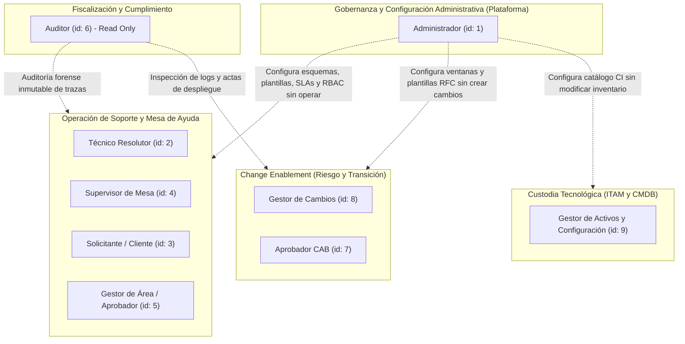

# Catálogo Maestro Granular de Jerarquía y Opciones de Menú por Perfil ITSM

> **Marcos Normativos y Estándares de Referencia:**  
> • **ITIL v4** (Sistema de Valor del Servicio - SVS, Service Desk, Change Enablement, ITAM, CMDB)  
> • **ISO/IEC 20000-1:2018** (Sistema de Gestión de Servicios de TI - Requisitos de Diseño, Entrega y Transición)  
> • **ISO/IEC 27001:2022** (Seguridad de la Información - Controles A.5.15 Control de Acceso, A.5.18 Segregación de Funciones SoD, A.8.15 Registro y Bitácoras)  
> • **COBIT 2019** (Gobernanza y Gestión de TI - Dominios DSS01, DSS02, DSS05, BAI06, BAI09, BAI10)  
> **Alcance:** Taxonomía Exhaustiva de Navegación (Niveles 1, 2 y 3), Matriz de Segregación de Funciones (SoD) para los 9 Perfiles Oficiales, Justificaciones Técnicas y Trazabilidad Integral con Reglas de Negocio (RN), Requerimientos Funcionales (RF) e Historias de Usuario (HU).

---

## 1. Especificación Integral de Roles, Atribuciones y Segregación de Funciones (SoD)

Para garantizar la integridad operativa, la confidencialidad de la información institucional y la prevención de conflictos de interés, el sistema opera bajo el principio de **Control de Acceso Basado en Roles (RBAC)** y una estricta **Segregación de Funciones (Separation of Duties - SoD)**.



### 1.1. Especificación Detallada de los 9 Roles Oficiales

#### 1. Administrador (`id_perfil: 1`)
- **Propósito Institucional:** Custodio global de la plataforma, oficial de configuración y gobierno técnico. Es responsable de parametrizar el espacio de trabajo tecnológico para que las demás unidades operen de forma estandarizada y segura.
- **Funciones y Atribuciones Oficiales:**
  1. Parametrizar y gobernar el espacio de trabajo del sistema, estableciendo políticas corporativas globales.
  2. Configurar formularios, campos requeridos y plantillas de captura: define qué datos se solicitan para tickets y qué campos son obligatorios para solicitudes RFC (impacto, plan de trabajo, pruebas, plan de rollback), cómo se almacenan y cómo se visualizan.
  3. Diseñar y mantener el Catálogo Corporativo de Servicios, parametrizando tiempos de SLA (primera respuesta y resolución) y compuertas de autorización.
  4. Gestionar el ciclo de vida de usuarios (altas, modificaciones, suspensiones) y asignar perfiles en la matriz RBAC.
  5. Configurar la estructura de departamentos de TI y parametrizar los acuerdos de nivel operativo (OLA).
  6. Configurar el equipo de especialistas técnicos, fijando niveles de soporte (L1, L2, L3) y capacidades de trabajo en progreso (límite WIP).
  7. Configurar la jerarquía, visibilidad y orden de las opciones de menú para cada perfil.
  8. Inspeccionar las bitácoras de seguridad e intentos de acceso bajo la norma ISO 27001.
- **Fronteras de Segregación de Funciones (Qué NO hace por diseño SoD):**
  - **No crea solicitudes de cambio (RFCs) operativas:** Las RFCs corresponden a iniciativas técnicas de infraestructura promovidas por Técnicos o coordinadas por el Gestor de Cambios.
  - **No vota en el Comité Asesor de Cambios (CAB):** La evaluación técnica del riesgo corresponde a los líderes técnicos del CAB.
  - **No atiende ni resuelve tickets de soporte:** No actúa como especialista resolutor para evitar el conflicto de intereses de auto-atenderse o distorsionar los tiempos de SLA calculados por sus propias reglas.
  - **No aprueba requerimientos con impacto presupuestal:** Dicha potestad pertenece exclusivamente a las jefaturas departamentales (Gestores de Área).

#### 2. Técnico (`id_perfil: 2`)
- **Propósito Institucional:** Especialista operativo resolutor de incidentes y requerimientos técnicos en primer, segundo o tercer nivel de soporte.
- **Funciones y Atribuciones Oficiales:**
  1. Atender y gestionar los tickets asignados a su nombre dentro de los plazos SLA y OLA.
  2. Tomar tickets disponibles de la bandeja general de pendientes (modelo pull), respetando su límite de carga simultánea (WIP).
  3. Registrar la bitácora de trabajo distinguiendo comentarios públicos para el usuario y notas técnicas internas para el equipo resolutor.
  4. Pausar el cronómetro de SLA cuando la atención dependa de respuesta del usuario o repuestos de terceros.
  5. Sustentar técnicamente la solución aplicada y clasificarla antes de declarar resuelto el caso.
  6. Registrar solicitudes de cambio (RFC) operativas cuando la solución de un incidente requiera una intervención mayor o alteración de la infraestructura productiva.
- **Fronteras SoD:** No puede modificar tiempos ni parámetros de SLA, no puede reasignar tickets arbitrariamente (labor del Supervisor), no aprueba compras ni accede a configuraciones globales del sistema.

#### 3. Solicitante (`id_perfil: 3`)
- **Propósito Institucional:** Cliente interno o colaborador de la organización que consume servicios de TI y reporta anomalías operativas.
- **Funciones y Atribuciones Oficiales:**
  1. Explorar el Catálogo de Servicios Corporativo por categorías estructuradas.
  2. Registrar incidentes y solicitudes de servicio adjuntando justificaciones y evidencias válidas.
  3. Consultar la base de autoayuda para solucionar dudas comunes de forma autónoma.
  4. Monitorear el progreso de sus solicitudes personales en tiempo real.
  5. Evaluar la satisfacción del servicio (CSAT) una vez resuelto su ticket.
  6. Solicitar la reapertura justificada del caso dentro de las 48 horas si comprueba persistencia de la falla.
- **Fronteras SoD:** No tiene visibilidad sobre solicitudes de otros usuarios, no ve notas técnicas internas, no interviene en la asignación ni accede a consolas administrativas o de cambios.

#### 4. Supervisor (`id_perfil: 4`)
- **Propósito Institucional:** Coordinador operativo de la mesa de servicio y líder de las unidades resolutoras técnicas.
- **Funciones y Atribuciones Oficiales:**
  1. Administrar el centro de asignación y despacho, equilibrando la carga de casos entre técnicos.
  2. Reasignar tickets en riesgo de incumplimiento o estancamiento operativo.
  3. Monitorear en tiempo real la disponibilidad, turnos y nivel de saturación WIP de los especialistas.
  4. Supervisar la consola global omnicanal con todos los tickets del sistema.
  5. Gestionar la capacidad operativa y asignación de especialistas a departamentos de TI.
  6. Analizar y exportar métricas ejecutivas de rendimiento (SLA, MTTA, MTTR, CSAT).
- **Fronteras SoD:** No administra identidades ni credenciales de acceso global, no autoriza gastos presupuestales ni altera registros inmutables de auditoría o cronómetros históricos.

#### 5. Gestor de Área (`id_perfil: 5`)
- **Propósito Institucional:** Gerente de unidad de negocio o titular de centro de costos responsable de la validación presupuestal y operativa de los pedidos de su equipo.
- **Funciones y Atribuciones Oficiales:**
  1. Evaluar y autorizar o rechazar formalmente las solicitudes de sus colaboradores que involucren compras de equipos, licencias con costo o accesos sensibles.
  2. Registrar el sustento obligatorio en caso de rechazo, cancelando formalmente la solicitud.
  3. Monitorear los tickets abiertos por los integrantes de su área para controlar el servicio entregado por TI.
  4. Tramitar solicitudes personales de servicio para su gestión gerencial.
  5. Consultar los reportes de volumen y consumo de servicios generados por su departamento.
- **Fronteras SoD:** No puede dictaminar sobre solicitudes de departamentos ajenos, no interviene en la configuración técnica de la infraestructura ni altera el flujo de atención técnica de TI.

#### 6. Auditor (`id_perfil: 6`)
- **Propósito Institucional:** Oficial de aseguramiento de calidad y cumplimiento normativo (ISO 20000, ISO 27001, COBIT, SOX).
- **Funciones y Atribuciones Oficiales:**
  1. Inspeccionar la trazabilidad completa e inalterable de todos los tickets y eventos del sistema.
  2. Fiscalizar las bitácoras de seguridad ISO 27001 (inicios de sesión, bloqueos de usuarios, direcciones IP y marcas de tiempo UTC).
  3. Auditar el cumplimiento contractual de los SLAs pactados en el catálogo de servicios.
  4. Inspeccionar el historial consolidado de cambios (RFCs), actas de votación CAB y revisiones PIR.
  5. Fiscalizar el cumplimiento del licenciamiento de software (SAM) y vigencia de garantías.
- **Fronteras SoD:** **Acceso de estricto modo de solo lectura (Read-Only)** en todas las pantallas. No posee facultades para crear, modificar, transicionar estados ni eliminar datos o bitácoras en ninguna parte del sistema.

#### 7. Aprobador CAB (`id_perfil: 7`)
- **Propósito Institucional:** Autoridad de Cambio integrante del Change Advisory Board responsable de la evaluación técnica y colegiada del riesgo de las modificaciones a la infraestructura.
- **Funciones y Atribuciones Oficiales:**
  1. Evaluar colegiadamente las solicitudes de cambio (RFC) normales y de emergencia en la consola CAB.
  2. Analizar exhaustivamente el plan de trabajo, análisis de impacto, plan de pruebas y plan de contingencia (rollback).
  3. Consultar la topología y relaciones de red en la CMDB para prever impactos cruzados.
  4. Verificar el calendario de cambios para evitar colisiones con ventanas concurrentes o periodos de congelamiento.
  5. Emitir su voto formal justificado (Aprobado, Rechazado o Requiere Modificaciones).
- **Fronteras SoD:** Regla de autoexclusión SoD obligatoria: no puede votar ni dictaminar sobre solicitudes de cambio donde figure como solicitante, promotor o técnico ejecutor. No realiza configuraciones globales ni atiende tickets de mesa de ayuda.

#### 8. Gestor de Cambios (`id_perfil: 8`)
- **Propósito Institucional:** Change Manager responsable del proceso integral de Habilitación del Cambio (Change Enablement) bajo el marco ITIL v4.
- **Funciones y Atribuciones Oficiales:**
  1. Coordinar y supervisar el ciclo de vida completo de las solicitudes de cambio (RFC).
  2. Formular y publicar el calendario corporativo de cambios y ventanas de mantenimiento.
  3. Definir y gestionar los periodos de congelamiento (Change Freeze) autorizados por la dirección.
  4. Convocar, facilitar y registrar las sesiones de dictamen del comité CAB.
  5. Supervisar la ejecución y documentar las revisiones post-implementación (PIR) y lecciones aprendidas.
- **Fronteras SoD:** No puede reemplazar la decisión colegiada del CAB para auto-aprobar cambios normales o mayores de forma unilateral. No administra la infraestructura de identidades ni logs perimetrales.

#### 9. Gestor de Activos y Configuración (`id_perfil: 9`)
- **Propósito Institucional:** Custodio patrimonial y tecnológico responsable de la Gestión de Activos de TI (ITAM) y la Base de Datos de Gestión de Configuración (CMDB).
- **Funciones y Atribuciones Oficiales:**
  1. Gestionar el inventario patrimonial de hardware (HAM), registrando marcas, modelos, series, ubicaciones y asignaciones.
  2. Mapear y administrar los Elementos de Configuración (CIs) y sus interdependencias lógicas y físicas en la CMDB.
  3. Supervisar el licenciamiento de software (SAM), contratos de soporte y fechas de caducidad de garantías.
  4. Alertar oportunamente sobre saturación de cupos de licencias o obsolescencia técnica de equipos.
- **Fronteras SoD:** No autoriza modificaciones en la infraestructura productiva sin una RFC aprobada por el CAB. No aprueba adquisiciones presupuestales de forma autónoma ni administra perfiles de usuario.

---

## 2. Catálogo Maestro Exhaustivo y Granular de Todas las Opciones de Menú

A continuación se presenta el catálogo completo y desglosado de todas las opciones de menú del sistema. Para dar cumplimiento a la directriz de **no resumir ni colapsar funcionalidades**, cada entorno de configuración, operación, supervisión, gobernanza y autoservicio dispone de un espacio y ruta URL propios.

```mermaid
graph TD
    M1["100. Mesa de Servicio"]
    M2["200. Gestión de Cambios"]
    M3["300. Activos de TI y CMDB"]
    M4["400. Reportes y Analítica"]
    M5["500. Administración del Sistema"]

    M1 --> S1_1["110. Portal de Autoservicio"]
    M1 --> S1_2["120. Operación y Soporte"]
    M1 --> S1_3["130. Supervisión y Despacho"]
    M1 --> S1_4["140. Gobernanza de Área"]

    M2 --> S2_1["210. Operación y Solicitudes RFC"]
    M2 --> S2_2["220. Comité Asesor CAB"]

    M3 --> S3_1["310. Hardware Asset Mgmt (HAM)"]
    M3 --> S3_2["320. Configuración CMDB"]
    M3 --> S3_3["330. Software Asset Mgmt (SAM)"]

    M4 --> S4_1["410. Desempeño y SLAs"]

    M5 --> S5_1["510. Identidades y Accesos (IAM)"]
    M5 --> S5_2["520. Servicios y Plantillas"]
    M5 --> S5_3["530. Departamentos y Capacidad"]
    M5 --> S5_4["540. Seguridad ISO 27001"]
```



---

### MÓDULO 1: MESA DE SERVICIO (SERVICE DESK)
- **Código Raíz:** `100` | **Nivel:** 1 | **Ruta:** `/tickets`
- **Descripción:** Núcleo integral para la recepción, trámite, atención y seguimiento del ciclo de vida de incidentes y peticiones de servicio según ITIL v4.

#### Submódulo 1.1: Portal de Autoservicio
- **Código:** `110` | **Nivel:** 2 | **Padre:** `100` | **Ruta:** `/tickets/catalogo`
- **Naturaleza:** Espacio de Autoservicio y Consumo para Colaboradores.

| ID | Nivel | Nombre de la Opción | Ruta URL | Naturaleza del Espacio | Descripción Funcional Detallada | Justificación Técnica y de Negocio | Normas y Reglas Asociadas |
| :---: | :---: | :--- | :--- | :--- | :--- | :--- | :--- |
| **111** | 3 | **Catálogo de servicios** | `/tickets/catalogo` | Autoservicio Consumidor | Portal corporativo estructurado por categorías temáticas (Hardware, Redes, Software, Cuentas) con fichas técnicas de servicios y SLAs pactados. | Facilita la adopción de servicios estandarizados, evita peticiones ambiguas y formaliza el portafolio de TI. | ITIL v4 (Service Request Mgmt), ISO 20000 Cl. 8.2, [RN-09], [RF-09], [HU-08] |
| **112** | 3 | **Registrar solicitud** | `/tickets/gestion/crear` | Autoservicio Operativo | Formulario dinámico de captura con categorización tripartita (Incidente, Solicitud, Problema), captura de justificación, nivel de impacto percibido y carga de evidencias. | Canaliza la demanda institucional con código correlativo único y vincula al colaborador titular sin repudio. | ITIL v4 (Incident Mgmt), ISO 20000 Cl. 8.6, [RN-01], [RN-18], [RN-19], [RF-16], [HU-15] |
| **113** | 3 | **Mis solicitudes** | `/tickets/gestion/mios` | Trazabilidad del Colaborador | Panel personal de seguimiento en tiempo real del estado de los requerimientos registrados por el usuario, con línea de tiempo pública y encuesta CSAT. | Disminuye la incertidumbre del colaborador y elimina consultas innecesarias de estado a la mesa de ayuda. | ITIL v4 (Service Desk Practice), [RN-02], [RN-25], [RN-29], [RF-05], [RF-23], [HU-22] |
| **114** | 3 | **Guías de autoayuda** | `/tickets/gestion/ayuda` | Gestión del Conocimiento | Repositorio de artículos de conocimiento, soluciones guiadas y manuales interactivos de resolución autónoma de incidentes frecuentes. | Fomenta el autoservicio de primer contacto, reduciendo la sobrecarga de incidencias rutinarias en el equipo técnico. | ITIL v4 (Knowledge Mgmt), ISO 20000 Cl. 8.6, [RN-13], [RF-11], [HU-10] |

---

#### Submódulo 1.2: Operación y Resolución Técnica
- **Código:** `120` | **Nivel:** 2 | **Padre:** `100` | **Ruta:** `/tickets/gestion/bandeja`
- **Naturaleza:** Espacio de Trabajo Resolutor para Especialistas Técnicos.

| ID | Nivel | Nombre de la Opción | Ruta URL | Naturaleza del Espacio | Descripción Funcional Detallada | Justificación Técnica y de Negocio | Normas y Reglas Asociadas |
| :---: | :---: | :--- | :--- | :--- | :--- | :--- | :--- |
| **121** | 3 | **Mis tickets asignados** | `/tickets/gestion/asignados` | Cola Personal Resolutora | Mesa de trabajo individual del técnico con los casos puestos bajo su responsabilidad, ordenados por prioridad calculada y vencimiento de SLA. | Centraliza la labor diaria del especialista, permitiendo transiciones de estado, pausas justificadas y registro de soluciones. | ITIL v4 (Incident Mgmt), ISO 20000 Cl. 8.6, [RN-10], [RN-22], [RN-24], [RF-19], [RF-22], [HU-18], [HU-21] |
| **122** | 3 | **Bandeja de pendientes** | `/tickets/gestion/bandeja` | Cola General (Pull) | Bandeja comunitaria de incidentes y requerimientos libres sin asignar, disponibles para autoasignación controlada según límite WIP. | Optimiza el flujo continuo de trabajo (Kanban/Pull) y reduce los tiempos de espera iniciales sin saturar al personal. | ITIL v4 (Incident Mgmt), [RN-15], [RN-16], [RN-17], [RF-19], [HU-18] |
| **123** | 3 | **Tickets de mi área técnica** | `/tickets/gestion/departamento` | Colaboración Resolutora | Vista compartida de los tickets asignados a la unidad técnica del especialista (Infraestructura, Redes, Aplicaciones) para respaldo operativo. | Permite el soporte colaborativo entre compañeros de guardia y cobertura durante descansos o contingencias de campo. | ITIL v4 (Team Collaboration), [RN-14], [RN-23], [RF-19], [RF-21], [HU-20] |
| **124** | 3 | **Historial de resueltos** | `/tickets/gestion/resueltos` | Base de Lecciones Técnicas | Repositorio de consulta de tickets cerrados con soluciones técnicas aplicadas, actas de diagnóstico y categorías de cierre. | Permite reutilizar diagnósticos previos y acelera el tiempo medio de resolución (MTTR) en problemas recurrentes. | ITIL v4 (Knowledge / Problem Mgmt), [RN-03], [RN-24], [RF-05], [HU-21] |

---

#### Submódulo 1.3: Supervisión y Despacho Operativo
- **Código:** `130` | **Nivel:** 2 | **Padre:** `100` | **Ruta:** `/tickets/gestion/asignar`
- **Naturaleza:** Espacio de Gobierno Operativo y Balanceo de Carga para Jefaturas de TI.

| ID | Nivel | Nombre de la Opción | Ruta URL | Naturaleza del Espacio | Descripción Funcional Detallada | Justificación Técnica y de Negocio | Normas y Reglas Asociadas |
| :---: | :---: | :--- | :--- | :--- | :--- | :--- | :--- |
| **131** | 3 | **Centro de asignación** | `/tickets/gestion/asignar` | Despacho y Balanceo | Consola para asignar y reasignar tickets manualmente a técnicos en turno, con alertas preventivas por saturación o riesgo de vencimiento de SLA al 80%. | Asegura una distribución equitativa de casos e interviene proactivamente antes de que se vulneren los compromisos SLA. | ITIL v4 (Service Desk Governance), [RN-14], [RN-15], [RN-16], [RN-28], [RF-19], [RF-26], [HU-18], [HU-25] |
| **132** | 3 | **Monitoreo de técnicos** | `/tickets/gestion/tecnicos` | Supervisión de Capacidad | Tablero de control de disponibilidad, estado de turno laboral activo y carga concurrente de tickets por especialista frente a su límite WIP autorizado. | Previene la sobrecarga laboral de los técnicos y garantiza que no se deriven casos a personal inactivo o con descanso programado. | ITIL v4 (Capacity Mgmt), [RN-16], [RN-17], [RF-15], [HU-14] |
| **133** | 3 | **Todos los tickets** | `/tickets/gestion/todos` | Consola Omnicanal | Visor integral de todos los requerimientos e incidentes del sistema con filtros avanzados por estado, área resolutora, prioridad y criticidad. | Otorga visibilidad completa del estado del servicio para coordinar emergencias mayores y auditorías operativas. | COBIT 2019 (DSS02), ISO 20000 Cl. 8.6, [RN-03], [RN-07], [RF-05], [HU-29] |
| **134** | 3 | **Auditoría forense** | `/tickets/gestion/auditoria` | Fiscalización de Trazas | Módulo forense inalterable que detalla la línea de tiempo de cada ticket: cronómetros, autores, cambios de estado, pausas de SLA y solución final. | Provee evidencia legal y técnica inmutable para auditorías externas de calidad, cumplimiento SLA y normas ISO. | ISO 27001 Control A.8.15, ISO 20000 Cl. 8.7, [RN-03], [RN-22], [RN-24], [RF-04], [RF-05], [HU-29] |

---

#### Submódulo 1.4: Gobernanza y Aprobaciones Departamentales
- **Código:** `140` | **Nivel:** 2 | **Padre:** `100` | **Ruta:** `/tickets/gestion/aprobaciones`
- **Naturaleza:** Espacio de Control y Gobernanza de Negocio para Jefaturas de Área.

| ID | Nivel | Nombre de la Opción | Ruta URL | Naturaleza del Espacio | Descripción Funcional Detallada | Justificación Técnica y de Negocio | Normas y Reglas Asociadas |
| :---: | :---: | :--- | :--- | :--- | :--- | :--- | :--- |
| **141** | 3 | **Mis aprobaciones** | `/tickets/gestion/aprobaciones` | Compuerta de Aprobación | Bandeja para revisar, autorizar o rechazar con motivo obligatorio las solicitudes generadas por colaboradores del área que involucren compras o recursos. | Salvaguarda el presupuesto corporativo y evita la asignación arbitraria de activos tecnológicos o accesos privilegiados. | ITIL v4 (Service Request Mgmt), [RN-04], [RN-12], [RN-21], [RF-18], [HU-17] |
| **142** | 3 | **Tickets de mi departamento** | `/tickets/gestion/departamento` | Supervisión de Consumo | Panel de supervisión de todos los casos tramitados por el personal adscrito al área del gestor, con estado y tiempos de respuesta. | Permite al gerente de negocio velar por la continuidad de sus procesos y comprobar la calidad del soporte prestado por TI. | ITIL v4 (Business Relationship Mgmt), [RN-07], [RN-30], [RF-08], [HU-07] |

---

### MÓDULO 2: GESTIÓN DE CAMBIOS (CHANGE ENABLEMENT)
- **Código Raíz:** `200` | **Nivel:** 1 | **Ruta:** `/cambios`
- **Descripción:** Control riguroso de modificaciones en la infraestructura tecnológica para maximizar cambios exitosos y mitigar riesgos operacionales.

#### Submódulo 2.1: Operación y Solicitudes RFC
- **Código:** `210` | **Nivel:** 2 | **Padre:** `200` | **Ruta:** `/cambios/gestion`
- **Naturaleza:** Espacio Operativo y de Programación de Cambios.

| ID | Nivel | Nombre de la Opción | Ruta URL | Naturaleza del Espacio | Descripción Funcional Detallada | Justificación Técnica y de Negocio | Normas y Reglas Asociadas |
| :---: | :---: | :--- | :--- | :--- | :--- | :--- | :--- |
| **211** | 3 | **Registrar solicitud RFC** | `/cambios/gestion/crear` | Formulación Operativa RFC | Formulario técnico estructurado para registrar solicitudes de cambio detallando impacto, clasificación (Estándar, Normal, Emergencia), plan de trabajo, pruebas y rollback obligatorio. | Estandariza la petición de cambios técnicos e impide intervenciones en producción sin análisis de contingencia. | ITIL v4 (Change Enablement), ISO 20000 Cl. 8.5, [RN-33], [RN-34], [RF-30], [HU-30] |
| **212** | 3 | **Calendario de ventanas** | `/cambios/gestion/calendario` | Planificación Temporal | Calendario corporativo que proyecta ventanas de mantenimiento autorizadas, cruces de dependencias y periodos de congelamiento (Change Freeze). | Previene colisiones entre intervenciones simultáneas y protege la operatividad del negocio en temporadas críticas. | ITIL v4 (Change Schedule), COBIT 2019 BAI06, [RN-33], [RF-32], [HU-32] |
| **213** | 3 | **Historial consolidado** | `/cambios/gestion/todos` | Trazabilidad y Cierre PIR | Repositorio forense de todas las solicitudes RFC ejecutadas, con registro del dictamen CAB, resultados de implementación y actas PIR. | Provee auditoría integral del historial de cambios y sustenta el ciclo de mejora continua de infraestructura. | ISO 20000 Cl. 8.5, ISO 27001 Control A.8.15, [RN-03], [RN-34], [RF-33], [HU-33] |

---

#### Submódulo 2.2: Comité Asesor CAB (Change Advisory Board)
- **Código:** `220` | **Nivel:** 2 | **Padre:** `200` | **Ruta:** `/cambios/gestion/cab`
- **Naturaleza:** Espacio de Gobernanza Colegiada y Evaluación de Riesgos.

| ID | Nivel | Nombre de la Opción | Ruta URL | Naturaleza del Espacio | Descripción Funcional Detallada | Justificación Técnica y de Negocio | Normas y Reglas Asociadas |
| :---: | :---: | :--- | :--- | :--- | :--- | :--- | :--- |
| **221** | 3 | **Dictamen colegiado CAB** | `/cambios/gestion/cab` | Votación y Quórum CAB | Consola colegiada donde los miembros de la Autoridad de Cambio evalúan planes de contingencia, analizan riesgos y emiten su voto con autoexclusión SoD. | Garantiza la evaluación técnica multidisciplinaria de cambios mayores e impide la autoaprobación de modificaciones por sus propios autores. | ITIL v4 (Change Authority), ISO 27001 Control A.5.18, [RN-31], [RN-32], [RF-31], [HU-31] |

---

### MÓDULO 3: ACTIVOS DE TI Y CONFIGURACIÓN (ITAM / CMDB)
- **Código Raíz:** `300` | **Nivel:** 1 | **Ruta:** `/activos`
- **Descripción:** Custodia patrimonial de hardware, mapeo de dependencias de red en la CMDB y cumplimiento legal del licenciamiento de software.

| ID | Nivel | Nombre de la Opción | Ruta URL | Naturaleza del Espacio | Descripción Funcional Detallada | Justificación Técnica y de Negocio | Normas y Reglas Asociadas |
| :---: | :---: | :--- | :--- | :--- | :--- | :--- | :--- |
| **310** | 2 | **Inventario de activos (HAM)** | `/activos/inventario` | Gestión Patrimonial HAM | Catálogo de equipos físicos y periféricos (servidores, estaciones, laptops, switches) con series, responsable asignado, ubicación y estado. | Controla el patrimonio tecnológico corporativo, previene pérdidas de equipos y optimiza el ciclo de vida del hardware. | ITIL v4 (IT Asset Mgmt), ISO 20000 Cl. 8.2, COBIT 2019 BAI09, [RN-35], [RF-34], [HU-34] |
| **320** | 2 | **Mapa de topología CMDB** | `/activos/cmdb` | Configuración Lógica SACM | Mapeo interactivo de Elementos de Configuración (CIs) y sus relaciones lógicas (servidor a base de datos, servicio de negocio a switch de red). | Permite realizar análisis de impacto instantáneo ante caídas de servicio o solicitudes de cambio a la infraestructura. | ITIL v4 (Service Configuration Mgmt), ISO 20000 Cl. 8.7, COBIT 2019 BAI10, [RN-35], [RF-35], [HU-35] |
| **330** | 2 | **Licencias de software (SAM)** | `/activos/licencias` | Control de Licenciamiento SAM | Monitoreo del parque de licencias adquiridas versus asignadas, suscripciones corporativas, fechas de caducidad y alertas de garantías. | Previene contingencias legales por uso de software no autorizado y evita gastos redundantes en licencias inactivas. | ITIL v4 (IT Asset Mgmt), ISO 27001 Control A.8.1, [RN-36], [RF-36], [HU-36] |

---

### MÓDULO 4: REPORTES Y ANALÍTICA DEL SERVICIO
- **Código Raíz:** `400` | **Nivel:** 1 | **Ruta:** `/tickets/reportes`
- **Descripción:** Inteligencia operacional y analítica de desempeño para la toma de decisiones gerenciales y la mejora continua del servicio.

| ID | Nivel | Nombre de la Opción | Ruta URL | Naturaleza del Espacio | Descripción Funcional Detallada | Justificación Técnica y de Negocio | Normas y Reglas Asociadas |
| :---: | :---: | :--- | :--- | :--- | :--- | :--- | :--- |
| **410** | 2 | **Indicadores y SLAs** | `/tickets/reportes` | Analítica Gerencial | Tableros ejecutivos con métricas de tiempo medio de respuesta (MTTA), resolución (MTTR), cumplimiento porcentual de SLAs, CSAT y exportación tabular. | Permite evaluar objetivamente la eficiencia del soporte, justificar necesidades de recursos y detectar cuellos de botella operativos. | ITIL v4 (Continual Improvement), ISO 20000 Cl. 9.1, [RN-10], [RN-30], [RF-28], [HU-27] |

---

### MÓDULO 5: ADMINISTRACIÓN DEL SISTEMA Y GOBERNANZA
- **Código Raíz:** `500` | **Nivel:** 1 | **Ruta:** `/admin`
- **Descripción:** Entorno exclusivo para que el Administrador configure, diseñe y gobierne la plataforma, estableciendo formularios, plantillas, esquemas de datos, SLAs y seguridad sin intervenir en la operación resolutora o transaccional.

#### Submódulo 5.1: Identidades y Control de Accesos (IAM & RBAC)
- **Código:** `510` | **Nivel:** 2 | **Padre:** `500` | **Ruta:** `/admin/usuarios`
- **Naturaleza:** Gobernanza de Identidades Corporativas y Seguridad Lógica.

| ID | Nivel | Nombre de la Opción | Ruta URL | Naturaleza del Espacio | Descripción Funcional Detallada | Justificación Técnica y de Negocio | Normas y Reglas Asociadas |
| :---: | :---: | :--- | :--- | :--- | :--- | :--- | :--- |
| **511** | 3 | **Gestión de usuarios** | `/admin/usuarios` | Mantenimiento de Identidades | Módulo para registrar colaboradores, editar información corporativa, restablecer claves seguras y aplicar suspensión o baja lógica inmutable. | Garantiza la autenticidad de las personas que interactúan con el soporte institucional bajo principios de no repudio. | ISO 27001 Control A.9.2, [RN-01], [RN-05], [RN-08], [RF-06], [HU-04] |
| **512** | 3 | **Perfiles y permisos** | `/admin/perfiles` | Matriz RBAC Corporativa | Módulo de configuración de roles del sistema y asignación de perfiles a usuarios, controlando facultades operativas y límites SoD. | Aplica el principio de menor privilegio, evitando asignación desmedida de atribuciones o conflictos de interés. | ISO 27001 Control A.5.15, [RN-05], [RN-07], [RN-38], [RF-06], [HU-05] |
| **513** | 3 | **Estructura del menú** | `/admin/menu` | Diseñador de Navegación | Consola de parametrización de la jerarquía de opciones (Niveles 1, 2 y 3), iconos asociados y reglas de visibilidad por perfil. | Permite estructurar de forma dinámica el menú del sistema adaptándolo a nuevas necesidades institucionales sin tocar código. | ISO 27001 Control A.5.15, [RN-07], [RN-38], [RF-38], [HU-07] |

---

#### Submódulo 5.2: Gobierno del Portafolio y Configuración de Formularios
- **Código:** `520` | **Nivel:** 2 | **Padre:** `500` | **Ruta:** `/admin/servicios`
- **Naturaleza:** Configuración de Esquemas, Plantillas de Captura y Acuerdos de Nivel de Servicio.

| ID | Nivel | Nombre de la Opción | Ruta URL | Naturaleza del Espacio | Descripción Funcional Detallada | Justificación Técnica y de Negocio | Normas y Reglas Asociadas |
| :---: | :---: | :--- | :--- | :--- | :--- | :--- | :--- |
| **521** | 3 | **Catálogo de servicios y SLAs** | `/admin/servicios` | Configurador de Servicios y SLAs | Consola de creación de servicios, parametrización de tiempos SLA (respuesta y solución), categorización y compuertas de autorización previa. | Fija los compromisos contractuales del soporte tecnológico antes de habilitar los trámites para los usuarios finales. | ITIL v4 (Service Level Mgmt), ISO 20000 Cl. 8.2, [RN-09], [RN-10], [RN-12], [RF-09], [HU-08] |
| **522** | 3 | **Configurador de esquemas RFC** | `/admin/servicios` | Parametrización de Plantillas RFC | Espacio administrativo donde el Administrador diseña los esquemas y formularios de cambio: qué campos se exigen al registrar, cómo se almacenan y cómo se visualizan. | Permite gobernar los requisitos documentales de los cambios institucionales sin que el Administrador sea quien opere o cree las solicitudes. | ITIL v4 (Change Governance), ISO 20000 Cl. 8.5, [RN-37], [RF-37], [HU-37] |

---

#### Submódulo 5.3: Organización y Capacidad Resolutora
- **Código:** `530` | **Nivel:** 2 | **Padre:** `500` | **Ruta:** `/admin/departamentos`
- **Naturaleza:** Configuración de Unidades Resolutoras y Capacidad Operativa.

| ID | Nivel | Nombre de la Opción | Ruta URL | Naturaleza del Espacio | Descripción Funcional Detallada | Justificación Técnica y de Negocio | Normas y Reglas Asociadas |
| :---: | :---: | :--- | :--- | :--- | :--- | :--- | :--- |
| **531** | 3 | **Departamentos de TI** | `/admin/departamentos` | Áreas Resolutoras y OLAs | Parametrización de unidades técnicas resolutoras (Infraestructura, Redes, Sistemas), asignación de supervisores titulares y metas de tiempo OLA. | Define la estructura organizativa de resolución interna y delimita las responsabilidades de gestión de cada especialidad. | ITIL v4 (Service Level Mgmt), [RN-14], [RF-13], [HU-12] |
| **532** | 3 | **Especialistas técnicos** | `/admin/tecnicos` | Capacidad y Niveles Técnicos | Asignación de técnicos a departamentos, configuración del nivel de pericia (N1, N2, N3) y calibración del tope máximo de carga concurrente (límite WIP). | Garantiza que el sistema conozca las competencias del personal y bloquee asignaciones por encima de la capacidad humana recomendada. | ITIL v4 (Capacity / Workload Mgmt), [RN-15], [RN-16], [RF-14], [HU-13] |

---

#### Submódulo 5.4: Seguridad de la Información y Cumplimiento ISO 27001
- **Código:** `540` | **Nivel:** 2 | **Padre:** `500` | **Ruta:** `/admin/seguridad-logs`
- **Naturaleza:** Monitor de Seguridad Perimetral y Auditoría Forense.

| ID | Nivel | Nombre de la Opción | Ruta URL | Naturaleza del Espacio | Descripción Funcional Detallada | Justificación Técnica y de Negocio | Normas y Reglas Asociadas |
| :---: | :---: | :--- | :--- | :--- | :--- | :--- | :--- |
| **541** | 3 | **Logs de seguridad ISO 27001** | `/admin/seguridad-logs` | Bitácora de Eventos de Seguridad | Visor inmutable de eventos de autenticación, inicios de sesión fallidos, bloqueos de usuarios, direcciones IP y marcas de tiempo. | Provee detección temprana de intrusiones, previene ataques de fuerza bruta y acredita cumplimiento del control A.8.15 de ISO 27001. | ISO/IEC 27001 Control A.8.15, [RN-03], [RN-38], [RF-39], [HU-38] |

---

## 3. Distribución Segregada de Opciones de Menú por Perfil

En cumplimiento del **Principio de Menor Privilegio (Least Privilege)** y la **Segregación Estricta de Funciones (SoD)**, cada colaborador visualiza únicamente las opciones indispensables para sus responsabilidades laborales.

---

### 3.1. Perfil Solicitante (`id_perfil: 3`)

#### Árbol Jerárquico Habilitado
```
Mesa de Servicio (/tickets)
└── Portal de Autoservicio (/tickets/catalogo)
    ├── Catálogo de servicios (/tickets/catalogo)
    ├── Registrar solicitud (/tickets/gestion/crear)
    ├── Mis solicitudes (/tickets/gestion/mios)
    └── Guías de autoayuda (/tickets/gestion/ayuda)
```

#### Justificación de Opciones Visibles
- **Catálogo de servicios (`111`):** Necesario para que el colaborador conozca los servicios de TI disponibles formalmente y sus plazos SLA.
- **Registrar solicitud (`112`):** Permite canalizar peticiones formales con evidencias, sustentando la demanda sin recurrir a canales informales.
- **Mis solicitudes (`113`):** Brinda seguimiento personal del avance de sus trámites, interacción con técnicos y calificación de satisfacción CSAT.
- **Guías de autoayuda (`114`):** Permite al usuario resolver dudas comunes de forma autónoma antes de saturar a la mesa de ayuda.

#### Exclusiones por Segregación de Funciones (SoD)
> [!IMPORTANT]
> - **Oculto: Operación y Soporte (`120`):** El solicitante no tiene competencias resolutoras ni puede acceder a colas técnicas.
> - **Oculto: Supervisión y Despacho (`130`):** No puede consultar tickets de otros colaboradores de la empresa por confidencialidad [RN-02].
> - **Oculto: Gestión de Cambios (`200`):** Las modificaciones de infraestructura productiva competen exclusivamente a ingeniería de TI.
> - **Oculto: Activos y Administración (`300`, `500`):** Protegidos para evitar manipulación de inventarios o configuraciones del sistema.

---

### 3.2. Perfil Técnico (`id_perfil: 2`)

#### Árbol Jerárquico Habilitado
```
Mesa de Servicio (/tickets)
├── Portal de Autoservicio (/tickets/catalogo)
│   ├── Registrar solicitud (/tickets/gestion/crear)
│   └── Guías de autoayuda (/tickets/gestion/ayuda)
└── Operación y Soporte (/tickets/gestion/bandeja)
    ├── Mis tickets asignados (/tickets/gestion/asignados)
    ├── Bandeja de pendientes (/tickets/gestion/bandeja)
    ├── Tickets de mi área técnica (/tickets/gestion/departamento)
    └── Historial de resueltos (/tickets/gestion/resueltos)
Gestión de Cambios (/cambios)
└── Operación y Solicitudes RFC (/cambios/gestion)
    ├── Registrar solicitud RFC (/cambios/gestion/crear)
    ├── Calendario de ventanas (/cambios/gestion/calendario)
    └── Historial consolidado (/cambios/gestion/todos)
Activos de TI y CMDB (/activos)
├── Inventario de activos (/activos/inventario)
└── Mapa de topología CMDB (/activos/cmdb)
```

#### Justificación de Opciones Visibles
- **Mis tickets asignados (`121`):** Centro neurálgico del trabajo resolutor, gestión de estados y documentación de solución bajo SLA.
- **Bandeja de pendientes (`122`):** Permite tomar tickets sin asignar (modelo pull) respetando su límite WIP.
- **Tickets de mi área técnica (`123`):** Facilita la colaboración entre especialistas del mismo departamento.
- **Historial de resueltos (`124`):** Base de consulta de soluciones previas para acelerar diagnósticos.
- **Registrar solicitud RFC (`211`):** Necesario cuando la solución de un incidente requiera intervenir la infraestructura de producción.
- **Calendario de ventanas (`212`):** Permite verificar que las intervenciones técnicas no coincidan con periodos de freeze.
- **Inventario (`310`) y CMDB (`320`):** Permite validar el hardware involucrado y sus dependencias de red durante el diagnóstico.

#### Exclusiones por Segregación de Funciones (SoD)
> [!WARNING]
> - **Oculto: Dictamen colegiado CAB (`221`):** El técnico no vota aprobaciones sobre cambios que él mismo implementa.
> - **Oculto: Centro de asignación (`131`) y Monitoreo (`132`):** El balanceo y supervisión de cargas es potestad del Supervisor.
> - **Oculto: Aprobaciones departamentales (`141`):** El técnico no puede autorizar compras de equipos ni gastos presupuestales.
> - **Oculto: Módulo de Administración (`500`):** No puede alterar parámetros de catálogo, SLAs ni perfiles de usuario.

---

### 3.3. Perfil Supervisor (`id_perfil: 4`)

#### Árbol Jerárquico Habilitado
```
Mesa de Servicio (/tickets)
├── Operación y Soporte (/tickets/gestion/bandeja)
│   ├── Bandeja de pendientes (/tickets/gestion/bandeja)
│   └── Historial de resueltos (/tickets/gestion/resueltos)
└── Supervisión y Despacho (/tickets/gestion/asignar)
    ├── Centro de asignación (/tickets/gestion/asignar)
    ├── Monitoreo de técnicos (/tickets/gestion/tecnicos)
    ├── Todos los tickets (/tickets/gestion/todos)
    └── Auditoría forense (/tickets/gestion/auditoria)
Gestión de Cambios (/cambios)
└── Operación y Solicitudes RFC (/cambios/gestion)
    ├── Calendario de ventanas (/cambios/gestion/calendario)
    └── Historial consolidado (/cambios/gestion/todos)
Reportes y Analítica (/tickets/reportes)
└── Indicadores y SLAs (/tickets/reportes)
Administración del Sistema (/admin)
└── Organización y Capacidad (/admin/departamentos)
    ├── Departamentos de TI (/admin/departamentos)
    └── Especialistas técnicos (/admin/tecnicos)
```

#### Justificación de Opciones Visibles
- **Centro de asignación (`131`):** Faculta el despacho de casos y la reasignación de tickets con riesgo de vencer su SLA.
- **Monitoreo de técnicos (`132`):** Supervisa la disponibilidad en turno y evita saturación de carga por encima del límite WIP.
- **Todos los tickets (`133`):** Visibilidad omnicanal indispensable para coordinar la mesa de ayuda.
- **Reportes (`410`):** Análisis de indicadores gerenciales MTTA, MTTR, cumplimiento SLA y CSAT.
- **Departamentos (`531`) y Técnicos (`532`):** Mantenimiento de la capacidad de guardia y especialidades técnicas resolutoras.

#### Exclusiones por Segregación de Funciones (SoD)
> [!NOTE]
> - **Oculto: Gestión de usuarios y perfiles (`511`, `512`):** La creación de usuarios y matriz RBAC es tarea del Administrador.
> - **Oculto: Dictamen colegiado CAB (`221`):** No sustituye a la autoridad colegiada CAB.
> - **Oculto: Aprobaciones departamentales (`141`):** No aprueba solicitudes con costo de áreas funcionales de negocio.

---

### 3.4. Perfil Gestor de Área (`id_perfil: 5`)

#### Árbol Jerárquico Habilitado
```
Mesa de Servicio (/tickets)
├── Portal de Autoservicio (/tickets/catalogo)
│   ├── Catálogo de servicios (/tickets/catalogo)
│   ├── Registrar solicitud (/tickets/gestion/crear)
│   └── Mis solicitudes (/tickets/gestion/mios)
└── Gobernanza de Área (/tickets/gestion/aprobaciones)
    ├── Mis aprobaciones (/tickets/gestion/aprobaciones)
    └── Tickets de mi departamento (/tickets/gestion/departamento)
Reportes y Analítica (/tickets/reportes)
└── Indicadores y SLAs (/tickets/reportes)
```

#### Justificación de Opciones Visibles
- **Mis aprobaciones (`141`):** Compuerta obligatoria de aprobación para solicitudes de su área con impacto financiero o de seguridad.
- **Tickets de mi departamento (`142`):** Monitorea el cumplimiento del servicio prestado por TI al personal bajo su mando.
- **Reportes (`410`):** Consulta el volumen y consumo de servicios generado por su unidad de negocio.
- **Portal de Autoservicio (`111`-`113`):** Le permite tramitar y dar seguimiento a sus propias solicitudes de trabajo.

#### Exclusiones por Segregación de Funciones (SoD)
> [!WARNING]
> - **Oculto: Operaciones Técnicas (`120`, `130`):** No puede asignar técnicos ni intervenir en la resolución técnica de TI.
> - **Oculto: Cambios y Activos (`200`, `300`):** Protegidos para evitar intromisión en la infraestructura interna de sistemas.
> - **Oculto: Administración (`500`):** No tiene atribuciones sobre parámetros del sistema.

---

### 3.5. Perfil Auditor (`id_perfil: 6`)

#### Árbol Jerárquico Habilitado (Estricto Modo de Solo Lectura)
```
Mesa de Servicio (/tickets)
└── Supervisión y Despacho (/tickets/gestion/asignar)
    └── Auditoría forense (/tickets/gestion/auditoria)
Gestión de Cambios (/cambios)
└── Operación y Solicitudes RFC (/cambios/gestion)
    └── Historial consolidado (/cambios/gestion/todos)
Activos de TI y CMDB (/activos)
├── Inventario de activos (/activos/inventario)
└── Licencias de software (/activos/licencias)
Reportes y Analítica (/tickets/reportes)
└── Indicadores y SLAs (/tickets/reportes)
Administración del Sistema (/admin)
├── Gobierno del Portafolio (/admin/servicios)
│   └── Catálogo de servicios y SLAs (/admin/servicios) [Solo Lectura]
└── Seguridad ISO 27001 (/admin/seguridad-logs)
    └── Logs de seguridad ISO 27001 (/admin/seguridad-logs)
```

#### Justificación de Opciones Visibles
- **Auditoría forense (`134`):** Verificación inalterable del ciclo de vida de tickets, pausas y justificaciones de cierre.
- **Historial consolidado de cambios (`213`):** Fiscalización de solicitudes RFC y actas de despliegue PIR.
- **Inventario (`310`) y Licencias (`330`):** Inspección patrimonial de hardware y cumplimiento legal de software SAM.
- **Logs de seguridad ISO 27001 (`541`):** Evidencia probatoria de accesos, intentos fallidos y bloqueos de seguridad.
- **Catálogo y SLAs (`521`):** Fiscalización de las condiciones de servicio pactadas con la dirección.

#### Exclusiones por Segregación de Funciones (SoD)
> [!CAUTION]
> - **Sin botones de acción ni edición:** El perfil auditor tiene **prohibida cualquier operación de escritura, creación o borrado**.
> - **Oculto: Bandejas resolutoras y de despacho (`120`, `131`):** No opera ni gestiona la mesa de ayuda.
> - **Oculto: Registro de RFC (`211`):** No origina modificaciones técnicas.

---

### 3.6. Perfil Administrador (`id_perfil: 1`)

#### Árbol Jerárquico Habilitado
```
Configuración (/admin)
├── Identidades y accesos (/admin/usuarios)
│   ├── Gestión de usuarios (/admin/usuarios)
│   ├── Perfiles y permisos (/admin/perfiles)
│   └── Estructura del menú (/admin/menu)
├── Catálogo de servicios y SLAs (/admin/servicios)
│   ├── Servicios de incidentes (/admin/servicios?tipo=1)
│   ├── Servicios de solicitudes (/admin/servicios?tipo=2)
│   ├── Categorías y ofertas publicadas (/admin/servicios)
│   ├── Acceso por perfil o criterio de audiencia (/admin/portal-autoservicio)
│   └── Objetivos SLA (/admin/servicios)
├── Configuración de procesos (/admin/tickets-formularios)
│   ├── Incidentes (/admin/tickets-formularios?tipo=incidente)
│   │   ├── Formularios y campos (/admin/tickets-formularios?tipo=incidente)
│   │   ├── Vistas previas por usuario/perfil (/admin/tickets-vistas?tipo=incidente)
│   │   ├── Flujo de estados y acciones (/admin/tickets-vistas?seccion=estados)
│   │   └── Reglas de notificación (/admin/notificaciones?proceso=incidente)
│   ├── Solicitudes de servicio (/admin/tickets-formularios?tipo=solicitud)
│   │   ├── Formularios y campos (/admin/tickets-formularios?tipo=solicitud)
│   │   ├── Vistas previas por usuario/perfil (/admin/tickets-vistas?tipo=solicitud)
│   │   ├── Flujo de atención y aprobaciones (/admin/servicios)
│   │   └── Reglas de notificación (/admin/notificaciones?proceso=solicitud)
│   ├── Gestión de cambios (/admin/rfc)
│   │   ├── Formulario RFC (/admin/rfc)
│   │   ├── Tipos de cambio y requisitos (/admin/rfc?seccion=requisitos)
│   │   ├── Flujo de evaluación, autorización y revisión posterior (/admin/rfc?seccion=aprobaciones)
│   │   └── Notificaciones y calendario de cambios (/cambios/gestion/calendario)
│   └── Gestión de problemas (/problemas)
│       ├── Formularios (/problemas)
│       ├── Flujo de investigación y seguimiento (/problemas)
│       └── Relación con incidentes, errores conocidos y conocimiento (/problemas/kedb)
├── Organización y soporte (/admin/departamentos)
│   ├── Departamentos empresariales (/admin/departamentos-empresa)
│   ├── Departamentos y grupos resolutores de TI (/admin/departamentos)
│   ├── Técnicos y niveles de soporte (/admin/tecnicos)
│   └── Supervisores (/admin/departamentos)
├── Activos y configuración (/activos/inventario)
│   ├── Tipos, modelos y atributos de activos (/activos/inventario)
│   ├── Ciclos de vida y reglas de transición (/activos/inventario)
│   ├── Licencias y contratos (/activos/licencias)
│   └── Tipos de elementos de configuración y relaciones de CMDB (/activos/cmdb/tipos)
├── Comunicaciones y notificaciones (/admin/notificaciones)
│   ├── Plantillas de correo y otros canales (/admin/notificaciones)
│   └── Configuración de conexiones de correo y canales externos (/admin/notificaciones)
├── Gobierno del conocimiento (/admin/conocimiento-config)
│   └── Categorías, responsables y reglas de publicación/revisión (/admin/conocimiento-config)
└── Auditoría, seguridad y retención (/admin/auditoria-sistema)
    ├── Auditoría de cambios (/admin/auditoria-sistema)
    ├── Registros de seguridad y autenticación (/admin/seguridad-logs)
    └── Retención y mantenimiento de datos (/admin/mantenimiento-datos)
Reportes y Analítica (/tickets/reportes)
├── Indicadores operativos y SLA (/tickets/reportes)
└── Tableros (/admin/reportes-disenador)
```

#### Justificación de Opciones Visibles
- **Módulo de Administración Completo (`510`-`540`):** Eje de sus atribuciones: configura usuarios, perfiles RBAC, menú dinámico, catálogo de servicios, tiempos SLA, departamentos de TI, límites WIP y logs perimetrales.
- **Configurador de esquemas RFC (`522`):** Permite parametrizar las plantillas y formularios que se pedirán al registrar cambios, cómo se almacenan y cómo se visualizan, cumpliendo su rol de diseñador sin ser resolutor.
- **Calendario de ventanas (`212`) e Historial (`213`):** Necesario para coordinar periodos de mantenimiento de la plataforma tecnológica y fiscalizar incidentes derivados de cambios.
- **Consola integral de tickets (`133`):** Supervisión macro del comportamiento global del sistema ante caídas o contingencias.
- **Activos y CMDB (`310`-`330`):** Parametrización y gobernanza de los catálogos base de hardware, licencias y topologías.

#### Exclusiones por Segregación de Funciones (SoD)
> [!IMPORTANT]
> - **Oculto: Registrar solicitud RFC (`211`):** El Administrador define la plantilla y los esquemas del formulario de RFC, pero **NO origina solicitudes de cambio operativas**. Dichas peticiones nacen del personal técnico resolutor o del Gestor de Cambios.
> - **Oculto: Dictamen colegiado CAB (`221`):** No emite voto resolutivo en el CAB para evitar que quien configura la infraestructura evalúe sus propios esquemas de riesgo.
> - **Oculto: Mis tickets asignados (`121`) y Bandeja de pendientes (`122`):** El Administrador no tiene cola resolutora de tickets personales; no atiende incidentes para evitar distorsiones en los SLAs configurados por él mismo.
> - **Oculto: Mis aprobaciones (`141`):** No autoriza compras departamentales de áreas de negocio.

---

### 3.7. Perfil Aprobador CAB (`id_perfil: 7`)

#### Árbol Jerárquico Habilitado
```
Gestión de Cambios (/cambios)
├── Operación y Solicitudes RFC (/cambios/gestion)
│   ├── Calendario de ventanas (/cambios/gestion/calendario)
│   └── Historial consolidado (/cambios/gestion/todos)
└── Comité Asesor CAB (/cambios/gestion/cab)
    └── Dictamen colegiado CAB (/cambios/gestion/cab)
Activos de TI y CMDB (/activos)
└── Mapa de topología CMDB (/activos/cmdb)
```

#### Justificación de Opciones Visibles
- **Dictamen colegiado CAB (`221`):** Consola para evaluar planes de trabajo, pruebas, rollbacks y registrar su voto con quórum colegiado.
- **Calendario de ventanas (`212`):** Permite comprobar que el cambio evaluado no colisione con otras intervenciones o periodos de congelamiento.
- **Historial consolidado (`213`):** Consulta de resultados históricos de cambios similares para evaluar riesgos previos.
- **Mapa de topología CMDB (`320`):** Indispensable para analizar qué componentes y servicios de negocio se verán afectados por el cambio.

#### Exclusiones por Segregación de Funciones (SoD)
> [!WARNING]
> - **Regla de Autoexclusión SoD:** El sistema bloquea automáticamente su voto si el aprobador figura como solicitante o técnico del cambio.
> - **Oculto: Registrar solicitud RFC (`211`):** No formula cambios desde este perfil.
> - **Oculto: Mesa de Servicio y Administración (`100`, `500`):** No gestiona tickets operativos ni altera parámetros del sistema.

---

### 3.8. Perfil Gestor de Cambios (`id_perfil: 8`)

#### Árbol Jerárquico Habilitado
```
Mesa de Servicio (/tickets)
└── Supervisión y Despacho (/tickets/gestion/asignar)
    └── Consola integral de todos los tickets (/tickets/gestion/todos)
Gestión de Cambios (/cambios)
├── Operación y Solicitudes RFC (/cambios/gestion)
│   ├── Registrar solicitud RFC (/cambios/gestion/crear)
│   ├── Calendario de ventanas (/cambios/gestion/calendario)
│   └── Historial consolidado (/cambios/gestion/todos)
└── Comité Asesor CAB (/cambios/gestion/cab)
    └── Dictamen colegiado CAB (/cambios/gestion/cab)
Activos de TI y CMDB (/activos)
└── Mapa de topología CMDB (/activos/cmdb)
```

#### Justificación de Opciones Visibles
- **Registrar solicitud RFC (`211`):** Faculta el registro y formalización de solicitudes de cambio institucionales.
- **Calendario de ventanas (`212`):** Permite agendar ventanas de mantenimiento, detectar colisiones y declarar periodos de freeze.
- **Dictamen colegiado CAB (`221`):** Coordina y facilita las deliberaciones del comité asesor de cambios.
- **Historial consolidado (`213`):** Supervisa el cierre de cambios y la documentación de la revisión post-implementación (PIR).
- **Consola integral de tickets (`133`):** Monitorea si los incidentes reportados en la mesa de ayuda tienen su origen en un cambio reciente.
- **Mapa CMDB (`320`):** Análisis de dependencias para evaluar el alcance de los cambios.

#### Exclusiones por Segregación de Funciones (SoD)
> [!NOTE]
> - **No puede auto-aprobar cambios mayores unilateralmente:** Requiere el quórum colegiado del comité CAB.
> - **Oculto: Administración del sistema (`500`):** No administra usuarios, credenciales ni menús dinámicos.

---

### 3.9. Perfil Gestor de Activos y Configuración (`id_perfil: 9`)

#### Árbol Jerárquico Habilitado
```
Mesa de Servicio (/tickets)
└── Supervisión y Despacho (/tickets/gestion/asignar)
    └── Consola integral de todos los tickets (/tickets/gestion/todos)
Gestión de Cambios (/cambios)
└── Operación y Solicitudes RFC (/cambios/gestion)
    ├── Calendario de ventanas (/cambios/gestion/calendario)
    └── Historial consolidado (/cambios/gestion/todos)
Activos de TI y CMDB (/activos)
├── Hardware Asset Mgmt (HAM) (/activos/inventario)
│   └── Inventario patrimonial de hardware (/activos/inventario)
├── Configuración CMDB (/activos/cmdb)
│   └── Mapa de topología y relaciones CI (/activos/cmdb)
└── Software Asset Mgmt (SAM) (/activos/licencias)
    └── Control de licencias y garantías (/activos/licencias)
```

#### Justificación de Opciones Visibles
- **Inventario de hardware (`311`):** Administración patrimonial de activos físicos, control de series y asignación a colaboradores.
- **Topología CMDB (`321`):** Mantenimiento de Elementos de Configuración y mapa de relaciones lógicas nodo a nodo.
- **Licencias SAM (`331`):** Control del stock de licencias de software, contratos y fechas de caducidad de garantías.
- **Calendario (`212`) e Historial de cambios (`213`):** Permite conocer qué cambios autorizados impactarán o renovarán activos de TI.
- **Consola de tickets (`133`):** Monitorea solicitudes de provisión de equipos o fallas de hardware en curso.

#### Exclusiones por Segregación de Funciones (SoD)
> [!WARNING]
> - **No autoriza cambios en infraestructura productiva:** Requiere tramitar una RFC aprobada por el CAB.
> - **No aprueba adquisiciones financieras unilaterales:** La compra requiere la autorización del Gestor de Área.
> - **Oculto: Administración global (`500`):** No administra perfiles RBAC ni claves de acceso.

---

## 4. Matriz Maestra de Trazabilidad Bidireccional de Opciones de Menú

La siguiente tabla consolida la alineación total de cada opción de menú con las Reglas de Negocio (RN), Requerimientos Funcionales (RF), Historias de Usuario (HU) y los marcos internacionales de referencia:

| ID | Opción de Menú | Nivel | Ruta URL | Naturaleza del Espacio | Perfiles Autorizados | Reglas de Negocio (RN) | Requerimientos (RF) | Historias de Usuario (HU) | Estándar de Referencia |
| :---: | :--- | :---: | :--- | :--- | :--- | :--- | :--- | :--- | :--- |
| **111** | Catálogo de servicios | 3 | `/tickets/catalogo` | Autoservicio Consumidor | Solicitante, Gestor de Área | [RN-09], [RN-10], [RN-12] | [RF-09], [RF-10] | [HU-08], [HU-09] | ITIL v4, ISO 20000 Cl. 8.2 |
| **112** | Registrar solicitud | 3 | `/tickets/gestion/crear` | Autoservicio Operativo | Solicitante, Técnico, Gestor de Área | [RN-01], [RN-18], [RN-19], [RN-27] | [RF-16], [RF-25] | [HU-15], [HU-24] | ITIL v4, ISO 20000 Cl. 8.6 |
| **113** | Mis solicitudes | 3 | `/tickets/gestion/mios` | Trazabilidad del Colaborador | Solicitante, Gestor de Área | [RN-02], [RN-25], [RN-26], [RN-29] | [RF-05], [RF-23], [RF-24], [RF-29] | [HU-22], [HU-23], [HU-28] | ITIL v4 Service Desk |
| **114** | Guías de autoayuda | 3 | `/tickets/gestion/ayuda` | Gestión del Conocimiento | Solicitante, Técnico | [RN-13] | [RF-11] | [HU-10] | ITIL v4 Knowledge Mgmt |
| **121** | Mis tickets asignados | 3 | `/tickets/gestion/asignados` | Cola Personal Resolutora | Técnico | [RN-10], [RN-22], [RN-23], [RN-24] | [RF-19], [RF-20], [RF-21], [RF-22] | [HU-18], [HU-19], [HU-20], [HU-21] | ITIL v4 Incident Mgmt |
| **122** | Bandeja de pendientes | 3 | `/tickets/gestion/bandeja` | Cola General (Pull) | Técnico, Supervisor | [RN-15], [RN-16], [RN-17] | [RF-19] | [HU-18] | ITIL v4, COBIT DSS02 |
| **123** | Tickets de mi área técnica | 3 | `/tickets/gestion/departamento` | Colaboración Resolutora | Técnico | [RN-14], [RN-23] | [RF-19], [RF-21] | [HU-18], [HU-20] | ITIL v4 Team Collaboration |
| **124** | Historial de resueltos | 3 | `/tickets/gestion/resueltos` | Base de Conocimiento Operativo | Técnico, Supervisor | [RN-03], [RN-24] | [RF-05], [RF-22] | [HU-21] | ITIL v4, ISO 20000 Cl. 8.6 |
| **131** | Centro de asignación | 3 | `/tickets/gestion/asignar` | Despacho y Balanceo | Supervisor | [RN-14], [RN-15], [RN-16], [RN-28] | [RF-19], [RF-26] | [HU-18], [HU-25] | ITIL v4 Workload Mgmt |
| **132** | Monitoreo de técnicos | 3 | `/tickets/gestion/tecnicos` | Control WIP y Capacidad | Supervisor | [RN-16], [RN-17] | [RF-15] | [HU-14] | ITIL v4 Capacity Mgmt |
| **133** | Todos los tickets | 3 | `/tickets/gestion/todos` | Consola Omnicanal | Supervisor, Administrador, Gestor de Cambios, Gestor de Activos | [RN-03], [RN-07] | [RF-05], [RF-08] | [HU-07], [HU-29] | COBIT DSS02, ISO 20000 |
| **134** | Auditoría forense | 3 | `/tickets/gestion/auditoria` | Fiscalización y Trazabilidad | Supervisor, Auditor | [RN-03], [RN-22], [RN-24] | [RF-04], [RF-05] | [HU-29] | ISO 27001 Control A.8.15 |
| **141** | Mis aprobaciones | 3 | `/tickets/gestion/aprobaciones` | Compuerta de Aprobación | Gestor de Área | [RN-04], [RN-12], [RN-21] | [RF-18] | [HU-17] | ITIL v4 Request Mgmt |
| **142** | Tickets de mi departamento | 3 | `/tickets/gestion/departamento` | Supervisión de Consumo | Gestor de Área | [RN-07], [RN-30] | [RF-08], [RF-28] | [HU-07], [HU-27] | ITIL v4 BRM |
| **211** | Registrar solicitud RFC | 3 | `/cambios/gestion/crear` | Formulación Operativa RFC | Técnico, Gestor de Cambios | [RN-33], [RN-34] | [RF-30] | [HU-30] | ITIL v4 Change Enablement, ISO 20000 Cl. 8.5 |
| **212** | Calendario de ventanas | 3 | `/cambios/gestion/calendario` | Planificación Temporal | Técnico, Supervisor, Administrador, Aprobador CAB, Gestor de Cambios, Gestor de Activos | [RN-33] | [RF-32] | [HU-32] | ITIL v4 Change Schedule, COBIT BAI06 |
| **213** | Historial consolidado | 3 | `/cambios/gestion/todos` | Trazabilidad y Cierre PIR | Técnico, Supervisor, Auditor, Administrador, Aprobador CAB, Gestor de Cambios, Gestor de Activos | [RN-03], [RN-34] | [RF-33] | [HU-33] | ISO 20000 Cl. 8.5, ISO 27001 |
| **221** | Dictamen colegiado CAB | 3 | `/cambios/gestion/cab` | Votación y Quórum CAB | Aprobador CAB, Gestor de Cambios | [RN-31], [RN-32] | [RF-31] | [HU-31] | ITIL v4 CAB, ISO 27001 Control A.5.18 |
| **310** | Inventario de activos (HAM) | 2 | `/activos/inventario` | Gestión Patrimonial HAM | Técnico, Auditor, Administrador, Gestor de Activos | [RN-35] | [RF-34] | [HU-34] | ITIL v4 ITAM, COBIT BAI09 |
| **320** | Mapa de topología CMDB | 2 | `/activos/cmdb` | Configuración Lógica SACM | Técnico, Administrador, Aprobador CAB, Gestor de Cambios, Gestor de Activos | [RN-35] | [RF-35] | [HU-35] | ITIL v4 CMDB, ISO 20000 Cl. 8.7, COBIT BAI10 |
| **330** | Licencias de software (SAM)| 2 | `/activos/licencias` | Control de Licenciamiento SAM | Auditor, Administrador, Gestor de Activos | [RN-36] | [RF-36] | [HU-36] | ITIL v4 SAM, ISO 27001 Control A.8.1 |
| **410** | Indicadores y SLAs | 2 | `/tickets/reportes` | Analítica Gerencial | Supervisor, Gestor de Área, Auditor, Administrador | [RN-10], [RN-30] | [RF-28] | [HU-27] | ITIL v4 Continual Improvement, ISO 20000 Cl. 9.1 |
| **511** | Gestión de usuarios | 3 | `/admin/usuarios` | Mantenimiento de Identidades | Administrador | [RN-01], [RN-05], [RN-08] | [RF-06] | [HU-04] | ISO 27001 Control A.9.2 |
| **512** | Perfiles y permisos | 3 | `/admin/perfiles` | Matriz RBAC Corporativa | Administrador | [RN-05], [RN-07], [RN-38] | [RF-06], [RF-38] | [HU-05] | ISO 27001 Control A.5.15 |
| **513** | Estructura del menú | 3 | `/admin/menu` | Diseñador de Navegación | Administrador | [RN-07], [RN-38] | [RF-08], [RF-38] | [HU-07] | ISO 27001 Control A.5.15 |
| **521** | Catálogo de servicios y SLAs| 3 | `/admin/servicios` | Configurador de Servicios y SLAs | Administrador (Auditor en Lectura) | [RN-09], [RN-10], [RN-12] | [RF-09] | [HU-08] | ITIL v4 Service Level Mgmt, ISO 20000 Cl. 8.2 |
| **522** | Configurador esquemas RFC | 3 | `/admin/servicios` | Parametrización Plantillas RFC | Administrador | [RN-37] | [RF-37] | [HU-37] | ITIL v4 Change Governance, ISO 20000 Cl. 8.5 |
| **531** | Departamentos de TI | 3 | `/admin/departamentos` | Áreas Resolutoras y OLAs | Administrador, Supervisor | [RN-14] | [RF-13] | [HU-12] | ITIL v4 Service Level Mgmt |
| **532** | Especialistas técnicos | 3 | `/admin/tecnicos` | Capacidad y Niveles Técnicos | Administrador, Supervisor | [RN-15], [RN-16] | [RF-14] | [HU-13] | ITIL v4 Capacity Mgmt |
| **541** | Logs de seguridad ISO 27001 | 3 | `/admin/seguridad-logs` | Bitácora de Eventos de Seguridad | Administrador, Auditor | [RN-03], [RN-38] | [RF-39] | [HU-38] | ISO/IEC 27001 Control A.8.15 |

---

## 5. Conclusiones y Próximos Pasos de Implementación

1. **Alineación Integral Consolidada:** Se ha establecido un modelo no resumido donde cada funcionalidad cuenta con su espacio y justificación técnica propia, respetando la estricta frontera entre configuración administrativa y ejecución operativa.
2. **Cumplimiento SoD Verificado:** El Administrador dispone de consolas de diseño de plantillas y esquemas sin invadir la ejecución de solicitudes de cambio operativas ni la resolución de tickets personales.
3. **Persistencia en Base de Datos:** Tras la aprobación formal del presente artefacto por parte del usuario, se procederá a sincronizar las tablas `opciones_menu`, `opciones_menu_perfiles` y el script [db/seed.sql](file:///c:/Users/apaza/Desktop/SISTEMA%20DE%20TICKETS/db/seed.sql) para reflejar exactamente esta taxonomía en el frontend dinámico.
