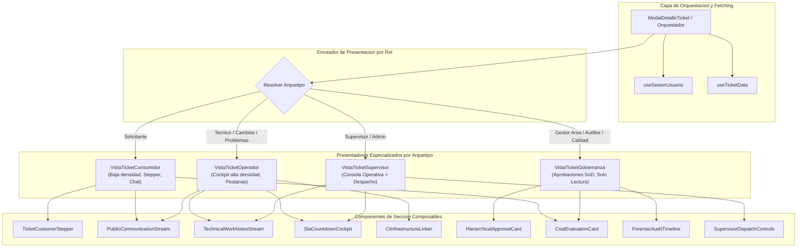

# ARQUITECTURA Y DISENO DE COMPOSICION DE VISTAS BASADA EN ROLES (ROLE-BASED UI COMPOSITION) PARA PLATAFORMA ITSM EMPRESARIAL

**Marcos de Referencia:** ITIL v4, ISO/IEC 20000-1:2018, ISO/IEC 27001:2022  
**Ecosistema:** Next.js 14 (App Router), React 18, TypeScript, Tailwind CSS / CSS Variables, PostgreSQL  
**Documento:** Diseno y Diagnostico de Arquitectura UX/UI para Entidades Compartidas  
**Estado:** Propuesta Tecnica para Evaluacion y Aprobacion (Fase de Diseno - Codigo Intacto)  

---

## INDICE GENERAL

1. [Introduccion y Diagnostico del Problema](#1-introduccion-y-diagnostico-del-problema)
2. [Tarea 1: Benchmark de la Industria ITSM Enterprise](#2-tarea-1-benchmark-de-la-industria-itsm-enterprise)
   - 2.1 ServiceNow: Employee Center vs Agent Workspace vs CAB Workbench
   - 2.2 Jira Service Management: Customer Portal vs Agent View
   - 2.3 Freshservice: Requester Portal vs Agent Console
   - 2.4 Principio Fundamental de Progressive Disclosure (Divulgacion Progresiva)
3. [Tarea 2: Auditoria Exhaustiva del Codigo Actual del Proyecto](#3-tarea-2-auditoria-exhaustiva-del-codigo-actual-del-proyecto)
   - 3.1 Modal de Detalle de Ticket (`ModalDetalleTicket.tsx`)
   - 3.2 Modal de Workflow en Catalogo de Servicios (`tickets/catalogo/page.tsx`)
   - 3.3 Modal de Planes de Cambio RFC (`cambios/gestion/todos/page.tsx`)
   - 3.4 Modal de Evaluacion y Votacion CAB (`cambios/gestion/cab/page.tsx`)
   - 3.5 Vista de Base de Conocimiento y KEDB (`tickets/gestion/ayuda/page.tsx`)
   - 3.6 Tabla Consolidada de Grado de Diferenciacion Actual
4. [Tarea 3: Matriz Maestra de Composicion de Vistas por Rol](#4-tarea-3-matriz-maestra-de-composicion-de-vistas-por-rol)
   - 4.1 Entidad 1: Detalle de Ticket (Matriz Integral para los 9 Perfiles)
   - 4.2 Entidad 2: Detalle de Servicio en Catalogo (Consumidor vs Tecnico vs Negocio)
   - 4.3 Entidad 3: Solicitud de Cambio RFC (Implementador vs CAB vs Auditor vs Admin)
   - 4.4 Entidad 4: Base de Conocimiento y KEDB (Autoservicio vs Resolucion N2 vs Auditor)
5. [Tarea 4: Recomendacion Arquitectonica para React 18 y Next.js 14](#5-tarea-4-recomendacion-arquitectonica-para-react-18-y-nextjs-14)
   - 5.1 Evaluacion de Patrones y Analisis de Trade-offs
   - 5.2 Patron Recomendado: Presentadores Polimorficos por Arquetipo con Secciones Composables
   - 5.3 Diagrama de Arquitectura de Componentes (Mermaid)
   - 5.4 Contratos de TypeScript y Definicion de Interfaces
   - 5.5 Estructura de Carpetas Propuesta
   - 5.6 Plan de Implementacion Progresivo sin Downtime
6. [Glosario y Conclusiones](#6-glosario-y-conclusiones)

---

## 1. INTRODUCCION Y DIAGNOSTICO DEL PROBLEMA

El sistema cuenta actualmente con un modelo de Control de Acceso Basado en Roles a nivel de ruta (RBAC de Navegacion), implementado en [src/lib/permisos.ts](file:///c:/Users/apaza/Desktop/SISTEMA%20DE%20TICKETS/src/lib/permisos.ts) y orquestado mediante la carga dinamica del menu en [src/lib/menu.ts](file:///c:/Users/apaza/Desktop/SISTEMA%20DE%20TICKETS/src/lib/menu.ts). Cada perfil accede unicamente a las URLs que le corresponden conforme a la matriz de gobernanza ITIL v4.

Sin embargo, existe una brecha arquitectonica en la **composicion de la interfaz de usuario dentro de una misma entidad compartida**: cuando dos o mas perfiles visualizan el mismo registro (por ejemplo, el ticket `INC-2026-0001` o el servicio de catalogo `SRV-ACC-01`), el sistema renderiza la misma estructura monolitica, los mismos metadatos tecnicos, el mismo orden jerarquico y los mismos contenedores.

### Sintomas Criticos Detectados en la Experiencia de Usuario:
1. **Sobrecarga Cognitiva para el Solicitante:** Al consultar el estado de su ticket mediante [src/components/ModalDetalleTicket.tsx](file:///c:/Users/apaza/Desktop/SISTEMA%20DE%20TICKETS/src/components/ModalDetalleTicket.tsx), un usuario no tecnico se enfrenta a terminos de ingenieria como *Categorizacion de Causa Raiz*, *Identificador de CI (Elemento de Configuracion)*, *Matriz de Impacto/Urgencia*, *Codigo de Problema ITIL*, y contadores de *Tiempo SLA Pausado Acumulado*.
2. **Exposicion de Secretos y Diagnosticos Internos:** Aunque los comentarios privados se ocultan parcialmente al solicitante puro en la API, tecnicos y solicitantes comparten la misma estructura visual. Si un usuario de negocio o supervisor visualiza la pantalla, se renderizan cajas de comentarios amarillas con etiquetas de "Nota tecnica interna" intercaladas, generando confusion.
3. **Cascarones Visuales Vacios (Empty UI Shells):** El contenedor de "Gestion del Ciclo de Vida ITIL" se renderiza para el solicitante con el texto de "Seguimiento de requerimientos", pero sin ningun boton util durante los estados En Proceso o En Espera, consumiendo espacio vertical de manera infructuosa.
4. **Falta de Vista de Cabina de Mando para el Tecnico:** El especialista de soporte carece de una consola de alta densidad con division por pestanas (Pestaña Publica para interactuar con el usuario vs Pestaña Privada de Work Notes para registrar logs de depuracion, comandos SQL o diagnosticos de red).
5. **Inexistencia de Vista Ejecutiva y de Negocio:** El Gestor de Area o evaluador CAB requiere evaluar el riesgo operacional de negocio y la ventana de disrupcion, no examinar scripts tecnicos o codigos de terminal.

---

## 2. TAREA 1: BENCHMARK DE LA INDUSTRIA ITSM ENTERPRISE

Las plataformas lideres del cuadrante magico de Gartner (ServiceNow, Jira Service Management y Freshservice) no resuelven la multiplicidad de roles anadiendo directivas condicionales `if/else` dentro de una unica pantalla. En su lugar, implementan el principio de **Arquetipos de Experiencia (Experience Archetypes)** y **Composicion Basada en Roles (Role-Based UI Composition)**.

### 2.1 ServiceNow
ServiceNow implementa tres mundos visuales radicalmente desacoplados para la misma base de datos relacional:

#### A. Employee Center (Portal del Consumidor / Solicitante)
- **Objetivo:** Experiencia de consumidor B2C (similar a una tienda de comercio electronico o servicio bancario).
- **Disposicion:**
  - Banner superior con estado amigable del requerimiento en lenguaje natural: *"Tu solicitud esta siendo revisada por TI"*.
  - Stepper visual simplificado (Etapas: *1. Enviado -> 2. Aprobacion -> 3. En Atencion -> 4. Completado*), abstrayendo los 8 estados internos de ITIL.
  - Flujo unico de conversacion tipo chat: unicamente mensajes publicos entre el usuario y la mesa.
  - Formulario de calificacion de satisfaccion (CSAT) integrado de 5 estrellas al pasar a resuelto.
  - Ocultamiento total de CIs de infraestructura, relaciones de base de datos y notas tecnicas privadas.

#### B. Agent Workspace / Configurable Workspace (Cabina del Especialista TI)
- **Objetivo:** Maxima densidad de datos, rapidez operativa mediante atajos de teclado y resolucion en primer contacto.
- **Disposicion:**
  - Diseno multi-panel de tres columnas:
    - **Columna Izquierda:** Resumen de ticket, datos del solicitante, historial de incidentes recientes del mismo usuario.
    - **Columna Central (Activity Stream Dual):** Pestañas independientes con codigo de color estricto:
      - *Pestaña Blanca / Azul:* Respuestas dirigidas al cliente (Customer Visible).
      - *Pestaña Amarilla / Ocre:* Notas de trabajo tecnicas (Work Notes), encriptadas visualmente y jamas expuestas al usuario final.
    - **Columna Derecha (Contextual Sidebar):** Indicadores SLA con anillo de tiempo decreciente, asociacion rapida de CIs de la CMDB, botonera para vincular Problema o elevar RFC de cambio, y barra de busqueda en Base de Conocimiento con un clic para insertar solucion conocida.
  - Acciones en barra superior fija: *Tomar Caso, Poner en Espera con Justificacion, Resolver con Causa Raiz, Cancelar*.

#### C. CAB Workbench (Consola del Comite de Cambios)
- **Objetivo:** Evaluacion colegiada de riesgo e impacto para aprobadores tecnicos y jefaturas de negocio.
- **Disposicion:**
  - Matriz de impacto cruzado: calendario de congelamiento (Change Freeze) y deteccion automatica de colisiones entre cambios programados en la misma ventana horaria.
  - Resumen ejecutivo: costo estimado, tiempo estimado de interrupcion del servicio, plan de contingencia (Rollback).
  - Votacion SoD (Segregation of Duties): panel de votos formales (*Aprobar / Rechazar / Observar*) con registro inmutable de firma digital y fecha/hora.

---

### 2.2 Jira Service Management (JSM)

#### A. Customer Portal (Vista del Cliente / Solicitante)
- Formato limpio y centrado, sin barras laterales complejas.
- Seccion de estado destacada con color amigable: *"Esperando respuesta del soporte"* o *"Esperando tu respuesta"*.
- Historial de actividad lineal: unicamente muestra comentarios compartidos con el cliente y adjuntos del usuario.
- Panel de participantes: opcion para compartir la peticion con companeros de la misma oficina o departamento.

#### B. Agent View (Vista del Agente en Cola de Atencion)
- Vista completa del issue en Jira Software / JSM:
  - Campos tecnicos customizables (Severidad, Afectacion de SLA de resolucion y primer contacto, Componente TI).
  - Caja de comentarios con selector explicito: *"Responder al cliente"* (Boton azul) vs *"Agregar nota interna"* (Boton amarillo con advertencia visual de privacidad).
  - Panel lateral de automatizaciones: ejecucion de playbooks, vinculacion de incidentes mayores y elementos de inventario (Assets).

---

### 2.3 Freshservice

#### A. Requester Portal
- Tarjetas de estado con lenguaje comprensible: *"Abierto"*, *"Siendo atendido"*, *"Esperando tu aprobacion"*.
- Boton de accion rapida: *"Cancelar mi solicitud"* o *"El problema se soluciono solo"*.
- Descarga directa de comprobantes de servicio.

#### B. Service Desk Agent Console
- Trazabilidad de tiempo transcurrido en horas habiles de operacion.
- Deteccion de colisiones en tiempo real: indicador visual que alerta si otro tecnico esta editando o respondiendo el mismo ticket simultaneamente para evitar duplicidad.
- Opciones de cambio de estado integradas con reglas de negocio: obligatoriedad de campos al pasar a estado "Resuelto" (Causa, Resolucion, Tipo de Activo).

---

### 2.4 Principio Fundamental de Progressive Disclosure (Divulgacion Progresiva)

El principio de **Divulgacion Progresiva** (establecido por Jakob Nielsen y estandarizado en sistemas de gestion empresarial) dicta que una interfaz debe presentar la informacion de acuerdo con cuatro reglas cardinales:

```
+-----------------------------------------------------------------------------------+
|                  PRINCIPIOS DE DIVULGACION PROGRESIVA EN ITSM                     |
+-----------------------------------------------------------------------------------+
| 1. Reduccion de Carga Cognitiva:                                                  |
|    Mostrar en el primer nivel solo lo necesario para el objetivo primario del     |
|    usuario; relegar detalles secundarios a niveles bajo demanda o sub-pestanas.   |
|                                                                                   |
| 2. Aislamiento Estricto de Informacion Confidencial:                              |
|    Las notas internas, logs de servidores y disputas operacionales deben residir  |
|    en canales visuales independientes, impidiendo fugas involuntarias.            |
|                                                                                   |
| 3. Orientacion a la Accion por Persona:                                           |
|    Cada rol debe visualizar unicamente los botones que representan acciones       |
|    legitimas de su funcion; los botones prohibidos se remueven, no se deshabilitan|
|    de forma confusa.                                                              |
|                                                                                   |
| 4. Densidad Visual Diferenciada:                                                  |
|    - Consumidores / Solicitantes: Baja densidad, tipografia legible, espaciado.   |
|    - Operadores Tecnicos: Alta densidad, tablas compactas, atajos de teclado.     |
|    - Auditores / Calidad: Media densidad, lineas de tiempo inmutables y sellos.   |
+-----------------------------------------------------------------------------------+
```

---

## 3. TAREA 2: AUDITORIA EXHAUSTIVA DEL CODIGO ACTUAL DEL PROYECTO

Se ha auditado el codigo fuente de los componentes y vistas donde convergen multiples perfiles sobre la misma entidad compartida.

### 3.1 Modal de Detalle de Ticket (`src/components/ModalDetalleTicket.tsx`)
Archivo auditado: [ModalDetalleTicket.tsx](file:///c:/Users/apaza/Desktop/SISTEMA%20DE%20TICKETS/src/components/ModalDetalleTicket.tsx) (1,627 lineas, 65.4 KB).  
Utilizado transversalmente por [TablaTickets.tsx](file:///c:/Users/apaza/Desktop/SISTEMA%20DE%20TICKETS/src/components/TablaTickets.tsx) en todas las bandejas del sistema: `/tickets/gestion/todos`, `/mios`, `/asignados`, `/resueltos`, `/bandeja`, `/asignar`, `/departamento`, `/auditoria` y `/aprobaciones`.

#### Perfiles que acceden:
Los 9 perfiles del sistema (`ADMINISTRADOR`, `TECNICO`, `SOLICITANTE`, `SUPERVISOR`, `GESTOR_AREA`, `AUDITOR`, `ANALISTA_CALIDAD`, `GESTOR_CAMBIOS`, `ESPECIALISTA_PROBLEMAS`).

#### Que ve cada perfil actualmente (Evidencia de Codigo):
1. **Encabezado Unificado (Lineas 249 a 320):**
   - Todos los perfiles visualizan el mismo bloque de badges ITIL agrupados: `tipo_nombre`, `prioridad_codigo`, `estado_nombre`, `servicio_nombre`, `departamento_nombre`, badge de SLA restante en horas, `problema_codigo`, `ci_codigo` y `conteo_reaperturas`.
   - *Fallo UX:* Un Solicitante ve insignias como `[PRB-2026-0001]` o `CI: [SRV-CORP-01]`, las cuales no tienen significado operativo para el usuario final y saturan la cabecera.
2. **Rejilla de Metadatos ITIL (Lineas 362 a 569):**
   - Una rejilla CSS grid de 10 celdas que renderiza invariablemente: Categoria, Solicitante, Tecnico Asignado, Impacto / Urgencia, Fecha Limite SLA, Fecha de Creacion, Servicio Catalogo, Area TI Responsable, Canal de Origen, SLA Pausado Acumulado y Causa / Tipificacion.
   - *Fallo UX:* El Solicitante ve valores de configuracion interna ("Causa / Tipificacion: CONFIGURACION" o "Impacto: ALTO / Urgencia: CRITICO") que pertenecen a la clasificacion tecnica.
3. **Compuerta de Aprobacion Jerarquica (Lineas 572 a 656):**
   - Linea 592: Si el usuario es el solicitante, renderiza una caja roja de advertencia: *"Restriccion de Segregacion de Funciones (SoD / ISO 27001): Usted es el solicitante registrado de este ticket... no esta permitido autoaprobar..."*.
   - Linea 609: Si el perfil es Administrador, Supervisor o Gestor de Area (`[1, 4, 5]`), muestra el input de nota de decision y botones *Aprobar Solicitud* / *Rechazar Solicitud*.
   - Linea 650: Para cualquier otro perfil (por ejemplo, el Tecnico o Auditor), renderiza un texto en cursiva: *"Esperando decision de la Jefatura de Area o Supervisor responsable"*.
4. **Encuesta de Calidad CSAT (Lineas 700 a 781):**
   - Si el ticket esta resuelto o cerrado (`id_estado` 5 o 6):
     - Si ya se califico: Muestra estrellas, comentario y fecha a todos.
     - Si no se ha calificado y es el solicitante dueno: Muestra los 5 botones de estrellas y campo de texto.
     - Si no es el solicitante dueno: Muestra *"Pendiente de evaluacion por parte del solicitante"*.
5. **Barra de Gestion del Ciclo de Vida ITIL (Lineas 988 a 1197):**
   - Condicion de visibilidad general: `!ticket.es_terminal`.
   - Linea 1010: Titulo *"Gestion del Ciclo de Vida ITIL"*.
   - *Fallo Critico:* Si el Solicitante abre un ticket en estado "En Proceso" o "En Espera", el subtitulo dice *"Seguimiento de requerimientos"*, pero no hay ningun boton disponible en su contenedor flex. El usuario ve una seccion titulada sin ninguna accion ejecutable.
   - Cuando el ticket esta Resuelto (`id_estado === 5`): El Solicitante ve *Confirmar conformidad y Cerrar* y *Reabrir ticket (48h)* (lineas 1108-1149).
   - Para el Tecnico asignado o Supervisor: Muestra *Iniciar atencion*, *Pausar (En espera)*, *Resolver ticket*, *Elevar a Problema ITIL*, y *Reasignar Tecnico* (solo Supervisor/Admin).
6. **Historial de Seguimiento y Comentarios (Lineas 1491 a 1621):**
   - Los comentarios se muestran en una sola lista vertical secuencial.
   - Si un comentario es interno (`c.es_interno === true`), se resalta con fondo amarillo suave y un badge *"Nota tecnica interna"*.
   - En el formulario inferior:
     - Si no es solicitante (`!esSolicitante`): Muestra el checkbox *"Nota tecnica interna (Privada para TI - no visible para el solicitante)"*.
     - Si es solicitante: El checkbox se oculta (linea 1608).
   - *Fallo UX:* La alternancia entre notas publicas y privadas en la misma linea de lectura confunde a los supervisores y auditores sobre quien ve que mensaje en cada momento.

---

### 3.2 Modal de Workflow en Catalogo de Servicios (`src/app/(app)/tickets/catalogo/page.tsx`)
Archivo auditado: [page.tsx](file:///c:/Users/apaza/Desktop/SISTEMA%20DE%20TICKETS/src/app/%28app%29/tickets/catalogo/page.tsx) (Lineas 600 a 692).  
Compartido por: Solicitantes que buscan solicitar un servicio, Tecnicos que consultan procedimientos, Gestores de Area y Administradores.

#### Evidencia en Codigo:
```tsx
// Lineas 621-667
<div style={{ display: "flex", flexDirection: "column", gap: 10, marginBottom: 20 }}>
  {servicioSeleccionado.pasos?.map((p: ServicioWorkflowPaso) => (
    <div key={p.id_paso} ...>
      <div ...>{p.orden}</div>
      <div style={{ flex: 1 }}>
        <strong style={{ fontSize: 13, color: "#1e293b" }}>{p.nombre_paso}</strong>
        <span style={{ fontSize: 10.5, fontWeight: 600, color: "#64748b" }}>
          {p.rol_ejecutor}
        </span>
        {p.es_compuerta_aprobacion && (
          <span style={{ fontSize: 11, color: "#b45309", fontWeight: 600 }}>
            Compuerta de Aprobacion Obligatoria (Requiere firma de Jefatura de Area)
          </span>
        )}
      </div>
    </div>
  ))}
</div>
```
#### Diagnostico de Diferenciacion:
- **Grado de Diferenciacion: NINGUNA.**
- El modal es 100% identico para el Solicitante, Tecnico, Gestor de Area y Administrador.
- Un empleado solicitante ve etiquetas tecnicas de backend (`rol_ejecutor: TECNICO`, `rol_ejecutor: ADMINISTRADOR`) y nombres de pasos de ingenieria que no le aportan valor sobre plazos de entrega, costos o alcances del servicio.

---

### 3.3 Modal de Planes de Cambio RFC (`src/app/(app)/cambios/gestion/todos/page.tsx`)
Archivo auditado: [page.tsx](file:///c:/Users/apaza/Desktop/SISTEMA%20DE%20TICKETS/src/app/%28app%29/cambios/gestion/todos/page.tsx) (Lineas 174 a 245).  
Compartido por: Gestor de Cambios, Especialista de Problemas, Tecnico de Infraestructura, Gestor de Area, Auditor y Administrador.

#### Evidencia en Codigo:
```tsx
// Lineas 197-243: Renderizado monolitico de planes tecnicos
<div style={{ display: "grid", gridTemplateColumns: "1fr 1fr", gap: 12, ... }}>
  <div><strong>Tipo:</strong> {cambioSeleccionado.tipo_cambio}</div>
  <div><strong>Estado:</strong> {cambioSeleccionado.estado_nombre}</div>
  <div><strong>CI Afectado:</strong> {cambioSeleccionado.ci_codigo}</div>
  <div><strong>Ventana Inicio:</strong> {new Date(cambioSeleccionado.ventana_inicio).toLocaleString()}</div>
</div>
{/* Secciones fijas: Justificacion, Plan Implementacion, Plan Rollback, Plan Pruebas, PIR */}
```
#### Diagnostico de Diferenciacion:
- **Grado de Diferenciacion: NINGUNA.**
- Muestra el mismo bloque de texto con los scripts de rollback y planes de ejecucion al Gestor de Area (quien requiere saber si se interrumpira la facturacion de su departamento) y al Administrador/Auditor (quienes evaluan cumplimiento y SoD).

---

### 3.4 Modal de Evaluacion y Votacion CAB (`src/app/(app)/cambios/gestion/cab/page.tsx`)
Archivo auditado: [page.tsx](file:///c:/Users/apaza/Desktop/SISTEMA%20DE%20TICKETS/src/app/%28app%29/cambios/gestion/cab/page.tsx) (Lineas 240 a 325).  
Compartido por los miembros del comite CAB: Gestor de Cambios, Gestores de Area convocados, Especialista de Problemas y Supervisores.

#### Evidencia en Codigo:
- Posee control de autoexclusion SoD para bloquear el voto de un miembro que haya registrado el RFC (Lineas 168-170: `const esMiSolicitud = rfc.id_usuario_solicitante === sesion?.id_usuario; const puedeVotar = !esAdmin && !esMiSolicitud;`).
- Sin embargo, dentro del modal de dictamen (Lineas 240-325), todos visualizan exactamente los mismos 3 campos de texto (*Titulo, Justificacion, Plan de Rollback*) sin evaluacion parametrizada de riesgos, matriz de servicios de negocio afectados, ni estado de votos emitidos por los demas integrantes del comite.
- **Grado de Diferenciacion: PARCIAL** (unicamente bloqueo booleano del boton de envio).

---

### 3.5 Vista de Base de Conocimiento y KEDB (`src/app/(app)/tickets/gestion/ayuda/page.tsx`)
Archivo auditado: [page.tsx](file:///c:/Users/apaza/Desktop/SISTEMA%20DE%20TICKETS/src/app/%28app%29/tickets/gestion/ayuda/page.tsx) (Lineas 60 a 220).  
Compartido por: Solicitantes (consumo de autoayuda), Tecnicos (consulta de workarounds), Especialista de Problemas (gestion de errores conocidos KEDB) y Auditores.

#### Diagnostico de Diferenciacion:
- **Grado de Diferenciacion: NINGUNA.**
- Lista plana de articulos con buscador de texto y votacion de utilidad binaria. No diferencia entre una guia paso a paso para usuarios finales y un procedimiento tecnico de recuperacion de base de datos o script de workaround vinculado a un problema ITIL.

---

### 3.6 Tabla Consolidada de Grado de Diferenciacion Actual

| Entidad / Vista | Ruta o Componente | Perfiles que Acceden | Grado de Diferenciacion Actual | Problema Principal Detectado |
| :--- | :--- | :--- | :--- | :--- |
| **Detalle de Ticket** | [ModalDetalleTicket.tsx](file:///c:/Users/apaza/Desktop/SISTEMA%20DE%20TICKETS/src/components/ModalDetalleTicket.tsx) | Los 9 perfiles del sistema | **PARCIAL (Deficiente)** | Monolito de 1600 lineas con `if/else` dispersos. El solicitante ve terminos de ingenieria y contenedores vacios de ciclo de vida. |
| **Detalle de Servicio en Catalogo** | [tickets/catalogo/page.tsx](file:///c:/Users/apaza/Desktop/SISTEMA%20DE%20TICKETS/src/app/%28app%29/tickets/catalogo/page.tsx) | Solicitante, Tecnico, Gestor Area, Admin | **NINGUNA** | Excursion de detalles tecnicos y roles ejecutores a usuarios que solo necesitan saber que reciben y en cuanto tiempo. |
| **Detalle de Cambio RFC** | [cambios/gestion/todos/page.tsx](file:///c:/Users/apaza/Desktop/SISTEMA%20DE%20TICKETS/src/app/%28app%29/cambios/gestion/todos/page.tsx) | Gestor Cambios, Tecnico, CAB, Auditor, Admin | **NINGUNA** | Misma visualizacion de planes de rollback y ejecucion para jefaturas de negocio y tecnicos de campo. |
| **Comite de Cambios (CAB)** | [cambios/gestion/cab/page.tsx](file:///c:/Users/apaza/Desktop/SISTEMA%20DE%20TICKETS/src/app/%28app%29/cambios/gestion/cab/page.tsx) | Gestor Cambios, Gestor Area, Problemas, Admin | **PARCIAL** | Solo implementa validacion SoD del boton; no adapta el contexto de evaluacion del cambio. |
| **Base de Conocimiento / KEDB** | [tickets/gestion/ayuda/page.tsx](file:///c:/Users/apaza/Desktop/SISTEMA%20DE%20TICKETS/src/app/%28app%29/tickets/gestion/ayuda/page.tsx) | Solicitante, Tecnico, Problemas, Auditor | **NINGUNA** | Mezcla guias de usuario con workarounds tecnicos de infraestructura sin clasificacion por audiencia. |
| **Gestion de Departamentos TI** | [admin/departamentos/page.tsx](file:///c:/Users/apaza/Desktop/SISTEMA%20DE%20TICKETS/src/app/%28app%29/admin/departamentos/page.tsx) | Administrador, Supervisor | **PARCIAL** | Orientado a configuracion cruda; carece de vista analitica de OLA y capacidad para supervisores. |

---

## 4. TAREA 3: MATRIZ MAESTRA DE COMPOSICION DE VISTAS POR ROL

Para erradicar la sobrecarga de datos y el riesgo de fuga de notas internas, se define la siguiente matriz que gobierna que ve, que se oculta, que acciones se habilitan y que jerarquia visual rige para cada perfil.

---

### 4.1 Entidad 1: Detalle de Ticket (`ModalDetalleTicket`)

#### Perfil 1: SOLICITANTE (Consumidor del Servicio)
- **Secciones que VE:**
  - Resumen amigable: Codigo, Titulo, Tipo simplificado ("Peticion" / "Incidencia").
  - Stepper de Progreso Lineal (4 etapas: Registrado -> En Revision / Aprobacion -> En Atencion -> Resuelto).
  - Tiempo estimado de respuesta / solucion en lenguaje natural (ej. *"Resolucion estimada: Hoy antes de las 18:00"*).
  - Especialista asignado (nombre y correo de contacto).
  - Descripcion original del requerimiento y sus adjuntos.
  - Modulo de conversacion publica con el equipo de soporte (tipo chat de ayuda).
  - Compuerta de aprobacion (unicamente si requiere su aprobacion en solicitudes delegadas y cumple SoD).
  - Tarjeta de Calificacion CSAT interactiva (1 a 5 estrellas + retroalimentacion al estar resuelto).
  - Alerta de reapertura (solo activa en las primeras 48 horas post-resolucion).
- **Secciones que NO VE (Ocultas):**
  - Codigos tecnicos de infraestructura (CIs de la CMDB, IDs de bases de datos).
  - Codigo y vinculo a Problema ITIL.
  - Causa raiz o tipificacion de resolucion (`categoria_resolucion`).
  - Matriz bidimensional Impacto x Urgencia (solo ve Prioridad si es relevante).
  - Tiempos de pausa de SLA acumulados y motivos internos de pausa.
  - Canal de comunicacion tecnico (API, Agente, Webhook).
  - Checkbox y mensajes de Notas Tecnicas Internas (las notas internas ni siquiera se transfieren a su payload de red).
  - Botonera operativa de transicion ITIL (*Iniciar atencion*, *Pausar SLA*, *Asignar especialista*).
- **Acciones y Botones Disponibles:**
  - Enviar mensaje / adjunto adicional a la conversacion.
  - Confirmar conformidad y Cerrar ticket (al estar resuelto).
  - Solicitar reapertura por falla persistente (ventana estricta de 48h con motivo obligatorio).
  - Enviar evaluacion de satisfaccion CSAT.
  - Cancelar mi ticket (solo si aun no ha iniciado atencion tecnica).
- **Orden de Prioridad de la Informacion:**
  1. Estado actual y tiempo estimado de entrega (Arriba, destacado con color amigable).
  2. Dialogo continuo con TI (Timeline central tipo chat).
  3. Que solicite (Descripcion y adjuntos colapsables).
  4. Quien me ayuda (Ficha lateral ligera del especialista).
- **Notas de Diseno Visual:**
  - Densidad baja, tipografia legible (14px base), espaciado holgado (`padding: 20px`), colores pastel (azules suaves, verdes esmeralda), eliminacion total de jerga tecnica o siglas como "OLA", "CMDB", "SLA", "RCA".

---

#### Perfil 2: TECNICO DE SOPORTE (Especialista Operativo)
- **Secciones que VE:**
  - Cabina de mando tecnica de alta densidad (Dos columnas operativas).
  - Tiempos SLA en tiempo real: reloj decreciente de solucion y primer contacto, indicador de advertencia a < 2h de vencer, estado de pausa SLA con motivo.
  - Matriz de Priorizacion ITIL completa (Nivel de Impacto, Nivel de Urgencia, Prioridad resultante).
  - Vinculacion CMDB: Elemento de Configuracion (CI) afectado con enlace a su ficha tecnica.
  - Vinculacion de Problema ITIL: Codigo de problema padre y errores conocidos asociados.
  - Especificaciones tecnicas detalladas (Campos dinamicos JSONB y evidencias adjuntas).
  - Actividad dual por pestanas:
    - *Pestaña Conversacion Publica:* Mensajes dirigidos al solicitante.
    - *Pestaña Notas Tecnicas Internas:* Depuracion privada, logs de terminal, enlaces de configuracion.
  - Formulario de resolucion modal estructurado con clasificacion obligatoria de causa raiz y documentacion de workaround.
- **Secciones que NO VE (Ocultas):**
  - Selector de reasignacion a otros tecnicos (la asignacion es prerrogativa del Supervisor / Administrador).
  - Boton para forzar aprobaciones de jefatura o eludir compuertas SoD.
  - Modificacion de parametros estructurales del SLA de la organizacion.
- **Acciones y Botones Disponibles:**
  - Tomar ticket y asignarselo a si mismo (si la bandeja esta sin asignar).
  - Iniciar atencion (cambio a En Proceso).
  - Pausar atencion (cambio a En Espera con seleccion obligatoria de motivo ITIL).
  - Reanudar atencion.
  - Registrar nota tecnica interna privada.
  - Enviar respuesta publica al solicitante.
  - Resolver ticket (apertura de formulario de solucion y tipificacion).
  - Elevar incidente a Problema ITIL.
- **Orden de Prioridad de la Informacion:**
  1. Alerta de SLA, criticidad y CI afectado (Panel superior derecho).
  2. Descripcion de la falla y datos de contacto del solicitante (Panel superior izquierdo).
  3. Registro y redaccion de Notas Tecnicas / Solucion (Area central interactiva).
  4. Historial de auditoria de transiciones previas.
- **Notas de Diseno Visual:**
  - Densidad alta, fuentes compactas (12-13px), contrastes tecnicos claros (gris pizarra, azul cobalto, acentos en naranja para pausas y verde para resolucion), pestanas claramente diferenciadas por fondo (amarillo tenue exclusivo para notas privadas).

---

#### Perfil 3: SUPERVISOR DE SOPORTE (Lider de Operaciones)
- **Secciones que VE:**
  - Vista identica a la del Tecnico sumando la **Barra de Despacho y Gobierno de Cola**.
  - Especialista asignado con capacidad operativa actual (ej. *"Juan Perez: 4/5 tickets activos"*).
  - Historial de reasignaciones y transiciones de estado con marcas de tiempo.
  - Indicador de cumplimiento de OLA por departamento de TI.
  - Auditoria completa de aprobaciones y notas tecnicas internas.
  - Evaluacion CSAT emitida por el usuario para analisis de calidad del servicio del tecnico.
- **Secciones que NO VE (Ocultas):**
  - Opciones de borrado fisico de registros en base de datos.
- **Acciones y Botones Disponibles:**
  - Asignar o reasignar especialista tecnico responsable (con selector inteligente de tecnicos del area).
  - Forzar cambio de estado operativo (intervencion ante bloqueos o tecnicos ausentes).
  - Elevar a Incidente Mayor / Problema ITIL.
  - Emitir dictamen en compuertas de aprobacion si el flujo lo convoca como supervisor responsable.
  - Cierre administrativo justificado de tickets abandonados.
- **Orden de Prioridad de la Informacion:**
  1. Riesgo de incumplimiento de SLA y especialista a cargo.
  2. Capacidad de reasignacion rapida y cuello de botella.
  3. Contenido de las notas tecnicas y grado de avance de la resolucion.
- **Notas de Diseno Visual:**
  - Densidad media-alta, panel de administracion destacado con bordes azul marino, insignias claras de OLA y disponibilidad de personal.

---

#### Perfil 4: GESTOR DE AREA (Jefatura de Negocio / Aprobador)
- **Secciones que VE:**
  - Resumen ejecutivo de la solicitud: Que colaborador lo solicita, para que departamento, justificacion del negocio y costo o equipamiento involucrado.
  - Bloque de Aprobacion Jerarquica con regla de cuatro ojos (SoD) visible.
  - Entregable pactado del servicio segun el catalogo.
  - Historial de decisiones de aprobacion previas con comentarios formales.
  - Estado del ticket en lenguaje gerencial (Pendiente de Aprobacion, Aprobado en Curso, Rechazado, Cumplido).
- **Secciones que NO VE (Ocultas):**
  - Notas de trabajo tecnicas de infraestructura (comandos bash, configuraciones de switches, etc.).
  - Botonera tecnica de atencion (Iniciar, Pausar, Tomar, Resolver).
  - Selector de asignacion de tecnicos de TI.
  - Codigos de Problemas o identificadores internos de base de datos.
- **Acciones y Botones Disponibles:**
  - Aprobar Requerimiento (con nota facultativa).
  - Rechazar Requerimiento (con motivo obligatorio de rechazo para el colaborador).
  - Publicar comentario de consulta al area de TI.
- **Orden de Prioridad de la Informacion:**
  1. Tarjeta central de aprobacion pendiente y justificacion de negocio.
  2. Detalle del servicio y especificaciones del entregable.
  3. Historial de aprobaciones previas.
- **Notas de Diseno Visual:**
  - Densidad media-baja, enfocado en tarjetas limpias, botones de decision prominentes (Verde para Aprobar, Rojo oscuro para Rechazar), tipografia corporativa.

---

#### Perfil 5: AUDITOR DE SEGURIDAD (Cumplimiento e Inspeccion Forense)
- **Secciones que VE:**
  - **Expediente Forense Completo (Modo Solo Lectura Inmutable):**
  - Traza completa de auditoria: quien creo el registro, desde que direccion IP o canal, cada cambio de estado con timestamp exacto (milisegundos).
  - Verificacion formal de Segregacion de Funciones (SoD): certificacion de que el solicitante no aprobo su propia peticion ni cerro su propio cambio.
  - Registro de todas las notas (tanto publicas como tecnicas internas) con autor original indeleble.
  - Tiempos reales de atencion vs SLA comprometido.
- **Secciones que NO VE / ACCIONES DESHABILITADAS:**
  - CERO botones de mutacion operativa: no puede editar, pausar, resolver, asignar ni comentar en el flujo operativo.
  - Ocultamiento de formularios de envio de respuestas normales.
- **Acciones y Botones Disponibles:**
  - Exportar expediente de auditoria a formato imprimible / PDF estructurado.
  - Emitir dictamen o hallazgo de conformidad de auditoria (en modulo de auditoria).
- **Orden de Prioridad de la Informacion:**
  1. Bitacora cronologica de auditoria y firmas digitales de aprobacion.
  2. Cumplimiento de politicas SoD e ISO 27001.
  3. Datos tecnicos completos y metadatos de red.
- **Notas de Diseno Visual:**
  - Diseno formal tipo expediente legal/auditoria, paleta en tonos grises tecnicos, tipografia monoespaciada para codigos y sellos de tiempo, marcas de agua visuales de "REGISTRO AUDITADO".

---

#### Perfil 6: ANALISTA DE CALIDAD (Evaluacion de Servicio y CSAT)
- **Secciones que VE:**
  - Desempeno integral del servicio: Calificacion CSAT (estrellas y retroalimentacion cualitativa del usuario).
  - Evaluacion del cumplimiento de SLA (Tiempo transcurrido vs Tiempo meta, pausas aplicadas y su legitimidad).
  - Analisis de reaperturas: si el ticket fue reabierto, motivo de reapertura ingresado por el solicitante.
  - Tipificacion de la causa raiz documentada por el tecnico vs la realidad del incidente reportado.
- **Secciones que NO VE (Ocultas):**
  - Botones de ejecucion tecnica operativa (no atiende ni resuelve tickets de soporte directamente).
- **Acciones y Botones Disponibles:**
  - Registrar observacion de calidad sobre la atencion.
  - Marcar ticket para revision en comite de mejora continua.
  - Recategorizar causa raiz con justificacion metodologica.
- **Orden de Prioridad de la Informacion:**
  1. Tarjeta de satisfaccion CSAT y quejas del usuario.
  2. Metricas de cumplimiento SLA y analisis de pausas.
  3. Calidad de la documentacion de resolucion dejada por el especialista.
- **Notas de Diseno Visual:**
  - Enfoque visual analitico, graficos pequenos de cumplimiento, colores calidos para bajas calificaciones de satisfaccion (alerta) y verdes para atenciones ejemplares.

---

#### Perfil 7: GESTOR DE CAMBIOS (Coordinacion de RFC e Infraestructura)
- **Secciones que VE:**
  - Relacion del ticket con la infraestructura corporativa: CI afectado, topologia de red.
  - Relacion con Solicitudes de Cambio (RFC): si el incidente origino un cambio normal o de emergencia.
  - Informacion de impacto de servicio y disponibilidad del sistema.
- **Secciones que NO VE (Ocultas):**
  - Despacho diario de tecnicos de nivel 1.
- **Acciones y Botones Disponibles:**
  - Crear Solicitud de Cambio (RFC) a partir del incidente para reparar la causa de fondo.
  - Vincular ticket a una ventana de mantenimiento programada.
- **Orden de Prioridad de la Informacion:**
  1. CI afectado y nivel de indisponibilidad.
  2. Incidentes asociados al mismo servicio en las ultimas 24 horas.
  3. Planes de mitigacion y RFCs vinculadas.

---

#### Perfil 8: ESPECIALISTA DE PROBLEMAS (RCA y Errores Conocidos)
- **Secciones que VE:**
  - Patron de recurrencia del incidente: tickets similares que comparten la misma categoria, servicio o CI.
  - Diagnostico profundo de causa raiz (RCA) y analisis metodologico (5 Porques / Ishikawa).
  - Error Conocido (KEDB): verificacion de si existe un workaround oficial documentado.
  - Historial de reaperturas y fallas de soluciones previas.
- **Secciones que NO VE (Ocultas):**
  - Gestion de turnos o colas operativas individuales de soporte de oficina.
- **Acciones y Botones Disponibles:**
  - Vincular ticket a un registro de Problema ITIL maestro existente.
  - Crear nuevo Problema formal a partir de este incidente.
  - Publicar o asociar workaround oficial de la Base de Errores Conocidos.
- **Orden de Prioridad de la Informacion:**
  1. Correlacion de incidentes repetitivos y CI impactado.
  2. Informacion de diagnostico y logs dejados en las notas tecnicas.
  3. Estado de la investigacion del problema padre.

---

#### Perfil 9: ADMINISTRADOR DEL SISTEMA (Gobernanza y Superusuario)
- **Secciones que VE:**
  - **Visibilidad Integral Omnicanal:** Puede alternar entre la vista tecnica, la vista del cliente o la vista de auditoria.
  - Metadatos de configuracion del sistema: IDs internos, estado de ejecucion de triggers, integridad de claves foraneas.
  - Enlaces directos a las tablas de parametros maestros (servicios, tecnicos, departamentos, politicas SLA).
- **Secciones que NO VE:**
  - Ninguna seccion se oculta tecnicamente, pero su interfaz resalta el caracter de gobernanza evitando interferir en las firmas operativas de los especialistas.
- **Acciones y Botones Disponibles:**
  - Mantenimiento general de registros.
  - Reasignacion de emergencia ante bloqueos organizacionales.
  - Forzar refresco de caches y recalculacion de SLAs.
- **Orden de Prioridad de la Informacion:**
  1. Consistencia del ciclo de vida y gobernanza.
  2. Salud operativa de la asignacion y compuertas de seguridad.

---

### 4.2 Entidad 2: Detalle de Servicio en Catalogo (`tickets/catalogo/page.tsx`)

| Seccion / Elemento | Vista Consumidor (SOLICITANTE) | Vista Mesa Tecnica (TECNICO / SUPERVISOR) | Vista Negocio (GESTOR DE AREA) | Vista Gobernanza (ADMINISTRADOR) |
| :--- | :--- | :--- | :--- | :--- |
| **Cabecera** | Nombre comercial, categoria amigable e icono intuitivo. | Codigo de servicio (`SRV-SW-01`), categoria ITIL y nivel de criticidad. | Nombre, departamento custodio y aprobador jerarquico requerido. | Codigo, clave foranea, estado de activacion en catalogo. |
| **Que incluye (Entregable)** | Descripcion del beneficio para el empleado en lenguaje claro. | Especificaciones tecnicas minimas y software homologado. | Alcance funcional, perfil de puesto beneficiario y politicas. | Descripcion comercial completa y vigencia. |
| **Compromiso de Tiempo** | *"Tiempo de entrega estimado: 4 horas habiles"*. | Metas de SLA de Resolucion (4h) y SLA de Primera Respuesta (1h). | Cumplimiento historico de SLA del area (ej. 98% a tiempo). | Horas base de resolucion y OLA departamental asignada. |
| **Workflow / Proceso** | Stepper simplificado de 3 pasos: *1. Enviar datos -> 2. Visto Bueno de Jefatura -> 3. Instalacion y Notificacion*. | Diagrama de flujo detallado: cada paso con rol ejecutor (`TECNICO_N2`), tareas tecnicas y compuertas de aprobacion. | Puntos de control de autorizacion donde se requiere su intervencion presupuestal o de acceso. | Tabla relacional de pasos, orden secuencial, IDs de rol y banderas de compuerta. |
| **Requisitos Previos** | Lista de insumos que el usuario debe tener a la mano (ej. Serie de equipo, aprobacion de cuenta). | Scripts de aprovisionamiento, licencias disponibles en inventario. | Costo aproximado del servicio o impacto presupuestario. | CIs vinculados y paquetes de software asociados en CMDB. |
| **Accion Principal** | Boton destacado: **Solicitar este Servicio** (abre formulario prellenado). | Boton secundario: Solicitar a nombre de usuario / Ver casos resueltos de este servicio. | Boton: Revisar politicas de aprobacion del servicio. | Boton: Editar configuracion del servicio en catalogo. |

---

### 4.3 Entidad 3: Solicitud de Cambio RFC (`cambios/gestion/todos` y `cab`)

| Seccion / Elemento | Implementador Tecnico (TECNICO / GESTOR CAMBIOS) | Miembro del CAB de Negocio (GESTOR DE AREA) | Lider de Problemas e Infraestructura (PROBLEMAS) | Inspector de Cumplimiento (AUDITOR) |
| :--- | :--- | :--- | :--- | :--- |
| **Resumen Ejecutivo** | Titulo, tipo (Normal/Emergencia), CI de red afectado y ventana. | Titulo, areas afectadas, ventana de posible corte y justificacion. | CI afectado, servicios descendientes impactados en la CMDB. | Codigo RFC, solicitante, autor, tipo de cambio y clasificacion. |
| **Plan de Implementacion** | Codigo fuente, comandos de consola paso a paso, checklist de despliegue. | Resumen no tecnico de que componentes se actualizaran y por que. | Evaluacion de cambios colaterales que puedan inducir incidentes. | Trazabilidad del creador y fecha de congelamiento del plan. |
| **Plan de Rollback** | Scripts de reversion inmediata, respaldos SQL y tiempo maximo de marcha atras. | Confirmacion ejecutiva de que existe plan de contingencia viable. | Verificacion de que el rollback no genere corrupcion de datos. | Certificacion formal del plan de marcha atras como requisito normativo. |
| **Evaluacion de Riesgo** | Riesgo de infraestructura, disponibilidad de repuestos o parches. | Riesgo de paralizacion de operaciones o atencion a clientes finales. | Historial de fallas previas en cambios sobre el mismo CI. | Cumplimiento de matriz de riesgos segun ISO 27001. |
| **Modulo de Votacion CAB** | Habilitado solo si no es el implementador (SoD) con voto tecnico. | Voto de negocio enfocado en autorizar la ventana de ejecucion. | Voto enfocado en estabilidad sistemica y ausencia de colisiones. | Panel de observacion de votos emitidos (Solo lectura). |

---

### 4.4 Entidad 4: Base de Conocimiento y KEDB (`tickets/gestion/ayuda` y `problemas`)

| Seccion / Elemento | Vista Consumidor (SOLICITANTE) | Vista Resolutor (TECNICO DE SOPORTE) | Vista Arquitecto (ESPECIALISTA PROBLEMAS) |
| :--- | :--- | :--- | :--- |
| **Tipo de Articulo** | Guias de autoayuda, preguntas frecuentes (FAQ) y manuales de usuario. | Procedimientos de diagnostico, arboles de decision y workarounds tecnicos. | Registro oficial de Errores Conocidos (KEDB), causas raiz y planes definitivos. |
| **Lenguaje y Formato** | Capturas de pantalla ilustrativas, pasos numerados sencillos y lenguaje claro. | Codigos de error, logs de aplicacion, comandos PowerShell/Bash y CIs involucrados. | Analisis estructural del defecto, bug de software o limitacion de hardware. |
| **Solucion Temporal (Workaround)** | Instruccion simple para que el usuario continue trabajando mientras se repara. | Procedimiento tecnico para restaurar el servicio temporalmente sin reiniciar servicios criticos. | Evaluacion de la efectividad del workaround y tasa de recurrencia residual. |
| **Accion de Utilidad** | *"¿Te sirvio este articulo? Si / No"* (Alimentacion de efectividad del portal). | *"Aplicar este workaround al ticket actual"* (Copia el procedimiento a la resolucion). | *"Promover a solucion definitiva / Deprecar articulo obsoleto"*. |

---

## 5. TAREA 4: RECOMENDACION ARQUITECTONICA PARA REACT 18 Y NEXT.JS 14

### 5.1 Evaluacion de Patrones y Analisis de Trade-offs

Se evaluaron cuatro alternativas tecnicas para resolver la composicion de vistas en Next.js 14 App Router:

#### Opcion A: Monolito con `if/else` Condicionales Dispersos (Estado Actual)
- **Como opera:** Un unico archivo [ModalDetalleTicket.tsx](file:///c:/Users/apaza/Desktop/SISTEMA%20DE%20TICKETS/src/components/ModalDetalleTicket.tsx) con decenas de ternarios `esSolicitante ? (...) : puedeOperar ? (...) : null`.
- **Desventajas:**
  - Altisimo acoplamiento y fragilidad: modificar la vista del solicitante puede romper los botones del supervisor.
  - Riesgo de seguridad severo: si un desarrollador olvida un condicional, datos tecnicos confidenciales se filtran al cliente.
  - Rendimiento degradado: el cliente descarga componentes y librerias de administracion que jamas utilizara.
- **Veredicto:** **Rechazado como anti-patron de mantenimiento.**

#### Opcion B: View Presenter / Configuration Pattern Dinamico
- **Como opera:** Un archivo JSON o hook `useRoleViewConfig(rol)` que entrega banderas booleanas (`mostrarCI: false`, `columnas: 1`, `mostrarNotasPrivadas: false`).
- **Ventajas:** Centraliza la configuracion en un solo objeto.
- **Desventajas:** Vuelve la interfaz rigida. Cuando un rol necesita un diseno estructuralmente diferente (por ejemplo, un Stepper amigable en lugar de una tabla de 10 celdas), las banderas booleanas colapsan en complejidad.
- **Veredicto:** **Insuficiente para cambios estructurales de UX.**

#### Opcion C: URLs Diferentes por Perfil (Forking de Rutas)
- **Como opera:** `/solicitante/tickets/[id]` vs `/tecnico/tickets/[id]`.
- **Desventajas:** Viola el principio REST donde el ticket es una entidad unica identificable por su ID. Dificulta compartir enlaces internos entre colaboradores con roles compartidos y duplica logica de fetching en multiples carpetas.
- **Veredicto:** **Rechazado.**

#### Opcion D (RECOMENDADA): Orquestador Polimorfico con Presentadores por Arquetipo y Componentes de Seccion Composables
- **Como opera:**
  1. Se conserva la ruta unificada del ticket y el modal principal como punto de entrada unico.
  2. Un orquestador ligero (`TicketDetailModalOrchestrator`) obtiene los datos y la sesion del usuario.
  3. Mapea el perfil activo a uno de los **4 Arquetipos de Experiencia**:
     - `CONSUMIDOR` (Solicitante puro).
     - `OPERADOR_TECNICO` (Tecnico de soporte, Gestor de Cambios, Especialista de Problemas).
     - `SUPERVISOR_OPERATIVO` (Supervisor, Administrador del sistema).
     - `GOBERNANZA_AUDITORIA` (Gestor de Area, Auditor de Seguridad, Analista de Calidad).
  4. Delega el renderizado en un **Layout Presenter especializado por arquetipo**, el cual ensambla componentes atomicos de seccion reutilizables pero contextualizados.

```
+----------------------------------------------------------------------------------------------------+
|                         MATRIZ DE ASIGNACION DE ARQUETIPOS DE VISTA                                |
+--------------------------+-----------------------+-------------------------------------------------+
| PERFIL DEL SISTEMA       | ARQUETIPO ASIGNADO    | PRESENTADOR DE VISTA DEDICADO                   |
+--------------------------+-----------------------+-------------------------------------------------+
| 3. Solicitante           | CONSUMIDOR            | <VistaTicketConsumidor />                       |
| 2. Tecnico de Soporte    | OPERADOR_TECNICO      | <VistaTicketOperador />                         |
| 4. Supervisor de Soporte | SUPERVISOR_OPERATIVO  | <VistaTicketSupervisor /> (Extiende Operador)   |
| 1. Administrador         | SUPERVISOR_OPERATIVO  | <VistaTicketSupervisor /> (+ Tools Plataforma)  |
| 5. Gestor de Area        | GOBERNANZA_APROBADOR  | <VistaTicketGobernanza />                       |
| 6. Auditor de Seguridad  | GOBERNANZA_AUDITORIA  | <VistaTicketAuditoria /> (Expediente Readonly)  |
| 7. Analista de Calidad   | GOBERNANZA_CALIDAD    | <VistaTicketCalidad /> (Metricas y CSAT)        |
| 8. Gestor de Cambios     | OPERADOR_TECNICO      | <VistaTicketOperador /> (+ Contexto RFC)        |
| 9. Especialista Problem. | OPERADOR_TECNICO      | <VistaTicketOperador /> (+ Herramientas RCA)    |
+--------------------------+-----------------------+-------------------------------------------------+
```

---

### 5.2 Diagrama de Arquitectura de Componentes



---

### 5.3 Contratos de TypeScript e Interfaces de Presentacion

Para garantizar seguridad en tiempo de compilacion, se establecen los siguientes tipos estrictos:

```typescript
// Ubicacion sugerida: src/types/ui-composition.ts

export type ArquetipoVistaTicket = 
  | "CONSUMIDOR"           // Solicitante
  | "OPERADOR_TECNICO"     // Tecnico, Gestor de Cambios, Especialista de Problemas
  | "SUPERVISOR_OPERATIVO" // Supervisor, Administrador
  | "GOBERNANZA_NEGOCIO"   // Gestor de Area
  | "AUDITORIA_FORENSE";   // Auditor de Seguridad, Analista de Calidad

export interface PropsVistaPresentadorTicket {
  ticket: Ticket;
  comentarios: ComentarioTicket[];
  sesion: SesionUsuario;
  onEjecutarAccion: (payload: Partial<ActualizarTicketPayload>) => Promise<void>;
  onEnviarComentario: (comentario: string, esInterno: boolean) => Promise<void>;
  ejecutandoAccion: boolean;
  enviandoComentario: boolean;
  onCerrarModal: () => void;
}

/**
 * Funcion pura de resolucion de arquetipo basada en el ID de perfil activo
 */
export function resolverArquetipoVista(idPerfil: number): ArquetipoVistaTicket {
  switch (idPerfil) {
    case 3: // Solicitante
      return "CONSUMIDOR";
    case 2: // Tecnico
    case 8: // Gestor de Cambios
    case 9: // Especialista de Problemas
      return "OPERADOR_TECNICO";
    case 4: // Supervisor
    case 1: // Administrador
      return "SUPERVISOR_OPERATIVO";
    case 5: // Gestor de Area
      return "GOBERNANZA_NEGOCIO";
    case 6: // Auditor de Seguridad
    case 7: // Analista de Calidad
      return "AUDITORIA_FORENSE";
    default:
      return "CONSUMIDOR";
  }
}
```

---

### 5.4 Estructura de Carpetas Propuesta

La reestructuracion no modifica el comportamiento externo, sino que encapsula las responsabilidades en componentes modulares limpios:

```
src/
├── components/
│   ├── ModalDetalleTicket.tsx                 <-- Orquestador principal (mantiene Props y API externa)
│   └── ticket-detail/
│       ├── presentadores/
│       │   ├── VistaTicketConsumidor.tsx      <-- Layout amigable con Stepper y Chat para Solicitante
│       │   ├── VistaTicketOperador.tsx        <-- Layout cabina 2 columnas con pestana amarilla para Tecnicos
│       │   ├── VistaTicketSupervisor.tsx      <-- Extiende Operador sumando Despacho y Reasignacion
│       │   ├── VistaTicketGobernanza.tsx      <-- Enfoque en aprobacion SoD y entregables para Jefaturas
│       │   └── VistaTicketAuditoria.tsx       <-- Vista inmutable con linea de tiempo forense
│       └── secciones/
│           ├── StepperProgresoConsumidor.tsx  <-- Barra de 4 etapas visuales
│           ├── StreamChatPublico.tsx          <-- Dialogo limpio con el cliente
│           ├── StreamNotasInternas.tsx        <-- Registro privado TI (fondo amarillo, advertencias)
│           ├── CockpitTemporizadorSla.tsx     <-- Reloj decrementalisimo con indicadores de brecha
│           ├── TarjetaAprobacionSod.tsx       <-- Visto bueno con validacion estricta de cuatro ojos
│           ├── TarjetaCalificacionCsat.tsx    <-- Estrellas y retroalimentacion
│           ├── PanelInfraestructuraCi.tsx     <-- Detalle de activo CMDB y topologia
│           └── ControlesDespacho.tsx          <-- Selectores de reasignacion y balance de carga
```

---

### 5.5 Plan de Implementacion Progresivo sin Downtime

Para ejecutar esta transformacion sin riesgos de regresion ni interrupcion de servicio, se disenara en tres fases ordenadas:

1. **Fase 1: Extraccion de Secciones Atomicas Reutilizables**
   - Crear la carpeta `src/components/ticket-detail/secciones/`.
   - Extraer bloques aislados como el Stepper de progreso, la tarjeta CSAT y el panel de notas internas, manteniendo los mismos nombres de variables y handlers.
2. **Fase 2: Construccion de Presentadores por Arquetipo**
   - Crear `VistaTicketConsumidor.tsx` optimizada especificamente para los solicitantes.
   - Crear `VistaTicketOperador.tsx` con soporte nativo de pestanas (Publico vs Notas Privadas) para tecnicos.
   - Crear `VistaTicketGobernanza.tsx` y `VistaTicketAuditoria.tsx`.
3. **Fase 3: Refactorizacion del Orquestador Principal**
   - Reducir [src/components/ModalDetalleTicket.tsx](file:///c:/Users/apaza/Desktop/SISTEMA%20DE%20TICKETS/src/components/ModalDetalleTicket.tsx) de 1627 lineas a un componente limpio de menos de 150 lineas que unicamente maneje la carga de datos y seleccione el presentador correspondiente mediante `resolverArquetipoVista(perfilActivo)`.
4. **Fase 4: Extension a Catalogo y Cambios RFC**
   - Aplicar el mismo patron de arquetipos al modal de servicio de catalogo y al modal de dictamen CAB.

---

## 6. GLOSARIO Y CONCLUSIONES

- **Role-Based UI Composition:** Patron arquitectonico en el cual la composicion estructural, visibilidad de campos, prioridad de lectura y acciones disponibles de una pantalla se adaptan dinamicamente segun la persona o rol autenticado.
- **Divulgacion Progresiva (Progressive Disclosure):** Principio de diseno que protege al usuario de la complejidad innecesaria, exponiendo unicamente la informacion relevante para su tarea inmediata.
- **Segregacion de Funciones (SoD / Four-Eyes Principle):** Control de seguridad normativo (ISO 27001 / SOX) que impide que un usuario apruebe o audite sus propias solicitudes o cambios tecnicos.
- **Activity Stream Dual:** Patron estandar de la industria que separa fisicamente los mensajes publicos orientados al solicitante de las notas tecnicas privadas confidenciales entre operadores.

> **Estado del Proyecto:** Este documento representa el diseno arquitectonico completo y exhaustivo. En estricto cumplimiento de la instruccion, **no se ha modificado ningun archivo de codigo de la aplicacion**. Se somete a revision del equipo para su aprobacion antes de dar inicio a la implementacion modular.
