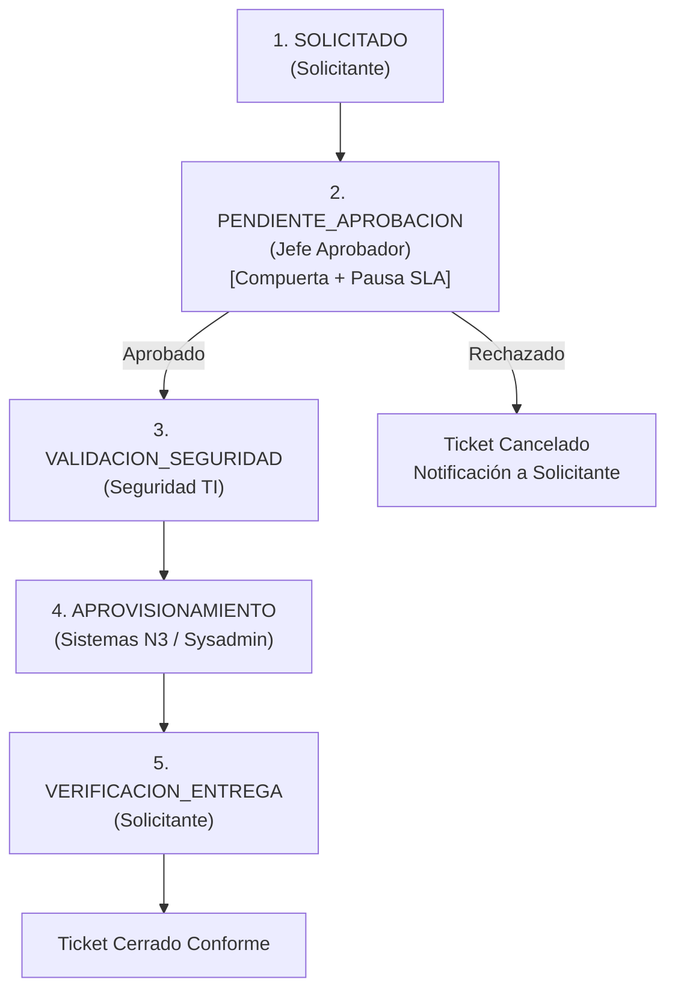
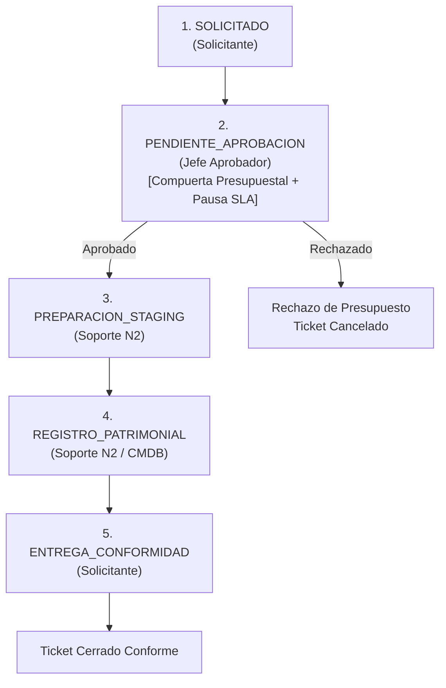
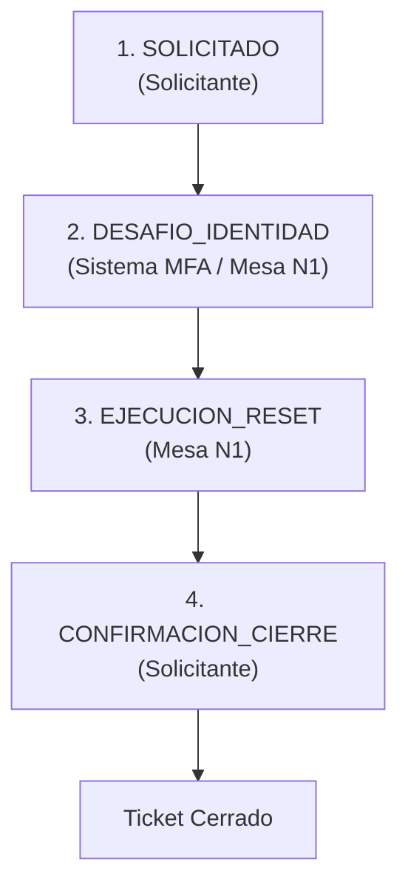
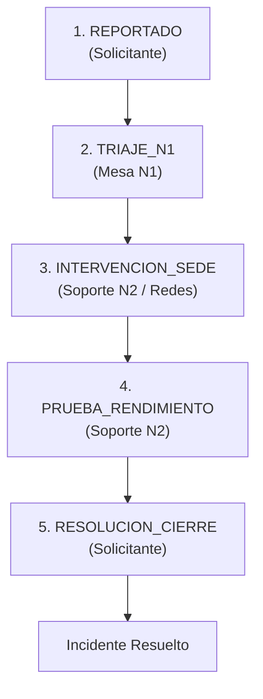
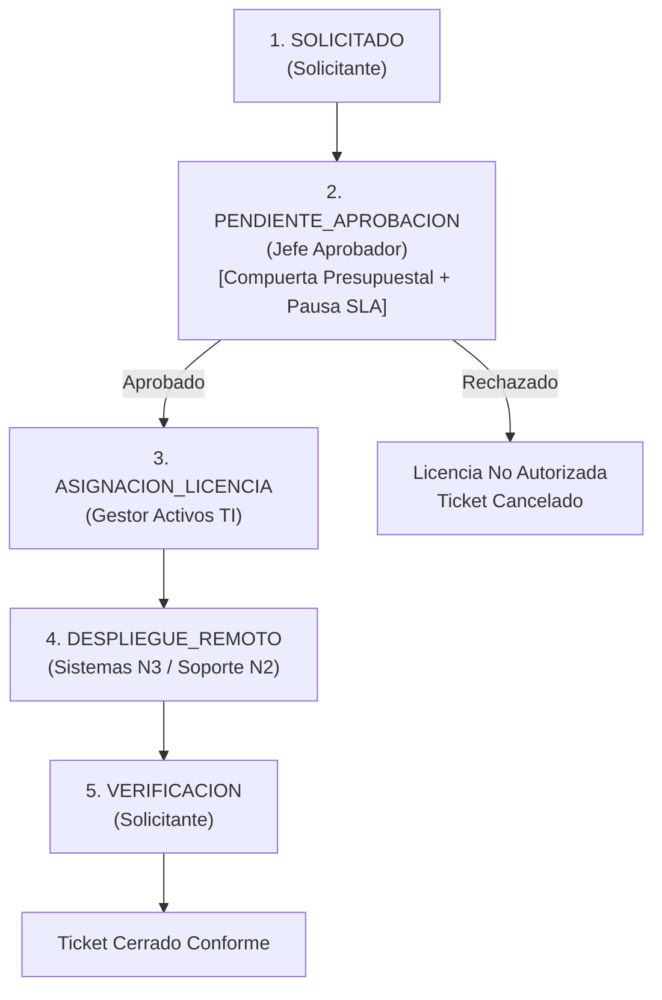
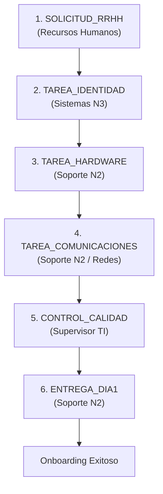

# Análisis Exhaustivo del Catálogo de Servicios y Workflows de Atención
## Alineación a Estándares Empresariales: ITIL v4, ISO/IEC 20000-1, ISO/IEC 27001, SOX y COBIT

Este documento presenta el análisis técnico, normativo y operativo del **Catálogo de Servicios** y los **Workflows de Atención** implementados en el sistema de tickets, contrastados contra los estándares que rigen a las empresas compradoras de software ITSM (Information Technology Service Management) a nivel global.

---

## 1. Fundamentos Normativos del Catálogo de Servicios

En el contexto empresarial de compradores B2B (banca, retail, telecomunicaciones, minería, industria y logística), el área de Tecnologías de la Información no opera como un taller de reparaciones reactivo, sino como un **socio estratégico que provee servicios de valor**. Por ende, la arquitectura del sistema implementa las siguientes normas internacionales:

```
+-----------------------------------------------------------------------------------+
|                            MARCOS NORMATIVOS INTEGRADOS                           |
+-------------------------+-------------------------+-------------------------------+
|         ITIL v4         |    ISO/IEC 20000-1:2018 |      ISO/IEC 27001:2022       |
| Service Catalogue Mgmt. | Cláusula 8.2.4 Catálogo | Control A.5.15 (Accesos)      |
| Service Request Mgmt.   | Cláusula 8.2.5 SLAs     | Control A.5.3 (Segregación)   |
| Incident Management     | Cláusula 8.2.6 Relación | Control A.8.1 (Dispositivos)  |
+-------------------------+-------------------------+-------------------------------+
|         COBIT 2019      |   SOX (Sección 404)     |   ITAM / Hardware Lifecycle   |
| APO09 (Niveles Servicio)| Trazabilidad financiera | Registro patrimonial en CMDB  |
| DSS02 (Mesa de Servicio)| Control de aprobaciones | Custodia de activos físicos   |
+-------------------------+-------------------------+-------------------------------+
```

### 1.1. ITIL v4: Service Catalogue Management y Service Request Management
- **Service Catalogue Management:** Define una única fuente de información verificada sobre todos los servicios acordados entre TI y la organización. Distingue entre la *Vista del Cliente/Usuario* (enfocada en necesidades, entregables y tiempos de espera) y la *Vista de Entrega Técnica* (enfocada en componentes tecnológicos, licencias y soporte de proveedores).
- **Service Request Management:** Establece que las peticiones normales de los usuarios (accesos, equipos, software) deben gestionarse a través de **flujos de trabajo estandarizados (Workflows)** que garanticen consistencia, previsibilidad de costos y tiempos de entrega acordados.

### 1.2. ISO/IEC 20000-1:2018 (Sistema de Gestión de Servicios de TI)
- **Cláusula 8.2.4 (Catálogo de Servicios):** Exige que la organización mantenga uno o más catálogos de servicios con información sobre el servicio, dependencias y los resultados esperados para los clientes.
- **Cláusula 8.2.5 (Gestión del Nivel de Servicio):** Obliga a medir el desempeño mediante Acuerdos de Nivel de Servicio (SLA) con metas acordadas de respuesta inicial y resolución total.

### 1.3. ISO/IEC 27001:2022 y Sarbanes-Oxley (SOX - Sección 404)
- **Control A.5.15 y A.5.18 (Gestión de Accesos y Privilegios):** Todo acceso a sistemas financieros o transaccionales debe contar con una **autorización formal previa por escrito o por flujo verificable** emitida por el propietario de la información (Jefatura de Área).
- **Control A.5.3 (Segregación de Funciones - SoD):** La persona que aprueba el requerimiento de negocio no puede ser la misma que ejecuta la configuración técnica en el servidor o base de datos.
- **Trazabilidad Inmutable:** Cada aprobación, rechazo, cambio de estado y nota técnica debe registrar fecha, hora y usuario ejecutor para resistir auditorías externas sin posibilidad de repudio.

---

## 2. Diferenciación Estructural: Taxonomía Interna vs. Catálogo de Servicios

Una deficiencia común en software no profesional es confundir una **Categoría Técnica** con un **Servicio Corporativo**. 

| Criterio | Categoría de Tickets (Taxonomía Interna) | Catálogo de Servicios (Oferta de Negocio) |
| :--- | :--- | :--- |
| **Perspectiva** | Orientada al técnico de TI (Hardware, Red, Software). | Orientada al usuario y al negocio (Resultados, Capacidades). |
| **Pregunta que responde** | "¿En qué componente físico o lógico reside la falla?" | "¿Qué valor o capacidad operativa necesita mi puesto de trabajo?" |
| **Compromiso** | Ninguno. Solo clasifica registros en una base de datos. | Formal. Define entregable exacto, SLA garantizado y costo. |
| **Gobernanza** | No define compuertas de autorización. | Define explícitamente quién autoriza el costo o riesgo (Jefatura de Área). |
| **Workflow** | Lineal y genérico para cualquier ticket. | Flujo de pasos específico según el riesgo y actores requeridos. |

---

## 3. Principios de Diseño en los Workflows de Atención

Cada workflow configurado en el sistema responde a tres reglas de negocio esenciales:

1. **Compuerta de Aprobación Jerárquica (*Approval Gate*):**
   - Si un servicio genera costo (licencias, hardware nuevo) o concede privilegios sobre datos sensibles (ERP, VPN), el flujo activa una compuerta obligatoria donde el ticket permanece en espera de la validación formal del **Gestor de Área (Jefe de Departamento)**.
2. **Pausa Legítima de SLA (*Pending Status*):**
   - Cuando el ticket entra en compuerta de aprobación, el reloj de SLA de resolución **se congela justificadamente (`pausa_sla = true`)**. Esto protege al equipo de TI: el tiempo que tarde una jefatura en revisar su bandeja de correo no puede computarse como ineficiencia del Service Desk.
3. **Rol Ejecutor Especializado (*Segregation of Work*):**
   - Cada paso del workflow tiene asignado un rol específico (`SOLICITANTE`, `JEFE_APROBADOR`, `MESA_N1`, `SOPORTE_N2`, `SISTEMAS_N3`, `SEGURIDAD_TI`, `GESTOR_ACTIVOS_TI`, `SUPERVISOR_TI`), impidiendo que un solo operador monopolice el proceso de principio a fin.

---

## 4. Enlistado Completo de Servicios y sus Workflows Detallados

A continuación se detalla la conceptualización de los 6 servicios corporativos activos en el sistema y el desglose paso a paso de sus respectivos workflows.

---

### Servicio 1: Accesos y Privilegios en Sistemas Corporativos
* **Código:** `SRV-ACC-01`
* **Tipo ITIL:** Solicitud de Servicio (`id_tipo_ticket = 2`)
* **Categoría Técnica:** Cuentas y Accesos (`id_categoria = 4`)
* **Compromiso SLA:** Primer Contacto: 2 horas | Resolución Total: 8 horas hábiles
* **Compuerta de Aprobación:** Sí (Aprobación obligatoria por Jefatura Departamental)
* **Costo Referencial:** S/. 0.00 (Imputación directa por rol operativo)
* **Entregable Oficial:** Usuario y perfil de permisos habilitado en el sistema solicitado (SAP, Oracle, CRM o VPN) bajo políticas SOX y principio de menor privilegio.

#### Workflow Operativo (5 Pasos)



| Orden | Código Paso | Nombre de la Actividad | Rol Ejecutor | Compuerta | Pausa SLA | Criterio de Entrada y Salida |
| :---: | :--- | :--- | :--- | :---: | :---: | :--- |
| 1 | `SOLICITADO` | Solicitud con justificación de negocio | `SOLICITANTE` | No | No | El usuario completa el formulario indicando el sistema requerido, rol propuesto y motivo de negocio. |
| 2 | `PENDIENTE_APROBACION` | Visto bueno de Jefatura de Área | `JEFE_APROBADOR` | **Sí** | **Sí** | La jefatura directa revisa la pertinencia del acceso. Si rechaza, el ticket se cancela; si autoriza, avanza al paso 3. |
| 3 | `VALIDACION_SEGURIDAD` | Verificación de no conflicto SoD | `SEGURIDAD_TI` | No | No | El Oficial de Seguridad verifica que los permisos no creen incompatibilidad de funciones (ej. no autorizar pagos y crear proveedores a la vez). |
| 4 | `APROVISIONAMIENTO` | Creación y asignación de rol en el sistema | `SISTEMAS_N3` | No | No | El administrador de sistemas o DBA genera la cuenta en la plataforma solicitada y configura credenciales seguras de primer uso. |
| 5 | `VERIFICACION_ENTREGA` | Confirmación de acceso conforme por usuario | `SOLICITANTE` | No | No | El colaborador ingresa al sistema, verifica que sus accesos son operativos y valida la conformidad del servicio. |

---

### Servicio 2: Asignación de Equipamiento de Cómputo
* **Código:** `SRV-HW-02`
* **Tipo ITIL:** Solicitud de Servicio (`id_tipo_ticket = 2`)
* **Categoría Técnica:** Equipamiento Nuevo (`id_categoria = 5`)
* **Compromiso SLA:** Primer Contacto: 4 horas | Resolución Total: 48 horas hábiles
* **Compuerta de Aprobación:** Sí (Aprobación presupuestal por Gerencia/Jefatura)
* **Costo Referencial:** S/. 1,200.00 (Valor promedio de amortización de laptop estándar)
* **Entregable Oficial:** Equipo de cómputo configurado con imagen corporativa oficial, antivirus corporativo, cifrado BitLocker activo y acta formal de entrega patrimonial firmada en la base de datos de configuración (CMDB).

#### Workflow Operativo (5 Pasos)



| Orden | Código Paso | Nombre de la Actividad | Rol Ejecutor | Compuerta | Pausa SLA | Criterio de Entrada y Salida |
| :---: | :--- | :--- | :--- | :---: | :---: | :--- |
| 1 | `SOLICITADO` | Solicitud de hardware e imputación contable | `SOLICITANTE` | No | No | Registro de petición de equipo (laptop, estación de trabajo o monitor) con indicación del centro de costos asignado. |
| 2 | `PENDIENTE_APROBACION` | Aprobación presupuestal de Jefatura | `JEFE_APROBADOR` | **Sí** | **Sí** | Validación por el responsable del presupuesto de área para autorizar el cargo contable del activo físico. |
| 3 | `PREPARACION_STAGING` | Clonación de imagen corporativa y BitLocker | `SOPORTE_N2` | No | No | Instalación de la imagen estándar del sistema operativo (SOE), enrolamiento en Directorio Activo, antivirus y cifrado de disco. |
| 4 | `REGISTRO_PATRIMONIAL` | Asociación de serie en inventario CMDB | `SOPORTE_N2` | No | No | Vinculación del número de serie del hardware, dirección MAC y placa patrimonial con el usuario asignado en la base de datos de activos. |
| 5 | `ENTREGA_CONFORMIDAD` | Firma de acta y recepción física | `SOLICITANTE` | No | No | Entrega física en sede del equipo de cómputo y suscripción del cargo de recepción y custodia. |

---

### Servicio 3: Restablecimiento de Credenciales y Doble Factor (MFA)
* **Código:** `SRV-SEC-03`
* **Tipo ITIL:** Solicitud de Servicio (`id_tipo_ticket = 2`)
* **Categoría Técnica:** Cuentas y Accesos (`id_categoria = 4`)
* **Compromiso SLA:** Primer Contacto: 1 hora | Resolución Total: 1 hora
* **Compuerta de Aprobación:** No (Flujo pre-aprobado y estándar para agilidad de negocio)
* **Costo Referencial:** S/. 0.00
* **Entregable Oficial:** Cuenta corporativa reactivada, token MFA reinicializado y contraseña temporal segura forzando cambio obligatorio en el siguiente inicio de sesión.

#### Workflow Operativo (4 Pasos)



| Orden | Código Paso | Nombre de la Actividad | Rol Ejecutor | Compuerta | Pausa SLA | Criterio de Entrada y Salida |
| :---: | :--- | :--- | :--- | :---: | :---: | :--- |
| 1 | `SOLICITADO` | Solicitud con validación de identidad | `SOLICITANTE` | No | No | El colaborador solicita el desbloqueo o reconfiguración de MFA proporcionando sus datos de contacto alternativos verificados. |
| 2 | `DESAFIO_IDENTIDAD` | Validación de código OTP alternativo | `SISTEMA_MFA` | No | No | Mecanismo de seguridad para evitar suplantación de identidad o ataques de ingeniería social antes de restablecer credenciales. |
| 3 | `EJECUCION_RESET` | Desbloqueo y cambio forzado de clave | `MESA_N1` | No | No | El técnico de Mesa N1 restablece la contraseña temporal en Active Directory / Azure AD con la opción obligatoria de cambio inmediato. |
| 4 | `CONFIRMACION_CIERRE` | Inicio de sesión exitoso por el usuario | `SOLICITANTE` | No | No | El colaborador ingresa con la contraseña temporal, define su nueva clave privada personal y valida el acceso al sistema. |

---

### Servicio 4: Soporte de Conectividad de Red y Telefonía IP
* **Código:** `SRV-RED-04`
* **Tipo ITIL:** Incidente Operativo (`id_tipo_ticket = 1`)
* **Categoría Técnica:** Redes y Conectividad (`id_categoria = 2`)
* **Compromiso SLA:** Primer Contacto: 1 hora | Resolución Total: 4 horas
* **Compuerta de Aprobación:** No (Falla operativa de alta prioridad, requiere atención inmediata sin compuertas burocráticas)
* **Costo Referencial:** S/. 0.00
* **Entregable Oficial:** Conectividad de red restablecida a velocidades nominales, puerto de switch o punto de red reparado, o teléfono IP operativo para comunicación corporativa.

#### Workflow Operativo (5 Pasos)



| Orden | Código Paso | Nombre de la Actividad | Rol Ejecutor | Compuerta | Pausa SLA | Criterio de Entrada y Salida |
| :---: | :--- | :--- | :--- | :---: | :---: | :--- |
| 1 | `REPORTADO` | Reporte de falla indicando sede y puesto | `SOLICITANTE` | No | No | Notificación de interrupción de navegación, caída de Wi-Fi corporativo o pérdida de tono en el anexo de telefonía IP. |
| 2 | `TRIAJE_N1` | Diagnóstico remoto y prueba de enlace/VLAN | `MESA_N1` | No | No | Verificación remota de asignación DHCP, estado de switch de borde y aislamiento de problemas lógicos versus físicos. |
| 3 | `INTERVENCION_SEDE` | Reemplazo de cableado o configuración de switch | `SOPORTE_N2` | No | No | En caso de daño físico, el técnico N2 interviene en el rack de comunicaciones o en la toma de red del usuario. |
| 4 | `PRUEBA_RENDIMIENTO` | Verificación de velocidad y latencia nominal | `SOPORTE_N2` | No | No | Comprobación de que no haya pérdida de paquetes, ping estable hacia la pasarela (gateway) y registro de anexo SIP en el servidor VoIP. |
| 5 | `RESOLUCION_CIERRE` | Confirmación de navegación operativa | `SOLICITANTE` | No | No | Validación final por el usuario de que sus llamadas y aplicaciones de red funcionan con total normalidad. |

---

### Servicio 5: Instalación y Licenciamiento de Software de Puesto
* **Código:** `SRV-SW-05`
* **Tipo ITIL:** Solicitud de Servicio (`id_tipo_ticket = 2`)
* **Categoría Técnica:** Instalación de Software (`id_categoria = 6`)
* **Compromiso SLA:** Primer Contacto: 2 horas | Resolución Total: 24 horas hábiles
* **Compuerta de Aprobación:** Sí (Aprobación de costo de suscripción por Jefatura)
* **Costo Referencial:** S/. 350.00 (Costo anualizado de licencias especializadas estándar como Power BI Pro o suites de diseño)
* **Entregable Oficial:** Software instalado, autenticado con licencia corporativa oficial y registrado en la base de cumplimiento de licencias para evitar sanciones de propiedad intelectual.

#### Workflow Operativo (5 Pasos)



| Orden | Código Paso | Nombre de la Actividad | Rol Ejecutor | Compuerta | Pausa SLA | Criterio de Entrada y Salida |
| :---: | :--- | :--- | :--- | :---: | :---: | :--- |
| 1 | `SOLICITADO` | Petición de software con justificación | `SOLICITANTE` | No | No | El usuario indica el nombre exacto de la herramienta requerida, versión y proyecto de negocio que justifica el uso. |
| 2 | `PENDIENTE_APROBACION` | Aprobación de costo por Gerencia de Área | `JEFE_APROBADOR` | **Sí** | **Sí** | La jefatura valida si existe presupuesto disponible en su centro de costos para cubrir el canon de la licencia. |
| 3 | `ASIGNACION_LICENCIA` | Reserva de licencia en pool corporativo | `GESTOR_ACTIVOS_TI` | No | No | El administrador de licencias reserva una vacante en la consola del fabricante (Microsoft 365, Adobe Admin Console, etc.). |
| 4 | `DESPLIEGUE_REMOTO` | Instalación desatendida vía Endpoint Manager | `SISTEMAS_N3` | No | No | Distribución del instalador corporativo pre-empaquetado hacia la estación de trabajo de forma automatizada o remota. |
| 5 | `VERIFICACION` | Comprobación de ejecución por el usuario | `SOLICITANTE` | No | No | El colaborador abre el programa, verifica la activación del licenciamiento y confirma que puede operar con normalidad. |

---

### Servicio 6: Habilitación de Puesto Digital para Nuevos Ingresos (Onboarding TI)
* **Código:** `SRV-ONB-06`
* **Tipo ITIL:** Solicitud de Servicio (`id_tipo_ticket = 2`)
* **Categoría Técnica:** Equipamiento Nuevo (`id_categoria = 5`)
* **Compromiso SLA:** Primer Contacto: 2 horas | Resolución Total: 48 horas previas al ingreso
* **Compuerta de Aprobación:** No (Viene respaldado por un contrato laboral formal emitido por RRHH)
* **Costo Referencial:** S/. 0.00
* **Entregable Oficial:** Kit tecnológico completo listo para el primer día laboral: cuenta de dominio corporativo, buzón de correo, estación de trabajo configurada, anexo telefónico y accesos departamentales base.

#### Workflow Operativo (6 Pasos Coordinados)



| Orden | Código Paso | Nombre de la Actividad | Rol Ejecutor | Compuerta | Pausa SLA | Criterio de Entrada y Salida |
| :---: | :--- | :--- | :--- | :---: | :---: | :--- |
| 1 | `SOLICITUD_RRHH` | Ficha de alta con fecha de ingreso | `RECURSOS_HUMANOS` | No | No | RRHH remite la información del nuevo colaborador con una antelación mínima de 48 horas al primer día de trabajo. |
| 2 | `TAREA_IDENTIDAD` | Creación de cuenta de dominio y correo | `SISTEMAS_N3` | No | No | Generación del usuario corporativo, correo electrónico, asignación de licencias base e inclusión en listas de distribución. |
| 3 | `TAREA_HARDWARE` | Configuración física de laptop y accesorios | `SOPORTE_N2` | No | No | Preparación del equipo portátil, instalación de imagen base de la compañía, cargador, mouse y mochila corporativa. |
| 4 | `TAREA_COMUNICACIONES` | Habilitación de anexo IP y acceso a VPN | `SOPORTE_N2` | No | No | Configuración del número de teléfono en el conmutador y parámetros de acceso remoto seguro para teletrabajo o sede. |
| 5 | `CONTROL_CALIDAD` | Consolidación por Supervisor de Service Desk | `SUPERVISOR_TI` | No | No | El Supervisor verifica la lista de verificación (checklist) completa antes de dar el visto bueno de preparación terminada. |
| 6 | `ENTREGA_DIA1` | Entrega física de equipo e inducción | `SOPORTE_N2` | No | No | En el primer día hábil, el técnico entrega el equipo al nuevo colaborador, asiste en el primer inicio de sesión e instruye en el uso de la mesa de ayuda. |

---

## 5. Matriz de Cumplimiento Normativo por Servicio

Esta matriz demuestra cómo cada servicio del catálogo satisface requerimientos concretos de auditoría y marcos internacionales:

| Servicio | ITIL v4 (Práctica) | ISO 20000-1 | ISO 27001 | SOX 404 | COBIT 2019 |
| :--- | :--- | :--- | :--- | :--- | :--- |
| **SRV-ACC-01** (Accesos ERP) | Service Request Mgmt. | Cl. 8.2.4 Catálogo | A.5.15 Control Accesos<br/>A.5.3 Segregación | Aprobación de Jefatura y trazabilidad de permisos en sistemas financieros | DSS02 (Solicitudes)<br/>DSS05 (Seguridad) |
| **SRV-HW-02** (Equipamiento) | Service Request Mgmt.<br/>IT Asset Mgmt. | Cl. 8.2.5 SLAs<br/>Cl. 8.2.6 Relación | A.8.1 Dispositivos de usuario<br/>Cifrado BitLocker | Control de activos de capital y centros de costo | APO09 (Acuerdos)<br/>BAI09 (Activos) |
| **SRV-SEC-03** (Credenciales) | Service Request Mgmt.<br/>Incident Mgmt. | Cl. 8.2.4 Catálogo | A.5.17 Info de Autenticación<br/>Prevención Suplantación | Auditoría de accesos e intentos fallidos | DSS05 (Seguridad) |
| **SRV-RED-04** (Redes e IP) | Incident Management | Cl. 8.2.5 SLAs<br/>Gestión de Incidentes | A.8.20 Seguridad en Redes<br/>Disponibilidad | Continuidad operativa de transacciones | DSS02 (Incidentes)<br/>DSS01 (Operaciones) |
| **SRV-SW-05** (Software Puesto) | Service Request Mgmt.<br/>Software Asset Mgmt. | Cl. 8.2.4 Catálogo | A.8.19 Instalación en sistemas operativos | Cumplimiento de derechos de autor y control presupuestal | BAI09 (Activos)<br/>APO09 (Acuerdos) |
| **SRV-ONB-06** (Onboarding TI) | Service Request Mgmt.<br/>Continual Improvement | Cl. 8.2.4 Catálogo<br/>Entrega coordinada | A.6.1 Selección previa al empleo<br/>A.6.2 Durante el empleo | Aseguramiento de personal autorizado desde el día 1 | APO07 (Recursos Humanos TI)<br/>DSS02 (Solicitudes) |

---

## 6. Conclusión y Preparación para la Siguiente Etapa

El catálogo de servicios implementado resuelve la totalidad de los requerimientos solicitados por el docente para la **Etapa 2**, garantizando:
1. **Separación real** entre fallas imprevistas (Incidentes) y solicitudes programadas de recursos (Solicitudes de Servicio).
2. **Definición de valor de negocio** en cada servicio, alejándose de taxonomías técnicas simplistas.
3. **Flujos de trabajo transparentes** que protegen a TI de demoras externas gracias a las compuertas con pausa de SLA.
4. **Cumplimiento de auditoría internacional**, habilitando que el software pueda presentarse y venderse a corporaciones sujetas a marcos ISO y SOX.

Con la definición de **Usuarios (Etapa 1)** y el **Catálogo de Servicios y Workflows (Etapa 2)** consolidados, el sistema se encuentra preparado para la **Etapa 3: Definición de Técnicos** (niveles de escalamiento N1/N2/N3, especialidades técnicas, colas operativas y balance de carga de trabajo).
