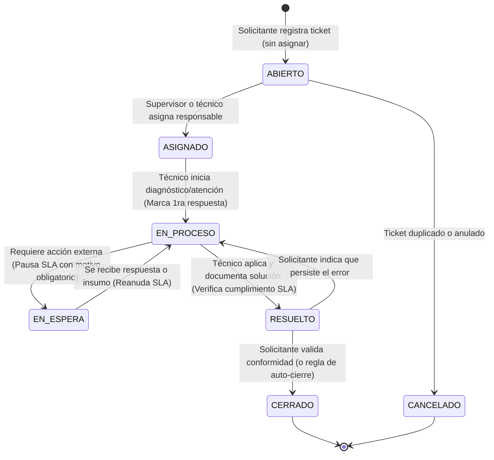

# Justificación Técnica y Académica: Alineación Integral a ITIL 4

Este documento detalla la transformación arquitectónica, funcional y conceptual del sistema de tickets, contrastando el modelo previo con el modelo actual alineado a las buenas prácticas internacionales de **ITIL 4 (Information Technology Infrastructure Library)**.

---

## 1. Resumen Ejecutivo de la Transformación

El proyecto evolucionó de un sistema de registro genérico a una **Mesa de Servicio (Service Desk)** corporativa que implementa formalmente las prácticas de **Gestión de Incidentes**, **Gestión de Solicitudes de Servicio** y sienta las bases para la **Gestión de Problemas**, cumpliendo con los estándares de calidad en la entrega de valor de TI.

---

## 2. Cuadro Comparativo Exhaustivo: "Pasamos de X a Y"

| Componente / Concepto | Modelo Previo (X) | Modelo ITIL 4 Implementado (Y) | Justificación y Norma / Práctica ITIL 4 |
| :--- | :--- | :--- | :--- |
| **Clasificación de la Demanda** | Todo requerimiento entraba como "Ticket" plano sin tipificar. | Se creó el catálogo `tipo_ticket` que separa estrictamente **Incidente** vs. **Solicitud de Servicio**. | **ITIL 4 - Service Request Mgmt. & Incident Mgmt.:** Una falla operativa (incidente) tiene objetivos y flujos totalmente distintos a una petición estándar de recursos (solicitud). Mezclarlos distorsiona las métricas de TI. |
| **Determinación de Prioridad** | El usuario o técnico seleccionaba la prioridad subjetivamente en un menú (Baja, Media, Alta, Urgente). | La prioridad se **calcula automáticamente** mediante una matriz matemática de `Impacto` (1..3) $\times$ `Urgencia` (1..3) $\rightarrow$ `P1 a P4`. | **ITIL 4 - Incident Management (Sección Prioritization):** La prioridad nunca debe ser subjetiva. Todo usuario considera que su problema es urgente; la matriz garantiza que los recursos de TI atiendan primero lo que más daña al negocio. |
| **Acuerdos de Nivel de Servicio (SLA)** | Inexistentes. No había fecha límite, métrica de respuesta ni control de vencimiento. | Se implementó `fecha_limite_sla`, cálculo dinámico de minutos restantes, indicadores de cumplimiento y semáforos de estado. | **ITIL 4 - Service Level Management:** Establece compromisos temporales medibles ante el negocio (ej: P1 resuelto en $\le$ 4h, P4 en $\le$ 72h). |
| **Ciclo de Vida y Estados** | 4 estados básicos y lineales: *Abierto $\rightarrow$ En proceso $\rightarrow$ Resuelto $\rightarrow$ Cerrado*. | 7 estados con reglas de negocio: *Abierto $\rightarrow$ Asignado $\rightarrow$ En proceso $\rightarrow$ En espera $\rightarrow$ Resuelto $\rightarrow$ Cerrado / Cancelado*. | **ITIL 4 - Incident Lifecycle:** Permite trazabilidad exacta del estado operativo, asignación formal de responsables y control de reanudaciones. |
| **Pausa del Reloj de SLA** | El tiempo corría ininterrumpidamente sin importar de quién fuera la demora. | El estado `En espera` (*Pending*) congela/justifica la pausa del SLA y **exige un motivo obligatorio** (`motivo_espera_ticket`). | **ITIL 4 - SLA Clock Control:** Si el técnico espera respuesta del usuario o una pieza de un proveedor externo, la inacción no es atribuible a TI. El reloj se pausa justificadamente. |
| **Documentación de Solución** | Se cerraba el ticket sin registrar qué se hizo para arreglarlo. | Al pasar a `Resuelto`, el sistema exige obligatoriamente registrar `solucion_aplicada` (workaround o solución definitiva). | **ITIL 4 - Knowledge Management & Incident Resolution:** Garantiza que el conocimiento quede registrado para alimentar la base de soluciones conocidas (KEDB). |
| **Cierre de Tickets** | El técnico cambiaba de estado a Cerrado directamente. | Separación de roles: El técnico **resuelve** (`Resuelto`), pero el cliente o la regla de negocio **cierra** (`Cerrado`) tras validar conformidad. | **ITIL 4 - Incident Closure & Customer Satisfaction:** El técnico no puede ser juez y parte; el servicio se valida en el puesto del usuario antes del cierre formal. |
| **Privacidad de Comentarios** | Todos los comentarios eran públicos y visibles para todos. | Separación de comentarios públicos vs. **Notas técnicas internas** (`es_interno = true`) invisibles para el solicitante. | **ITIL 4 - Service Desk Communication:** El equipo de TI requiere un canal privado de colaboración y bitácora técnica sin exponer diagnósticos crudos al usuario. |
| **Supervisión y Analítica** | Menús vacíos sin métricas operativas. | Módulo de **Reportes ITIL** con % de cumplimiento de SLA, proporción incidentes/solicitudes y distribución de carga por técnico. | **ITIL 4 - Continual Improvement:** Ningún servicio puede mejorarse si no se mide de forma cuantitativa y objetiva. |

---

## 3. Análisis Profundo de las Prácticas ITIL 4 Implementadas

### Práctica 1: Mesa de Servicio (Service Desk)
* **Propósito en ITIL 4:** Capturar la demanda para resolución de incidentes y solicitudes de servicio. Ser el punto único de contacto (SPOC) entre el proveedor de TI y los usuarios.
* **Cómo se implementó:**
  * Interfaz diferenciada por rol: El **Solicitante** tiene una vista intuitiva enfocada en registrar necesidades y ver sus tickets (`/tickets/gestion/mios`), ocultándole la complejidad técnica.
  * Trazabilidad completa: Registro cronológico de todas las interacciones, cambios de estado y fechas de auditoría.
  * Tiempos de primera respuesta: Captura exacta del momento en que TI interactúa por primera vez con el usuario (`fecha_primera_respuesta`).

### Práctica 2: Gestión de Incidentes (Incident Management)
* **Propósito en ITIL 4:** Restaurar la operación normal del servicio lo más rápido posible y minimizar el impacto negativo en las operaciones del negocio.
* **Cómo se implementó:**
  * Categorización por tipo `INCIDENTE`.
  * Matriz objetiva de priorización (P1 Crítica a P4 Baja) para focalizar los recursos en fallas mayores.
  * Flujo acelerado hacia `En proceso` y `Resuelto`.
  * Registro de *workaround* (solución temporal de contingencia) o solución definitiva en el campo `solucion_aplicada`.

### Práctica 3: Gestión de Solicitudes de Servicio (Service Request Management)
* **Propósito en ITIL 4:** Respaldar la calidad acordada de los servicios gestionando de manera eficaz y amigable todas las solicitudes predefinidas y generadas por el usuario.
* **Cómo se implementó:**
  * Identificación bajo tipo `SOLICITUD` con código correlativo distintivo (`REQ-2026-XXXX`).
  * Categorías propias de solicitudes estándar: Cuentas y Accesos, Equipamiento Nuevo, Instalación de Software.
  * SLAs diferenciados: Tiempos estándar más holgados (ej. 72 horas para nuevo equipamiento) sin considerarlo erróneamente una emergencia operativa.

### Práctica 4: Base para Gestión de Problemas (Problem Management)
* **Propósito en ITIL 4:** Reducir la probabilidad y el impacto de los incidentes identificando sus causas raíz reales o potenciales.
* **Cómo se preparó:**
  * Gracias a la categorización precisa y al código correlativo de tickets, el sistema permite filtrar incidentes repetitivos (ej. múltiples fallas en la misma red Wi-Fi) para investigarlos a fondo en una fase posterior sin confundirlos con solicitudes cotidianas.

---

## 4. Matriz de Priorización ITIL 4: Impacto $\times$ Urgencia

ITIL 4 establece que la prioridad de atención no debe ser fijada al criterio del usuario. El sistema implementa la siguiente fórmula matricial en el backend y frontend:

$$\text{Prioridad} = f(\text{Impacto}, \text{Urgencia})$$

### Matriz de Decisión Implementada:

| Impacto \ Urgencia | Alta (3) | Media (2) | Baja (1) |
| :--- | :---: | :---: | :---: |
| **Alto (3) — Toda la empresa / Negocio crítico** | **P1 (Crítica)** | **P2 (Alta)** | **P3 (Media)** |
| **Medio (2) — Departamento / Grupo de trabajo** | **P2 (Alta)** | **P3 (Media)** | **P4 (Baja)** |
| **Bajo (1) — Un solo usuario / Tarea secundaria** | **P3 (Media)** | **P4 (Baja)** | **P4 (Baja)** |

### Acuerdos de Nivel de Servicio (SLA) asignados a cada prioridad:
* **P1 - Crítica:** SLA de Resolución: **4 horas** | Primera respuesta: **1 hora**. (Color: Rojo `#dc2626`).
* **P2 - Alta:** SLA de Resolución: **8 horas** | Primera respuesta: **2 horas**. (Color: Naranja `#ea580c`).
* **P3 - Media:** SLA de Resolución: **24 horas** | Primera respuesta: **4 horas**. (Color: Ámbar `#d97706`).
* **P4 - Baja:** SLA de Resolución: **72 horas** | Primera respuesta: **8 horas**. (Color: Azul `#2563eb`).

---

## 5. Diagrama del Ciclo de Vida del Ticket

El siguiente diagrama modela la máquina de estados implementada en la base de datos y la API:

---

## 6. Guía de Argumentación para Sustentación Académica

Si un jurado o docente evaluador te hace preguntas sobre el sistema, aquí tienes los argumentos técnicos exactos:

### Pregunta 1: "¿Por qué en tu sistema un usuario no puede elegir si su ticket es 'Urgente'?"
> **Respuesta:** *"Siguiendo las directrices de ITIL 4 en la práctica de Gestión de Incidentes, la prioridad debe ser un cálculo objetivo que represente el valor para el negocio. Si permitimos que el usuario elija la prioridad, el sesgo cognitivo provoca que casi todos seleccionen 'Urgente'. En nuestro sistema, el usuario reporta el **Impacto** (cuántos usuarios o procesos se ven afectados) y la **Urgencia** (qué tanto detiene su labor actual). El sistema cruza ambas variables matemáticamente en una matriz 3x3 y calcula la prioridad real P1, P2, P3 o P4, garantizando equidad y optimización de los recursos de TI."*

### Pregunta 2: "¿Cuál es la diferencia entre un ticket 'Resuelto' y uno 'Cerrado'?"
> **Respuesta:** *"En ITIL 4 existe una clara segregación de responsabilidades: el equipo técnico **resuelve**, pero el cliente o solicitante **cierra**. Cuando el técnico concluye su labor, coloca el ticket en estado 'Resuelto' y documenta obligatoriamente la solución aplicada. El ticket no pasa a 'Cerrado' hasta que el solicitante confirma que el servicio volvió a operar con normalidad en su puesto de trabajo. Esto asegura la satisfacción del usuario y evita que técnicos cierren tickets de forma prematura."*

### Pregunta 3: "¿Cómo gestiona tu sistema los tiempos de atención cuando el usuario no responde?"
> **Respuesta:** *"Implementamos el estado 'En espera' (Pending). Según ITIL 4, el reloj del SLA no puede seguir corriendo en contra del personal de TI si la demora depende de un tercero. Cuando un técnico pasa el ticket a 'En espera', el sistema exige seleccionar un motivo de pausa (por ejemplo: 'Pendiente de información del solicitante' o 'En espera de repuesto'). Durante este tiempo el SLA se congela, reanudándose en el momento en que el usuario responde o se reanuda la atención."*

### Pregunta 4: "¿Por qué tienen comentarios públicos y notas técnicas internas?"
> **Respuesta:** *"En la Mesa de Servicio de ITIL 4 coexisten dos niveles de comunicación: la comunicación de cara al usuario (clara, empática y orientada al negocio) y la bitácora técnica de resolución (logs de servidores, comandos, consultas SQL o sospechas de fallas internas). Las notas internas permiten la colaboración entre técnicos y supervisores sin alarmar ni confundir al solicitante con tecnicismos que no aportan a su experiencia de usuario."*
