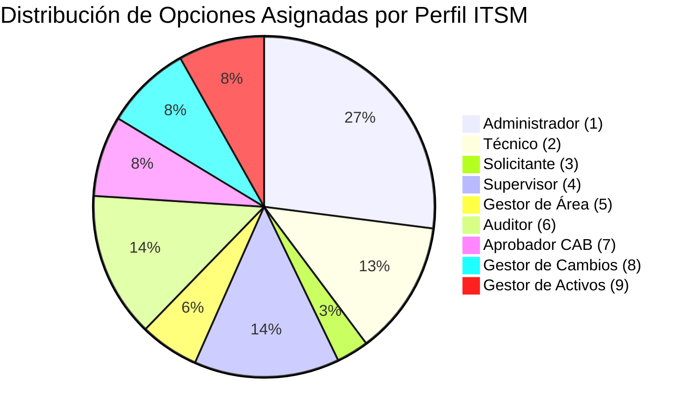
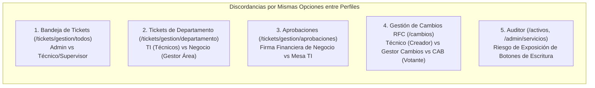

# Matriz de Análisis Integral de Opciones de Menú, Segregación de Perfiles y Arquitectura de Rutas ITSM

**Documento:** Matriz Maestra de Reconciliación de Menú y Atribuciones del Administrador  
**Corte de Auditoría:** 2026-10-01  
**Marcos de Referencia:** ITIL v4 (SVS, Service Desk, Change Enablement, ITAM, SACM, Problem Management), ISO/IEC 20000-1:2018 (Operación del Servicio), ISO/IEC 27001:2022 (Control de Acceso y Segregación SoD), COBIT 2019 (DSS01, DSS02, BAI06, BAI09).  

---

## 1. Matriz de Opciones del Administrador Definidas en la Conversación

La siguiente matriz analiza cada una de las opciones y conceptos abordados en la conversación, evaluando si fueron definidos formalmente, si se indicaron de forma implícita o parcial, y especificando con exactitud qué debe hacer el Administrador en cada espacio conforme a la visión funcional requerida.

| Jerarquía / Opción de Menú | ¿Se define en la conversación? | Cómo se define en la conversación y qué debe hacer el Administrador |
|---|---|---|
| **Configuración (Nivel Raíz Superior)** | **Sí** | Se define como la raíz principal ubicada en el primer lugar absoluto del sistema (por encima de Reportes y Analítica). El usuario fundamenta que la razón de ser del Administrador es gobernar, parametrizar y establecer las reglas que los demás usuarios utilizarán. |
| **1. Identidades y Accesos** | **Sí** | Bloque prioritario de seguridad y gobernanza RBAC. |
| ├── **Gestión de usuarios** | **Sí** | Administrar el ciclo de vida de los usuarios (altas, bajas, suspensiones, restablecimiento de credenciales). No opera tickets de usuarios. |
| ├── **Perfiles y permisos** | **Sí** | Parametrizar la matriz de los 9 perfiles institucionales y asignar permisos específicos a cada rol. |
| └── **Estructura del menú** | **Sí** | Configurar la jerarquía, orden, niveles y visibilidad de las opciones de navegación para cada uno de los roles. |
| **2. Catálogo de Servicios y SLAs** | **Sí** | Se define que no debe llamarse "Gobierno de portafolio", sino "Catálogo de servicios". Debe estar separado en dos ramas principales: **Servicios de Incidentes** y **Servicios de Solicitudes**. |
| ├── **Servicios de Incidentes** | **Sí** | Listado de servicios que representan fallas (red, hardware, software, telefonía). Cada servicio dentro del catálogo debe tener: su plantilla de formulario particular (fotos, capturas, logs de error), su workflow propio de resolución y sus tiempos SLA de primera respuesta y solución. |
| ├── **Servicios de Solicitudes** | **Sí** | Listado de requerimientos estándar (pedir mouse, nuevo equipo, licencias). Cada servicio posee su propio formulario (con carga de documentos de aprobación del jefe), su propio workflow de aprobaciones y entrega, y su SLA específico. |
| ├── **Categorías y ofertas publicadas** | **Sí** | Clasificación taxonómica de las ofertas que se publican en el portal corporativo. |
| ├── **Acceso por perfil o criterio de audiencia** | **Sí** | Definir qué perfiles pueden solicitar cada oferta específica del catálogo (restricción por perfil activo). |
| └── **Objetivos SLA** | **Sí** | Parametrizar los tiempos máximos de respuesta y resolución en horas hábiles/calendario dentro de cada ficha de servicio. |
| **3. Configuración de Procesos: Incidentes** | **Sí (Muy Detallado)** | Módulo independiente de configuración del proceso de gestión de incidentes. |
| ├── **Formularios y campos dinámicos** | **Sí** | En la parte superior de la pantalla debe figurar la **lista completa de usuarios/perfiles**. Al seleccionar un usuario o rol: si no le corresponde incidentes, debe mostrar un mensaje *"No habilitado para este usuario"* con un botón a la izquierda *"Habilitar para este usuario"*. Al habilitarlo, el Administrador configura qué campos solicita el formulario (visibles y obligatorios) y activa o desactiva botones normativos predeterminados. |
| ├── **Vistas previas por usuario/perfil** | **Sí** | En la parte superior muestra la **lista completa de usuarios/perfiles**. Al hacer clic sobre uno de ellos: si está habilitado, renderiza la vista previa exacta de cómo ese usuario verá el ticket en tiempo real (para detectar errores de diseño); si no está configurado, indica que no está habilitado y ofrece el botón de habilitación directa. |
| ├── **Flujo de estados y acciones** | **Sí** | Configurar la máquina de estados y transiciones válidas de incidentes (Abierto, Asignado, En Proceso, En Espera con motivo y pausa de SLA, Resuelto con clasificación obligatoria, Cerrado y Cancelado). |
| └── **Reglas de notificación** | **Sí (Discutido)** | Parametrizar las alertas automáticas del sistema (sin intervención del usuario) ante hitos de creación, asignación y resolución. |
| **4. Configuración de Procesos: Solicitudes de Servicio** | **Sí (Muy Detallado)** | Módulo independiente para gobernar las solicitudes de provisión de recursos. |
| ├── **Formularios y campos dinámicos** | **Sí** | Constructor dinámico con selector superior de usuarios/perfiles, comprobación de estado habilitado/no habilitado, botón de habilitación y parametrización de campos específicos y botones normativos. |
| ├── **Vistas previas por usuario/perfil** | **Sí** | Previsualizador interactivo por usuario/rol para validar la interfaz que recibirá el colaborador o jefe antes de desplegarla a producción. |
| ├── **Flujo de atención y aprobaciones** | **Sí** | Parametrizar el circuito de aprobación financiera o departamental (Gestor de Área) antes de que el requerimiento pase al grupo resolutor de TI. |
| └── **Reglas de notificación** | **Sí** | Alertas de solicitud registrada, solicitud aprobada, compra en curso y entrega de activo. |
| **5. Configuración de Procesos: Gestión de Cambios (RFC)** | **Sí** | El Administrador no aprueba cambios ni vota en el CAB, pero configura el espacio tecnológico para los demás roles. |
| ├── **Formulario RFC** | **Sí** | Diseñar la plantilla y campos que completa el solicitante técnico (plan de trabajo, fecha y hora de ventana de intervención). |
| ├── **Tipos de cambio y requisitos base** | **Sí** | Parametrizar requisitos para Cambios Estándar (preautorizados), Normales (evaluación CAB) y de Emergencia (ECAB). Exigir plan de pruebas, plan de reversión obligatorio (rollback), CI afectado de CMDB y duración máxima de ventana en horas. |
| ├── **Flujo de evaluación, autorización y revisión posterior** | **Sí** | Configurar las compuertas de votación del comité CAB, quórum mínimo y el acta de Revisión Posterior a la Implementación (PIR). |
| └── **Notificaciones y calendario de cambios** | **Sí** | Calendario de ventanas de mantenimiento, alertas a partes interesadas y períodos de congelamiento (freeze). |
| **6. Configuración de Procesos: Gestión de Problemas** | **Sí** | Configurar el espacio de investigación estructural sin participar como especialista de causa raíz. |
| ├── **Formularios de problema y RCA** | **Sí** | Parametrizar la plantilla de captura para problemas: métodos de Análisis de Causa Raíz (5 Porqués, Diagrama de Ishikawa), componentes de falla y síntomas recurrentes. |
| ├── **Flujo de investigación y seguimiento** | **Sí** | Ciclo de vida: Registrado, En Investigación, Causa Raíz Identificada, Error Conocido (KEDB), Resuelto y Cerrado. |
| └── **Relación con incidentes, errores conocidos (KEDB) y conocimiento** | **Sí** | Vincular múltiples incidentes secundarios al problema maestro, publicar soluciones provisionales (workarounds) en la KEDB y sincronizar el cierre masivo de tickets. |
| **7. Organización y Soporte (Estructura Organizacional)** | **Sí** | Modelado formal de las unidades técnicas y funcionales. |
| ├── **Departamentos empresariales** | **Sí** | Clasificar a los usuarios en áreas cliente (Finanzas, Legal, Operaciones) para que el Gestor de Área pueda auditar y supervisar los requerimientos de su personal. Configurar centros de costos y jefaturas de área. |
| ├── **Departamentos y grupos resolutores de TI** | **Sí** | Estructurar los grupos técnicos según ITIL: Mesa de Ayuda (N1), Soporte de Sitio y Hardware (N2), Sistemas, Infraestructura y Cloud (N3). Las áreas de Redes/Telefonía y Ciberseguridad/Identidades se integran formalmente como grupos especializados de Nivel 3. Asignar el supervisor a cada grupo. |
| ├── **Técnicos y niveles de soporte** | **Sí** | Asignar especialistas técnicos a cada departamento de TI, fijando su nivel resolutor (L1, L2, L3) y capacidad simultánea (límite WIP). Se mantienen como técnicos con atributos de nivel sin requerir un perfil separado de "ingeniero". |
| └── **Supervisores de TI** | **Sí** | Designar supervisores técnicos para liderar los grupos resolutores de TI, diferenciándolos estrictamente del Gestor de Área. |
| **8. Activos y Configuración (ITAM y CMDB)** | **Sí (Detallado tras consulta)** | Configuración técnica del catálogo maestro de inventario y topología. El Administrador define la estructura pero no custodia equipos individuales. |
| ├── **Tipos, modelos y atributos de activos** | **Sí** | Definir tipos de activo (laptop, servidor, router, switch), modelos y marcas con vida útil en meses y método de depreciación lineal. |
| ├── **Ciclos de vida y reglas de transición** | **Sí** | Estados patrimoniales (En Stock, Asignado, En Reparación, Retirado, Baja) y matriz de transiciones autorizadas con motivo obligatorio. |
| ├── **Licencias y contratos (SAM)** | **Sí** | Parámetros de licenciamiento de software, control de cupos máximos, asignaciones a usuarios o equipos, detección de licencias inactivas y alertas de vencimiento de contratos de soporte. |
| ├── **Proveedores de TI** | **Sí** | Registro de proveedores de hardware, software y telecomunicaciones vinculados a contratos y compras. |
| └── **Tipos de elementos de configuración y relaciones de CMDB** | **Sí** | Modelar las clases de CI y las relaciones topológicas de dependencia (*depende de*, *alberga a*, *conectado con*) para mapear el impacto de caídas y cambios en los servicios del negocio. |
| **9. Comunicaciones y Notificaciones** | **Sí** | Centralización de plantillas y canales de comunicación. |
| ├── **Plantillas de correo HTML** | **Sí** | Diseñador visual con logo corporativo, colores institucionales y marcadores de posición (`{{codigo_ticket}}`, `{{solicitante}}`) para correos de ticket creado, resuelto, cambio de contraseña y entrega de credenciales. |
| └── **Configuración de conexiones de correo y canales externos** | **Sí** | Integración de pasarelas SMTP, WhatsApp Cloud API, SMS Twilio, webhooks de Slack y Microsoft Teams. |
| **10. Gobierno del Conocimiento (KCS)** | **Sí** | Estandarización de la base de soluciones y autoayuda. |
| └── **Categorías, responsables y reglas de publicación/revisión** | **Sí** | Estructurar categorías de artículos, ciclo editorial (borrador, en revisión, publicado), responsables técnicos de validación y retiro justificado de artículos obsoletos. |
| **11. Auditoría, Seguridad y Retención** | **Sí** | Cumplimiento ISO 27001 e inmutabilidad de registros. |
| ├── **Auditoría de cambios** | **Sí** | Bitácora inmutable de modificaciones en el sistema (quién cambió qué parámetro, fecha/hora, valor anterior y valor nuevo). |
| ├── **Registros de seguridad y autenticación** | **Sí** | Bitácora de accesos, intentos fallidos, bloqueos preventivos por fuerza bruta, direcciones IP y eventos de cambio de contraseña. |
| └── **Retención y mantenimiento de datos** | **Sí** | Herramientas de optimización y purga segura de tickets cerrados con más de 5 años de antigüedad con registro de auditoría. |
| **12. Reportes y Analítica** | **Sí** | Ubicado en el segundo gran bloque funcional después de Configuración. |
| ├── **Indicadores operativos y SLA** | **Sí** | Monitoreo de indicadores agregados (MTTA, MTTR, cumplimiento porcentual de SLA y satisfacción CSAT). |
| └── **Tableros** | **Sí** | Diseñador y visualizador de dashboards ejecutivos con gráficos de pastel de tickets abiertos y barras de rendimiento por área. |

---

## 2. Inventario Exhaustivo de Todas las Opciones del Sistema (9 Perfiles)

El sistema cuenta con 48 opciones de menú base registradas en la base de datos, las cuales se distribuyen a través de la tabla asociativa `opciones_menu_perfiles` entre los 9 perfiles institucionales:



### 2.1. Opciones por Perfil Institucional

#### Perfil 1: Administrador (`id_perfil: 1` — 53 asignaciones)
- **Configuración (`500`)**
  - Identidades y accesos (`510`): Gestión de usuarios (`511`), Perfiles y permisos (`512`), Estructura del menú (`513`).
  - Catálogo de servicios y SLAs (`520`): Servicios de incidentes (`521`), Servicios de solicitudes (`522`), Categorías y ofertas publicadas (`523`), Acceso por perfil o criterio de audiencia (`524`), Objetivos SLA (`525`).
  - Configuración de procesos (`5300`):
    - Incidentes (`5310`): Formularios y campos (`5311`), Vistas previas por usuario/perfil (`5312`), Flujo de estados y acciones (`5313`), Reglas de notificación (`5314`).
    - Solicitudes de servicio (`5320`): Formularios y campos (`5321`), Vistas previas por usuario/perfil (`5322`), Flujo de atención y aprobaciones (`5323`), Reglas de notificación (`5324`).
    - Gestión de cambios (`5330`): Formulario RFC (`5331`), Tipos de cambio y requisitos (`5332`), Flujo de evaluación, autorización y revisión posterior (`5333`), Notificaciones y calendario de cambios (`5334`).
    - Gestión de problemas (`5340`): Formularios (`5341`), Flujo de investigación y seguimiento (`5342`), Relación con incidentes, errores conocidos y conocimiento (`5343`).
  - Organización y soporte (`5400`): Departamentos empresariales (`5401`), Departamentos y grupos resolutores de TI (`5402`), Técnicos y niveles de soporte (`5403`), Supervisores (`5404`).
  - Activos y configuración (`5500`): Tipos, modelos y atributos de activos (`5501`), Ciclos de vida y reglas de transición (`5502`), Licencias y contratos (`5503`), Tipos de elementos de configuración y relaciones de CMDB (`5504`).
  - Comunicaciones y notificaciones (`5600`): Plantillas de correo y otros canales (`5601`), Configuración de conexiones de correo y canales externos (`5602`).
  - Gobierno del conocimiento (`5700`): Categorías, responsables y reglas de publicación/revisión (`5701`).
  - Auditoría, seguridad y retención (`5800`): Auditoría de cambios (`5801`), Registros de seguridad y autenticación (`5802`), Retención y mantenimiento de datos (`5803`).
- **Reportes y Analítica (`400`)**
  - Indicadores operativos y SLA (`410`).
  - Tableros (`420`).

#### Perfil 2: Técnico Resolutor (`id_perfil: 2` — 25 asignaciones)
- **Mesa de Servicio (`100`):**
  - Portal de Autoservicio (`110`): Catálogo de servicios (`111`), Registrar solicitud (`112`), Base de conocimiento (`113`).
  - Operación y Soporte (`120`): Mis tickets asignados (`121`), Bandeja de pendientes (`122`), Tickets de mi área técnica (`123`), Historial de resueltos (`124`).
- **Gestión de Cambios (`200`):**
  - Operación y Solicitudes RFC (`210`): Registrar solicitud RFC (`211`), Calendario de ventanas (`212`), Historial consolidado (`213`).
- **Activos de TI y CMDB (`300`) [Lectura Operativa]:**
  - Inventario de hardware (`310`), Topología CMDB (`320`).
- **Gestión de Problemas (`700`):**
  - Investigación y análisis (`710`), Errores conocidos KEDB (`720`).
- **Reportes y Analítica (`400`):** Indicadores operativos y SLA (`410`).

#### Perfil 3: Solicitante / Cliente (`id_perfil: 3` — 6 asignaciones)
- **Mesa de Servicio (`100`):**
  - Portal de Autoservicio (`110`): Catálogo de servicios (`111`), Registrar solicitud (`112`), Mis solicitudes (`114`), Base de conocimiento (`113`).
- **Mi Cuenta:** Datos personales y preferencias de notificación.

#### Perfil 4: Supervisor de TI (`id_perfil: 4` — 27 asignaciones)
- **Mesa de Servicio (`100`):**
  - Operación y Soporte (`120`): Bandeja de pendientes (`122`), Historial de resueltos (`124`).
  - Supervisión y Despacho (`130`): Centro de asignación (`131`), Monitoreo de técnicos (`132`), Todos los tickets (`133`), Auditoría forense (`134`).
- **Gestión de Cambios (`200`):**
  - Operación RFC (`210`): Registrar solicitud RFC (`211`), Calendario (`212`), Historial (`213`).
- **Gestión de Problemas (`700`):** Investigación (`710`), KEDB (`720`).
- **Organización y Capacidad (`530`):** Departamentos de TI (`531`), Especialistas técnicos (`532`).
- **Reportes y Analítica (`400`):** Indicadores operativos y SLA (`410`).

#### Perfil 5: Gestor de Área / Aprobador Departamental (`id_perfil: 5` — 11 asignaciones)
- **Mesa de Servicio (`100`):**
  - Portal de Autoservicio (`110`): Catálogo (`111`), Registrar solicitud (`112`), Mis solicitudes (`114`).
  - Gobernanza de Área (`140`): Mis aprobaciones departamentales (`141`), Tickets de mi departamento (`142`).
- **Reportes y Analítica (`400`):** Indicadores operativos y SLA (`410`).

#### Perfil 6: Auditor Forense (`id_perfil: 6` — 27 asignaciones, Estricto Read-Only)
- **Mesa de Servicio (`100`):** Auditoría forense de tickets (`134`).
- **Gestión de Cambios (`200`):** Historial consolidado de cambios y actas PIR (`213`), Calendario (`212`).
- **Activos de TI y CMDB (`300`):** Inventario de hardware (`310`), Licencias de software SAM (`330`), Topología CMDB (`320`).
- **Seguridad ISO 27001 (`540`):** Registros de seguridad y autenticación (`541`).
- **Reportes y Analítica (`400`):** Indicadores operativos y SLA (`410`).

#### Perfil 7: Aprobador CAB (`id_perfil: 7` — 15 asignaciones)
- **Gestión de Cambios (`200`):**
  - Operación RFC (`210`): Calendario de ventanas (`212`), Historial consolidado (`213`).
  - Comité Asesor CAB (`220`): Dictamen y votación colegiada CAB (`221`).
- **Activos de TI y CMDB (`300`) [Lectura]:** Topología CMDB (`320`) para evaluar impacto de cambios.

#### Perfil 8: Gestor de Cambios (`id_perfil: 8` — 16 asignaciones)
- **Gestión de Cambios (`200`):**
  - Operación RFC (`210`): Registrar solicitud RFC (`211`), Calendario de ventanas y freezes (`212`), Historial consolidado (`213`).
  - Comité Asesor CAB (`220`): Convocatoria y seguimiento de actas CAB (`221`).
- **Activos de TI y CMDB (`300`):** Topología CMDB (`320`), Inventario (`310`).
- **Reportes y Analítica (`400`):** Indicadores de cambios y efectividad (`410`).

#### Perfil 9: Gestor de Activos y Configuración (`id_perfil: 9` — 16 asignaciones)
- **Activos de TI y CMDB (`300`):**
  - Inventario de hardware y ciclo de vida ITAM (`310`).
  - Topología CMDB y relaciones de dependencias SACM (`320`).
  - Licencias de software y cumplimiento SAM (`330`).
- **Reportes y Analítica (`400`):** Indicadores de inventario y garantías (`410`).

---

## 3. Discordancias Detectadas entre Perfiles por las Mismas Opciones

Al analizar las opciones del menú y sus permisos efectivos, se identifican las siguientes discordancias funcionales y de seguridad (SoD):



### 3.1. Conflicto de la Consola de Tickets para el Administrador
- **Problema:** En instalaciones iniciales, el Administrador podía acceder a `/tickets/gestion/todos` y al abrir un ticket observaba botones como *"Iniciar Atención"*, *"Elevar a Problema"* o *"Guardar Nota Técnica"*.
- **Discordancia:** Viola el principio de segregación SoD de ITIL y COBIT DSS01. El Administrador configura las reglas y los SLAs; si opera o resuelve tickets, incurre en conflicto de interés para manipular sus propios indicadores de cumplimiento.
- **Resolución Técnica Implementada:** En [VistaTicketAdministrador.tsx](file:///c:/Users/apaza/Desktop/SISTEMA%20DE%20TICKETS/src/components/ticket-detail/presentadores/VistaTicketAdministrador.tsx), el Administrador entra en modo estricto de auditoría y gobernanza sin botones operativos. Si el usuario necesita operar, debe cambiar su perfil activo a Técnico o Supervisor.

### 3.2. Ambigüedad en la Ruta `/tickets/gestion/departamento`
- **Problema:** La misma ruta se utilizaba para dos conceptos opuestos:
  1. Opción `123` (*Tickets de mi área técnica* para Técnico y Supervisor): Filtra los tickets asignados al grupo resolutor de TI (ej. Mesa de Ayuda N1 o Redes).
  2. Opción `142` (*Tickets de mi departamento* para Gestor de Área): Filtra los tickets solicitados por colaboradores de su departamento de negocio (ej. personal de Finanzas o Recursos Humanos).
- **Discordancia:** Compartían la misma URL pero la lógica de backend requería distinguir si el usuario solicitaba tickets donde su grupo es *resolutor* o donde su departamento es *solicitante cliente*.
- **Resolución Técnica:** Se implementó verificación en el endpoint `/api/tickets` evaluando el `perfilActivo`: si el perfil es 5 (Gestor de Área), filtra por `usuario_solicitante.id_departamento`; si es 2 o 4 (Técnico o Supervisor), filtra por `ticket.id_departamento` (grupo resolutor TI).

### 3.3. Conflicto en el Circuito de Aprobaciones (`/tickets/gestion/aprobaciones`)
- **Problema:** La opción `141` (*Mis aprobaciones*) figuraba visible en configuraciones anteriores para Supervisor o Administrador.
- **Discordancia:** Un Supervisor de TI no puede autorizar una compra presupuestal de un equipo para un área comercial; esa atribución corresponde exclusivamente a la jefatura de la unidad de negocio (Gestor de Área).
- **Resolución Técnica:** Se excluyó la opción `141` de los perfiles 1 y 4, restringiéndola exclusivamente al Perfil 5 (Gestor de Área) en `opciones_menu_perfiles`.

### 3.4. Conflicto de Voto y Transición en Cambios RFC (`/cambios`)
- **Problema:** Técnicos, Gestores de Cambios y Aprobadores CAB accedían a las mismas vistas de cambios.
- **Discordancia:**
  - El Técnico registra la RFC pero no puede dictaminar ni aprobarla.
  - El Aprobador CAB vota la RFC asignada en comité, pero no puede transicionar unilateralmente el estado de la RFC a *Aprobado* o *En Ejecución*.
  - El Gestor de Cambios coordina el calendario y transiciona el ciclo de vida, pero no debe votar en su propia RFC.
- **Resolución Técnica:** El endpoint `/api/cambios/[id]` y la interfaz de `/cambios/gestion/cab` restringen la emisión de votos colegiados al perfil 7 (Aprobador CAB) y bloquean al usuario si es el solicitante directo de la RFC.

### 3.5. Exposición de Acciones de Escritura al Auditor (`id_perfil: 6`)
- **Problema:** El Auditor tenía acceso a opciones compartidas con el Administrador y el Gestor de Activos (`/activos/inventario`, `/activos/licencias`, `/admin/servicios`, `/admin/seguridad-logs`).
- **Discordancia:** Si la interfaz reutiliza los mismos formularios sin validar el perfil, el Auditor podría ver botones de *"Crear Activo"*, *"Dar de Baja"* o visualizar claves de licencia en texto plano, violando ISO 27001 (A.5.15 y A.8.15).
- **Resolución Técnica:** El frontend desactiva formularios de mutación para perfil 6 y los endpoints de API (`/api/activos`, `/api/activos/licencias`, `/api/servicios`) devuelven código `403 Forbidden` ante métodos `POST`, `PUT`, `PATCH` o `DELETE` provenientes del perfil Auditor.

---

## 4. Inventario Exhaustivo de Opciones que Repiten su Ruta

En la tabla `opciones_menu` existen **29 URLs que se encuentran duplicadas** entre 2 y 6 veces. Esto ocurre principalmente porque las opciones contenedor (carpetas de Nivel 1 o Nivel 2) fueron creadas apuntando a la misma URL de su primera opción hija, o bien porque coexisten opciones de esquemas previos con opciones del esquema jerárquico actual.

A continuación se detalla la matriz completa de colisiones detectada en la base de datos:

| URL Duplicada | Frecuencia | Opciones de Menú Asociadas (ID: Nombre) | Causa de la Colisión |
|---|---|---|---|
| `/admin/servicios` | **6** | `520`: Catálogo de servicios y SLAs<br/>`521`: Gobierno de catálogo y SLAs<br/>`523`: Categorías y ofertas publicadas<br/>`525`: Objetivos SLA<br/>`5323`: Flujo de atención y aprobaciones<br/>`5200`: Catálogo de servicios | Agrupación de múltiples conceptos de catálogo en una sola página general. |
| `/admin/departamentos` | **5** | `530`: Organización y capacidad<br/>`531`: Departamentos de TI<br/>`5400`: Organización y soporte<br/>`5402`: Departamentos y grupos resolutores de TI<br/>`5404`: Supervisores | La carpeta padre comparte URL con los grupos técnicos y la designación de supervisores. |
| `/problemas` | **5** | `700`: Gestión de Problemas<br/>`710`: Investigación y análisis<br/>`5340`: Gestión de problemas<br/>`5341`: Formularios<br/>`5342`: Flujo de investigación y seguimiento | Módulo raíz, vista operativa y opciones de configuración administrativa apuntando a la misma ruta. |
| `/activos/inventario` | **4** | `300`: Activos de TI y CMDB<br/>`310`: Inventario de hardware y equipos<br/>`5501`: Tipos, modelos y atributos de activos<br/>`5502`: Ciclos de vida y reglas de transición | Coexistencia de la vista operativa de inventario con las opciones de configuración de tipos y ciclo de vida. |
| `/admin/notificaciones` | **4** | `560`: Comunicaciones y canales<br/>`561`: Plantillas de correo HTML<br/>`5601`: Plantillas de correo y otros canales<br/>`5602`: Configuración de conexiones de correo y canales externos | Opciones padre e hijo comparten la URL de la consola de notificaciones. |
| `/admin/auditoria-sistema` | **4** | `570`: Auditoría y registros<br/>`571`: Auditoría integral<br/>`5800`: Auditoría, seguridad y retención<br/>`5801`: Auditoría de cambios | Carpeta padre de auditoría y opción hija de bitácora de cambios comparten la misma página. |
| `/admin/portal-autoservicio` | **3** | `524`: Acceso por perfil o criterio de audiencia<br/>`580`: Experiencia y conocimiento<br/>`581`: Configuración del portal | Opciones de audiencia de catálogo y diseñador del portal enlazadas al mismo endpoint. |
| `/admin/conocimiento-config` | **3** | `5700`: Gobierno del conocimiento<br/>`582`: Gobierno del conocimiento<br/>`5701`: Categorías, responsables y reglas de publicación/revisión | Carpeta padre e hijos enlazan a la administración editorial KCS. |
| `/admin/tecnicos` | **2** | `532`: Especialistas técnicos<br/>`5403`: Técnicos y niveles de soporte | Opción legada (`532`) y opción actual (`5403`). |
| `/admin/departamentos-empresa` | **2** | `533`: Departamentos empresariales<br/>`5401`: Departamentos empresariales | Opción legada (`533`) y opción actual (`5401`). |
| `/tickets/gestion/aprobaciones` | **2** | `140`: Gobernanza de Área (Carpeta)<br/>`141`: Mis aprobaciones (Opción operativa) | Contenedor e hijo apuntan a la misma ruta. |
| `/admin/tickets-formularios?tipo=incidente` | **2** | `5310`: Incidentes (Carpeta Nivel 3)<br/>`5311`: Formularios y campos (Opción Nivel 4) | El nodo padre adopta el enlace de su primera opción funcional. |
| `/admin/rfc` | **2** | `5330`: Gestión de cambios (Carpeta Nivel 3)<br/>`5331`: Formulario RFC (Opción Nivel 4) | Contenedor e hijo enlazan al configurador de RFC. |
| `/tickets/reportes` | **2** | `400`: Reportes y Analítica (Raíz)<br/>`410`: Indicadores operativos y SLA (Nivel 2) | La raíz de reportes comparte URL con la vista de métricas. |
| `/tickets/gestion/bandeja` | **2** | `120`: Operación y Soporte (Carpeta)<br/>`122`: Bandeja de pendientes (Hijo) | Contenedor de soporte e hijo operativo. |
| `/problemas/kedb` | **2** | `720`: Errores conocidos (KEDB)<br/>`5343`: Relación con incidentes, errores conocidos y conocimiento | Opción operativa y opción de configuración del repositorio KEDB. |
| `/tickets/catalogo` | **2** | `110`: Portal de Autoservicio (Carpeta)<br/>`111`: Catálogo de servicios (Hijo) | Contenedor e hijo enlazados al catálogo del solicitante. |
| `/admin/mantenimiento-datos` | **2** | `573`: Mantenimiento de datos<br/>`5803`: Retención y mantenimiento de datos | Opción legada (`573`) y opción actual (`5803`). |
| `/admin/tickets-vistas` | **2** | `550`: Diseño de formularios y vistas<br/>`551`: Vistas de ticket por perfil | Contenedor e hijo del diseñador de vistas. |
| `/activos/licencias` | **2** | `330`: Licencias de software (SAM)<br/>`5503`: Licencias y contratos | Opción operativa y opción de configuración administrativa. |
| `/tickets/gestion/departamento` | **2** | `123`: Tickets de mi área técnica<br/>`142`: Tickets de mi departamento | Colisión funcional entre grupos técnicos y departamentos clientes. |
| `/cambios/gestion/calendario` | **2** | `212`: Calendario de ventanas<br/>`5334`: Notificaciones y calendario de cambios | Enlace operativo y enlace de configuración del calendario. |
| `/admin/tickets-formularios` | **2** | `552`: Constructor de formularios<br/>`5300`: Configuración de procesos | Carpeta general y diseñador base de formularios. |
| `/admin/usuarios` | **2** | `510`: Identidades y accesos (Carpeta)<br/>`511`: Gestión de usuarios (Hijo) | Contenedor e hijo de administración de usuarios. |
| `/tickets/gestion/asignar` | **2** | `130`: Supervisión y Despacho (Carpeta)<br/>`131`: Centro de asignación (Hijo) | Contenedor de despacho y centro de balanceo. |
| `/admin/reportes-disenador` | **2** | `420`: Tableros<br/>`572`: Diseñador de dashboards | Opción del menú de reportes y opción de administración de tableros. |
| `/cambios/gestion/cab` | **2** | `220`: Comité Asesor CAB (Carpeta)<br/>`221`: Dictamen colegiado CAB (Hijo) | Contenedor e hijo de votación CAB. |
| `/admin/seguridad-logs` | **2** | `541`: Registros de seguridad<br/>`5802`: Registros de seguridad y autenticación | Opción legada (`541`) y opción actual (`5802`). |
| `/admin/tickets-formularios?tipo=solicitud` | **2** | `5320`: Solicitudes de servicio (Carpeta)<br/>`5321`: Formularios y campos (Hijo) | Carpeta de solicitudes enlazada a su primer hijo con parámetro. |

---

## 5. Respuestas Técnicas e Investigación a las Consultas de la Conversación

### 5.1. Consulta 1: ¿Las áreas de Redes/Telefonía y Ciberseguridad/Identidades deben ser áreas independientes o grupos de Nivel 3?
- **Dictamen Normativo ITIL v4:**  
  En ITIL v4 y la práctica de *Service Desk* e *Incident Management*, el soporte técnico se estructura en **niveles de escalamiento funcional jerárquico**:
  - **Nivel 1 (Mesa de Ayuda y Triage):** Recepción omnicanal, primer contacto, categorización, solución de casos estándar mediante base de conocimiento (FCR) y despacho.
  - **Nivel 2 (Soporte en Sitio y Hardware):** Intervenciones físicas en estaciones de trabajo, impresoras, sustitución de periféricos y soporte de campo.
  - **Nivel 3 (Soporte Especializado y Tercer Nivel):** Resolución avanzada que requiere acceso a infraestructura crítica, consolas de administración o código fuente.
- **Recomendación para la Arquitectura:**  
  Tanto *"Redes, conectividad y telefonía"* como *"Ciberseguridad y gestión de identidades"* son **grupos resolutores especializados pertenecientes al Nivel 3**. No deben concebirse como silos aislados fuera de la jerarquía de soporte, sino como grupos técnicos resolutores de Nivel 3 (`nivel_soporte: 'N3'`) dentro de `departamento_ti`. Un incidente que no se resuelve en N1 escala a N2 (si es local/hardware) o a N3 (a Infraestructura, Redes o Ciberseguridad según la categoría del servicio).

### 5.2. Consulta 2: ¿Técnicos vs Ingenieros en Nivel 3?
- **Dictamen para el Proyecto:**  
  En empresas grandes existen cargos como "Ingeniero de Redes", "Especialista Cloud" o "Analista de Ciberseguridad". Sin embargo, a nivel de **Roles de Acceso (RBAC) y Seguridad**, todos ellos comparten la misma responsabilidad operativa: **resolver tickets, registrar notas técnicas internas, diagnosticar causas raíz y solicitar cambios RFC**.
- **Solución Implementada:**  
  Se mantiene un **único perfil oficial `Técnico` (`id_perfil: 2`)**. La distinción de especialidad no requiere crear nuevos perfiles en la base de datos (lo que complicaría el menú y la matriz de permisos), sino que se gobierna mediante la tabla `tecnico_detalle`:
  - `id_usuario`: Referencia al usuario.
  - `id_departamento`: Grupo al que pertenece (ej. Redes, Ciberseguridad o Mesa de Ayuda).
  - `nivel_soporte`: `N1`, `N2` o `N3`.
  - `capacidad_maxima_tickets`: Límite WIP de carga simultánea.
  De este modo, se cumple estrictamente con el marco normativo sin desestabilizar la matriz de los 9 perfiles institucionales.

### 5.3. Consulta 3: ¿Supervisores vs Jefes en los Departamentos de TI?
- **Dictamen de Segregación SoD:**  
  - Cada departamento de TI (`departamento_ti`) tiene un **Supervisor de TI** asignado (`id_supervisor` en la tabla `departamento_ti`). Este supervisor tiene el perfil oficial **Supervisor (`id_perfil: 4`)**.
  - El Supervisor coordina la carga técnica de sus especialistas (N1, N2 o N3), equilibra el límite WIP, reasigna casos estancados y fiscaliza el cumplimiento de SLA.
  - El **Gestor de Área (`id_perfil: 5`)** es una figura completamente distinta: es el jefe de una unidad de negocio (Finanzas, Contabilidad, Legal, Recursos Humanos). Su rol es autorizar o rechazar solicitudes de sus colaboradores que tengan costo o impacto antes de que TI las ejecute.

### 5.4. Consulta 4: ¿Qué más se configura en Departamentos Empresariales además de agrupar usuarios?
- **Dictamen según ISO/IEC 20000-1 y COBIT:**  
  En los departamentos empresariales de negocio (`departamento_empresa`), además de vincular a los colaboradores y a su Gestor de Área, el marco internacional contempla:
  1. **Centro de Costos / Código Presupuestal:** Para imputación contable de activos y servicios solicitados.
  2. **Umbral de Aprobación Automática:** Monto financiero por debajo del cual una solicitud no requiere firma del gerente (aprobación preautorizada).
  3. **Criticidad del Negocio (Business Impact):** Nivel de impacto que tiene la unidad en la continuidad operativa de la empresa (ej. Operaciones o Ventas tienen criticidad más alta que Archivo Central, lo que pondera la prioridad del ticket).

### 5.5. Consulta 5: ¿Dónde se configuran las Notificaciones?
- **Dictamen Arquitectónico:**  
  1. **Diseño Visual de Plantillas:** Centralizado en `Comunicaciones y Notificaciones -> Plantillas de Correo HTML` (`/admin/notificaciones`). Aquí se diseñan el encabezado, pie de página, logo corporativo y estilos globales de todos los correos institucionales (Ticket Creado, Resuelto, RFC a CAB, Cambio de Contraseña, Entrega de Credenciales).
  2. **Reglas de Disparo y Destinatarios por Proceso:** Las reglas de cuándo se emite la notificación y quién la recibe se parametrizan en el submenú de cada práctica (`Incidentes -> Reglas de notificación`, `Solicitudes -> Reglas de notificación`, `Cambios -> Notificaciones y calendario`) que enlazan paramétricamente al motor central de reglas (`/admin/notificaciones?proceso=...`), garantizando coherencia en la base de datos `regla_notificacion`.

### 5.6. Consulta 6: ¿Qué configura el Administrador en Activos y CMDB?
- **Dictamen de Gobernanza ITAM y SACM:**  
  El Gestor de Activos y Configuración (perfil 9) opera el día a día (registra números de serie, asigna laptops a personas, documenta relaciones). El **Administrador (`id_perfil: 1`)** configura las reglas del juego:
  1. **Catálogo de Tipos y Clases de CI:** Modela qué es un servidor, una base de datos, un router o una licencia, y qué atributos son obligatorios para cada uno.
  2. **Modelos de Activos y Depreciación:** Define las plantillas por marca y modelo, con su vida útil en meses, método de depreciación lineal y porcentaje residual.
  3. **Matriz de Ciclo de Vida y Transiciones:** Define las reglas de transición autorizadas (ej. un equipo no puede pasar de *En Stock* a *Baja* sin pasar por *Inspección Técnica*, y toda baja exige justificación obligatoria de al menos 5 caracteres).
  4. **Cumplimiento de Licencias SAM:** Parámetros de licenciamiento por volumen y alertas ante cupos agotados.
  5. **Topología de Relaciones:** Define las clases de relación permitidas (*depende de*, *alberga a*, *conectado con*) para el análisis de impacto de cambios.

---

## 6. Arquitectura de Rutas Recomendada (Frontend y Backend)

Conforme a la solicitud del usuario de erradicar rutas anidadas artificiales (`/tickets/gestion/...`) y reflejar módulos autónomos tanto en la interfaz como en el servidor, se establece el siguiente estándar de arquitectura:

```
Rutas de Frontend (Páginas):
├── /incidentes                          -> Módulo independiente de Incidentes
├── /solicitudes                         -> Módulo independiente de Solicitudes de Servicio
├── /problemas                           -> Módulo independiente de Gestión de Problemas
├── /problemas/kedb                      -> Base de Datos de Errores Conocidos (KEDB)
├── /cambios                             -> Módulo de Gestión de Cambios (RFC)
├── /cambios/gestion/calendario          -> Calendario de Cambios y Ventanas
├── /cambios/gestion/cab                 -> Comité Asesor CAB
├── /activos/inventario                  -> Inventario de Activos (ITAM)
├── /activos/licencias                   -> Licencias de Software (SAM)
├── /activos/cmdb                        -> Topología y Mapa CMDB (SACM)
├── /activos/cmdb/tipos                  -> Modelado de Tipos de Elementos de Configuración
├── /admin/usuarios                      -> Identidades y Gestión de Usuarios
├── /admin/perfiles                      -> Matriz RBAC de Perfiles y Permisos
├── /admin/menu                          -> Estructura Dinámica de Menú
├── /admin/servicios                     -> Catálogo de Servicios y SLAs
├── /admin/tickets-formularios           -> Constructor Dinámico de Formularios
├── /admin/tickets-vistas                -> Diseñador de Vistas y Flujo de Estados
├── /admin/rfc                           -> Configurador de Esquemas RFC
├── /admin/notificaciones                -> Plantillas HTML y Conexiones Externas
├── /admin/conocimiento-config           -> Gobierno Editorial del Conocimiento KCS
├── /admin/auditoria-sistema             -> Bitácora Inmutable de Cambios del Sistema
├── /admin/seguridad-logs                -> Registros de Seguridad e Intentos de Acceso
├── /admin/mantenimiento-datos           -> Optimización, Retención y Purga de Datos
└── /tickets/reportes                    -> Indicadores Ejecutivos y Reportes

Rutas de Backend (APIs Dedicadas):
├── /api/incidentes                      -> Endpoints de Incidentes (GET, POST, PATCH)
├── /api/solicitudes                     -> Endpoints de Solicitudes (GET, POST, PATCH)
├── /api/problemas                       -> Endpoints de Problemas y KEDB
├── /api/cambios                         -> Endpoints de RFC y Votación CAB
├── /api/activos                         -> Endpoints de ITAM y Ciclo de Vida
├── /api/activos/licencias               -> Endpoints de Licenciamiento SAM
├── /api/activos/cmdb                    -> Endpoints de Topología y Relaciones CI
├── /api/admin/configuracion             -> Parámetros Globales (Vistas, Formularios, Estados)
├── /api/admin/rfc-config                -> Persistencia de Esquemas RFC
├── /api/admin/portal-config             -> Distribución de Catálogo por Perfil
├── /api/admin/notificaciones/reglas     -> Motor de Reglas de Disparo de Alertas
├── /api/admin/auditoria-sistema         -> Consulta de Trazas de Auditoría
└── /api/admin/mantenimiento-datos       -> Simulación y Purga Histórica de Registros
```

---

## 7. Plan de Acción y Ejecución en Fases Graduales

Para abordar la totalidad de los requerimientos sin colisiones ni saturación técnica, el trabajo se estructura en las siguientes fases ordenadas:

1. **Fase A (Formularios y Vistas con Selector de Usuario/Perfil):**
   - Implementar en `/admin/tickets-formularios` y `/admin/tickets-vistas` la barra superior con el listado completo de usuarios/perfiles.
   - Mostrar indicador de estado (*Habilitado* / *No habilitado para este usuario*) y botón de habilitación directa a la izquierda.
   - En la vista previa, renderizar la ficha interactiva exacta de cómo el usuario seleccionado verá el ticket, permitiendo validar la visibilidad de notas internas, botones normativos y paneles de CMDB.
2. **Fase B (Saneamiento de Colisiones de URLs en Menú):**
   - Asignar URLs específicas con parámetros o rutas dedicadas a las opciones que actualmente colisionan en `opciones_menu` (ej. `/admin/servicios?vista=sla`, `/admin/departamentos?vista=supervisores`, `/activos/inventario?seccion=ciclo-vida`).
   - Mantener consistencia en la tabla `opciones_menu_perfiles` para los 9 roles.
3. **Fase C (Consolidación de Modelado CMDB y Activos para el Administrador):**
   - Asegurar que el Administrador disponga de la vista dedicada para definir clases de CI, modelos, marcas y reglas de depreciación lineal sin confundirla con la operación de inventario físico.
4. **Fase D (Plantillas de Correo y Eventos de Seguridad Adicionales):**
   - Incorporar en el diseñador de notificaciones las plantillas para cambio de contraseña y envío de credenciales con previsualización en tiempo real.
   - Registrar en los logs de seguridad los eventos de modificación de contraseñas y desbloqueo de usuarios.
