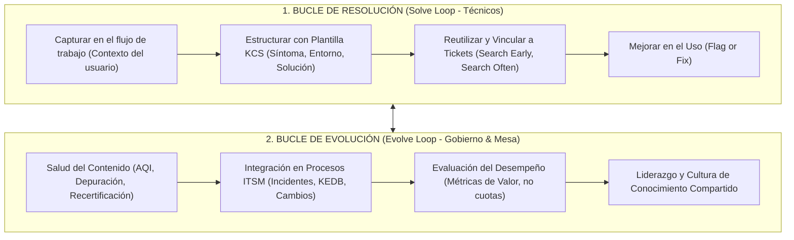
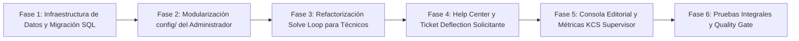

# PROMPT 4 — Transformación Integral: GESTIÓN DEL CONOCIMIENTO MULTI-ROL (KCS v6 & ITIL 4)

> **Documento canónico de investigación, arquitectura técnica y especificación funcional multi-rol.**
> **Alcance:** Todas las opciones internas del módulo de Conocimiento (`src/modules/conocimiento`), abarcando **Administrador**, **Técnico Resolutor**, **Solicitante (Autoservicio)**, **Supervisor de Mesa**, **Gestor de Problemas/Cambios** y **Auditor**.
> **Módulo dueño y único perímetro de trabajo:** `src/modules/conocimiento` (con contratos de UI en `src/modules/conocimiento/ui.ts` para integración con la mesa y portal).
> **Marcos de Referencia Internacionales:** KCS (Knowledge-Centered Service) v6 · ITIL 4 (Knowledge Management Practice & DIKW) · ISO/IEC 20000-1:2018 (Cláusulas 8.2 y 7.5) · ISO 30401:2018 (Sistemas de Gestión del Conocimiento) · ISO/IEC 27001 (Clasificación de Seguridad de la Información).
> **Benchmark de Mercado Analizado:** ServiceNow Knowledge Management (Utah/Washington) · Atlassian JSM + Confluence Knowledge Base · Zendesk Guide & Answer Bot · Freshservice Freddy AI Solutions · BMC Helix Knowledge Management (KCS v6 Verified).

---

## 0. Resumen Ejecutivo de la Investigación y Benchmark de Mercado

### 0.1 Estudio Comparativo de Software Líder en la Industria

| Plataforma | Fortaleza Clave Evaluada | Mecanismo de Captura y Reuso | Modelo de Desvío (Ticket Deflection) | Gobernanza y Calidad |
| :--- | :--- | :--- | :--- | :--- |
| **ServiceNow Knowledge Management** | Bases de Conocimiento segregadas (KBs) por audiencia con "User Criteria" y "Knowledge Blocks" reutilizables. | Botón "Attach to Incident" y "Copy to Incident". Inserta snippets dinámicos según el rol del lector. | Machine Learning clustering (Knowledge Demand Insights) para identificar brechas de contenido no resueltas. | Versionado mayor/menor (1.0 -> 1.1 -> 2.0), recertificación periódica con alertas de expiración al autor. |
| **Jira Service Management + Confluence** | Integración nativa entre el portal de atención y el motor wiki semántico. | Creación con 1 clic desde incidentes resueltos ("Create KB article") prellenando síntoma, causa y solución. | Smart Graph Search predictivo en el formulario del cliente: muestra los 3 mejores artículos antes de enviar el ticket. | Distinción explícita de artículos de cara al cliente (`portal-only`) vs artículos técnicos internos (`agent-only`). |
| **Zendesk Guide & Answer Bot** | App de captura de conocimiento en la barra lateral del agente resolutor (Knowledge Capture App). | Búsqueda contextual automática basada en las palabras clave del ticket sin abandonar la pantalla de atención. | Bot de respuesta automática que mide el porcentaje de tickets resueltos sin intervención humana. | Bucle de feedback cerrado: calificación negativa exige seleccionar motivo estructurado y genera tarea editorial. |
| **Freshservice (Freddy Copilot / Solutions)** | Taxonomía estructurada en 3 niveles (Categoría -> Carpeta -> Artículo de Solución). | Freddy AI sugiere soluciones pertinentes al técnico a medida que escribe las notas de trabajo. | Detección de palabras clave en el catálogo de servicios sugiriendo artículos de autoayuda previos al envío. | Dashboard de Salud del Artículo (Article Health): detecta artículos sin visitas en 180 días o con alta tasa de rechazo. |
| **BMC Helix Knowledge Management** | Herramienta oficialmente certificada en KCS v6 (Consortium for Service Innovation). | Metodología de doble bucle (Solve Loop & Evolve Loop) y política estricta de "Flag or Fix". | Búsqueda cognitiva con análisis de búsquedas con cero resultados ("Zero-Search Results") para cerrar brechas. | Puntuación AQI (Article Quality Index): lista de verificación de calidad previa a la publicación definitiva. |

---

### 0.2 Síntesis de Marcos Normativos y Metodologías



1. **KCS (Knowledge-Centered Service) v6:**
   - El conocimiento no es una tarea administrativa adicional al final de la jornada; es el subproducto natural del proceso de resolución de incidentes.
   - **Solve Loop (En el momento):** Captura en el vocabulario del usuario, estructuración estandarizada, reuso en contexto y política de "Flag or Fix" (si un técnico detecta un error en un artículo, lo corrige de inmediato si tiene rango KCS, o lo marca con una bandera "Flag" y observaciones para el editor).
   - **Evolve Loop (Evolución continua):** Auditoría de calidad (AQI), monitoreo de búsquedas sin resultados (Gaps), eliminación de duplicados y recertificación periódica.
2. **ITIL 4 Knowledge Management Practice & DIKW:**
   - Transforma Datos operativos (logs, eventos) en Información (tickets, CIs), Conocimiento (artículos validados, workarounds) y Sabiduría (toma de decisiones preventivas).
   - Habilita la corriente de valor "Entregar y dar soporte" mediante la resolución en primer contacto (FCR) y la corriente "Mejorar continuamente".
3. **ISO/IEC 20000-1:2018 (Cláusulas 8.2 y 7.5):**
   - Control de información documentada: trazabilidad de versiones inalterables, autorías, aprobaciones y retención controlada de artículos.
4. **ISO 30401:2018 (Sistemas de Gestión del Conocimiento):**
   - Principios rectores: el conocimiento es un activo intangible de la organización; no existe una talla única; la cultura colaborativa es el factor crítico de éxito.
5. **ISO/IEC 27001 (Seguridad y Clasificación de la Información):**
   - Clasificación en 3 niveles mandatorios: **Público** (visible para solicitantes), **Interno TI** (solo personal técnico y supervisores) y **Confidencial Jefaturas** (restringido a directores y auditores).

---

## 1. Arquitectura de Navegación y Cobertura Multi-Rol

El módulo `src/modules/conocimiento` se organiza de forma integral para satisfacer a los diferentes perfiles del sistema:

```
src/modules/conocimiento/
├── index.ts                              # Contrato de servidor expuesto a otros módulos
├── ui.ts                                 # Contrato de componentes UI reutilizables (TicketDeflection, WidgetArticulos)
├── api/                                  # Controladores API REST
│   ├── admin/                            # Endpoints de administración (categorías, políticas, plantillas, salud)
│   ├── articulosController.ts            # CRUD operativo, búsqueda semántica y filtros facetados
│   ├── articuloDetalleController.ts      # Ficha de artículo, versiones e historial
│   ├── feedbackController.ts             # Votación CSAT útil/no útil y reporte de flags
│   ├── vinculoTicketController.ts        # Enlace formal de artículos a tickets resueltos (Solve Loop)
│   └── deflexionController.ts            # Registro de búsquedas en portal y telemetría de desvío
├── config/                               # Opciones de Menú del Administrador (Subcarpetas dedicadas)
│   ├── categorias/                       # /plataforma/conocimiento/config/categorias (Árbol taxonómico)
│   ├── workflow-editorial/               # /plataforma/conocimiento/config/workflow-editorial (Etapas de revisión)
│   ├── politicas-acceso/                 # /plataforma/conocimiento/config/politicas-acceso (Seguridad ISO 27001)
│   ├── plantillas/                       # /plataforma/conocimiento/config/plantillas (Plantillas KCS estándar)
│   └── salud-kcs/                        # /plataforma/conocimiento/config/salud-kcs (AQI y Obsolescencia)
├── services/                             # Capa de dominio con SQL parametrizado
│   ├── conocimientoService.ts            # Orquestador principal de artículos
│   ├── categoriasService.ts              # Mantenimiento de jerarquía de categorías
│   ├── plantillasService.ts              # Plantillas KCS y validación de estructura
│   ├── feedbackService.ts                # Gestión de votos y motivos negativos
│   └── metricasKcsService.ts             # Cálculo de deflexión, reuso y brechas (Gaps)
├── views/                                # Vistas de pantalla completas por perfil
│   ├── VistaConocimientoBase.tsx         # Catálogo interactivo con buscador y filtros
│   ├── VistaConocimientoDetalle.tsx      # Lector de artículo con versiones, tags y feedback
│   ├── VistaConocimientoNuevo.tsx        # Editor Markdown con selección de plantilla KCS
│   ├── VistaConocimientoRevisiones.tsx   # Consola editorial para supervisores con diff visual
│   ├── VistaConocimientoMisArticulos.tsx # Consola personal del técnico autor
│   ├── VistaHelpCenterSolicitante.tsx    # Portal de autoservicio amigable para clientes
│   └── VistaMetricasKcsSupervisor.tsx    # Dashboard directivo KCS para supervisores
└── components/                           # Widgets y subcomponentes reutilizables
    ├── BarraAccionesConocimiento.tsx     # Botones contextuales según perfil
    ├── BuscadorConocimiento.tsx          # Input con debounce y resaltado de coincidencias
    ├── SelectorPlantillaKcs.tsx          # Ficha visual para elegir tipo de documento
    ├── VisorVersionesDiffModal.tsx       # Comparador de versiones históricas
    ├── ModalReportarInexactitudFlag.tsx  # Modal KCS para que técnicos sugieran mejoras
    ├── WidgetTicketDeflection.tsx        # Widget montable en formulario de tickets
    └── ModalVincularArticuloTicket.tsx   # Modal para asociar solución a ticket en mesa
```

---

## 2. Especificación Detallada por Perfil

### 2.1 Perfil 1: Administrador / Knowledge Manager
**Objetivo:** Establecer las directrices de gobernanza, taxonomía, seguridad y ciclo de vida de los artículos.

#### Pantalla 1: Estructura de Categorías (`/plataforma/conocimiento/config/categorias`)
- **Directorio:** `src/modules/conocimiento/config/categorias/`
- **Funcionalidad:**
  - Árbol taxonómico de hasta 3 niveles de profundidad (Área -> Categoría -> Subcategoría).
  - Configuración de icono representativo (Lucide React) y color temático.
  - Switch de visibilidad: "¿Visible en portal de autoservicio para solicitantes?".
  - Indicador de total de artículos activos por categoría y orden de visualización.

#### Pantalla 2: Flujo Editorial y Aprobación (`/plataforma/conocimiento/config/workflow-editorial`)
- **Directorio:** `src/modules/conocimiento/config/workflow-editorial/`
- **Funcionalidad:**
  - Configuración del flujo: `BORRADOR` -> `EN_REVISION` -> `PUBLICADO` -> `ARCHIVADO`.
  - Checkbox: "Exigir aprobación previa obligatoria para técnicos N1/N2".
  - Política de Auto-Publicación: Permite que técnicos con rol "KCS Coach" o "Especialista N3" publiquen directamente sin pasar por cola de revisión.
  - Asignación de grupos revisores (Supervisores de Soporte, Gestores de Problemas).

#### Pantalla 3: Políticas de Acceso y Seguridad (`/plataforma/conocimiento/config/politicas-acceso`)
- **Directorio:** `src/modules/conocimiento/config/politicas-acceso/`
- **Funcionalidad (ISO/IEC 27001):**
  - **Público:** Accesible para Solicitantes, Técnicos, Gestores y Administradores.
  - **Interno TI:** Oculto para solicitantes; accesible para Técnicos, Supervisores y Administradores (contiene comandos de consola, IPs internas o procedimientos operativos de red).
  - **Confidencial Jefaturas:** Restringido a Gestores de Área, Aprobadores y Auditores.

#### Pantalla 4: Plantillas KCS (`/plataforma/conocimiento/config/plantillas`)
- **Directorio:** `src/modules/conocimiento/config/plantillas/`
- **Funcionalidad:**
  - Mantenimiento de las 5 plantillas oficiales:
    1. `HOWTO`: Instructivo paso a paso para tareas rutinarias.
    2. `FALLA`: Incidente técnico estructurado (Síntoma, Entorno, Causa Raíz, Solución Definitiva).
    3. `KEDB_WORKAROUND`: Solución temporal mitigante vinculada a un Problema.
    4. `FAQ`: Pregunta y respuesta directa en lenguaje natural.
    5. `SOP`: Procedimiento Operativo Estándar para administradores.
  - Editor del esqueleto Markdown por defecto y campos obligatorios mínimos.

#### Pantalla 5: Salud y Calidad KCS (`/plataforma/conocimiento/config/salud-kcs`)
- **Directorio:** `src/modules/conocimiento/config/salud-kcs/`
- **Funcionalidad:**
  - Periodo de caducidad y recertificación: Días máximos sin revisión (valor recomendado: 90 días para artículos críticos, 180 días estándar).
  - Regla de alerta por feedback negativo: Si un artículo acumula 3 o más votos negativos consecutivos, pasa automáticamente a estado de alerta y notifica al autor.
  - Parámetros del AQI (Article Quality Index): Checklist de calidad (Título descriptivo, plantilla respetada, sin información confidencial expuesta, solución probada).

---

### 2.2 Perfil 2: Técnico / Especialista Resolutor (Solve Loop)
**Objetivo:** Reutilizar conocimiento existente para resolver rápidamente incidentes, capturar soluciones nuevas en el flujo de trabajo y mejorar artículos existentes ("Flag or Fix").

#### Experiencia del Técnico en su Mesa de Trabajo:
1. **Búsqueda Asistida en el Diagnóstico del Ticket:**
   - En la vista de atención del ticket (`VistaTicketOperador.tsx`), se incorpora el widget flotante de conocimiento. Al seleccionar la categoría o ingresar el título de la falla, el sistema busca en milisegundos en la base de conocimiento y muestra snippets relevantes.
2. **Acción "Vincular a Ticket y Marcar como Solución":**
   - El técnico puede presionar un botón con un clic: "Usar este artículo para resolver el ticket".
   - Esto realiza tres acciones automáticas:
     1. Registra una fila en `articulo_conocimiento_vinculo_ticket`.
     2. Incrementa el contador `veces_utilizado_en_tickets` del artículo.
     3. Inserta automáticamente en la solución del ticket la referencia del artículo (ej. "Resuelto aplicando el procedimiento ART-2026-015: Reconfiguración de Adaptador VPN").
3. **Captura Rápida desde Ticket Resuelto:**
   - Si la solución no existía previamente, al cerrar el ticket el técnico marca la casilla: "Crear artículo de conocimiento a partir de esta solución".
   - El sistema abre `VistaConocimientoNuevo.tsx` con el formulario prellenado:
     - Título: Copiado del resumen del ticket.
     - Categoría: Asignada automáticamente.
     - Síntoma: Tomado de la descripción inicial del solicitante.
     - Solución: Tomada de la nota de cierre técnico.
4. **Política "Flag or Fix" (Reportar Inexactitud):**
   - Si un técnico encuentra un artículo que tiene un comando desactualizado o un paso incompleto, abre el modal `ModalReportarInexactitudFlag.tsx` y envía un feedback constructivo ("El comando del paso 2 cambió en la versión 14"). Esto genera una notificación al autor original sin romper el artículo publicado.
5. **Consola Personal (`VistaConocimientoMisArticulos.tsx`):**
   - Panel donde el técnico ve sus artículos redactados, cuántas veces han sido consultados por compañeros, cuántas veces han resuelto tickets y el estado de sus borradores.

---

### 2.3 Perfil 3: Solicitante / Cliente (Portal de Autoservicio y Desvío de Tickets)
**Objetivo:** Permitir al usuario final resolver sus problemas de manera rápida, intuitiva y autónoma, evitando la creación innecesaria de tickets de soporte.

#### Experiencia del Solicitante:
1. **Portal Help Center (`VistaHelpCenterSolicitante.tsx`):**
   - Interfaz limpia, moderna y amigable orientada a la experiencia de usuario (UX).
   - Caja de búsqueda central con texto predictivo en lenguaje común ("No abre mi correo", "Cambiar mi contraseña", "Configurar Wi-Fi").
   - Tarjetas visuales de categorías populares y accesos directos a "Las 5 guías más consultadas este mes".
2. **Lector de Artículos para Solicitante:**
   - Tipografía legible con interlineado amplio, callouts visuales de ayuda, capturas de pantalla ampliables y ausencia de jerga técnica interna.
   - Breadcrumbs claros: `Inicio > Soporte al Puesto de Trabajo > Correo Electrónico > Configuración en Móvil`.
3. **Mecanismo de Desvío de Tickets (Ticket Deflection Widget):**
   - Ubicado en el formulario de creación de tickets (`/solicitante/crear`).
   - A medida que el usuario escribe el asunto (ej. "La pantalla se queda congelada"), el widget analiza los términos y despliega un panel lateral suave:
     - *"Antes de enviar tu solicitud, ¿probaste alguna de estas soluciones?"*
     - Muestra los 3 artículos con mayor coincidencia y puntuación positiva.
     - Si el solicitante abre un artículo y presiona el botón: **"¡Esto resolvió mi problema, no necesito ticket!"**:
       - Se registra una entrada en `busqueda_conocimiento_log` con `deflexion_exitosa = true`.
       - Se cancela la creación del ticket, ahorrando tiempo al usuario y descongestionando la mesa de ayuda de TI.
4. **Calificación CSAT Cerrada con Bucle de Retroalimentación:**
   - Al final de cada artículo se presenta la pregunta: **"¿Te resultó útil este artículo?"** con dos botones interactivos: `[ Sí, me sirvió ]` y `[ No, necesito ayuda ]`.
   - Si presiona `Sí`: Incrementa `utilidad_positiva` y muestra un mensaje de agradecimiento.
   - Si presiona `No`: Despliega un micro-modal respetuoso con opciones:
     - *"Lamentamos que no te haya servido. ¿Por qué motivo? (Información confusa / No resolvió mi caso / Procedimiento desactualizado)"*.
     - Ofrece un botón directo: **"Crear ticket de soporte con esta información"**, transfiriendo el contexto para que el técnico sepa qué artículo leyó previamente y no le repita los mismos pasos.

---

### 2.4 Perfil 4: Supervisor de Mesa (Aseguramiento KCS y Analítica)
**Objetivo:** Velar por la calidad editorial, aprobar contribuciones técnicas y detectar brechas de conocimiento organizacional.

#### Consola del Supervisor:
1. **Bandeja de Revisiones Editoriales (`VistaConocimientoRevisiones.tsx`):**
   - Listado de artículos en estado `EN_REVISION` enviados por técnicos.
   - Visualizador de diferencias (Diff Viewer): Muestra claramente qué texto fue modificado, agregado o eliminado respecto a la versión anterior.
   - Lista de Verificación AQI (Article Quality Index):
     - [x] Título claro y orientado a síntomas.
     - [x] Estructura KCS respetada.
     - [x] Sin credenciales, contraseñas ni datos sensibles.
     - [x] Procedimiento técnico probado y reproducible.
   - Acciones con un clic: `[ Aprobar y Publicar ]` o `[ Rechazar con Observaciones al Autor ]`.
2. **Dashboard de Analítica KCS (`VistaMetricasKcsSupervisor.tsx`):**
   - **Tasa de Desvío de Tickets (Deflection Rate):** Porcentaje de usuarios que resolvieron su caso en el portal sin abrir ticket (`tickets_desviados / (tickets_desviados + tickets_creados)`).
   - **Análisis de Brechas de Conocimiento (Zero-Search Gaps):** Tabla con las palabras clave más buscadas en los últimos 30 días que arrojaron cero resultados en la base de datos, indicando a la mesa qué guías urgentes deben redactarse.
   - **Tasa de Reutilización por Técnico:** Muestra qué técnicos aplican buenas prácticas KCS vinculando artículos a sus tickets y cuáles resuelven sin consultar la base.
   - **Artículos en Riesgo de Obsolescencia:** Alerta temprana de artículos que superaron los 90/180 días sin revisión o con utilidad negativa acumulada.

---

### 2.5 Perfiles de Gestión e Infraestructura: Gestor de Problemas y Gestor de Cambios
1. **Gestor de Problemas:**
   - Integración nativa con la **KEDB (Known Error Database)**.
   - Cuando se valida un Workaround en `src/modules/problemas`, la acción "Publicar Workaround en KEDB" inserta un artículo de conocimiento con plantilla `KEDB_WORKAROUND`, flag `es_workaround_kedb = true` y enlace directo al ID del problema.
2. **Gestor de Cambios:**
   - Tras la conclusión exitosa de una Solicitud de Cambio (RFC) en producción y su sesión de revisión PIR (Post-Implementation Review), las lecciones aprendidas y nuevos diagramas operativos se publican en conocimiento como guía técnica de referencia.

---

### 2.6 Perfil Auditor: Trazabilidad Inalterable y Cumplimiento Normativo
1. **Historial Inmutable de Versiones (`articulo_conocimiento_version`):**
   - Cada vez que un artículo es editado y publicado, la versión anterior se archiva de forma inalterable con el ID del autor, fecha y hash de verificación.
2. **Trazabilidad de Decisiones Editoriales:**
   - Registro de quién aprobó, rechazó o retiró un artículo, garantizando cumplimiento de las normas ISO/IEC 20000-1 e ISO 30401.
3. **Auditoría de Clasificación de Seguridad:**
   - Verificación de que ningún artículo marcado como "Interno TI" o "Confidencial" tenga activada visibilidad para el perfil Solicitante.

---

## 3. Modelo de Datos y Migración SQL

La migración `db/migrations/20261022_fase5_gestion_conocimiento_kcs.sql` ya ha sido incorporada al proyecto con las siguientes estructuras:

```sql
-- 1. Campos adicionales en articulo_conocimiento
ALTER TABLE articulo_conocimiento
  ADD COLUMN IF NOT EXISTS tipo_plantilla VARCHAR(30) NOT NULL DEFAULT 'HOWTO',
  ADD COLUMN IF NOT EXISTS clasificacion_seguridad VARCHAR(30) NOT NULL DEFAULT 'PUBLICO',
  ADD COLUMN IF NOT EXISTS fecha_proxima_revision DATE,
  ADD COLUMN IF NOT EXISTS es_workaround_kedb BOOLEAN NOT NULL DEFAULT false,
  ADD COLUMN IF NOT EXISTS veces_utilizado_en_tickets INT NOT NULL DEFAULT 0,
  ADD COLUMN IF NOT EXISTS etiquetas TEXT[] NOT NULL DEFAULT ARRAY[]::TEXT[],
  ADD COLUMN IF NOT EXISTS resumen_sintoma TEXT,
  ADD COLUMN IF NOT EXISTS resumen_solucion TEXT,
  ADD COLUMN IF NOT EXISTS aqi_puntuacion INT NOT NULL DEFAULT 100;

-- 2. Plantillas KCS Estandarizadas
CREATE TABLE IF NOT EXISTS articulo_plantilla (
  id_plantilla SERIAL PRIMARY KEY,
  codigo VARCHAR(30) UNIQUE NOT NULL,
  nombre VARCHAR(100) NOT NULL,
  descripcion TEXT,
  icono VARCHAR(50) DEFAULT 'FileText',
  estructura_markdown TEXT NOT NULL,
  campos_obligatorios JSONB NOT NULL DEFAULT '[]'::jsonb,
  activo BOOLEAN NOT NULL DEFAULT true,
  fecha_creacion TIMESTAMPTZ NOT NULL DEFAULT now()
);

-- 3. Versionado Inmutable
CREATE TABLE IF NOT EXISTS articulo_conocimiento_version (
  id_version SERIAL PRIMARY KEY,
  id_articulo INT NOT NULL REFERENCES articulo_conocimiento(id_articulo) ON DELETE CASCADE,
  numero_version VARCHAR(10) NOT NULL,
  titulo VARCHAR(255) NOT NULL,
  contenido_markdown TEXT NOT NULL,
  motivo_cambio TEXT,
  id_autor INT NOT NULL REFERENCES usuario(id_usuario),
  fecha_creacion TIMESTAMPTZ NOT NULL DEFAULT now()
);

-- 4. Feedback Detallado y Motivos de Insatisfacción
CREATE TABLE IF NOT EXISTS articulo_conocimiento_feedback (
  id_feedback SERIAL PRIMARY KEY,
  id_articulo INT NOT NULL REFERENCES articulo_conocimiento(id_articulo) ON DELETE CASCADE,
  id_usuario INT REFERENCES usuario(id_usuario),
  es_positivo BOOLEAN NOT NULL,
  motivo_negativo VARCHAR(50),
  comentario TEXT,
  ip VARCHAR(45),
  fecha TIMESTAMPTZ NOT NULL DEFAULT now()
);

-- 5. Vinculación Solve Loop: Artículos usados en Tickets
CREATE TABLE IF NOT EXISTS articulo_conocimiento_vinculo_ticket (
  id_vinculo SERIAL PRIMARY KEY,
  id_articulo INT NOT NULL REFERENCES articulo_conocimiento(id_articulo) ON DELETE CASCADE,
  id_ticket INT NOT NULL REFERENCES ticket(id_ticket) ON DELETE CASCADE,
  id_tecnico INT NOT NULL REFERENCES usuario(id_usuario),
  resolvio_ticket BOOLEAN NOT NULL DEFAULT true,
  fecha_vinculo TIMESTAMPTZ NOT NULL DEFAULT now(),
  CONSTRAINT uq_articulo_ticket UNIQUE (id_articulo, id_ticket)
);

-- 6. Telemetría de Búsquedas y Detección de Brechas
CREATE TABLE IF NOT EXISTS busqueda_conocimiento_log (
  id_log SERIAL PRIMARY KEY,
  termino_busqueda VARCHAR(255) NOT NULL,
  resultados_encontrados INT NOT NULL DEFAULT 0,
  id_articulo_clicado INT REFERENCES articulo_conocimiento(id_articulo) ON DELETE SET NULL,
  deflexion_exitosa BOOLEAN NOT NULL DEFAULT false,
  id_usuario INT REFERENCES usuario(id_usuario),
  id_perfil INT REFERENCES perfil(id_perfil),
  origen VARCHAR(30) NOT NULL DEFAULT 'PORTAL',
  fecha TIMESTAMPTZ NOT NULL DEFAULT now()
);
```

---

## 4. Plan de Implementación y Fases de Entrega



### 4.1 Fases Detalladas:
- **Fase 1 (Completada):** Migración SQL `20261022_fase5_gestion_conocimiento_kcs.sql` con plantillas base.
- **Fase 2:** Descomposición de la configuración monolítica en `config/categorias/`, `config/workflow-editorial/`, `config/politicas-acceso/`, `config/plantillas/` y `config/salud-kcs/`.
- **Fase 3:** Enriquecimiento del servicio de conocimiento (`conocimientoService.ts`) y vistas operativas de técnicos (`VistaConocimientoNuevo.tsx` con plantillas y `VistaConocimientoDetalle.tsx` con historial de versiones y vinculación a tickets).
- **Fase 4:** Componente reutilizable `WidgetTicketDeflection` y visor optimizado para solicitantes.
- **Fase 5:** Consola de revisión editorial con comparador visual diff y dashboard de métricas KCS.
- **Fase 6:** Verificación estricta de compilación con `npm run build` (código de salida 0) y auditoría de Cero Emojis.
