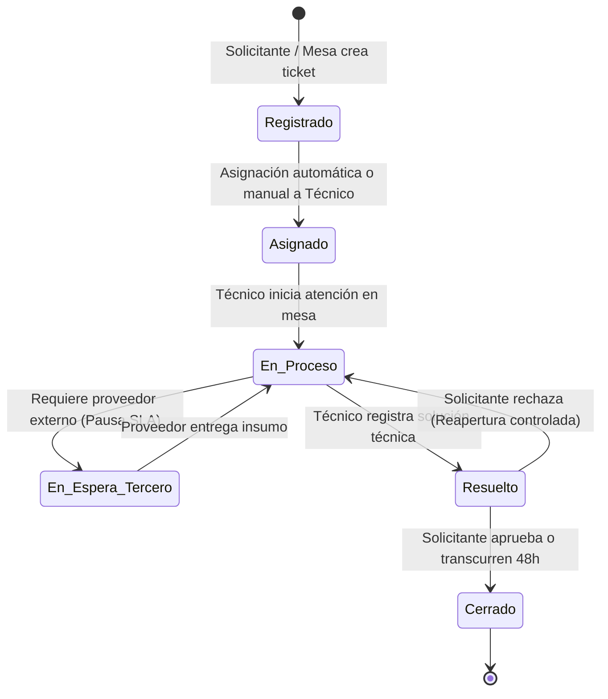
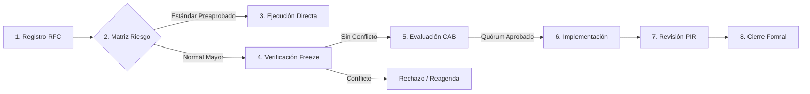

# FlowDesk ITSM — Sistema Integral de Gestión de Servicios de TI

> **Plataforma Enterprise de Gestión de Servicios de TI (ITSM)** diseñada bajo arquitectura modular estricta de *Vertical Slice*, implementada con **Next.js 14 (App Router)**, **TypeScript 5 (Strict Mode)**, **React 18** y **PostgreSQL 15 (Supabase)**.
> Alineada integralmente con los estándares internacionales **ITIL 4**, **ISO/IEC 20000-1:2018**, **ISO/IEC 27001:2022**, **ISO/IEC 19770-1** y **COBIT 2019**.

---

## 1. ¿Qué es FlowDesk ITSM?

**FlowDesk ITSM** es una solución integral de software para la gestión de servicios y operaciones de tecnología de la información en entornos corporativos e institucionales. Su propósito es centralizar, estandarizar y automatizar todas las interacciones entre los usuarios de negocio (solicitantes) y las áreas especializadas de TI (mesas de ayuda, ingenieros de soporte, comités de cambio, auditores y gerencias de sistemas).

A diferencia de los sistemas de tickets tradicionales que tratan todos los requerimientos como simples registros planos, FlowDesk implementa una arquitectura orientada al valor del servicio (*Service Value System - SVS* de ITIL 4). Esto significa que distingue formalmente entre una falla operativa imprevista (**Incidente**), una petición planificada de recursos (**Solicitud de Servicio**), una investigación técnica profunda de causa raíz (**Problema**), una intervención programada en producción (**Cambio / RFC**), el control patrimonial de hardware y software (**Activos HAM/SAM**) y el mapa topológico de infraestructura tecnológica (**CMDB**).

---

## 2. ¿Para qué sirve y qué problema resuelve?

En las organizaciones medianas y grandes, los departamentos de TI suelen enfrentar caos operativo debido a canales informales (correos dispersos, mensajes de chat, llamadas telefónicas), tickets sin trazabilidad, falta de cumplimiento de Acuerdos de Nivel de Servicio (SLA), intervenciones de cambio que causan caídas imprevistas del sistema (*blackouts*), descontrol en licencias de software con riesgo de multas legales y acumulación de privilegios no autorizados.

FlowDesk ITSM resuelve estos problemas estructurales proporcionando:

1. **Un Portal Único de Autoservicio:** Los usuarios finales disponen de un catálogo visual interactivo de servicios clasificados por categorías, con búsqueda predictiva y formularios dinámicos validados en tiempo real.
2. **Despacho Técnico Inteligente y Equitativo:** Los tickets se dirigen automáticamente a grupos resolutores especializados (N1, N2, N3), balanceando la carga según turnos laborales, guardias y ausencias médicas o vacaciones del personal técnico.
3. **Cumplimiento Estricto de SLAs con Temporización Hábil:** Cálculo automático de tiempos límite de primera respuesta y resolución que descuenta rigurosamente fines de semana y feriados oficiales, emitiendo alertas preventivas al 75% y 80% de consumo del tiempo antes de que ocurra una brecha de servicio.
4. **Erradicación Definitiva de Fallas Recurrentes:** Módulo dedicado de Gestión de Problemas con metodología de los 5 Porqués, diagramas causa-efecto (Ishikawa) y Base de Datos de Errores Conocidos (KEDB) con soluciones temporales (*workarounds*) indexadas para los técnicos.
5. **Control de Cambios Colegiado sin Colisiones:** Matriz de evaluación de riesgo, verificación automática contra ventanas de congelamiento (*freeze*) y panel virtual para el Comité Asesor de Cambios (CAB) con registro de votación formal y planes de contingencia (*rollback*) obligatorios.
6. **Gobierno de Activos y Licenciamiento SAM:** Inventario físico de equipos con número de serie, marca, modelo y custodio asignado, junto a un semáforo de cumplimiento SAM que previene la sobreasignación de licencias de software.
7. **Visión Topológica de Infraestructura (CMDB):** Grafo interactivo de dependencias entre Elementos de Configuración (CIs) que permite simular la caída de un servidor o switch y predecir qué servicios de negocio se verán afectados aguas abajo (*downstream*).
8. **Segregación Estricta de Funciones (SoD) y Auditoría ISO 27001:** Políticas que impiden que un colaborador apruebe sus propias solicitudes o autorice cambios sobre componentes que él mismo administra, con bitácora forense inmutable de eventos.

---

## 3. Métricas y Dimensionamiento Real del Sistema

El repositorio cuenta con métricas consolidadas verificables directamente en la base de datos viva y en el árbol de código fuente:

| Métrica del Repositorio | Valor Verificado | Fuente de Verificación Técnica |
| :--- | :---: | :--- |
| **Perfiles Oficiales RBAC** | **10** | Tabla `perfiles` en PostgreSQL |
| **Módulos de Dominio Independientes** | **17** | Directorios en `src/modules/` |
| **Opciones de Menú Activas** | **230** | Tabla `opciones_menu` (`estado_registro = true`) |
| **Filas de Visibilidad de Menú** | **393** | Tabla `opciones_menu_perfiles` |
| **Route Handlers de API** | **209** | Archivos `route.ts` bajo `src/app/api/` |
| **Páginas del Sistema** | **312** | Archivos `page.tsx` bajo `src/app/plataforma/` |
| **Total de Páginas Compiladas** | **335** | Salida oficial de `npm run build` |
| **Tablas Base en Esquema Público** | **132** | `information_schema.tables` (`table_schema = 'public'`) |
| **Vistas Relacionales Compatibles** | **1** | `vista_ticket` (Modelo C plano) |
| **Capacidades Semánticas RBAC** | **71** | Constante `CAPACIDADES` en `src/shared/lib/capacidades.ts` |
| **Suite de Pruebas E2E ITIL 4** | **30 / 30** | Script oficial `scripts/test_e2e_lifecycle.js` (100% éxito) |

---

## 4. Los 10 Perfiles Oficiales (RBAC) y Segregación de Funciones (SoD)

El sistema opera bajo un modelo de Control de Acceso Basado en Roles (**RBAC**) semántico donde cada perfil tiene atribuciones operativas exclusivas en cumplimiento de las directrices de Segregación de Funciones (**SoD**):

```
                                  FLOWDESK ITSM
                               ┌─────────────────┐
                               │  10 PERFILES    │
                               └────────┬────────┘
        ┌───────────────────┬───────────┼───────────┬───────────────────┐
        ▼                   ▼           ▼           ▼                   ▼
  1. Administrador     2. Técnico   3. Solicitante 4. Supervisor   5. Gestor de Área
  (Gobierno e IAM)    (Resolución)  (Autoservicio) (SLA y Colas)  (Aprobaciones)
        │                   │           │           │                   │
        ▼                   ▼           ▼           ▼                   ▼
  6. Auditor           7. Aprobador 8. G. Cambios  9. G. Activos  10. G. Problemas
  (Solo Lectura)       (Comité CAB) (Ciclo RFC)    (HAM/SAM)      (RCA y KEDB)
```

1. **Administrador (`/plataforma/operacion/paneles/administrador`):**  
   Gobierno general de la plataforma, configuración de identidades, taxonomía de categorías, diseñador dinámico de formularios, Acuerdos SLA y visualización de logs de auditoría.
2. **Técnico (`/plataforma/operacion/paneles/tecnico`):**  
   Mesa de trabajo resolutora (Nivel 1, 2 y 3). Autoasignación de casos de su departamento (máximo 5 tickets simultáneos según regla RN-16), diagnóstico técnico, aplicación de soluciones temporales KEDB y resolución de incidentes/solicitudes.
3. **Solicitante (`/plataforma/operacion/paneles/solicitante`):**  
   Portal de autoservicio para colaboradores de la empresa. Exploración del catálogo, creación asistida de pedidos, bandeja de seguimiento personal "Mis Tickets", visualizador con línea de tiempo (*stepper*) y calificación de atención CSAT.
4. **Supervisor (`/plataforma/operacion/paneles/supervisor`):**  
   Monitoreo operativo de la mesa de servicio. Supervisión de cumplimiento de SLA, redistribución de tickets, balanceo de colas, gestión de guardias y reasignación técnica ante ausencias.
5. **Gestor de Área (`/plataforma/operacion/paneles/gestor-area`):**  
   Jefatura de departamento de negocio. Evaluación y dictamen formal de solicitudes de servicio con impacto económico o jerárquico generadas por personal de su área.
6. **Auditor (`/plataforma/operacion/paneles/auditor`):**  
   Inspección y control de cumplimiento (Compliance). Acceso estrictamente de **solo lectura** a la bitácora inmutable de eventos, análisis de SoD, recertificación de cuentas y líneas base de configuración. No puede modificar transacciones operativas.
7. **Aprobador / Miembro del CAB (`/plataforma/operacion/paneles/aprobador`):**  
   Participación en el Comité Asesor de Cambios (CAB). Evaluación de Solicitudes de Cambio (RFC), análisis de riesgos, planes de pruebas, planes de marcha atrás (*rollback*) y emisión de dictamen colegiado.
8. **Gestor de Cambios (`/plataforma/operacion/paneles/gestor-cambios`):**  
   Coordinador del proceso de Habilitación del Cambio (*Change Enablement*). Convoca reuniones CAB, gestiona el calendario de producción, administra periodos de congelamiento (*freeze*) y conduce la Revisión Post-Implementación (PIR).
9. **Gestor de Activos (`/plataforma/operacion/paneles/gestor-activos`):**  
   Administrador de inventario patrimonial (HAM) y licenciamiento de software (SAM). Control de altas, stock en almacén, equipos asignados, mantenimientos en taller, semáforo SAM de licencias y bajas seguras.
10. **Gestor de Problemas (`/plataforma/operacion/paneles/gestor-problemas`):**  
    Investigador de fallas crónicas y problemas mayores. Conduce el análisis de causa raíz (RCA) mediante 5 Porqués e Ishikawa, administra la Base de Errores Conocidos (KEDB) y promueve solicitudes de cambio para soluciones definitivas.

---

## 5. Los 17 Módulos de Dominio

La lógica de negocio se encuentra particionada en 17 módulos de dominio independientes bajo el directorio `src/modules/`:

| # | Módulo | Directorio | Dominio y Responsabilidad Funcional | Dueño en el Equipo |
| --: | :--- | :--- | :--- | :--- |
| 1 | **tickets** | `src/modules/tickets` | Motor Core transaccional congelado, ciclo de vida compartido, despacho y stepper. | Miguel |
| 2 | **incidentes** | `src/modules/incidentes` | Gestión de fallas no planificadas, clasificación de severidad e incidentes mayores P1. | Miguel |
| 3 | **solicitudes** | `src/modules/solicitudes` | Peticiones de catálogo, justificación de negocio, plazos y compuertas de aprobación SoD. | Miguel |
| 4 | **reportes** | `src/modules/reportes` | Analítica ITSM consolidada, los 9 reportes centralizados y exportación gerencial CSV/Excel. | Miguel |
| 5 | **operacion** | `src/modules/operacion` | Tableros unificados de perfil, monitoreo de eventos y alertas automáticas de SLA al 75%/90%. | Miguel |
| 6 | **plataforma** | `src/modules/plataforma` | Gobierno del sistema, logs inmutables, salud técnica, menú dinámico y parámetros globales. | Miguel |
| 7 | **servicios** | `src/modules/servicios` | Catálogo de servicios al cliente y técnico, taxonomía, Acuerdos SLA/OLA/UC y formularios. | Lourdes |
| 8 | **activos** | `src/modules/activos` | Gestión de Activos TI (HAM), inventario con número de serie, semáforo SAM de licencias y bajas. | Lourdes |
| 9 | **problemas** | `src/modules/problemas` | Ciclo de problemas, análisis RCA (5 Porqués / Ishikawa) y base de errores conocidos (KEDB). | Alexis / Darhien |
| 10 | **conocimiento**| `src/modules/conocimiento` | Base de conocimientos KCS v6, ciclo editorial, búsqueda predictiva y votos de utilidad. | Alexis / Darhien |
| 11 | **seguridad** | `src/modules/seguridad` | Portal de autenticación, hash bcrypt, JWT, captcha, sesiones protegidas y recuperación de clave. | Junior |
| 12 | **identidades**| `src/modules/identidades` | Directorio corporativo de usuarios, asignación de perfiles RBAC y desbloqueo seguro. | Junior |
| 13 | **organizacion**| `src/modules/organizacion` | Departamentos empresa, grupos de soporte TI N1/N2/N3, balanceo de carga, turnos y ausencias. | Junior |
| 14 | **proveedores** | `src/modules/proveedores` | Directorio de contratistas tecnológicos, contratos de soporte externo (UC) y evaluación continua. | Junior |
| 15 | **cambios** | `src/modules/cambios` | Solicitudes de Cambio (RFC), matriz de autoridad CAB/ECAB, calendario y ventanas freeze. | Nain |
| 16 | **cmdb** | `src/modules/cmdb` | Configuración SACM, catálogo de CIs, topología de dependencias e impacto en cascada. | Nain |
| 17 | **perfiles** | `src/modules/perfiles` | Vistas y componentes específicos de alcance por perfil (integrados con los módulos base). | Compartido |

---

## 6. Flujos Operativos y Ciclos de Vida End-to-End

### 6.1. Ciclo de Vida del Ticket (Modelo C de Datos)
FlowDesk implementa el **Modelo C** en base de datos: la tabla `ticket` almacena el ciclo de vida, SLA, comentarios, prioridad y estados comunes, mientras que dos tablas de extensión 1:1 (`ticket_incidente` y `ticket_solicitud`) almacenan exclusivamente los atributos propios de cada naturaleza. Una vista relacional `vista_ticket` garantiza compatibilidad transparente mediante `LEFT JOIN`.



### 6.2. Ciclo de Habilitación del Cambio (RFC y CAB)


### 6.3. Ciclo de Activos (HAM) e Impacto en CMDB
El cambio de estado de un bien patrimonial en `src/modules/activos` actualiza de forma automática la custodia y disponibilidad de stock. Si el activo está clasificado como Elemento de Configuración crítico en `src/modules/cmdb`, el motor topológico calcula el impacto sobre los servicios de negocio que dependen de dicho servidor o switch antes de autorizar cualquier mantenimiento.

---

## 7. Stack Tecnológico

| Capa | Tecnología | Versión | Justificación Técnica |
| :--- | :--- | :---: | :--- |
| **Framework Full-Stack** | Next.js (App Router) | `14.2.35` | Server-Side Rendering (SSR), Server Components, Route Handlers y layouts anidados de alto rendimiento. |
| **Librería UI** | React | `18.3.1` | Renderizado reactivo en cliente y compatibilidad nativa con React Server Components (RSC). |
| **Lenguaje** | TypeScript | `5.5.4` | Tipado estricto en modo `strict: true` en toda la aplicación, garantizando cero errores `any` injustificados. |
| **Motor de Base de Datos** | PostgreSQL (Supabase) | `15` | Base de datos relacional robusta con soporte para JSONB, llaves foráneas estrictas y pooler transaccional. |
| **Driver de Conexión** | `pg` (node-postgres) | `^8.12.0` | Cliente oficial de alto rendimiento para PostgreSQL con pool de conexiones parametrizadas seguras. |
| **Validación de Esquemas**| Zod | `^3.23.8` | Validación de tipos en tiempo de ejecución tanto en controladores HTTP como en formularios dinámicos. |
| **Autenticación y Criptografía** | `bcryptjs` + `jsonwebtoken` | `^2.4.3` / `^9.0.2` | Hashing seguro de claves con 10 rondas de salting y tokens JWT firmados en cookies `HttpOnly` y `SameSite=Lax`. |
| **Generación de Reportes** | ExcelJS | `^4.4.0` | Generación programática de libros de cálculo Excel corporativos con estilos, fórmulas y múltiples hojas. |
| **Servicio de Correo** | Nodemailer | `^6.9.15` | Despacho seguro de correos transaccionales SMTP con plantillas HTML para alertas y recuperación de contraseñas. |

---

## 8. Estructura del Repositorio

```text
SISTEMA DE TICKETS/
├── src/
│   ├── app/                      # Cascarones delgados de presentación y endpoints HTTP
│   │   ├── api/                  # 209 Route Handlers (route.ts) que reexportan desde módulos
│   │   ├── plataforma/           # 312 Páginas (page.tsx) protegidas bajo el layout común
│   │   ├── login/                # Portal público de autenticación institucional
│   │   ├── layout.tsx            # Shell raíz de la plataforma
│   │   └── not-found.tsx         # Manejador de rutas inexistentes 404
│   ├── modules/                  # 17 Módulos de Dominio (Vertical Slices independientes)
│   │   ├── <modulo>/
│   │   │   ├── index.ts          # Contrato público de SERVIDOR (servicios, tipos y validaciones)
│   │   │   ├── ui.ts             # Contrato público de CLIENTE (componentes UI exportados)
│   │   │   ├── api/              # Controladores HTTP de backend del módulo
│   │   │   ├── services/         # Lógica de dominio, reglas ITIL y consultas SQL
│   │   │   ├── views/            # Pantallas operativas completas del módulo
│   │   │   ├── components/       # Componentes y widgets internos reutilizables
│   │   │   └── config/           # Submódulos modulares de parametrización administrativa
│   ├── shared/                   # Capa transversal compartida (Hoja estricta: NO importa módulos)
│   │   ├── lib/                  # db.ts, auth.ts, api-auth.ts, page-auth.ts, menu.ts, errores.ts
│   │   ├── components/           # Componentes UI globales (Sidebar, Navbar, Tabla, Modales, Alertas)
│   │   └── types/                # Tipos TypeScript comunes del sistema
│   └── middleware.ts             # Protección perimetral de cookies de sesión
├── db/                           # Esquema relacional y migraciones
│   ├── schema.sql                # Esquema base de la plataforma
│   ├── seed.sql                  # Datos semilla de catálogos, perfiles, menú y usuarios demo
│   └── migrations/               # 40 migraciones SQL incrementales versionadas
├── scripts/                      # Herramientas de mantenimiento y suites de prueba E2E
│   └── test_e2e_lifecycle.js     # Suite oficial con 30 pruebas automatizadas ITIL 4
└── DOCUMENTACIÓN/                # Paquete canónico de documentación técnica y de gestión
    ├── README.md                 # Índice maestro de documentación
    ├── ARQUITECTURA_Y_CODIGO.md  # Manual exhaustivo de arquitectura y contratos
    ├── MENUS_Y_PERFILES.md       # Catálogo de 230 opciones y matriz de 10 perfiles
    ├── REQUERIMIENTOS.md         # Requerimientos funcionales, no funcionales y reglas de negocio
    ├── HISTORIAS_DE_USUARIO.md   # Backlog consolidado de 41 historias de usuario atómicas (31 HECHO, 10 PRODUCT BACKLOG)
    ├── TRAZABILIDAD.md           # Matriz bidireccional Funcionalidad ↔ HU ↔ RF ↔ RN
    ├── PLAN_EQUIPO_Y_SCRUM.md    # Metodología ágil, propiedad de módulos y flujo Git
    ├── CATALOGO_SERVICIOS_DATOS.md# 30 servicios de referencia precargados
    ├── BITACORA_DAILY_SCRUM.xlsx # Bitácora de seguimiento de 12 días en 5 hojas
    ├── Historia de Usuario trello.txt # Formato texto plano para Trello
    └── ASIGNACION_*.md           # Planes individuales por integrante (Miguel, Lourdes, Alexis, Junior, Nain)
```

---

## 9. Instalación y Puesta en Marcha

### 9.1. Requisitos Previos
- **Node.js:** Versión 18.17.0 o superior (recomendado Node.js 20 LTS).
- **npm:** Versión 9 o superior.
- **PostgreSQL:** Instancia de PostgreSQL 15 en la nube (Supabase) o local.

### 9.2. Pasos de Instalación

1. **Clonar el repositorio:**
   ```bash
   git clone https://github.com/Azure-2312/FlowDesk-Software-ITSM.git
   cd "FlowDesk-Software-ITSM"
   ```

2. **Instalar dependencias:**
   ```bash
   npm install
   ```

3. **Configurar variables de entorno:**
   Crear un archivo `.env.local` en la raíz del proyecto con la siguiente estructura:
   ```env
   # Cadena de conexión a PostgreSQL (con pooler y SSL)
   DATABASE_URL="postgresql://postgres:[PASSWORD]@[HOST]:6543/postgres?pgbouncer=true"

   # Secreto criptográfico para firma de JWT (mínimo 32 caracteres)
   JWT_SECRET="flowdesk_secret_jwt_key_seguridad_itsm_2026_super_segura_32_chars"

   # Credenciales SMTP para envío de correos (Opcional en desarrollo)
   GMAIL_USER="soporte.flowdesk.itsm@gmail.com"
   GMAIL_APP_PASSWORD="xxxx xxxx xxxx xxxx"
   ```

4. **Ejecutar el servidor en modo desarrollo:**
   ```bash
   npm run dev
   ```
   Abrir en el navegador: `http://localhost:3000`

---

## 10. Verificación de Calidad y Suite de Pruebas

El repositorio cuenta con estrictos *Quality Gates* que garantizan la integridad del software:

```bash
# 1. Comprobación estricta de tipado TypeScript (Cero errores)
npx tsc --noEmit

# 2. Compilación de producción (Generación de 335 páginas sin fallas)
npm run build

# 3. Suite oficial de pruebas E2E ITIL 4 (30 escenarios automáticos)
node scripts/test_e2e_lifecycle.js
```

---

## 11. Distribución de Responsabilidades del Equipo Scrum

El equipo de desarrollo se organiza bajo la metodología Scrum con propiedad de módulos delimitada para garantizar cero colisiones de código:

| Integrante | Dominio Principal de Responsabilidad | Módulos Asignados |
| :--- | :--- | :--- |
| **Miguel** | **Tech Lead & Núcleo Operativo:** Motor base de tickets, mesas operativas, resiliencia, analítica central y gobernanza técnica. | `tickets`, `incidentes`, `solicitudes`, `reportes`, `operacion`, `plataforma` y `shared/lib` |
| **Lourdes** | **Servicios y Gestión de Activos TI:** Portafolio del catálogo, Acuerdos SLA/OLA/UC, inventario patrimonial (HAM) y licencias (SAM). | `servicios`, `activos` |
| **Alexis / Darhien** | **Problemas y Gestión del Conocimiento:** Análisis RCA (5 Porqués / Ishikawa), Base KEDB de errores conocidos y base KCS. | `problemas`, `conocimiento` |
| **Junior** | **Ciberseguridad, Identidades (IAM) y Organización:** Autenticación ISO 27001, roles RBAC, grupos resolutores, turnos y proveedores. | `seguridad`, `identidades`, `organizacion`, `proveedores` |
| **Nain** | **Habilitación del Cambio y CMDB:** Ciclo de RFCs, Comité Asesor CAB/ECAB, calendario de freeze, CIs y topología de impacto. | `cambios`, `cmdb` |

---

## 12. Enlaces a la Documentación Canónica

Para profundizar en cualquier aspecto del sistema, consulte los documentos normativos:

- [Arquitectura y Código](./DOCUMENTACIÓN/ARQUITECTURA_Y_CODIGO.md) — Explicación profunda de contratos, vertical slice, base de datos y diseño interno.
- [Menús y Perfiles](./DOCUMENTACIÓN/MENUS_Y_PERFILES.md) — Detalle de los 10 roles, matriz SoD y árbol de navegación de 230 opciones.
- [Requerimientos](./DOCUMENTACIÓN/REQUERIMIENTOS.md) — Especificación de Requerimientos Funcionales, No Funcionales y Reglas de Negocio (RN-01 a RN-48).
- [Historias de Usuario](./DOCUMENTACIÓN/HISTORIAS_DE_USUARIO.md) — 41 historias de usuario atómicas estructuradas (31 HECHO, 10 PRODUCT BACKLOG) con criterios Given-When-Then.
- [Matriz de Trazabilidad](./DOCUMENTACIÓN/TRAZABILIDAD.md) — Trazabilidad bidireccional entre requerimientos, reglas, código y evidencias.
- [Plan de Equipo y Scrum](./DOCUMENTACIÓN/PLAN_EQUIPO_Y_SCRUM.md) — Ceremonias Scrum, flujo Git, quality gates y aislamiento entre ramas.
